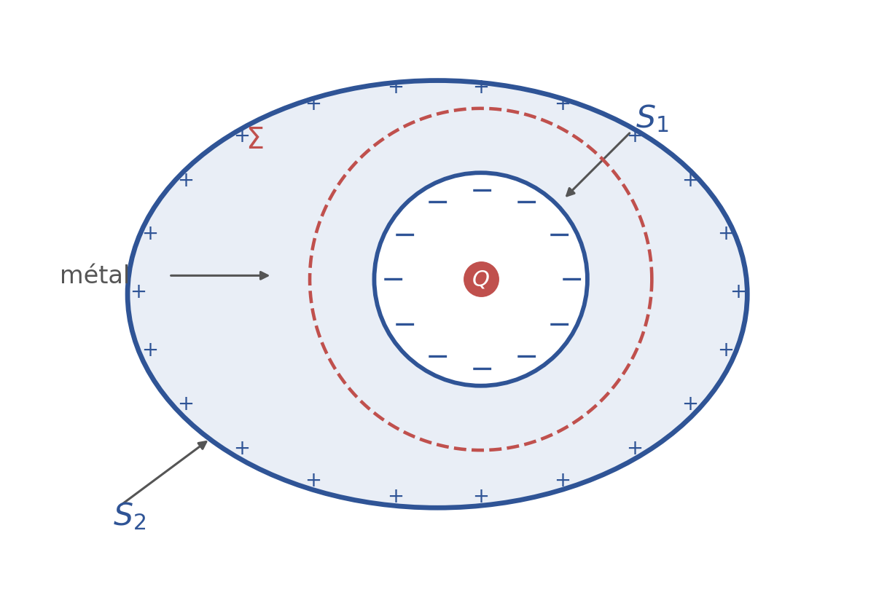
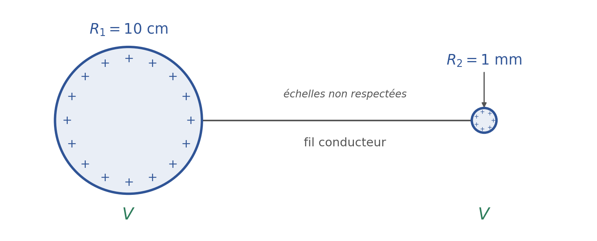
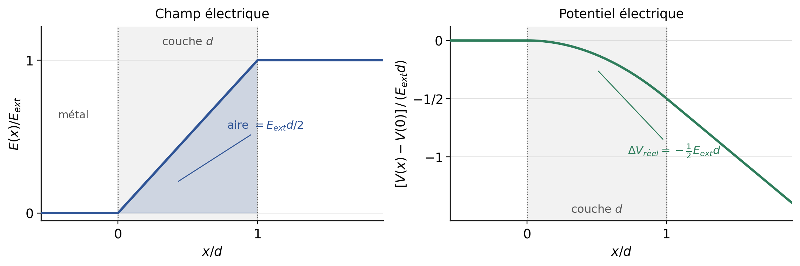

# 第 3 次习题课　导体与电容器

TD 3 — Conducteurs et condensateur

CORRIGÉ · 参考解答

中法对照讲义 · 由 LaTeX 源文件渲染

!!! info "阅读说明"

    每段先列法语原文；其下缩进、带深蓝竖条的小字号段落为中文翻译。<strong>加粗</strong>为关键词，括号内为中文释义。

## Exercice 1 : Vrai ou faux 练习 1：判断正误

1. L'air est un conducteur électrique.

    空气是电导体。
    {: .zh }

2. Le champ électrique à l'intérieur d'un conducteur électrique est toujours nul.

    导体内部的电场总是为零。
    {: .zh }

3. Dans un conducteur en équilibre, les charges en excès se répartissent uniformément en surface du matériau.

    在处于平衡的导体中，多余电荷均匀分布在材料表面。
    {: .zh }

4. Lorsque l'on relie deux matériaux conducteurs par un fil conducteur, les deux matériaux se mettent au même potentiel électrostatique.

    用导线连接两块导体材料时，两者达到相同的静电势。
    {: .zh }

5. Si on veut protéger un appareil électrique des perturbations électriques extérieures, il vaut mieux l'entourer d'un matériau isolant.

    若要保护电器免受外界电扰动，最好用绝缘材料把它包起来。
    {: .zh }

!!! sol ""

    1. <strong>Faux.</strong> Dans les conditions usuelles, l'air est un <strong>isolant</strong> (milieu diélectrique) : il ne contient pratiquement pas de porteurs de charge libres. Il ne devient conducteur que s'il est ionisé, par exemple sous l'effet d'un champ électrique très intense (claquage) ou d'un rayonnement ionisant.

        <strong>错。</strong>在通常条件下，空气是<strong>绝缘体</strong>（电介质）：其中几乎没有自由载流子。只有被电离时——例如在极强的电场下击穿（claquage），或受到电离辐射时——它才成为导体。
        {: .zh }

    2. <strong>Vrai, à l'équilibre électrostatique.</strong> Dans le volume du métal, le champ est alors nul, sinon les charges libres continueraient à se déplacer et l'équilibre ne serait pas atteint. En revanche, le champ n'est pas nul dans une cavité contenant des charges, ni si le conducteur est parcouru par un courant (hors équilibre).

        <strong>对，在静电平衡条件下。</strong>此时金属内部体积中电场为零，否则自由电荷会继续移动，平衡就无法建立。不过，若空腔内含有电荷，或导体中有电流通过（非平衡态），则电场不为零。
        {: .zh }

    3. <strong>Faux.</strong> Les charges en excès se placent bien <em>en surface</em>, mais pas uniformément : la densité surfacique \(\sigma\) dépend de la géométrie locale. Elle est plus grande là où la courbure est forte (pointes, petits rayons) et plus faible dans les parties concaves. Elle n'est uniforme que sur une sphère isolée.

        <strong>错。</strong>多余电荷确实分布在<em>表面</em>，但并不均匀：面电荷密度 \(\sigma\) 取决于局部几何。曲率大处（尖端、小半径处）\(\sigma\) 较大，凹陷处较小。只有孤立球体上才是均匀的。
        {: .zh }

    4. <strong>Vrai.</strong> À l'équilibre, un conducteur est un volume équipotentiel. Le fil conducteur relie les deux matériaux, qui forment alors un seul et même conducteur : ils prennent le même potentiel.

        <strong>对。</strong>平衡时导体是等势体。导线把两块材料连成一个导体，因此它们具有相同的电势。
        {: .zh }

    5. <strong>Faux.</strong> Un isolant ne s'oppose pas à la traversée d'un champ électrostatique. Pour protéger un appareil, il faut l'entourer d'une <strong>enceinte conductrice</strong> reliée à la terre (une <strong>cage de Faraday</strong>) : le champ est alors nul à l'intérieur de l'enceinte.

        <strong>错。</strong>绝缘体并不能阻挡静电场穿过。要保护仪器，应当用接地的<strong>导体外壳</strong>（<strong>法拉第笼</strong>）把它包围起来：此时壳内电场为零。
        {: .zh }

!!! warning "Vocabulaire clé 练习 1 核心术语"

    - <strong>conducteur (électrique)</strong>：导体
    - <strong>isolant / diélectrique</strong>：绝缘体 / 电介质
    - <strong>équilibre électrostatique</strong>：静电平衡
    - <strong>charges en excès</strong>：多余电荷
    - <strong>densité surfacique de charge</strong>：面电荷密度
    - <strong>cage de Faraday</strong>：法拉第笼
    - <strong>blindage électrostatique</strong>：静电屏蔽

## Exercice 2 : Effet d'une charge dans une cavité 练习 2：空腔中电荷的影响

On place une charge Q dans la cavité d'un conducteur de charge initialement nulle et on attend quelques secondes. On appelle la surface interne du conducteur \(S_1\) et la surface externe du conducteur \(S_2\).

把一个电荷 \(Q\) 放入一个原本不带电的导体的空腔中，等待数秒。称导体的内表面为 \(S_1\)，外表面为 \(S_2\)。
{: .zh }

1. En utilisant le théorème de Gauss, en déduire la charge portée par \(S_1\).

    利用高斯定理，推出 \(S_1\) 所带的电荷。
    {: .zh }

2. Quelle est la charge portée par \(S_2\) ?

    外表面 \(S_2\) 带多少电荷？
    {: .zh }

<em>Figure 1</em> — Conducteur avec cavité : la charge \(Q\), la surface interne \(S_1\), la surface externe \(S_2\) et une surface de Gauss \(\Sigma\) dans le métal. 导体与空腔：腔内电荷 \(Q\)、内表面 \(S_1\)、外表面 \(S_2\)，以及金属中的一个高斯面 \(\Sigma\)。

!!! sol ""

    Le conducteur est en équilibre électrostatique : le champ \(\vec{E}\) est nul en tout point du métal. On note \(Q\) la charge placée dans la cavité et \(Q(S_1)\), \(Q(S_2)\) les charges portées par les deux surfaces.

    导体处于静电平衡：金属中处处 \(\vec{E}=0\)。记腔内电荷为 \(Q\)，两表面所带电荷分别为 \(Q(S_1)\)、\(Q(S_2)\)。
    {: .zh }

    <strong>1. Charge de \(S_1\).</strong> On choisit comme <strong>surface de Gauss</strong> une surface fermée \(\Sigma\) entièrement contenue dans le métal et entourant la cavité. Comme \(\vec{E}=0\) sur \(\Sigma\), le flux sortant est nul :

    \[
    \Phi=\oint_{\Sigma}\vec{E}\cdot\mathrm{d}\vec{S}=0=\frac{Q_{int}}{\varepsilon_0},
    \]

    <strong>1. \(S_1\) 上的电荷。</strong>取一个完全位于金属内部、把空腔包围在内的闭合<strong>高斯面</strong> \(\Sigma\)。由于 \(\Sigma\) 上 \(\vec{E}=0\)，向外通量为零：
    {: .zh }

    or \(Q_{int}=Q+Q(S_1)\), d'où

    \[
    Q(S_1)=-Q.
    \]

    而 \(Q_{int}=Q+Q(S_1)\)，故
    {: .zh }

    La surface interne porte donc la charge <em>opposée</em> à celle de la cavité : c'est le phénomène d'<strong>influence totale</strong>.

    内表面因此带上与腔内电荷<strong>等量异号</strong>的电荷：这就是<strong>完全静电感应</strong>（influence totale）。
    {: .zh }

    <strong>2. Charge de \(S_2\).</strong> Le conducteur était initialement neutre et aucune charge ne lui est apportée de l'extérieur : sa charge totale se conserve,

    \[
    Q(S_1)+Q(S_2)=0
    \quad\Longrightarrow\quad
    Q(S_2)=+Q.
    \]

    <strong>2. \(S_2\) 上的电荷。</strong>导体原本不带电，外界也没有向它输送电荷：总电荷守恒，
    {: .zh }

    La surface externe porte \(+Q\), répartie exactement comme si le conducteur était seul : la cavité et la charge \(Q\) sont <em>invisibles</em> de l'extérieur. C'est le principe du <strong>blindage électrostatique</strong> (cage de Faraday).

    外表面带 \(+Q\)，其分布与导体单独存在时完全相同：从外部看，空腔和腔内电荷 \(Q\) 是<em>不可见</em>的。这就是<strong>静电屏蔽</strong>（法拉第笼）原理。
    {: .zh }

!!! warning "Vocabulaire clé 练习 2 核心术语"

    - <strong>cavité</strong>：空腔
    - <strong>surface interne / externe</strong>：内表面 / 外表面
    - <strong>théorème de Gauss</strong>：高斯定理
    - <strong>surface de Gauss</strong>：高斯面
    - <strong>influence totale</strong>：完全静电感应
    - <strong>conservation de la charge</strong>：电荷守恒
    - <strong>blindage électrostatique</strong>：静电屏蔽

## Exercice 3 : Modélisation de l'effet de pointe 练习 3：尖端效应的建模

On considère deux sphères conductrices très éloignées l'une de l'autre (pour négliger leur influence mutuelle), de rayons respectifs \(R_1=10\) cm et \(R_2=1\) mm (\(R_1\gg R_2\)).

考虑两个相距很远的导体球（以忽略彼此的相互影响），半径分别为 \(R_1=10\) cm 和 \(R_2=1\) mm（\(R_1\gg R_2\)）。
{: .zh }

Elles sont reliées par un fil conducteur infiniment fin (dont on néglige la capacité). On place sur l'ensemble une charge totale telle que le potentiel électrique commun des deux sphères est \(V=10\,000\) V (potentiel pris nul à l'infini).

两球由一根无限细的导线连接（忽略其电容）。向整体加入电荷，使两球的共同电势为 \(V=10\,000\) V（取无穷远处电势为零）。
{: .zh }

<em>Figure 2</em> — Deux sphères conductrices reliées par un fil, portées au même potentiel \(V\). 两球由导线相连，处于同一电势 \(V\)。

<strong>Questions :</strong>　问题：

1. Exprimer, en fonction de \(V\), \(R_1\) et \(R_2\), les charges \(Q_1\) et \(Q_2\) portées par chaque sphère.

    用 \(V\)、\(R_1\)、\(R_2\) 表示每个球所带的电荷 \(Q_1\) 和 \(Q_2\)。
    {: .zh }

2. En déduire les densités surfaciques de charge \(\sigma_1\) et \(\sigma_2\) sur chaque sphère.

    由此推出每个球上的面电荷密度 \(\sigma_1\) 和 \(\sigma_2\)。
    {: .zh }

3. Faire l'application numérique et conclure quant à l'effet de pointe.

    进行数值计算，并就尖端效应作出结论。
    {: .zh }

4. Démontrez la formule générale du champ électrostatique au voisinage immédiat d'un conducteur à l'équilibre.

    证明平衡导体表面附近静电场的通式。
    {: .zh }

5. Calculer le champ électrique \(E\) au voisinage immédiat des surfaces de chaque sphère. L'air est-il un isolant dans ces conditions ?

    计算各球表面附近的电场 \(E\)。在这些条件下空气还是绝缘体吗？
    {: .zh }

!!! sol ""

    <strong>1. Charges \(Q_1\) et \(Q_2\).</strong> Les deux sphères sont très éloignées : chacune se comporte comme une sphère conductrice isolée, pour laquelle le potentiel vaut \(V=\frac{Q}{4\pi\varepsilon_0R}\) (potentiel nul à l'infini). Comme le fil les relie, elles sont au même potentiel \(V\) :

    \[
    Q_1=4\pi\varepsilon_0R_1V,
    \qquad
    Q_2=4\pi\varepsilon_0R_2V.
    \]

    <strong>1. 电荷 \(Q_1\) 与 \(Q_2\)。</strong>两球相距很远，各自可视为孤立导体球，其电势为 \(V=\frac{Q}{4\pi\varepsilon_0R}\)（无穷远处电势为零）。导线相连使两球电势相同，均为 \(V\)：
    {: .zh }

    soit

    \[
    \frac{Q_1}{Q_2}=\frac{R_1}{R_2}=100
    \qquad\text{et}\qquad
    Q_1+Q_2=4\pi\varepsilon_0(R_1+R_2)V.
    \]

    即
    {: .zh }

    La grosse sphère porte cent fois plus de charge que la petite.

    大球所带电荷是小球的 100 倍。
    {: .zh }

    <strong>2. Densités surfaciques.</strong> La charge se répartit uniformément sur chaque sphère, car chacune est isolée : \(\sigma=\frac{Q}{4\pi R^2}\), d'où

    \[
    \sigma_1=\frac{Q_1}{4\pi R_1^2}=\frac{\varepsilon_0V}{R_1},
    \qquad
    \sigma_2=\frac{Q_2}{4\pi R_2^2}=\frac{\varepsilon_0V}{R_2},
    \qquad
    \frac{\sigma_1}{\sigma_2}=\frac{R_2}{R_1}=10^{-2}.
    \]

    <strong>2. 面电荷密度。</strong>每个球都是孤立的，电荷在其表面均匀分布：\(\sigma=\frac{Q}{4\pi R^2}\)，故
    {: .zh }

    La petite sphère porte cent fois <em>moins</em> de charge, mais sa densité surfacique est cent fois <em>plus</em> grande.

    小球所带电荷少 100 倍，但其面电荷密度却大 100 倍。
    {: .zh }

    <strong>3. Application numérique.</strong> Avec \(\varepsilon_0=8{,}85\times10^{-12}\) F·m\(^{-1}\), \(V=10^4\) V, \(R_1=0{,}10\) m et \(R_2=10^{-3}\) m :

    \[
    \sigma_1=\frac{8{,}85\times10^{-12}\times10^{4}}{0{,}10}
    =8{,}85\times10^{-7}\ \mathrm{C\,m^{-2}},
    \]

    \[
    \sigma_2=\frac{8{,}85\times10^{-12}\times10^{4}}{10^{-3}}
    =8{,}85\times10^{-5}\ \mathrm{C\,m^{-2}},
    \]

    <strong>3. 数值计算。</strong>取 \(\varepsilon_0=8.85\times10^{-12}\) F·m\(^{-1}\)、\(V=10^4\) V、\(R_1=0.10\) m、\(R_2=10^{-3}\) m：
    {: .zh }

    et

    \[
    Q_1=4\pi\varepsilon_0R_1V\simeq1{,}1\times10^{-7}\ \mathrm{C}
    \approx0{,}11\ \mu\mathrm{C},
    \]

    \[
    Q_2=4\pi\varepsilon_0R_2V\simeq1{,}1\times10^{-9}\ \mathrm{C}
    \approx1{,}1\ \mathrm{nC}.
    \]

    以及
    {: .zh }

    <strong>Conclusion.</strong> À potentiel égal, \(\sigma\propto\frac{1}{R}\) : la charge s'accumule sur les petites surfaces, c'est-à-dire là où la courbure est forte. C'est l'<strong>effet de pointe</strong> : au voisinage d'une pointe, la densité surfacique — donc le champ — est très grande, ce qui peut ioniser l'air et provoquer une décharge. C'est le principe du paratonnerre et du « pouvoir des pointes ».

    <strong>结论。</strong>电势相同时 \(\sigma\propto\frac{1}{R}\)：电荷聚集在小表面上，即曲率大处。这就是<strong>尖端效应</strong>：尖端附近面电荷密度——因而电场——极大，可使空气电离并放电。避雷针与“尖端放电”都基于这一原理。
    {: .zh }

    <strong>4. Champ au voisinage d'un conducteur.</strong> Soit un conducteur en équilibre dont la surface \(\Sigma\) porte la densité surfacique \(\sigma\). On cherche le champ \(\vec{E}\) au point \(M\) infiniment voisin de la surface, à l'extérieur. On utilise une <strong>boîte à pilule</strong> : un petit cylindre d'axe normal à la surface, de base \(S\), dont une face est dans le métal et l'autre à l'extérieur, et dont la hauteur \(h\to0\).

    <strong>4. 导体表面附近的电场。</strong>设平衡导体表面 \(\Sigma\) 的面电荷密度为 \(\sigma\)，求紧邻表面外侧 \(M\) 点处的电场 \(\vec{E}\)。取一个<strong>扁盒</strong>（boîte à pilule）：一小段轴线垂直于表面的圆柱，底面积为 \(S\)，一个底面位于金属内部、另一个位于外部，高度 \(h\to0\)。
    {: .zh }

    À l'équilibre, \(\vec{E}=0\) dans le métal ; la surface est une équipotentielle, donc \(\vec{E}\) est normal à la surface à l'extérieur. Le flux sortant de la boîte se réduit à celui de la face extérieure :

    \[
    \Phi=\underbrace{E\,S}_{\text{face extérieure}}
    +\underbrace{0}_{\text{face interne}}
    +\underbrace{0}_{\text{face latérale }(h\to0)}
    =\frac{\sigma S}{\varepsilon_0}.
    \]

    平衡时金属内 \(\vec{E}=0\)；表面是等势面，故外侧 \(\vec{E}\) 垂直于表面。穿出扁盒的通量只剩外侧底面一项：
    {: .zh }

    d'où la <strong>formule générale</strong>

    \[
    \boxed{\ \vec{E}=\frac{\sigma}{\varepsilon_0}\,\vec{n}\ }
    \]

    由此得到<strong>通式</strong>
    {: .zh }

    où \(\vec{n}\) est la normale extérieure unitaire : le champ est normal à la surface, dirigé vers l'extérieur si \(\sigma>0\), et sa norme ne dépend que de la densité locale.

    其中 \(\vec{n}\) 为外法向单位矢量：电场垂直于表面，\(\sigma>0\) 时指向外部，其大小只取决于当地的面电荷密度。
    {: .zh }

    <strong>5. Champ au voisinage de chaque sphère.</strong> En appliquant \(\vec{E}=\frac{\sigma}{\varepsilon_0}\vec{n}\) avec \(\sigma=\frac{\varepsilon_0V}{R}\) :

    \[
    E_1=\frac{V}{R_1}=\frac{10^{4}}{0{,}10}=10^{5}\ \mathrm{V\,m^{-1}},
    \qquad
    E_2=\frac{V}{R_2}=\frac{10^{4}}{10^{-3}}=10^{7}\ \mathrm{V\,m^{-1}}.
    \]

    <strong>5. 各球表面附近的电场。</strong>由 \(\vec{E}=\frac{\sigma}{\varepsilon_0}\vec{n}\) 及 \(\sigma=\frac{\varepsilon_0V}{R}\)：
    {: .zh }

    <strong>L'air est-il isolant ?</strong> Le champ de claquage de l'air vaut environ \(E_c\simeq3\times10^{6}\) V·m\(^{-1}\) (soit 30 kV·cm\(^{-1}\)). Au voisinage de la grosse sphère, \(E_1=10^{5}\) V·m\(^{-1}\ll E_c\) : l'air reste isolant. Au voisinage de la petite sphère, \(E_2=10^{7}\) V·m\(^{-1}>E_c\) : l'air est <strong>ionisé</strong> localement (décharge couronne) et cesse d'être isolant.

    <strong>空气还是绝缘体吗？</strong>空气的击穿场强约为 \(E_c\simeq3\times10^{6}\) V·m\(^{-1}\)（即 30 kV·cm\(^{-1}\)）。大球附近 \(E_1=10^{5}\) V·m\(^{-1}\ll E_c\)：空气仍为绝缘体。小球附近 \(E_2=10^{7}\) V·m\(^{-1}>E_c\)：空气被局部<strong>电离</strong>（电晕放电），不再绝缘。
    {: .zh }

!!! warning "Vocabulaire clé 练习 3 核心术语"

    - <strong>effet de pointe</strong>：尖端效应
    - <strong>sphère conductrice</strong>：导体球
    - <strong>fil conducteur</strong>：导线
    - <strong>potentiel commun</strong>：共同电势
    - <strong>boîte à pilule</strong>：扁盒（高斯面）
    - <strong>champ de claquage</strong>：击穿场强
    - <strong>décharge couronne</strong>：电晕放电
    - <strong>à potentiel égal</strong>：在电势相同的条件下

## Exercice 4 : Levée de la discontinuité — Du modèle macroscopique à la réalité microscopique 练习 4：消解不连续性——从宏观模型到微观现实

<strong>Contexte physique :</strong>　物理背景：

En électrostatique macroscopique, on modélise la surface d'un conducteur chargé comme une couche de charges d'épaisseur nulle. Le champ électrique y est discontinu : il passe brutalement de \(E_{int}=0\) à l'intérieur à \(E_{ext}=\sigma/\varepsilon_0\) à l'extérieur. Le potentiel, lui, est considéré comme continu (\(V_{int}=V_{surface}\)).

在宏观静电学中，带电导体表面被模型化为零厚度的电荷层。电场在该处不连续：从内部的 \(E_{int}=0\) 突变为外部的 \(E_{ext}=\sigma/\varepsilon_0\)。而电势被视为连续的（\(V_{int}=V_{surface}\)）。
{: .zh }

En réalité, à l'échelle atomique, les électrons en excès ne sont pas parfaitement plaqués sur une surface mathématique. Ils s'étendent sur une fine couche d'épaisseur \(d\approx1\) Å (\(1\) Å \(=10^{-10}\) m), appelée longueur d'écran de Thomas-Fermi. Dans cette zone, le champ électrique décroît continûment de sa valeur externe jusqu'à \(0\).

实际上，在原子尺度上，多余电子并非完美地贴在一个数学表面上，而是分布在一层厚度 \(d\approx1\) Å（\(1\) Å \(=10^{-10}\) m）的薄层中，称为托马斯–费米屏蔽长度。在该区域内，电场从外部值连续减小到 \(0\)。
{: .zh }

On considère une sphère conductrice de rayon \(R=1\) cm, portée à un potentiel macroscopique \(V_0=10\,000\) V par rapport à l'infini. On néglige les influences extérieures.

考虑一个半径 \(R=1\) cm 的导体球，其宏观电势（相对无穷远）为 \(V_0=10\,000\) V。忽略外界影响。
{: .zh }

<strong>Données :</strong>　数据：

\[
R=10^{-2}\ \mathrm{m},\quad
V_0=10^{4}\ \mathrm{V},\quad
d=10^{-10}\ \mathrm{m},\quad
\varepsilon_0=8{,}85\times10^{-12}\ \mathrm{F\cdot m^{-1}}.
\]

### Partie A : Le modèle macroscopique idéal (la discontinuité) A 部分：理想宏观模型（不连续）

1. Calculer la norme du champ électrique \(E_{ext}\) régnant à la surface extérieure de la sphère.

    计算球外表面处电场的大小 \(E_{ext}\)。
    {: .zh }

2. En déduire la densité surfacique de charge \(\sigma\) sur la sphère.

    由此推出球面上的面电荷密度 \(\sigma\)。
    {: .zh }

3. Quel est le champ électrique \(E_{int}\) à l'intérieur du métal (volume) ?

    金属内部（体积中）的电场 \(E_{int}\) 是多少？
    {: .zh }

4. Quelle est la différence de potentiel \(\Delta V_{\text{modèle}}=V_{surface}-V_{\text{intérieur}}\) prédite par le modèle idéal ?

    理想模型预言的电势差 \(\Delta V_{\text{modèle}}=V_{surface}-V_{\text{intérieur}}\) 是多少？
    {: .zh }

### Partie B : Le modèle réel B 部分：真实模型

On s'intéresse maintenant à l'extrême surface. Soit \(x\) la coordonnée locale perpendiculaire à la surface, orientée de l'intérieur vers l'extérieur. On pose \(x=0\) à la limite « interne » du nuage d'électrons (où \(E=0\)) et \(x=d\) à la limite « externe » du nuage (où \(E=E_{ext}\)).

现在考察最表层。设 \(x\) 为垂直于表面的局部坐标，由内向外取向。取 \(x=0\) 在电子云的“内”边界（此处 \(E=0\)），\(x=d\) 在电子云的“外”边界（此处 \(E=E_{ext}\)）。
{: .zh }

On suppose, pour simplifier le calcul, que le champ décroît <strong>linéairement</strong> dans cette fine couche :

为简化计算，假设电场在该薄层内<strong>线性</strong>变化：
{: .zh }

\[
E(x)=E_{ext}\left(1-\frac{x}{d}\right).
\]

<em>Figure 3</em> — Champ et potentiel à travers la couche de Thomas–Fermi. 穿过托马斯–费米层的电场与电势。

<strong>5.</strong> Calculer la variation réelle du potentiel \(\Delta V_{\text{réel}}=V(d)-V(0)\) en traversant cette couche d'épaisseur \(d\).

<strong>5.</strong> 计算穿过厚度为 \(d\) 的该层时电势的真实变化 \(\Delta V_{\text{réel}}=V(d)-V(0)\)。
{: .zh }

<strong>6.</strong> Faire l'application numérique. Comparer \(\Delta V_{\text{réel}}\) à \(V_0\).

<strong>6.</strong> 进行数值计算，并把 \(\Delta V_{\text{réel}}\) 与 \(V_0\) 作比较。
{: .zh }

!!! sol ""

    <strong>A.1. Champ extérieur.</strong> La sphère étant portée au potentiel \(V_0\), le champ à sa surface extérieure vaut

    \[
    E_{ext}=\frac{V_0}{R}=\frac{10^{4}}{10^{-2}}=10^{6}\ \mathrm{V\,m^{-1}}.
    \]

    <strong>A.1. 外部电场。</strong>球体电势为 \(V_0\)，其外表面处的电场为
    {: .zh }

    <strong>A.2. Densité surfacique.</strong> D'après la formule générale \(\vec{E}=\frac{\sigma}{\varepsilon_0}\vec{n}\) :

    \[
    \sigma=\varepsilon_0E_{ext}
    =8{,}85\times10^{-12}\times10^{6}
    =8{,}85\times10^{-6}\ \mathrm{C\,m^{-2}}.
    \]

    <strong>A.2. 面电荷密度。</strong>由通式 \(\vec{E}=\frac{\sigma}{\varepsilon_0}\vec{n}\)：
    {: .zh }

    <strong>A.3. Champ intérieur.</strong> Dans le volume du métal, à l'équilibre,

    \[
    E_{int}=0.
    \]

    <strong>A.3. 内部电场。</strong>平衡时，金属内部体积中
    {: .zh }

    <strong>A.4. Différence de potentiel du modèle idéal.</strong> Dans ce modèle, le potentiel est continu et constant dans le métal : \(V_{\text{intérieur}}=V_{surface}=V_0\), donc

    \[
    \Delta V_{\text{modèle}}=V_{surface}-V_{\text{intérieur}}=0.
    \]

    <strong>A.4. 理想模型的电势差。</strong>该模型中电势连续且在金属内为常数：\(V_{\text{intérieur}}=V_{surface}=V_0\)，故
    {: .zh }

    Le modèle idéal ne fait donc <em>pas</em> de saut de potentiel : seule la <em>dérivée</em> de \(V\) (c'est-à-dire le champ) est discontinue.

    可见理想模型中电势<em>没有</em>跃变：不连续的只是 \(V\) 的<em>导数</em>（即电场）。
    {: .zh }

    <strong>B.5. Variation réelle du potentiel.</strong> Dans la couche, le champ n'est pas nul : il passe continûment de \(0\) (en \(x=0\)) à \(E_{ext}\) (en \(x=d\)). Comme \(\vec{E}=-\vec{\nabla}V\), soit ici \(E_x=-\frac{\mathrm{d}V}{\mathrm{d}x}\) :

    \[
    \Delta V_{\text{réel}}=V(d)-V(0)=-\int_{0}^{d}E(x)\,\mathrm{d}x.
    \]

    <strong>B.5. 电势的真实变化。</strong>在薄层中电场不为零：它从 \(x=0\) 处的 \(0\) 连续增大到 \(x=d\) 处的 \(E_{ext}\)。由 \(\vec{E}=-\vec{\nabla}V\)，此处即 \(E_x=-\frac{\mathrm{d}V}{\mathrm{d}x}\)：
    {: .zh }

    Avec une décroissance linéaire, cette intégrale est l'aire d'un triangle de base \(d\) et de hauteur \(E_{ext}\) :

    \[
    \Delta V_{\text{réel}}=-\frac{1}{2}E_{ext}\,d.
    \]

    按线性变化，该积分等于底为 \(d\)、高为 \(E_{ext}\) 的三角形面积：
    {: .zh }

    <em>Remarque.</em> La formule \(E(x)=E_{ext}\left(1-\frac{x}{d}\right)\) correspond à un axe \(x\) compté depuis la face <em>externe</em> (\(E=E_{ext}\) en \(x=0\), \(E=0\) en \(x=d\)). Avec l'orientation choisie dans l'énoncé (\(E=0\) en \(x=0\), \(E=E_{ext}\) en \(x=d\)), il faut lire \(E(x)=E_{ext}\frac{x}{d}\). L'aire du triangle — donc \(\Delta V\) — est la même dans les deux cas.

    <em>注。</em>题给公式 \(E(x)=E_{ext}\left(1-\frac{x}{d}\right)\) 相当于从<em>外</em>侧计 \(x\)（\(x=0\) 处 \(E=E_{ext}\)，\(x=d\) 处 \(E=0\)）。若按题述取向（\(x=0\) 处 \(E=0\)，\(x=d\) 处 \(E=E_{ext}\)），应写作 \(E(x)=E_{ext}\frac{x}{d}\)。两种写法下三角形面积——即 \(\Delta V\)——相同。
    {: .zh }

    <strong>B.6. Application numérique.</strong>

    <strong>B.6. 数值计算。</strong>
    {: .zh }

    \[
    \left|\Delta V_{\text{réel}}\right|
    =\frac{1}{2}\times10^{6}\times10^{-10}
    =5\times10^{-5}\ \mathrm{V}.
    \]

    En comparaison du potentiel macroscopique \(V_0=10^{4}\) V :

    \[
    \frac{\left|\Delta V_{\text{réel}}\right|}{V_0}
    =\frac{5\times10^{-5}}{10^{4}}
    =5\times10^{-9}.
    \]

    与宏观电势 \(V_0=10^{4}\) V 相比：
    {: .zh }

    <strong>Conclusion.</strong> Le saut de potentiel réel à travers la couche de Thomas–Fermi (environ \(50\ \mu\)V) est neuf ordres de grandeur plus petit que \(V_0\) : il est totalement négligeable. L'hypothèse macroscopique d'un potentiel continu est donc excellente. La discontinuité du modèle idéal ne porte que sur le champ, et elle est « lissée » sur une épaisseur atomique \(d\approx1\) Å.

    <strong>结论。</strong>穿过托马斯–费米层的真实电势降（约 \(50\ \mu\)V）比 \(V_0\) 小九个数量级，完全可以忽略。因此“电势连续”的宏观假设极为精确；理想模型的不连续性只涉及电场，而且它被“抹平”在约 1 Å 的原子尺度厚度上。
    {: .zh }

!!! warning "Vocabulaire clé 练习 4 核心术语"

    - <strong>discontinuité</strong>：不连续性
    - <strong>couche de charges d'épaisseur nulle</strong>：零厚度电荷层
    - <strong>longueur d'écran de Thomas–Fermi</strong>：托马斯–费米屏蔽长度
    - <strong>potentiel macroscopique</strong>：宏观电势
    - <strong>modèle idéal</strong>：理想模型
    - <strong>ordre de grandeur</strong>：数量级
    - <strong>négligeable</strong>：可忽略的
    - <strong>lever une discontinuité</strong>：消解不连续性
