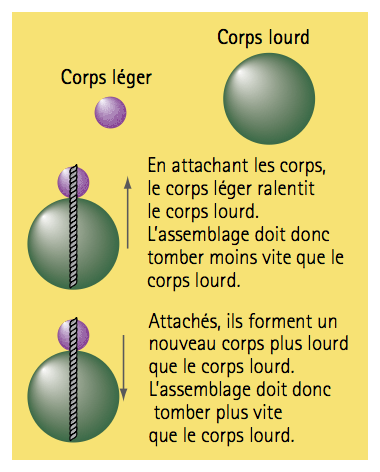
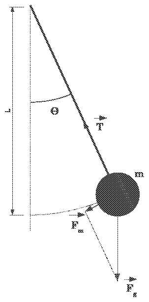

# 绪论　物理课程基础

Fondements de la physique — Introduction

PREMIER COURS · 第一课

中法对照讲义 · 由 LaTeX 源文件渲染

!!! info "阅读说明"

    每段先列法语原文；其下缩进、带深蓝竖条的小字号段落为中文翻译。<strong>加粗</strong>为关键词，括号内为中文释义。

    本讲是《电路基础》的第一课（4 学时），也是 TD1–TD2 的对应讲义：先讲科学方法与实验方法，再讲测量、量纲与不确定度，最后讨论 AI 时代的学习方法与中法教学理念。原讲义中本身即为中文的幻灯片（1977 年高考题、AI 讨论、中法教育比较等）按原样排印，不再另译。

## 0.1　Organisation du cours 课程安排

<strong>6 Enseignants</strong> : Laurent Bédat, Pierre Jean Vallobra, Maël Balluet, 任宽芳, 吴楠, 武媚娟.

<strong>6 位教师</strong>：Laurent Bédat、Pierre Jean Vallobra、Maël Balluet、任宽芳、吴楠、武媚娟。
{: .zh }

!!! note ""

    <em>bilingue français–anglais</em>（法英双语）　·　<em>trilingues ch/fr/en</em>（中法英三语）　·　<em>bilingue ch/en</em>（中英双语）

<strong>24 h cours magistraux</strong>（24 学时课堂讲授，CM）分为三个模块：

Répartition des 24 h de cours magistraux 24 学时课堂讲授的分配

<strong>Fondements de la physique</strong> 物理课程基础 — <strong>4 h</strong>

1. Méthode scientifique — 科学方法
2. Mesures, dimensions et incertitudes — 测量、量纲与不确定度
3. IA et mentalités d'enseignement françaises et chinoises — 人工智能与法中教学理念

<strong>Électrostatique — Champs et potentiels</strong> 静电学——电场与电势 — <strong>10 h</strong>

1. Force et champ électrostatiques — 静电力与静电场
2. Théorème de Gauss — 高斯定理
3. Conducteurs et condensateurs — 导体与电容器

<strong>Électrocinétique et circuits électriques</strong> 动电学与电路 — <strong>10 h</strong>

1. Transport de charges — 电荷输运
2. Circuits électriques — 电路
3. Dissipation d'énergie — 能量耗散
4. Structure des circuits électriques — 电路结构

<strong>24 h TD</strong> : 12 séances de 2 h　　<strong>16 h TP</strong> : 4 séances de 4 h <strong>(2 enseignants/séance)</strong>

<strong>24 学时 TD（辅导课）</strong>：12 次，每次 2 小时　　<strong>16 学时 TP（实验课）</strong>：4 次，每次 4 小时（<strong>每场 2 名教师</strong>）
{: .zh }

- TP1 — Mesure et incertitude（测量与不确定度）　　TP2 — Résistance（电阻）

- TP3 — Ondoscope / Oscilloscope（示波器）　　TP4 — Capaciteurs（电容器）

!!! note "Lexique 词汇"

    HC = h : heure de cours（课时）；CM : cours magistral（课堂讲授）；
    TD : travaux dirigés（辅导课）；TP : travaux pratiques（实验课）。

本讲属于 <strong>Partie 1 — Fondements de la physique</strong>（第一部分——物理基础），该部分包含三节：

本讲属于<strong>第一部分——物理基础</strong>，该部分包含三节：
{: .zh }

1. Méthode scientifique — 科学方法
2. Mesures, dimensions et incertitudes — 测量、量纲与不确定度
3. IA et mentalités d'enseignement françaises et chinoises — 人工智能与法中教学理念

## 0.2　Méthode scientifique 科学方法

### 0.2.1　De l'enseignement secondaire au supérieur 从中学到大学

<strong>Du primaire et au secondaire</strong>（初等和中等教育）：

<strong>初等和中等教育</strong>：
{: .zh }

- Découvrir les phénomènes physiques ;

    发现物理现象；
    {: .zh }

- Acquérir des notions et des lois fondamentales ;

    掌握基本概念与基本定律；
    {: .zh }

- Résoudre des problèmes simples et guidés.

    解决简单且有引导的问题。
    {: .zh }

<em>Observer</em>（观察）→ <em>découvrir</em>（发现）→ <em>apprendre</em>（学习）→ <em>appliquer</em>（应用）

<strong>Dans l'enseignement supérieur</strong>（高等教育）：

<strong>高等教育</strong>：
{: .zh }

- Comprendre pourquoi et connaître les conditions de validité ;

    理解“为什么”，并知道适用条件；
    {: .zh }

- Construire des modèles et les confronter à l'expérience ;

    建立模型，并用实验加以检验；
    {: .zh }

- Maîtriser les technologies avancées et innover.

    掌握先进技术并创新。
    {: .zh }

<em>Observer</em>（观察）→ <em>comprendre</em>（理解）→ <em>expérimenter</em>（验证）→ <em>créer, innover</em>（创新）

!!! danger "Objectif 目标"

    L'objectif n'est plus de savoir « quelle formule utiliser ? », mais de comprendre pourquoi, de construire des modèles et de les valider.

    高等教育的目的不再是“用哪个公式”，而是理解为什么、建立模型并验证，最终能够创新。
    {: .zh }

<strong>Formation de l'ingénieur demande</strong>（工程师教育的要求）：

<strong>工程师教育的要求</strong>：
{: .zh }

- <strong>comprendre</strong> les concepts fondamentaux ;

    清楚理解基本概念；
    {: .zh }

- <strong>identifier</strong> les hypothèses d'un modèle ;

    明确分辨模型假设；
    {: .zh }

- <strong>utiliser</strong> les mathématiques pour décrire les phénomènes ;

    能用数学模型进行描述；
    {: .zh }

- <strong>valider</strong> les modèles par les expériences ;

    能用实验进行验证；
    {: .zh }

- <strong>évaluer</strong> la cohérence, les incertitudes et les limites.

    评价结果的一致性、误差及使用条件。
    {: .zh }

!!! success "Objectif de la première année 第一学年培养目标"

    Passer de « savoir appliquer » à « comprendre et raisonner comme un scientifique et un futur ingénieur ».

    从“学会应用／做题”到“具备科学家与未来工程师的理解力与推理能力”。
    {: .zh }

### 0.2.2　Observer, hypothèse, expérimentation 观察、假设与实验

!!! danger "But de la physique 物理学的目标"

    La physique vise à établir les <strong>lois de la nature</strong> à partir d'<strong>observations intentionnelles et quantitatives</strong>.

    物理学旨在通过<strong>有目的、定量的观察</strong>建立<strong>自然规律</strong>。
    {: .zh }

Différence entre <strong>voir</strong> et <strong>observer</strong> scientifiquement. Ex. Pomme de Newton ou pendule simple...

<strong>看</strong>与科学<strong>观察</strong>之间的区别。例：牛顿的苹果或单摆……
{: .zh }

- La physique n'est pas une <em>collection de formules</em> mais une <em>démarche de questionnement et de raisonnement</em> ;

    物理学不是<em>公式的集合</em>，而是<em>质疑与推理的思维方法</em>；
    {: .zh }

- En France, l'enseignement privilégie la réflexion logique et l'esprit critique. Les prépas insistent quant à elles sur la rigueur mathématique. En Chine, on met l'accent sur la mémorisation des formules et stratégies d'examen. Pourtant, <em>l'essentiel reste la compréhension physique profonde</em>.

    在法国，教学重视逻辑思维与批判精神，预科班尤其强调数学严谨性；在中国，教学侧重公式记忆与应试策略。然而，<em>核心仍是对物理的深刻理解</em>。
    {: .zh }

- <strong>Objectif BIFAST</strong> : former des ingénieurs <em>créatifs et novateurs</em> capables de concevoir leurs propres protocoles, au-delà de la simple maîtrise de techniques avancées.

    <strong>BIFAST 目标</strong>：培养<em>有创造力与创新精神</em>的工程师，能够设计自己的实验方案，而不仅是掌握先进技术。
    {: .zh }

!!! success "Définition 定义"

    <strong>Observer</strong> est distinct de <strong>regarder</strong> ou de <strong>voir</strong>. L'observation scientifique est <strong>intentionnelle</strong> et <strong>structurée</strong>.

    <strong>观察</strong>不同于<strong>看</strong>或<strong>看见</strong>。科学观察是<strong>有目的</strong>、<strong>有结构</strong>的。
    {: .zh }

<strong>Caractéristiques d'une bonne observation</strong>（良好观察的特征）：

<strong>良好观察的特征</strong>：
{: .zh }

- <u>Systématique</u> 系统的：on observe avec un protocole ;

    按照实验方案进行观察；
    {: .zh }

- <u>Mesurable</u> 可量化的：on quantifie (ou du moins on qualifie avec rigueur) ;

    进行定量（至少严格定性）描述；
    {: .zh }

- <u>Reproductible</u> 可复现的：une observation isolée n'est pas scientifique.

    孤立的观察不具科学性。
    {: .zh }

<strong>Exemple</strong>（示例）：

<strong>示例</strong>：
{: .zh }

- On <strong>regarde</strong> un parachutiste qui chute, on voit la pluie tomber...

    我们<strong>看</strong>到跳伞者下落，看到雨滴落下……
    {: .zh }

- On <strong>observe</strong> la chute d'une pomme, d'une pierre ou d'une plume et on mesure le temps de chute.

    我们<strong>观察</strong>苹果、石头或羽毛的下落，并测量下落时间。
    {: .zh }

- On <strong>cherche à établir</strong> une relation entre le temps de chute et certaines propriétés de l'objet.

    我们<strong>试图建立</strong>下落时间与物体某些性质之间的关系。
    {: .zh }

Pour cela, il est nécessaire de formuler des <strong>hypothèses</strong> et de tester <strong>expérimentalement</strong>.

为此，需要提出<strong>假设</strong>并进行<strong>实验</strong>检验。
{: .zh }

!!! success "Définition 定义"

    Une <strong>hypothèse</strong> est une réponse <u>anticipée et provisoire</u> à une question issue de l'observation. Elle doit être <u>testable</u>.

    <strong>假设</strong>是对观察所提出的问题作出的<u>预先的、临时性的</u>回答。它必须<u>可验证</u>。
    {: .zh }

<strong>Les deux types d'hypothèses</strong>（两类假设）：

<strong>两类假设</strong>：
{: .zh }

1. <u>Hypothèse de protocole</u> 方案假设：comment concevoir l'expérience pour tester la question ?

    如何设计实验来检验该问题？
    {: .zh }

2. <u>Hypothèse causale</u> 因果关系假设：quelle relation entre les variables ?

    各变量之间存在什么关系？
    {: .zh }

<strong>L'importance de l'échec</strong> : une hypothèse invalidée est <strong>au moins aussi importante</strong> qu'une hypothèse validée. Elle enseigne sur les causes de l'échec et oriente la prochaine expérience.

<strong>失败的重要性</strong>：被否定的假设<strong>至少与</strong>被证实的假设<strong>同等重要</strong>。它揭示了失败的原因，并指引下一次实验。
{: .zh }

!!! info "Exemple — loi d'un objet en chute libre 例：自由落体定律"

    - Hypothèse de protocole : <u>champ gravitationnel et frottements négligeables</u>（重力场和摩擦均可忽略）

        方案假设：<u>重力场和摩擦均可忽略</u>；
        {: .zh }

    - Hypothèse causale : \(t = f(h,m,g)\) \(\;\Rightarrow\;\) par analyse dimensionnelle \(t = f(h,g)\) \(\;\Rightarrow\;\) par <strong>expérience</strong> : \(t = \sqrt{2h/g}\).

        因果关系假设：\(t = f(h,m,g)\) \(\;\Rightarrow\;\) 由量纲分析得 \(t = f(h,g)\) \(\;\Rightarrow\;\) 由<strong>实验</strong>得 \(t = \sqrt{2h/g}\)。
        {: .zh }

<strong>Principe fondamental</strong> : la méthode expérimentale consiste à modifier <em>un seul facteur à la fois</em> pour mesurer son effet sur le phénomène étudié.

<strong>基本原则</strong>：实验方法要求<em>每次只改变一个因素</em>，以测量它对待研究现象的影响。
{: .zh }

<strong>Schéma OHERIC</strong>（présentation simplifiée）: <strong>O</strong>bservation, <strong>H</strong>ypothèse, <strong>E</strong>xpérience, <strong>R</strong>ésultat, <strong>I</strong>nterprétation, <strong>C</strong>onclusion.

<strong>OHERIC 模式</strong>（简化表述）：观察（Observation）、假设（Hypothèse）、实验（Expérience）、结果（Résultat）、解释（Interprétation）、结论（Conclusion）。
{: .zh }

<strong>Le protocole expérimental</strong>（实验方案）：

<strong>实验方案</strong>：
{: .zh }

1. Objectif : que cherche-t-on à caractériser ?

    目标：要表征什么？
    {: .zh }

2. Principe de mesure : quelle méthode utilise-t-on ?

    测量原理：采用什么方法？
    {: .zh }

3. Montage : schéma clair et annoté ;

    装置：清晰并标注的示意图；
    {: .zh }

4. Étapes : séquence d'actions ;

    步骤：操作的先后顺序；
    {: .zh }

5. Analyse : traitement des données ;

    分析：数据处理；
    {: .zh }

6. Conclusion : validation ou invalidation de l'hypothèse.

    结论：假设被证实还是被否定。
    {: .zh }

### 0.2.3　Les trois types d'expérimentation 三类实验方法

L'expérimentation ne se réduit pas à la manipulation matérielle. On en distingue aujourd'hui trois types, chacun ayant ses spécificités, ses avantages et ses inconvénients.

实验并不局限于对实物进行操作。如今区分出三类实验，各具特点、优势与局限。
{: .zh }

#### 1. Expérimentation physique (matérielle) 物理实验（实物操作）

« Le réel résiste ». C'est la forme la plus classique, celle que les étudiants connaissent des TP.

“现实会抵抗”。这是最经典的形式，也是学生在实验课上熟悉的形式。
{: .zh }

!!! success "Définition 定义"

    Manipulation d'objets matériels (bancs optiques, circuits, pendules, éolienne miniature) avec des instruments de mesure réels.

    使用真实测量仪器操作实物（光学平台、电路、单摆、微型风力发电机）。
    {: .zh }

<strong>Spécificité</strong>（特点）：

<strong>特点</strong>：
{: .zh }

- Elle confronte la théorie aux incertitudes de mesure, aux défauts de fabrication... donc un « test de vérité ».

    它把理论置于测量不确定度与制造缺陷的检验之下……因此是一场“真理测试”。
    {: .zh }

- Elle est souvent coûteuse, longue à mettre en place et parfois impossible (ex. : étudier l'intérieur d'une étoile).

    它往往昂贵、搭建耗时，有时甚至不可能实现（例如研究恒星内部）。
    {: .zh }

- Elle peut aussi être simple et peu coûteuse, réalisable chez soi, et très utile pour comprendre la physique, au point de valoir parfois plus qu'un dispositif sophistiqué.

    它也可以简单而廉价，在家即可完成，对理解物理非常有用，有时甚至胜过复杂精密的装置。
    {: .zh }

#### 2. L'expérimentation de pensée 思想实验

Initiée par Galilée, popularisée par Einstein. C'est l'outil du théoricien.

由伽利略开创、爱因斯坦普及，是理论工作者的工具。
{: .zh }

!!! success "Définition 定义"

    Une expérience réalisée <strong>mentalement</strong>, en poussant un raisonnement logique jusqu'à ses extrêmes. Elle repose sur des « idéalisations ».

    在<strong>头脑中</strong>进行的实验，把逻辑推理推向极致。它建立在“理想化”之上。
    {: .zh }

<strong>Force</strong> : l'expérience de pensée ne prouve pas que le réel fonctionne d'une certaine façon — seul le terrain peut le dire. En revanche, elle prouve, <em>par la seule force de la logique</em>, ce qui est impossible, contradictoire ou nécessaire dans un cadre donné. C'est un outil de <em>réfutation</em> et de <em>clarification conceptuelle</em> d'une puissance redoutable.

<strong>力量</strong>：思想实验不能证明现实如何运作——只有实际检验才能回答。但它<em>仅凭逻辑的力量</em>就能证明：在给定框架内什么是不能的、矛盾的或必然的。它是极具威力的<em>反驳</em>与<em>概念澄清</em>工具。
{: .zh }

<strong>Exemples</strong>（示例）：

<strong>示例</strong>：
{: .zh }

- Expérience de pensée de Galilée (le temps de chute d'un objet ; voir figure) ;

    伽利略的思想实验（物体下落时间；见图）；
    {: .zh }

- Expérience de pensée d'Einstein (la poursuite du rayon lumineux, le paradoxe EPR...) ;

    爱因斯坦的思想实验（追赶光线、EPR 佯谬……）；
    {: .zh }

- On peut élargir et appliquer cette méthode à des questions simples : la surface d'eau sur la Terre ne peut pas être plane si la Terre a une taille finie. À vous de donner d'autres exemples...

    还可以把这种方法推广到简单问题上：如果地球尺寸有限，地球上的水面不可能是平的。请你们再举一些例子……
    {: .zh }

Figure 1 — Expérience de pensée de Galilée sur la chute des corps : le corps léger ralentit le corps lourd, mais l'ensemble est plus lourd que le corps lourd — deux conclusions contradictoires. 图 1：伽利略关于物体下落的思想实验——轻物会拖慢重物，但绑在一起又比重物更重，两种结论互相矛盾。

#### 3. L'expérimentation numérique (simulation) 数值实验（数值模拟）

C'est « le 3e pilier de la science », essentiel pour le BIFAST (modélisation).

它是“科学的第三支柱”，对 BIFAST（建模）至关重要。
{: .zh }

!!! success "Définition 定义"

    On ne manipule pas la matière, mais un <strong>modèle mathématique du réel</strong> codé dans un ordinateur (ex. : simulation par éléments finis, dynamique des fluides).

    不操作实物，而是操作在计算机中编码的<strong>现实数学模型</strong>（例如有限元模拟、流体力学）。
    {: .zh }

<strong>Spécificité</strong> : elle permet de faire varier des paramètres que la réalité interdit (ex. : annuler la gravité, simuler des températures extrêmes) et de visualiser des grandeurs invisibles (champs de pression, lignes de courant).

<strong>特点</strong>：它可以改变现实所禁止的参数（例如消除重力、模拟极端温度），并把不可见的量（压力场、流线）可视化。
{: .zh }

!!! danger "Le grand piège 最大的陷阱"

    <strong>« Garbage in, garbage out »</strong> 垃圾进，垃圾出。

    Une simulation numérique est aussi bonne que le modèle et les paramètres qu'on lui donne. Elle ne crée pas de vérité, elle explore des scénarios.

    <strong>“垃圾进，垃圾出”</strong>。数值模拟的好坏取决于所给的模型与参数。它不创造真理，只探索情景。
    {: .zh }

D'un usage simple quotidien au plus sophistiqué et complet.

从日常的简单使用到最复杂、最完备的应用。
{: .zh }

### 0.2.4　Comparaison et résumé 比较与小结

Tableau 1 — Comparaison des trois types d'expérimentation 表 1：三类实验方法的比较

| Type d'expérience | Question principale | Ce qu'elle prouve | Limite |
|---|---|---|---|
| <strong>Expérience de pensée</strong>（思想实验） | Est-ce logiquement cohérent ?（逻辑上是否自洽？） | La <strong>cohérence logique</strong> ou l'<strong>impossibilité logique</strong> d'une hypothèse dans un cadre donné.（在给定框架内假设的<strong>逻辑自洽性</strong>或<strong>逻辑不可能性</strong>。） | Ne vérifie pas directement la réalité.（不直接检验现实。） |
| <strong>Expérience physique</strong>（物理实验） | Est-ce conforme aux observations ?（是否符合观察？） | La <strong>conformité au réel</strong> dans les conditions testées.（在所检验条件下的<strong>现实符合性</strong>。） | Valide seulement dans les conditions testées.（仅在所检验条件下成立。） |
| <strong>Expérience numérique</strong>（数值实验） | Que prédit le modèle ?（模型预言什么？） | La <strong>stabilité et les conséquences</strong> d'un modèle mathématique.（数学模型的<strong>稳定性与推论</strong>。） | Ne vérifie pas à elle seule que le modèle est juste.（仅凭它不能验证模型正确。） |

<strong>La boucle</strong> : 3 types d'expérimentation pour confirmer ou infirmer l'hypothèse.

<strong>闭环</strong>：用三类实验证实或否定假设。
{: .zh }

<strong>Le cycle complet</strong> : Observation → Question → Hypothèse → Expérience → Résultat → Interprétation → Nouvelle question.

<strong>完整循环</strong>：观察 → 问题 → 假设 → 实验 → 结果 → 解释 → 新问题。
{: .zh }

<strong>Ce qui est important pour les étudiants BIFAST</strong>（对 BIFAST 学生而言重要的是）：

<strong>对 BIFAST 学生而言重要的是</strong>：
{: .zh }

- La démarche n'est pas <u>séquentielle</u> 顺序的 : elle est dynamique, on revient en arrière si nécessaire ;

    过程并非<u>顺序的</u>：它是动态的，必要时可回到前一步；
    {: .zh }

- L'anticipation est clé 预判是关键 : on analyse le problème et prévoit les résultats possibles avant l'expérience ;

    预判是关键：实验前分析问题并预想可能的结果；
    {: .zh }

- Le protocole 方案 est un élément pivot : mémoire de la manipulation, outil de contrôle.

    实验方案是枢纽：它是操作的记录，也是控制的工具。
    {: .zh }

<strong>Conclusion et perspectives</strong>（总结与展望）：

<strong>总结与展望</strong>：
{: .zh }

- La méthode scientifique n'est pas une recette mais une <u>posture intellectuelle</u> 思想姿态 ;

    科学方法不是配方，而是一种<u>思想姿态</u>；
    {: .zh }

- L'ingénieur est celui qui sait concevoir, critiquer et adapter une démarche expérimentale ;

    工程师应当能够设计、批判并调整实验过程；
    {: .zh }

- Les « échecs » expérimentaux sont des <u>ressources d'apprentissage</u> 学习资源.

    实验中的“失败”是<u>学习资源</u>。
    {: .zh }

!!! warning "Vocabulaire clé &nbsp;&nbsp; 重点词汇 科学方法核心术语"

    - <strong>observation intentionnelle</strong>：有目的的观察
    - <strong>hypothèse testable</strong>：可检验的假设
    - <strong>protocole expérimental</strong>：实验方案
    - <strong>systématique / mesurable / reproductible</strong>：系统的／可量化的／可复现的
    - <strong>démarche de questionnement</strong>：质疑与推理的过程
    - <strong>expérimentation matérielle</strong>：实物实验
    - <strong>expérimentation de pensée</strong>：思想实验
    - <strong>expérimentation numérique</strong>：数值实验
    - <strong>idéalisation</strong>：理想化
    - <strong>réfutation</strong>：反驳
    - <strong>anticiper</strong>：预判
    - <strong>posture intellectuelle</strong>：思想姿态

## 0.3　Mesures, dimensions et incertitudes 测量、量纲与不确定度

Les <strong>propriétés physiques</strong> sont <strong>quantifiées</strong> avec des <strong>grandeurs physiques</strong>.

<strong>物理性质</strong>要通过<strong>物理量</strong>加以<strong>量化</strong>。
{: .zh }

- Une <strong>grandeur physique</strong> n'a de sens que si elle est <strong>mesurée</strong> et accompagnée d'une <strong>unité</strong> ;

    <strong>物理量</strong>只有在被<strong>测量</strong>并带有<strong>单位</strong>时才有意义；
    {: .zh }

- Elle doit être compatible <strong>dimensionnellement</strong> avec les lois physiques.

    它必须在<strong>量纲</strong>上与物理定律相容。
    {: .zh }

<strong>Objectifs</strong>（本节教学目的）：

<strong>本节教学目的</strong>：
{: .zh }

- Distinguer 分清楚 grandeur, dimension et unité ;
- Utiliser les équations aux dimensions 量纲方程 ;
- Vérifier l'homogénéité 量纲一致性 d'une équation physique ;
- Identifier les principales sources d'erreurs expérimentales ;
- Calculer une moyenne 平均值 et une incertitude 不确定度 simple ;
- Présenter correctement un résultat expérimental.

### 0.3.1　Grandeurs, dimensions et unités 物理量、量纲与单位

- <strong>Grandeur physique</strong>（物理量）：une propriété mesurable = valeur numérique avec unité（可测量的性质＝数值＋单位）；
- <strong>Unité</strong>（单位）：quantification d'une grandeur（对物理量的量化）；
- <strong>Dimension</strong>（量纲）：nature physique d'une grandeur（物理量的物理本质）。

!!! info "Exemple 例"

    Une personne de 60 kg pèse 588,6 N. Son énergie cinétique est de 1387,2 J lorsqu'il court à 6,8 m/s.

    一个 60 kg 的人重 588,6 N；当他以 6,8 m/s 奔跑时，动能为 1387,2 J。
    {: .zh }

Tableau 2 — Valeur, unité et dimension de quatre grandeurs physiques 表 2：四个物理量的数值、单位与量纲

| Grandeur physique 物理量 | masse 质量 | poids 重力 | vitesse 速度 | énergie cinétique 动能 |
|---|---|---|---|---|
| Valeur 数值 | 60 | 588,6 | 6,8 | 1387,2 |
| Unité 单位 | kg | N (Newton) | m/s | J (Joule) |
| Dimension 量纲 | M | MLT\(^{-2}\) | LT\(^{-1}\) | ML\(^{2}\)T\(^{-2}\) |

- Seules 3 dimensions de base interviennent pour les 4 grandeurs : Masse <strong>M</strong>, Longueur <strong>L</strong>, Temps <strong>T</strong> ;

    这 4 个物理量只涉及 3 个基本量纲：质量 <strong>M</strong>、长度 <strong>L</strong>、时间 <strong>T</strong>；
    {: .zh }

- Selon le document 2019 du Bureau International des poids et mesures sur le Système International.

    依据国际计量局 2019 年关于国际单位制的文件。
    {: .zh }

### 0.3.2　Dimensions de base 基本量纲

- Chaque grandeur physique a son unité. Combien de dimensions sont nécessaires afin de décrire la <strong>totalité</strong> des quantités physiques ?
- La réponse est 7, dont 4 seulement en mécanique et électricité.

    每个物理量都有自己的单位。要描述<strong>全部</strong>物理量，需要多少个量纲？答案是 7 个，其中力学与电学只用到 4 个。
    {: .zh }

!!! note ""

    <strong>La Longueur, le Temps, la Masse, la température \(\Theta\), l'Intensité du courant</strong>

    长度、时间、质量、温度 \(\Theta\)、电流强度。

!!! note "读者注"

    原文此处称“力学与电学只用到 4 个”，但紧接着列出的基本量为长度、时间、质量、温度与电流强度共 5 个。按国际单位制，力学用到 L、T、M 三个，电学再加电流强度 I，共 4 个；温度 \(\Theta\) 属于热学。

- À partir des dimensions de base on peut en créer de nouvelles ;
- <strong>Exemples</strong>（示例）：

    由基本量纲可以导出新的量纲。例如：速度、能量（功）、功率、电阻、电压的量纲如下。
    {: .zh }

\[
\text{a.}\ [\text{vitesse}] = \mathrm{L}\cdot\mathrm{T}^{-1},
\qquad
\text{b.}\ [\text{énergie}] = [\text{travail}] = \mathrm{M}\cdot\mathrm{L}^{2}\cdot\mathrm{T}^{-2},
\]

\[
\text{c.}\ [\text{puissance}] = \mathrm{M}\cdot\mathrm{L}^{2}\cdot\mathrm{T}^{-3},
\qquad
\text{d.}\ [\text{résistance}] = \mathrm{M}\cdot\mathrm{L}^{2}\cdot\mathrm{T}^{-3}\cdot\mathrm{I}^{-2},
\qquad
\text{e.}\ [\text{tension}] = \mathrm{M}\cdot\mathrm{L}^{2}\cdot\mathrm{T}^{-3}\cdot\mathrm{I}^{-1}.
\]

!!! info "Démonstration 证明"

    \[
    \text{a.}\ \text{vitesse} = \frac{\text{distance}}{\text{temps}},
    \qquad
    \text{b.}\ E = \frac{1}{2}mv^{2}\ \text{ou}\ W = Fd,
    \qquad
    \text{c.}\ P = \frac{W}{t}.
    \]

    由速度＝距离／时间、\(E=\frac12 mv^2\) 或 \(W=Fd\)、\(P=W/t\)，可直接导出上述量纲。
    {: .zh }

### 0.3.3　Homogénéité et analyse dimensionnelle 量纲一致性与量纲分析

Toute loi physique doit s'écrire de manière <strong>homogène</strong> — 一切物理定律都必须满足量纲一致性：tous les termes doivent avoir la même dimension.

任何物理定律都必须写成<strong>量纲一致</strong>的形式：所有项必须具有相同的量纲。
{: .zh }

- Certaines grandeurs physiques sont <strong>sans dimension</strong>（某些物理量无量纲）：
    - Le rapport des grandeurs de la même unité. Ex. diamètre et hauteur d'un cylindre ; \([d/h]=\varnothing\).

        同一单位的量之比。例：圆柱的直径与高度；\([d/h]=\varnothing\)。
        {: .zh }

    - L'angle n'a pas de dimension.

        角度没有量纲。
        {: .zh }

    - Du point de vue des dimensions, une dérivée est une division. Ex. : \([a]=[dv/dt]=\mathrm{L}\cdot\mathrm{T}^{-2}\).

        从量纲角度看，求导相当于除法。例：\([a]=[dv/dt]=\mathrm{L}\cdot\mathrm{T}^{-2}\)。
        {: .zh }

    - Une intégration correspond à l'inverse d'une dérivation. Ex. : \([v]=[\int a\,dt]=\mathrm{L}\cdot\mathrm{T}^{-1}\).

        积分相当于求导的逆运算。例：\([v]=[\int a\,dt]=\mathrm{L}\cdot\mathrm{T}^{-1}\)。
        {: .zh }

    - Les arguments des fonctions mathématiques usuelles sont forcément sans dimension.

        常用数学函数的自变量必须无量纲。
        {: .zh }

!!! danger "Principe d'homogénéité 量纲一致性原理"

    On ne peut additionner, soustraire ou comparer que des grandeurs ayant la même dimension.

    只能对具有相同量纲的量进行相加、相减或比较。
    {: .zh }

!!! note ""

    L'analyse dimensionnelle est un excellent outil de vérification utilisé quotidiennement en physique.

    量纲分析是一种极佳的验证工具，物理学中每天都会用到。
    {: .zh }

- <strong>Principe fondamental</strong> : une équation physique doit être homogène ;
- <strong>Pratique</strong> : tous les membres doivent avoir la même dimension ;
- <strong>Exemples</strong> :
    - 5 kg plus 8 m n'a pas de sens.

        5 kg 加 8 m 没有意义。
        {: .zh }

    - L'équation \(x=v+t\) est certainement fausse (\(x\) — distance, \(v\) — vitesse, \(t\) — temps).

        方程 \(x=v+t\) 必定错误（\(x\) 为距离，\(v\) 为速度，\(t\) 为时间）。
        {: .zh }

    - La période d'un pendule simple est indépendante de la masse. On peut déduire \(T \propto \sqrt{l/g}\).

        单摆周期与质量无关，可由此推出 \(T \propto \sqrt{l/g}\)。
        {: .zh }

- <strong>Applications</strong>（应用）：vérifier une formule（检验公式）; retrouver une unité（还原单位）; détecter une erreur de calcul（发现计算错误）; construire une loi physique approchée（建立近似物理定律）。

### 0.3.4　Unités et Système international 单位与国际单位制

- Les grandeurs physiques de même dimension peuvent avoir des unités différentes :
    - Longueur : mètre, km ; <em>pouce</em>, <em>mile</em>...

        同一量纲的物理量可以有不同的单位。长度：米、千米；英寸、英里……
        {: .zh }

    - Volume : litre, m\(^{3}\) ; <em>once liquide</em>, <em>gallon</em>...

        体积：升、立方米；液量盎司、加仑……
        {: .zh }

- Il existe deux grandes familles de systèmes d'unités（单位制分为两大类）：
    - la famille <strong>métrique SI</strong> avec variantes CGS et MKS — système moderne, universel et cohérent（<strong>国际公制 SI</strong>，含 CGS、MKS 变体——现代、通用且一致的单位制）；
    - la famille <strong>anglo-saxonne</strong> — système ancien, hérité d'usages historiques, et moins cohérent（<strong>英美制</strong>——历史沿袭的旧制，一致性较差）。

- Les grandeurs doivent être exprimées dans un système d'unités commun pour（物理量必须用共同的单位制来表示，以便）：
    - comparer des mesures réalisées dans différents laboratoires（比较不同实验室的测量结果）；
    - garantir la cohérence des calculs（保证计算的一致性）；
    - éviter les erreurs de conversion（un problème très courant : confusion entre degré et radian）（避免换算错误，很常见的问题：混淆度与弧度）；
    - communiquer les résultats de manière universelle（以通用的方式交流结果）。

Pour effectuer les mesures, il faut disposer d'une référence appelée <strong>unité à comparer</strong>.

要进行测量，就需要一个参照标准，称为<strong>用以比较的单位</strong>。
{: .zh }

- <strong>La Chine</strong> est l'un des premiers États à avoir cherché une unification des mesures.
    - <strong>Qin Shi Huang</strong> impose des étalons communs dans tout l'empire : longueur, le <em>chi</em> 尺 ; masse, le <em>jin</em> 斤 ; volume, le <em>dou</em> 斗.
    - Les valeurs exactes du <em>chi</em> ou du <em>jin</em> changent légèrement selon les dynasties, mais le principe d'un étalon contrôlé par l'État reste une constante pendant plus de deux mille ans.

    <strong>中国</strong>是最早寻求统一度量衡的国家之一。<strong>秦始皇</strong>在全国推行统一的基准：长度用尺，质量用斤，体积用斗。尺、斤的确切数值随朝代略有变化，但由国家控制基准这一原则延续了两千多年。
    {: .zh }

- <strong>La France</strong> possède des centaines d'unités différentes jusqu'au XVIIIe siècle.
    - La même unité peut avoir une valeur différente selon les villes.
    - En 1791, le <strong>mètre</strong> est défini, début du SI — Système International.
    - Bureau International des Poids et Mesures 国际计量局 — son abréviation officielle reste <strong>BIPM</strong>, en français.
    - Le SI est entièrement <strong>dématérialisé</strong> dans sa définition <strong>depuis 2019</strong> : on n'a plus besoin d'étalons 标准具 matériels pour définir les unités.

    <strong>法国</strong>直到 18 世纪仍有数百种不同的单位。同一单位在不同城市可能有不同数值。1791 年，<strong>米</strong>被定义，国际单位制 SI 由此开端。国际计量局的官方英文缩写至今仍沿用其法语缩写 <strong>BIPM</strong>。自 <strong>2019 年</strong>起，SI 的定义已完全<strong>非实物化</strong>：不再需要实物基准来定义单位。
    {: .zh }

- <strong>SI</strong> : système de référence en recherche scientifique, industrie et ingénierie ;
- <strong>Sept unités de base</strong> : chacune étant associée à <em>une grandeur fondamentale</em> et à <em>une dimension fondamentale</em>.

    <strong>SI</strong> 是科学研究、工业与工程领域的参考单位制；<strong>七个基本单位</strong>分别对应一个<em>基本量</em>和一个<em>基本量纲</em>。
    {: .zh }

Tableau 3 — Les sept unités de base du SI（Cf. « Le Système international d'unités », 9e éd., tab. 2 et 3） 表 3：SI 的七个基本单位（参见《国际单位制》第 9 版表 2 与表 3）

| Grandeur de base 基本量 | Dimension 量纲 | Symbole 符号 | Unité de base 基本单位 | Symbole 符号 |
|---|---|---|---|---|
| temps 时间 | T | \(t\) | seconde 秒 | s |
| longueur 长度 | L | \(l,x,r\) | mètre 米 | m |
| masse 质量 | M | \(m\) | kilogramme 千克 | kg |
| courant électrique 电流 | I | \(I,i\) | ampère 安培 | A |
| température thermodynamique 热力学温度 | \(\Theta\) | \(T\) | kelvin 开尔文 | K |
| quantité de matière 物质的量 | N | \(n\) | mole 摩尔 | mol |
| intensité lumineuse 发光强度 | J | \(I_v\) | candela 坎德拉 | cd |

- <strong>Lettres droites</strong>（正体）：量纲符号与单位符号；
- <em>Lettres penchées</em>（斜体）：物理量符号。

Les sept constantes définissant le SI et les sept unités qu'elles définissent :

定义 SI 的七个常数及它们所定义的七个单位：
{: .zh }

Tableau 4 — Les sept constantes définissant le SI（Cf. tab. 1, 9e éd.） 表 4：定义 SI 的七个常数（参见第 9 版表 1）

| Symbole 符号 | Constante 常数 | Valeur numérique 数值 | Unité 单位 |
|---|---|---|---|
| \(\Delta\nu_{\mathrm{Cs}}\) | fréquence de la transition hyperfine du césium 铯原子超精细跃迁频率 | \(9\,192\,631\,770\) | \(\mathrm{Hz}\) |
| \(c\) | vitesse de la lumière dans le vide 真空光速 | \(299\,792\,458\) | \(\mathrm{m\,s^{-1}}\) |
| \(h\) | constante de Planck 普朗克常数 | \(6{,}626\,070\,15\times10^{-34}\) | \(\mathrm{J\,s}\) |
| \(e\) | charge élémentaire 元电荷 | \(1{,}602\,176\,634\times10^{-19}\) | \(\mathrm{C}\) |
| \(k\) | constante de Boltzmann 玻尔兹曼常数 | \(1{,}380\,649\times10^{-23}\) | \(\mathrm{J\,K^{-1}}\) |
| \(N_A\) | constante d'Avogadro 阿伏伽德罗常数 | \(6{,}022\,140\,76\times10^{23}\) | \(\mathrm{mol^{-1}}\) |
| \(K_{\mathrm{cd}}\) | efficacité lumineuse 光视效能 | \(683\) | \(\mathrm{lm\,W^{-1}}\) |

!!! danger "Valeurs fixées par définition 由定义固定"

    Les valeurs numériques des sept constantes de base du SI sont <strong>fixées par définition</strong> ; elles ne sont plus déterminées par la mesure.

    SI 七个基本常数的数值<strong>由定义固定</strong>，不再通过测量确定。
    {: .zh }

### 0.3.5　Incertitudes de mesure 测量的不确定度

Même si une équation est <u>homogène</u> 量纲一致的, les mesures restent imparfaites.

即使方程<u>量纲一致</u>，测量仍然是不完美的。
{: .zh }

- Une mesure sans incertitude n'a pas de signification physique :
    - En physique, il n'existe pas de mesure parfaitement certaine ;
    - L'incertitude quantifie la confiance que l'on peut accorder à une mesure ;
    - Un résultat expérimental s'exprime toujours sous la forme : <strong>valeur ± incertitude</strong>.

    没有不确定度的测量没有物理意义：在物理学中，不存在完全确定的测量；不确定度量化了对一次测量可以给予的信任程度；实验结果总是写成：<strong>数值 ± 不确定度</strong>。
    {: .zh }

<strong>Exemple</strong> : mesurer l'épaisseur d'une télécommande avec différents instruments（示例：用不同仪器测量遥控器的厚度）：

<strong>示例</strong>：用不同仪器测量遥控器的厚度：
{: .zh }

- <u>Règle graduée</u> : 17 mm (incertitude \(\sim\) 1 mm) — 刻度尺：17 mm（不确定度约 1 mm）
- <u>Pied à coulisse</u> 游标卡尺 : 17,2 mm (incertitude \(\sim\) 0,1 mm)
- <u>Micromètre</u> 千分尺，螺旋测微器 : 17,24 mm (incertitude \(\sim\) 0,01 mm)

!!! note ""

    L'instrument le plus précis réduit l'incertitude, mais ne l'élimine jamais.

    最精密的仪器能降低不确定度，却永远无法消除它。
    {: .zh }

<strong>Erreurs systématiques</strong> 系统误差：

<strong>系统误差</strong>：
{: .zh }

- <strong>Origine</strong> : défaut de l'instrument, défaut du protocole, mauvaise calibration, offset du capteur.

    来源：仪器缺陷、方案缺陷、校准不当、传感器零点偏移。
    {: .zh }

- <strong>Caractère</strong> : décalage constant ou régulier. Ne disparaît pas en répétant les mesures.

    特征：恒定或规律性的偏移，重复测量不会使其消失。
    {: .zh }

- <strong>Exemple</strong> : balance mal tarée, zéro décalé sur un appareil.

    例子：天平未去皮、仪器零点偏移。
    {: .zh }

<strong>Erreurs aléatoires</strong> 随机误差：

<strong>随机误差</strong>：
{: .zh }

- <strong>Origine</strong> : fluctuations incontrôlables — vibrations, bruit de capteur, réaction humaine au chronomètre.

    来源：不可控的涨落——振动、传感器噪声、按秒表的人为反应。
    {: .zh }

- <strong>Caractère</strong> : elles varient d'une mesure à l'autre, tantôt positives tantôt négatives.

    特征：逐次测量时正时负。
    {: .zh }

- On les réduit en augmentant le nombre de mesures \(n\).

    增加测量次数 \(n\) 可以减小随机误差。
    {: .zh }

<strong>On distingue</strong>（可分为）：

<strong>可分为</strong>：
{: .zh }

- <u>Justesse</u> 正确度 : proximité de la valeur vraie — liée aux erreurs systématiques（与真值的接近程度——与系统误差有关）；
- <u>Précision</u> 精密度 : faible dispersion — liée aux erreurs aléatoires（分散程度小——与随机误差有关）。

#### Incertitudes-type de Type A A 类标准不确定度

<strong>Incertitudes-type de Type A</strong>：évaluation statistique de l'incertitude à partir de mesures répétées. On réalise \(n\) mesures d'une même grandeur : \(x_1, x_2, \cdots, x_n\).

<strong>A 类标准不确定度</strong>：根据重复测量对不确定度作统计评估。对同一量进行 \(n\) 次测量：\(x_1, x_2, \cdots, x_n\)。
{: .zh }

1. <strong>Valeur estimée</strong> : moyenne arithmétique（估计值：算术平均值）

    \[
    \bar{x}=\frac{1}{n}\sum_{i=1}^{n}x_i .
    \]

2. <strong>Écart-type</strong> 标准差 expérimental（écart-type de la série）: caractérise la dispersion des mesures autour de la moyenne.

    实验标准差（样本标准差）：刻画测量值在均值周围的分散程度。

    \[
    \sigma_{n-1}=\sqrt{\frac{1}{n-1}\sum_{i=1}^{n}(x_i-\bar{x})^{2}} .
    \]

3. <strong>Incertitude-type</strong> 标准不确定度 sur la moyenne (erreur standard sur la moyenne) \(u_A(\bar{x})\)：

    \[
    u_A(\bar{x})=\frac{\sigma_{n-1}}{\sqrt{n}} .
    \]

    平均值的标准不确定度 \(u_A(\bar{x})\) 如上式。
    {: .zh }

!!! note ""

    <strong>Note</strong> : l'augmentation de \(n\) diminue \(u_A(\bar{x})\) — répéter les mesures réduit l'incertitude aléatoire sur la moyenne.

    <strong>注</strong>：增大 \(n\) 会减小 \(u_A(\bar{x})\)——重复测量可降低平均值上的随机不确定度。
    {: .zh }

#### Incertitudes-type de Type B B 类标准不确定度

<strong>Incertitudes-type de Type B</strong> : c'est l'incertitude issue de données <strong>connues à l'avance</strong>, sans répétition de mesure.

<strong>B 类标准不确定度</strong>：来自<strong>预先已知</strong>数据、无需重复测量的不确定度。
{: .zh }

<strong>Formule générale</strong>（一般公式）：

\[
u_B=\frac{\Delta_c}{\sqrt{3}} .
\]

\(\Delta_c\) est l'erreur maximale tolérée donnée par le constructeur, la précision de mesure... ; \(\sqrt{3}\) pour une distribution uniforme.

\(\Delta_c\) 为制造商给出的最大允许误差或测量精度……；分母 \(\sqrt{3}\) 对应均匀分布。
{: .zh }

<strong>Incertitude composée</strong> (incertitude-type du résultat)（合成不确定度，即结果的标准不确定度）：

\[
u_C=\sqrt{u_A^{2}+u_B^{2}} .
\]

<strong>Incertitude élargie</strong> 扩展不确定度：

\[
U=k\cdot u_C .
\]

<strong>Expression finale</strong>（最终表达式）：

\[
x=\bar{x}\pm U .
\]

\(k=1\) pour un intervalle de confiance à 68 % et \(k=2\) pour un intervalle de confiance à 95 %.

置信区间 68 % 取 \(k=1\)，置信区间 95 % 取 \(k=2\)。
{: .zh }

#### Propagation des incertitudes 不确定度的传播

<strong>Propagation des incertitudes</strong> pour une grandeur composée (présentation simplifiée)：

<strong>复合量的不确定度传播</strong>（简化表述）：
{: .zh }

1. <strong>Produit / quotient</strong> : \(z=x\cdot y\) ou \(z=\dfrac{x}{y}\), par le calcul de la dérivée de fonction \(\ln(z)\)（积／商，可通过对 \(\ln(z)\) 求导得到）：

    \[
    \frac{\Delta z}{z}=\frac{\Delta x}{x}\pm\frac{\Delta y}{y}
    \;\Rightarrow\;
    \left(\frac{\Delta z}{z}\right)^{2}
    =\left(\frac{\Delta x}{x}\right)^{2}
    +\left(\frac{\Delta y}{y}\right)^{2}
    \]

    \[
    \Rightarrow\;
    \left(\frac{u(z)}{z}\right)^{2}
    =\left(\frac{u(x)}{x}\right)^{2}
    +\left(\frac{u(y)}{y}\right)^{2}.
    \]

2. <strong>Somme / différence</strong> : \(z=x+y\) ou \(z=x-y\)（和／差）：

    \[
    (\Delta z)^{2}=(\Delta x)^{2}+(\Delta y)^{2}
    \quad\Rightarrow\quad
    u^{2}(z)=u^{2}(x)+u^{2}(y).
    \]

<strong>Règle d'écriture du résultat final</strong>（最终结果的书写规则）：

\[
z=\bar{z}\pm u(z),
\]

avec cohérence sur le nombre de chiffres significatifs (CS).

并保持有效数字（CS）位数一致。
{: .zh }

### 0.3.6　Chiffres significatifs 有效数字

<strong>Chiffres significatifs</strong> 有效数字 transmettent une information sur la <strong>précision</strong> d'une mesure expérimentale.

<strong>有效数字</strong>传递实验测量的<strong>精度</strong>信息。
{: .zh }

- Exemples : <strong>0,045 m</strong> : seuls 4 et 5 sont significatifs (2 CS), la mesure est au millimètre près.

    例：<strong>0,045 m</strong> 中只有 4 和 5 是有效数字（2 位 CS），测量精确到毫米。
    {: .zh }

- <strong>4,50 m</strong> : 4, 5 et 0 sont significatifs (3 CS), la mesure est au centimètre près. Le zéro final confirme la précision.

    <strong>4,50 m</strong> 中 4、5、0 都是有效数字（3 位 CS），测量精确到厘米；末尾的零确认了精度。
    {: .zh }

<strong>Règles de comptage des chiffres significatifs</strong>（有效数字的计数规则）：

<strong>有效数字的计数规则</strong>：
{: .zh }

- Zéros à gauche : non significatifs（左侧的零：不是有效数字）；
- Chiffres non nuls : toujours significatifs（非零数字：总是有效数字）；
- Zéros à droite (après virgule) : significatifs（右侧小数点后的零：是有效数字）；
- Règle des zéros intermédiaires : toujours significatifs. Ex. 10,05 et 9006 ont 4 CS（中间零规则：总是有效数字。例：10,05 和 9006 都有 4 位 CS）；
- Règle des nombres entiers : ambiguïté et notation scientifique（整数规则：存在歧义，应使用科学计数法）
    - cas ambigu 模糊性举例 : 500 peut signifier 1, 2 ou 3 CS（500 可能表示 1、2 或 3 位 CS）；
    - écriture scientifique 科学书写形式 : \(5\times10^{2}\) a seul 1 CS, alors \(5,00\times10^{2}\) a 3 CS（\(5\times10^{2}\) 只有 1 位 CS，而 \(5,00\times10^{2}\) 有 3 位 CS）。

<strong>Règles de calcul avec chiffres significatifs</strong>（有效数字的运算规则）：

<strong>有效数字的运算规则</strong>：
{: .zh }

- <strong>Addition et soustraction</strong> : le terme le moins précis impose le nombre de décimales du résultat. Ex. \(12,54+3,2=15,7\) (1 décimale, comme le terme le moins précis).

    <strong>加法与减法</strong>：以最不精确的项决定结果的小数位数。例：\(12,54+3,2=15,7\)（保留 1 位小数，与最不精确的项一致）。
    {: .zh }

- <strong>Multiplication et division</strong> : le résultat conserve autant de chiffres significatifs (CS) que la donnée initiale qui en a le moins. Ex. \(4,20\times2,1=8,8\) (2 CS, correspondant au terme le moins précis).

    <strong>乘法与除法</strong>：结果保留的有效数字位数与初始数据中位数最少者相同。例：\(4,20\times2,1=8,8\)（2 位 CS，对应最不精确的项）。
    {: .zh }

!!! note ""

    <strong>口诀：加减看末位，乘除看位数。</strong>

<strong>Cas particuliers importants</strong>（几种重要的特殊情况）：

<strong>几种重要的特殊情况</strong>：
{: .zh }

- Les constantes n'influencent pas le résultat : \(\pi\), \(e\), 2, 1/2, \(\sqrt{2}\), nombres entiers → précision infinie.

    常数不影响结果：\(\pi\)、\(e\)、2、1/2、\(\sqrt{2}\)、整数 → 精度无限。
    {: .zh }

- Arrondi des résultats intermédiaires : un chiffre de garde au moins en cours de calcul, arrondi seulement à la fin. Ex. \((4,56\times3,2)/1,234=14,592/1,234=12\) ou \(14,6/1,234=12\).

    中间结果取整：计算过程中至少保留一位保护数字，只在最后取整。例：\((4,56\times3,2)/1,234=14,592/1,234=12\)，或 \(14,6/1,234=12\)。
    {: .zh }

- Écriture scientifique : la précision est donnée par la partie décimale. Ex. \(2,50\times10^{6}\) (3 CS).

    科学计数法：精度由小数部分给出。例：\(2,50\times10^{6}\)（3 位 CS）。
    {: .zh }

!!! info "Exercice à faire 课堂练习"

    1. \(12,34+2,1=?\)

    2. \(15,62-0,345=?\)

    3. \(12,5\times3,145=?\)

    4. \(0,040\div3,0=?\)

    5. \((6,02\times10^{23})\times(3,0\times10^{4})=?\)

    6. \(2\pi\times1,50=?\)　（\(\pi\) 为常数）

!!! tip "Corrigés 参考答案"

    1. \(14,44\ \rightarrow\ 14,4\)　（第 1 位小数）
    2. \(15,275\ \rightarrow\ 15,28\)　（第 2 位小数）
    3. \(39,3125\ \rightarrow\ 39,3\)　（3 位有效数字）
    4. \(0,013\)　（2 位有效数字；计算值为 0,01333333…）
    5. \(1,8\times10^{28}\)　（2 位有效数字；计算值为 1,806×10²⁸）
    6. \(9,42\)　（3 位有效数字，\(2\pi\) 精确）

### 0.3.7　Traitement des données 数据处理

<strong>Utilité</strong>（用途）：vérifier des lois physiques（检验物理定律）；déterminer des paramètres dans une loi physique par les mesures（通过测量确定物理定律中的参数）。

<strong>Méthodes</strong>（方法）：

<strong>方法</strong>：
{: .zh }

1. Mesure dans la même configuration — une seule mesure ou une série de mesures (statistique).

    <em>Exemple</em> \(g=\dfrac{2z}{t^{2}}\) : une mesure de \(t\) en \(z\) permet de déduire \(g\). On peut répéter la mesure pour rendre le résultat plus fiable.

    同一配置下测量——单次测量或一组测量（统计）。例：\(g=2z/t^{2}\)，在高度 \(z\) 处测 \(t\) 即可推出 \(g\)；重复测量可提高结果可靠性。
    {: .zh }

2. Mesure en variant un paramètre et traitement avec une <u>loi supposée</u> 一个假设的规律。

    <em>Exemple</em> \(z=\dfrac{1}{2}gt^{2}\) : on mesure \(t\) pour différentes valeurs de \(z\) et on fait une régression linéaire \(z=\dfrac{1}{2}gs\) avec \(s=t^{2}\), et on détermine \(g\) avec la pente de la droite \(z=as\).

    改变参数进行测量，并用<u>假设的规律</u>处理。例：\(z=\frac12 gt^{2}\)，对不同 \(z\) 测 \(t\)，作线性回归 \(z=\frac12 gs\)（\(s=t^{2}\)），由直线 \(z=as\) 的斜率确定 \(g\)。
    {: .zh }

<strong>Remarques</strong>（说明）：

<strong>说明</strong>：
{: .zh }

- Beaucoup d'outils informatiques sont développés pour le traitement des données de la méthode 2 ;

    已开发出许多用于方法 2 数据处理的信息工具；
    {: .zh }

- La régression linéaire reste essentielle. Par changement de variable on peut rendre une fonction non-linéaire linéaire. <em>Exemple</em> : \(E(x)=E_0e^{-\alpha x}\), alors \(y(x)=\ln(E)=\ln(E_0)-\alpha x\).

    线性回归仍然至关重要。通过变量代换可把非线性函数化为线性。例：\(E(x)=E_0e^{-\alpha x}\)，则 \(y(x)=\ln(E)=\ln(E_0)-\alpha x\)。
    {: .zh }

### 0.3.8　Résumé 小结

1. <strong>Grandeur physique</strong> 物理量 = dimension + unité + valeur mesurée（＝量纲＋单位＋测得值）。
2. <strong>Dimensions</strong> 量纲 décrivent la nature physique ; les unités permettent de quantifier（量纲描述物理本质；单位用于量化）。
3. <strong>Homogénéité</strong> : seuls des termes de même dimension peuvent s'additionner ou se comparer（量纲一致性：只有同量纲的项才能相加或比较）。
4. <strong>Analyse dimensionnelle</strong> : vérifier une formule, retrouver une unité, construire une loi（量纲分析：检验公式、还原单位、建立定律）。
5. <strong>Toute mesure a une incertitude</strong> — aucune mesure n'est parfaitement exacte（任何测量都有不确定度——没有完全精确的测量）。
6. <strong>Erreurs systématiques</strong> → exactitude ; <strong>erreurs aléatoires</strong> → dispersion（系统误差 → 正确度；随机误差 → 分散度）。
7. <strong>Moyenne</strong> = meilleure estimation si erreurs aléatoires（存在随机误差时，平均值是最佳估计）。
8. <strong>Écart-type</strong> 标准偏差 = dispersion ; \(u_A(\bar{x})=\dfrac{\sigma_{n-1}}{\sqrt{n}}\)（标准差衡量分散程度）。
9. <strong>Résultat</strong> : \(x=\bar{x}\pm U\) (unité), chiffres significatifs cohérents（结果：\(x=\bar{x}\pm U\)，带单位，有效数字一致）。
10. <strong>Dimensions + unités + incertitudes</strong> 不确定度 = socle de toute démarche expérimentale（量纲＋单位＋不确定度＝一切实验过程的基础）。
11. <strong>Chiffres significatifs</strong> : information sur la <strong>précision</strong> d'une mesure expérimentale（有效数字：反映实验测量<strong>精度</strong>的信息）。
12. <strong>Traitement des données</strong> (régression linéaire) : vérifier des lois physiques ou déterminer des paramètres dans une loi physique par les mesures（数据处理：检验物理定律，或由测量确定其中的参数）。

!!! warning "Vocabulaire clé &nbsp;&nbsp; 重点词汇 测量与不确定度核心术语"

    - <strong>grandeur physique</strong>：物理量
    - <strong>dimension</strong>：量纲
    - <strong>unité</strong>：单位
    - <strong>homogénéité</strong>：量纲一致性
    - <strong>analyse dimensionnelle</strong>：量纲分析
    - <strong>incertitude de mesure</strong>：测量不确定度
    - <strong>erreur systématique / aléatoire</strong>：系统误差／随机误差
    - <strong>justesse / précision</strong>：正确度／精密度
    - <strong>moyenne arithmétique</strong>：算术平均值
    - <strong>écart-type</strong>：标准差
    - <strong>incertitude composée / élargie</strong>：合成不确定度／扩展不确定度
    - <strong>chiffres significatifs</strong>：有效数字
    - <strong>régression linéaire</strong>：线性回归

## 0.4　Applications typiques 典型应用实例

### 0.4.1　我的一道高考题（1977 年陕西）

<strong>5.</strong> 把一块质量为一千克的铅放在坩埚里，在汽油喷灯上加热。若铅刚熔解完，问需要多少汽油？汽油燃烧时仅有 10 % 的热量被铅吸收，室温是 28 °C。铅的熔点是 328 °C，铅的比热是 0.031 千卡/千克·°C，铅的溶解热是 6.3 千卡/千克，汽油的燃烧值是 11000 千卡/千克。

!!! info "解"

    此题当时仅根据逻辑推理写出公式，进行计算，并检验结果。

    升温过程所需热量：（328 − 28）°C × 0.031 千卡/(千克·°C) × 1 千克 = 9.3 千卡

    熔化所需热量：6.3 千卡/千克 × 1 千克 = 6.3 千卡

    刚熔解完所需总热量：6.3 + 9.3 = 15.6 千卡。

    根据热平衡，所需汽油：15.6 千卡 ÷ 11000 千卡/千克 = 1.4 克

    只有 10 % 热量被吸收：1.4 克 ÷ 10 % = 14 克。

    <strong>答：所需汽油为 14 克。</strong>

!!! tip "说明"

    - 我没有核实各物理量的准确值，但结果合理。
    - 如果计算结果是 14 千克、5 吨或几毫克、几微克，至少要声明结果不合理。
    - 一般数值计算结果必须给出单位。
    - 有效位数必须合理。

### 0.4.2　单摆微分方程

Figure 2 — Pendule simple : masse \(m\), angle \(\theta\), tension \(\vec{T}\), poids \(\vec{F}_g= m\vec{g}\), centre de masse \(G\). 图 2：单摆——小球质量 \(m\)、摆角 \(\theta\)、绳张力 \(\vec{T}\)、重力 \(\vec{F}_g\)、质心 \(G\)。

<strong>1.</strong> 下列哪个单摆方程是

\[
\text{a)}\ \frac{d^{2}\theta}{dt^{2}}+A\cos\theta=0
\qquad
\text{b)}\ \frac{d^{2}\theta}{dt^{2}}+A\sin(m\theta)=0
\]

\[
\text{c)}\ \frac{d^{2}\theta}{dt^{2}}+A\sin\theta=0
\qquad
\text{d)}\ \frac{d^{2}\theta}{dt^{2}}+A\theta=0
\]

<strong>2.</strong> \(A\) 的量纲是什么？　　<strong>3.</strong> 常数 \(A\) 为正还是为负？

!!! info "答案"

    <strong>1. 单摆方程：</strong>

    a) 肯定错误，因为 \(\theta=0\) 处加速度不为零。

    b) 肯定错误，因为正弦函数的宗量量纲为质量（量纲不合法）。

    c) 此方程对任意 \(\theta\) 都应当成立。

    d) 在小角度 \(\theta\approx 0\) 条件下可以成立，但大角度时不再成立。

    <strong>2.</strong> \(A\) 的量纲必须 \(\mathrm{T}^{-2}\)。实际上，很容易推导出 \(A=g/L\)，与质量 \(m\) 无关。

    <strong>3.</strong> \(A\) 必须为正值：

    - 从物理角度：角加速度与角位移 \(\theta\) 符号相反。
    - 从数学角度：\(\theta(t)\) 是振荡函数。

### 0.4.3　量纲应用（法国大二应用数学考题）

给定球坐标系下电势：

\[
V(r)=\frac{q}{4\pi\varepsilon_0 r}\left(1+\frac{r}{a}\right)
\exp\left(-\frac{2r}{a}\right).
\]

请用下列公式求电场 \(\vec{E}(r)\)、电荷密度 \(\rho(r)\) 和半径为 \(r\) 的球内总电荷 \(Q(r)\)：

\[
\vec{E}(r)=-\frac{dV}{dr}\,\vec{e}_r,\qquad
\rho(r)=\frac{1}{r^{2}}\frac{d(r^{2}V)}{dr},\qquad
Q(r)=4\pi r^{2}\frac{dV}{dr}.
\]

这里不做数学计算和推导。下面是部分学生答案，请判断哪些是合理的：

\[
\text{a)}\ \vec{E}(r)=\frac{q}{4\pi\varepsilon_0}
\left(\frac{2}{a^{2}}+\frac{2}{ar}+\frac{1}{r^{2}}\right)
\exp\left(\frac{2r}{a}\right)
\]

\[
\text{b)}\ \vec{E}(r)=\frac{q}{4\pi\varepsilon_0}
\left(\frac{2}{a}+\frac{2}{ar}+\frac{1}{r^{2}}\right)
\exp\left(-\frac{2r}{a}\right)\vec{e}_r
\]

\[
\text{c)}\ \rho(r)=\frac{q}{4\pi}
\left(\frac{1}{a^{3}}+\frac{1}{r^{2}}\right)
\exp\left(-\frac{2r}{a}\right)
\]

\[
\text{d)}\ Q(r)=q\left(\frac{2r}{a^{2}}+\frac{2r}{a}+\frac{1}{r^{2}}\right)
\exp\left(-\frac{2r}{a}\right)
\]

!!! info "答案"

    <strong>所有给出结果都是错的。</strong>

    a) 两个错误：\(\vec{E}(r)\to\infty\)；结果为标量。

    b) 第一项量纲错误。

    c) 第二项量纲错误。

    d) 第一、三项量纲错误。

!!! danger "各量的长度量纲应该为"

    - \(E \sim 1/r^{2}\)
    - \(\rho \sim 1/r^{3}\)
    - \(Q \sim r^{0}\)

!!! note ""

    <strong>一定要养成检查量纲、公式和结果合理性的习惯！！！</strong>

### 0.4.4　量纲及误差分析

<em>Portée d'un projectile</em>（抛物体的射程）：

\[
L(\alpha)=\frac{v_0^{2}\sin(2\alpha)}{g}.
\]

- <strong>Analyse dimensionnelle</strong> 量纲分析 : \(L\) est indépendant de la masse et proportionnel à \(v_0^{2}\) en raison de \(g\). On justifie le facteur \(2\alpha\) au lieu de \(\alpha\) par des cas particuliers \(\alpha=0\) et \(90°\).

    量纲分析：\(L\) 与质量无关，且因分母 \(g\) 的关系与 \(v_0^{2}\) 成正比。可由 \(\alpha=0\) 与 \(90°\) 的特殊情形说明为何因子是 \(2\alpha\) 而不是 \(\alpha\)。
    {: .zh }

- <strong>Analyse d'erreur relative</strong> 误差分析 :

    \[
    \frac{\Delta L}{L}=\frac{2\Delta v_0}{v_0}
    +\frac{2\cos(2\alpha)}{\sin(2\alpha)}\,\Delta\alpha,
    \qquad g\ \text{est constant}.
    \]

    1. Erreur relative due à \(v_0\) est 2 fois de celle de \(\Delta v_0\) car \(v_0^{2}\) : \(2\Delta v_0/v_0\).

        由于 \(v_0^{2}\)，由 \(v_0\) 引起的相对误差是 \(\Delta v_0/v_0\) 的两倍：\(2\Delta v_0/v_0\)。
        {: .zh }

    2. On étudie l'erreur relative due à \(\alpha\) :

        研究由 \(\alpha\) 引起的相对误差：
        {: .zh }

        - Si \(\alpha\) tend vers 0, l'erreur tend vers l'infini : à vous de l'expliquer.

            当 \(\alpha\to 0\) 时误差趋于无穷：请你们解释原因。
            {: .zh }

        - Si \(\alpha=45°\) l'erreur théorique est nulle, la portée maximale, à vous de l'expliquer.

            当 \(\alpha=45°\) 时理论误差为零，此时射程最大：请你们解释原因。
            {: .zh }

        - Si \(\alpha=30°\) avec une incertitude \(\Delta\alpha=1°\) :

            \[
            \frac{\Delta L}{L}=\frac{2\cos(60°)}{\sin(60°)}\,1°
            =\frac{2\cdot 1/2}{\sqrt{3}/2}=1.15
            \ \rightarrow\ 115\,\%\ ???
            \]

            当 \(\alpha=30°\)、不确定度 \(\Delta\alpha=1°\) 时，形式上得到 115 %。
            {: .zh }

Vérification numérique : \(v_0=500\) m/s, \(g=9.8\) m/s\(^{2}\) : \(L(30°)=44.18\) m, \(L(31°)=45.05\) m, \(\dfrac{\Delta L}{L}\cong0.02=2\,\%\).

数值验证：\(v_0=500\) m/s，\(g=9.8\) m/s\(^{2}\)：\(L(30°)=44.18\) m，\(L(31°)=45.05\) m，\(\Delta L/L\cong0.02=2\,\%\)。
{: .zh }

!!! danger "Attention 注意"

    <strong>\(\Delta\alpha\) doit être en radian !</strong>　\(\Delta\alpha\) 必须以弧度为单位！

    \(1°=\pi/180=0.01745\)；　\(1.15\times0.017=0.02\)，OK。

!!! note ""

    <strong>一定要养成检查量纲、公式和结果合理性的习惯！！！</strong>

!!! warning "Vocabulaire clé &nbsp;&nbsp; 重点词汇 典型应用核心术语"

    - <strong>analyse dimensionnelle</strong>：量纲分析
    - <strong>ordre de grandeur</strong>：数量级
    - <strong>portée d'un projectile</strong>：抛体射程
    - <strong>erreur relative</strong>：相对误差
    - <strong>incertitude</strong>：不确定度
    - <strong>radian</strong>：弧度
    - <strong>pendule simple</strong>：单摆
    - <strong>équation différentielle</strong>：微分方程
    - <strong>champ électrique</strong>：电场
    - <strong>densité de charge</strong>：电荷密度

## 0.5　IA et mentalités d'enseignement 人工智能与教学理念

### 0.5.1　人工智能的本质与现实

<strong>人工智能的本质与现实</strong>（IA — Intelligence Artificielle）：

- <strong>✓ IA 是一个随时可用、事事可答的“万能助手”</strong>，可以极大地提高我们的学习和工作效率。
- <strong>✗ IA 是“概率大师”而非“真理大师”</strong>。它通过海量数据拟合出最可能的答案，但并不理解这些答案的含义。它可能产生逻辑通顺但事实错误的“幻觉”。
- <strong>✗ IA 的知识截止于其训练数据</strong>。它无法真正“创新”，只能“重组”已有信息。
- <strong>! IA 无事不通，但会出现物理公式错误、文献造假、前后逻辑不通等问题。</strong>

    它的强大恰恰放大了人的判断力的重要性。答案越容易获得，甄别答案的能力就越珍贵。

- <strong>! 许多教育学家惊呼：</strong> 面对 IA，以记忆和应试技巧为核心的传统教育模式将“全军覆没”。

    只有那些具备独立思考、批判性分析和价值判断能力的人，才能在 AI 时代脱颖而出。

### 0.5.2　IA 时代的学习方法

Tableau 5 — Principes et stratégies d'apprentissage à l'ère de l'IA 表 5：IA 时代的学习原则与具体策略

| 原则 | 具体策略 |
|---|---|
| <strong>✗ 不与 IA 拼记忆</strong> | IA 的记忆容量无限、提取速度极快。死记硬背定义、公式、定理、典型题答案、解题模式等，都是徒劳的。 |
| <strong>✓ 学会“利用”IA，而非仅仅“使用”</strong> | “使用”是接受答案；“利用”是主动设计提问、交叉验证、追问逻辑链条，把 IA 当作“思辨伙伴”而非“答案机器”。 |
| <strong>✓ 超越 IA 的关键：分析与判断能力</strong> | IA 可以给出多种方案，但只有人能判断哪一种最优、最可行、最符合科学和伦理。这种能力不是天生的，而是通过训练积累的。 |
| <strong>✓ 分析与判断能力需要培养</strong> | 加强自我知识体系和分析能力的训练；通过质疑式学习（对答案进行分析提出质疑）、对比式学习（比较多个来源的答案）和项目式学习（解决真实问题）等方式，逐步构建自己的分析方法和认知体系。 |

### 0.5.3　使用举例：没有防护眼镜怎样看日食？

直接拷贝的答案，答案加编号以便讲解。

!!! note "DeepSeek"

    <strong>S0. 绝对不要在没有任何防护的情况下直视日食，哪怕是 1 秒！</strong> 这会造成永久性黄斑灼伤，且无痛、不可逆。如果实在没有专用眼镜，请严格使用以下间接观测法（绝对安全）：

    <strong>S1. 针孔投影（最推荐）</strong>：找一张硬纸扎个小孔（或利用树叶缝隙），背对太阳，让阳光透过小孔投射到另一张白纸或地面上。观察投影的圆形光斑变化即可，千万不要透过小孔看太阳。

    <strong>S2. 日常厨具</strong>：漏勺、编织帽的孔洞在日食时，地面投影会变成无数个“月牙”形状，效果非常有趣。

    <strong>S3. 双筒望远镜/相机投影</strong>：将设备架在三脚架上，背对太阳，用目镜对准白纸调焦，投影出日面像。切记：绝对不能用手通过取景器或目镜去看，强光瞬间就会烧坏设备并灼伤眼睛。

    <strong>S4.</strong> 最后，绝对禁止使用墨镜、X 光片、烟熏玻璃或胶片——它们挡不住红外线和紫外线，看久了照样伤眼。如果现在手边实在没有工具，最稳妥的办法是看官方直播，各大天文台都会有实时画面。

!!! note "豆包"

    <strong>B0 绝对禁止方式</strong>

    肉眼直视、墨镜、茶色玻璃、曝光胶片、软盘、手机直接拍摄，均无法阻挡红外，极易灼伤黄斑，造成永久性视力损伤。

    <strong>可行的间接观测（无专业日食眼镜）</strong>

    <strong>B1. 小孔投影法（首选，安全）</strong> 拿一张硬纸板，扎一个直径 1–2 mm 小圆孔。背对太阳，小孔朝向日光，在身后地面/白纸承接光斑。光斑就是太阳的像，可以清晰看到日食缺口。不要去看小孔，只观察白纸上的投影。

    <strong>B2. 镜面反射法</strong> 小平面镜斜放，将太阳光反射到室内墙壁。观测墙壁上面的太阳光斑。严禁直视镜面。

    <strong>B3. 水盆倒影</strong> 室外盛一盆清水，可以滴少量墨汁。观看水面的太阳倒影。不要俯身直视太阳。

    <strong>简短结论</strong>：没有合格日食滤光片，绝不直接看向太阳。只采用投影、倒影间接观察。补充：普通太阳镜衰减不足，不能直视日食。

<strong>答案分析：</strong>

S0：言少，无懈可击。B0：言多有失：软盘？红外？

S1、B1 为最古老方法，可行。S1 不够具体，小孔多大？树叶缝隙，原理不同。B1 较 S1 具体，可行。

S2：信口雌黄。B2 原理不通。小镜片反射的光斑是镜片的形状，而非太阳形状。

S3：白纸为漫反射，不可能反映出太阳形状。<strong>B3：有道理可行</strong>，需根据日食时太阳高度估计水面反射率，调节加墨量。

!!! note ""

    <strong>要掌握基本科学原理，学会和养成自己分析和判断的能力。</strong>

### 0.5.4　最重要的事：持之以恒、方法得当

- “只有坚持不懈的锻炼，你才会比别人更强。”
- 但“锻炼”不等于盲目苦干。成功的训练需要两个要素：

<strong>✓ 毅力</strong>

- 深度学习是“慢认知”，它要求长时间的专注、反复的推敲和持续的反思。
- 面对 AI 生成的“完美答案”，要敢于说“不”，敢于自己从头推理。

<strong>✓ 方法</strong>

- 找到适合自己的节奏和领域。兴趣是最好的燃料。选择你真正好奇的问题去钻研，而不是被动地完成练习。
- 找到有效的反馈机制。没有反馈的训练是无效的。主动寻求老师的点评、同学的讨论、实验的验证。

!!! danger "公式"

    <strong>核心竞争力 = 批判性思维 × 持续训练 × 适合的方法</strong>

### 0.5.5　IA 是镜子，照出人的本质

- IA 迫使我们回答一个古老的问题：作为人，我们究竟为什么而学？
- 如果只是为了记住答案，我们永远比不上 IA。
- 但如果是为了理解世界、创造价值、做出判断——那么，IA 只是我们手中的工具，而我们永远是主人。

<strong>名言醒目标注：</strong>

- <em>« Le jugement est plus important que la connaissance. »</em>（判断比知识更重要。）
- <em>« Le doute est le début de la sagesse. »</em>（怀疑是智慧的开端。）

<strong>BIFAST</strong>

- 中法双重文化将为我们提供更丰富的思考路径，并促使我们进行视角的交融。
- 两种教育实践融合，将帮助我们打下更坚实的根基，并培养出更强的分析能力。

### 0.5.6　中法文化的异同

<strong>Similitudes (les points communs)</strong>（相似性，共同点）：

Tableau 6 — Similitudes entre les cultures française et chinoise 表 6：中法文化的相似之处

| Dimension 维度 | Similitude 相似之处 |
|---|---|
| <strong>Fierté nationale 民族自豪感</strong> | Les deux nations sont profondément attachées à leur histoire, leur langue et leur patrimoine culturel.（两国都深深珍视自己的历史、语言与文化遗产。） |
| <strong>Centralisation 中央集权</strong> | Les deux pays ont une longue tradition d'État centralisé (Paris vs Pékin).（两国都有悠久的中央集权传统，巴黎 vs 北京。） |
| <strong>Rôle de l'élite 精英作用</strong> | Les deux cultures valorisent la formation des élites et le mérite (concours, examen).（两种文化都重视精英培养与功绩，如竞赛、考试。） |
| <strong>Art de vivre 生活艺术</strong> | La gastronomie, le vin/thé, la conversation et les arts occupent une place essentielle.（美食、葡萄酒／茶、交谈与艺术都占有重要地位。） |
| <strong>Raison et logique 理性与逻辑</strong> | Les deux traditions intellectuelles valorisent la rigueur et la cohérence (Descartes vs Confucius).（两种思想传统都重视严谨与一致性，笛卡尔 vs 孔子。） |

<strong>Différences (les contrastes)</strong>（差异，对比）：

Tableau 7 — Différences culturelles entre la France et la Chine 表 7：中法文化差异

| Dimension 维度 | France 法国 | Chine 中国 |
|---|---|---|
| Valeur centrale 核心价值 | <strong>Liberté</strong> — l'individu prime（自由——个人优先） | <strong>Harmonie</strong> — le groupe prime（和谐——集体优先） |
| Rapport à l'autorité 对权威的态度 | Critique, débat, contestation（批判、辩论、质疑） | Respect, déférence, hiérarchie（尊重、恭敬、等级） |
| Communication 沟通方式 | <strong>Directe</strong> — on dit ce qu'on pense（直接——说出自己的想法） | <strong>Implicite</strong> — sous-entendus et contexte（含蓄——言外之意与语境） |
| Rapport à l'échec 对失败的态度 | Accepté, source d'apprentissage（接受，视为学习来源） | Stigmatisé, perte de face（污名化，丢面子） |

### 0.5.7　中法教育理念比较

<strong>Philosophie et objectif général</strong>（教育哲学与总体目标）：

Tableau 8 — Philosophie et objectif général de l'enseignement 表 8：教育哲学与总体目标

| Dimension 维度 | France : flexible et ouvert 法国：灵活开放 | Chine : rigide et organisé 中国：严格有序 |
|---|---|---|
| Valeur centrale 核心价值 | Liberté, égalité des chances, esprit critique（自由、机会均等、批判精神） | Harmonie sociale, excellence collective（社会和谐、集体卓越） |
| Finalité 培养目标 | Former des citoyens autonomes et éclairés（培养自主、开明的公民） | Former des élites compétentes au service de la nation（培养为国家服务的优秀精英） |
| Approche pédagogique 教学方式 | Centrée sur l'élève et son autonomie（以学生及其自主性为中心） | Centrée sur le savoir et l'enseignant（以知识与教师为中心） |

<strong>Le rapport au savoir</strong>（与知识的关系）：

Tableau 9 — Rapport au savoir 表 9：与知识的关系

| Dimension 维度 | France 法国 | Chine 中国 |
|---|---|---|
| Manuel scolaire 教材 | Souvent absent ; les profs construisent leur cours（常常没有教材；教师自行构建课程） | Roi ; tout cours s'appuie sur un manuel（至高无上；一切课程都以教材为依据） |
| Cours magistral 课堂讲授 | Flexible, avec digressions et liens avec la réalité（灵活，允许离题并与现实联系） | Structuré, fidèle au plan et au manuel（结构化，忠实于大纲与教材） |
| Objectif 目标 | Comprendre les démonstrations et les idées（理解证明与思想） | Maîtriser les connaissances et les techniques de résolution（掌握知识及解题技巧） |
| Interdisciplinarité 跨学科性 | Forte ; les concepts sont utilisés de façon transversale（强；概念跨学科使用） | Faible ; chaque discipline est traitée indépendamment（弱；各学科独立处理） |

<strong>Relation enseignant-élève</strong>（师生关系）：

Tableau 10 — Relation enseignant-élève 表 10：师生关系

| Dimension 维度 | France 法国 | Chine 中国 |
|---|---|---|
| Rôle de l'enseignant 教师角色 | Guide, accompagnateur, animateur（引导者、陪伴者、组织者） | Autorité savante, transmetteur de connaissances（知识权威、知识传授者） |
| Relation 关系 | Horizontale, informelle, parfois « chaotique »（横向、非正式，有时“混乱”） | Hiérarchique, respectueuse（等级分明、恭敬） |
| Participation en classe 课堂参与 | Active, encouragée, les exercices sont choisis en fonction des difficultés des étudiants（积极、受鼓励，习题依学生困难选择） | Passive ; les étudiants écoutent et prennent des notes（被动；学生听讲并记笔记） |
| Critique du professeur 批评教师 | Acceptable, voire encouragée（可以接受，甚至受鼓励） | Considérée comme impolie et manquant de modestie（被视为无礼、缺乏谦逊） |

<strong>Place de l'effort et de la pression</strong>（努力与压力的地位）：

Tableau 11 — Place de l'effort et de la pression 表 11：努力与压力的地位

| Dimension 维度 | France 法国 | Chine 中国 |
|---|---|---|
| Culture de l'effort 努力文化 | Valorise l'autonomie et l'exploration personnelle（重视自主与个人探索） | La pression est une source de motivation（压力是动力来源） |
| Échec 失败 | Accepté comme étape d'apprentissage（作为学习阶段被接受） | Stigmatisé ; source de « honte »（被污名化；“耻辱”的来源） |
| Discipline en classe 课堂纪律 | Relâchée ; certains enseignants chinois décrivent une classe française comme « un bar »（宽松；一些中国教师把法国课堂形容为“酒吧”） | Stricte ; le respect de l'enseignant est fondamental（严格；尊师是根本） |

### 0.5.8　Résumé 小结

France : liberté, flexibilité, esprit critique, autonomie, horizontale.
Chine : discipline, rigueur, mémorisation, respect hiérarchique, verticale.
<strong>BIFAST</strong> : l'art de conjuguer les deux héritages（将两种遗产融为一体的艺术）。

法国：自由、灵活、批判精神、自主、横向关系。中国：纪律、严谨、记忆、尊重等级、纵向关系。<strong>BIFAST</strong>：将两种遗产融为一体的艺术。
{: .zh }

Tableau 12 — Résumé de la comparaison franco-chinoise 表 12：中法教育理念比较小结

| Dimension 维度 | 法国 | 中国 |
|---|---|---|
| 核心价值 | 自由、批判精神、公民意识 | 和谐、集体荣誉、为国服务 |
| 教学重心 | 理解概念、活学活用、跨学科 | 知识体系、技巧熟练、分科独立 |
| 师生关系 | 平等开放，鼓励质疑 | 尊师重道，有序听讲 |
| 努力观 | 自主探索，失败可接受 | 压力即动力，失败即丢脸 |
| 工程师培养 | 精英·通才（管理+工业） | 专才·纵深（技术+研发） |

!!! note ""

    <strong>核心启示：</strong> 法国求“通”，中国求“专”；法式重“疑”，中式重“勤”。<strong>BIFAST</strong> 的使命：融合二者之长，培养既有扎实功底，又有批判眼光的未来工程师。

## 0.6　Conclusion et suggestions 结论与建议

<em>La physique est une science logique formulée par les mathématiques.</em>

物理学是一门逻辑科学，以数学作为工具来表述。
{: .zh }

!!! note ""

    <strong>理解物理量与物理定律，并掌握科学方法，远比死记公式、掌握做题窍门和解题技巧更为重要，更有效。</strong>

<strong>Suggestions</strong>（学习建议）：

<strong>学习建议</strong>：
{: .zh }

- Bien comprendre les définitions des <strong>concepts / grandeurs physiques</strong> ;

    充分理解<strong>概念／物理量</strong>的定义；
    {: .zh }

- Bien comprendre les <strong>lois physiques</strong> ;

    充分理解<strong>物理定律</strong>；
    {: .zh }

- Vérifier <strong>toujours</strong> l'homogénéité des dimensions dans les équations ;

    方程中<strong>务必始终</strong>检验量纲一致性；
    {: .zh }

- Vérifier que les résultats sont raisonnables dans <strong>des cas particuliers</strong> ;

    检验结果在<strong>特殊情形</strong>下是否合理；
    {: .zh }

- Vérifier que l'<strong>ordre de grandeur</strong> des résultats numériques est raisonnable.

    检验数值结果的<strong>数量级</strong>是否合理。
    {: .zh }

!!! warning "Vocabulaire clé &nbsp;&nbsp; 重点词汇 教学理念与学习建议核心术语"

    - <strong>esprit critique</strong>：批判精神
    - <strong>jugement</strong>：判断力
    - <strong>doute</strong>：怀疑
    - <strong>sagesse</strong>：智慧
    - <strong>fierté nationale</strong>：民族自豪感
    - <strong>centralisation</strong>：中央集权
    - <strong>élite</strong>：精英
    - <strong>valeur centrale</strong>：核心价值
    - <strong>rapport à l'autorité</strong>：对权威的态度
    - <strong>rapport à l'échec</strong>：对失败的态度
    - <strong>interdisciplinarité</strong>：跨学科性
    - <strong>ordre de grandeur</strong>：数量级

---

De nos différences naît notre force ; de notre union naît notre gloire.

差异催生动力，互鉴铸就辉煌 · Fin du cours — Merci pour votre attention.

