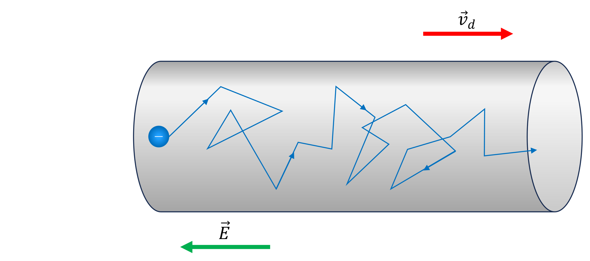

# 第 1 章　电荷输运

Chapitre n°1 — Transport de charges

中法对照讲义 · 由 LaTeX 源文件渲染

!!! info "阅读说明"

    每段先列法语原文；其下缩进、带深蓝竖条的小字号段落为中文翻译。<strong>加粗</strong>为关键词，括号内为中文释义。

    原讲义是课堂填空版，正文中的推导与例题公式留白供课上填写；本站版本已补全全部公式，便于课后复习与核对。

## 1.1　Mouvement de charges et courant électrique 电荷运动与电流

L'origine du courant électrique vient du mouvement des porteurs de charge mobiles. Par exemple, les électrons sont les porteurs de charge mobiles dans les métaux. Les porteurs mobiles de charge peuvent être positifs, négatifs ou les deux à la fois.

电流的来源是可移动<strong>电荷载流子</strong>（porteurs de charge mobiles）的运动。例如，在金属中，电子就是可移动的电荷载流子。可移动的电荷载流子可以是正电荷、负电荷，或者两者兼有。
{: .zh }

Le mouvement des porteurs de charge mobiles est dû à la force \(\vec{F}\) exercée par le champ électrique \(\vec{E}\) sur les charges \(q\) (équation 1.1). Selon la seconde loi de Newton, nous pouvons exprimer l'accélération \(\vec{a}\) (ou la dérivée de la vitesse \(\vec{v}\)) des porteurs de charge en fonction de leur masse \(m\), de leur charge \(q\) et du champ électrique \(\vec{E}\) (équation 1.2).

可移动电荷载流子的运动源于<strong>电场</strong>（champ électrique）\(\vec{E}\) 对电荷 \(q\) 施加的力 \(\vec{F}\)（式 1.1）。根据牛顿第二定律，我们可以把电荷载流子的<strong>加速度</strong>（accélération）\(\vec{a}\)（即速度 \(\vec{v}\) 的导数）表示为它们的质量 \(m\)、电荷 \(q\) 与电场 \(\vec{E}\) 的函数（式 1.2）。
{: .zh }

\[
\vec{F} = q\vec{E}.
\tag{1.1}
\]

\[
m\vec{a} = q\vec{E}.
\tag{1.2}
\]

L'unité Système International (SI) du champ électrique est le volt par mètre (V&nbsp;m\(^{-1}\)), ce qui est équivalent à des newtons par coulomb (N&nbsp;C\(^{-1}\)).

电场的国际单位制（SI）单位是伏特每米（V&nbsp;m\(^{-1}\)），等价于牛顿每库仑（N&nbsp;C\(^{-1}\)）。
{: .zh }

Figure 1.1 — La vitesse de dérive \(\vec{v}_d\) d'un électron sous l'effet d'un champ électrique \(\vec{E}\) est non nulle, et de direction opposée à celle du champ. 图 1.1：电子在电场 \(\vec{E}\) 作用下的<strong>漂移速度</strong>（vitesse de dérive）\(\vec{v}_d\) 不为零，且方向与电场方向相反。

Sous l'effet d'un champ électrique, le vecteur vitesse moyen des porteurs de charge est non nul, et est responsable du courant électrique dans les matériaux conducteurs. Cette vitesse \(\vec{v}_d\) est la <strong>vitesse de dérive</strong> (figure 1.1).

在电场作用下，电荷载流子的平均速度向量不为零，正是它在导体材料中产生了电流。这个速度 \(\vec{v}_d\) 称为<strong>漂移速度</strong>（vitesse de dérive，图 1.1）。
{: .zh }

\[
\langle \vec{v} \rangle = \vec{v}_d \neq \vec{0}.
\]

## 1.2　Densité de courant électrique 电流密度

!!! success "Définition 1.1 : densité de courant électrique 定义 1.1：电流密度（densité de courant électrique）"

    La <strong>densité de courant électrique</strong> \(\vec{J}\) est un vecteur dont la norme représente la charge totale traversant une surface élémentaire par unité de temps (équation 1.3).

    <strong>电流密度</strong>（densité de courant électrique）\(\vec{J}\) 是一个向量，其大小表示单位时间内穿过一个面元的总电荷量（式 1.3）。
    {: .zh }

    \[
    \vec{J} = \frac{dQ}{dt\,dS}\,\vec{n},
    \tag{1.3}
    \]

    où \(\vec{n}\) est le vecteur unitaire normal à la surface élémentaire \(dS\).

    其中 \(\vec{n}\) 是面元 \(dS\) 的单位法向量。
    {: .zh }

La densité de courant dans un matériau conducteur dépend de la densité volumique \(n\) de porteurs de charge et de leur charge \(q\). L'unité SI de la densité de courant est l'ampère par mètre carré (A&nbsp;m\(^{-2}\)), ce qui est équivalent à des coulombs par mètre carré par seconde (C&nbsp;m\(^{-2}\)&nbsp;s\(^{-1}\)).

导体材料中的电流密度取决于电荷载流子的<strong>体密度</strong>（densité volumique）\(n\) 及其电荷 \(q\)。电流密度的 SI 单位是安培每平方米（A&nbsp;m\(^{-2}\)），等价于库仑每平方米每秒（C&nbsp;m\(^{-2}\)&nbsp;s\(^{-1}\)）。
{: .zh }

Dans un conducteur métallique, les porteurs de charge mobiles sont les électrons (électrons libres), dont la charge \(q\) est négative : \(q = -e < 0\) (\(e\) est la charge élémentaire). Nous constatons que la densité de courant \(\vec{J}\) est opposée au vecteur vitesse de dérive \(\vec{v}_d\).

在金属导体中，可移动的电荷载流子是电子（<strong>自由电子</strong>，électrons libres），其电荷 \(q\) 为负：\(q = -e < 0\)（\(e\) 为<strong>元电荷</strong>）。我们由此看到，电流密度 \(\vec{J}\) 与漂移速度向量 \(\vec{v}_d\) 方向相反。
{: .zh }

!!! info "Exemple 1.2 例 1.2"

    Considérons un vecteur densité de courant \(\vec{J}\) de module \(J = 2 \times 10^{6}\)&nbsp;A&nbsp;m\(^{-2}\), traversant un point d'un conducteur composé de cuivre. Le cuivre est un conducteur métallique, les électrons libres sont donc les porteurs de charge mobiles ; nous prenons donc \(q = e\) (notons que nous utilisons des modules de vecteur ; nous pouvons donc utiliser \(q = e > 0\)). La densité volumique \(n\) d'électrons libres dans le cuivre est \(n = 8{,}43 \times 10^{28}\)&nbsp;m\(^{-3}\). Rappelons aussi la charge élémentaire \(e\) (charge d'un électron) \(e = 1{,}6 \times 10^{-19}\)&nbsp;C.

    考虑一个电流密度向量 \(\vec{J}\)，其大小为 \(J = 2 \times 10^{6}\)&nbsp;A&nbsp;m\(^{-2}\)，通过铜导体中的某一点。铜是金属导体，因此自由电子是可移动的电荷载流子；我们取 \(q = e\)（注意这里使用向量的大小，因此可取 \(q = e > 0\)）。铜中自由电子的体密度为 \(n = 8{,}43 \times 10^{28}\)&nbsp;m\(^{-3}\)。再回顾元电荷 \(e\)（一个电子的电荷）\(e = 1{,}6 \times 10^{-19}\)&nbsp;C。
    {: .zh }

    Nous pouvons calculer le module \(v_d\) du vecteur vitesse de dérive \(\vec{v}_d\) :

    我们可以计算漂移速度向量 \(\vec{v}_d\) 的大小 \(v_d\)：
    {: .zh }

    \[
    \begin{aligned}
    v_d&= \frac{J}{nq} \\
        &= \frac{2 \times 10^{6}}{8{,}43 \times 10^{28} \times 1{,}6 \times 10^{-19}} \\
        &= \frac{2 \times 10^{6}}{1{,}35 \times 10^{10}} \\
        &= 1{,}48 \times 10^{-4}\ \text{m\,s}^{-1}.
    \end{aligned}
    \]

    Notons que l'ampère (A) correspond à une charge par unité de temps (C&nbsp;s\(^{-1}\)). Cette équation est donc bien homogène.

    注意，安培（A）对应于单位时间的电荷量（C&nbsp;s\(^{-1}\)）。因此该等式在量纲上是齐次的。
    {: .zh }

    Notons aussi que le module \(v_d\) du vecteur vitesse de dérive \(\vec{v}_d\) des porteurs de charge est très faible devant la vitesse à laquelle les variations du champ électrique se propagent dans le circuit (une fraction de la vitesse \(c\) de la lumière).

    还要注意，电荷载流子的漂移速度向量 \(\vec{v}_d\) 的大小 \(v_d\) 远小于电场变化在电路中传播的速度（光速 \(c\) 的一个很小的分数）。
    {: .zh }

    Bien que les notions d'intensité du courant et de section d'un conducteur soient introduites dans le chapitre 2, la densité de courant \(J\) correspondrait par exemple à un courant de 10&nbsp;A traversant un fil de cuivre de section 0,05&nbsp;cm\(^{2}\), un ordre de grandeur réaliste pour certaines installations électriques.

    尽管电流强度和导体截面的概念要到第 2 章才引入，但这一电流密度 \(J\) 大致相当于 10&nbsp;A 的电流通过截面积为 0,05&nbsp;cm\(^{2}\) 的铜导线，这对某些电气装置来说是符合实际的量级。
    {: .zh }

## 1.3　Loi d'Ohm microscopique et conductivité 微观欧姆定律与电导率

Nous avons vu dans l'équation 1.2 que la vitesse \(\vec{v}\) des porteurs de charge dépend de la force exercée par le champ électrique \(\vec{E}\). Cependant, la vitesse \(\vec{v}\) des porteurs de charge n'augmente pas indéfiniment. En effet, dans un conducteur métallique par exemple, les collisions entre les électrons (porteurs de charge) et le noyau des atomes ralentissent le mouvement des électrons.

我们在式 1.2 中看到，电荷载流子的速度 \(\vec{v}\) 取决于电场 \(\vec{E}\) 所施加的力。然而，电荷载流子的速度 \(\vec{v}\) 并不会无限增大。事实上，例如在金属导体中，电子（电荷载流子）与原子核之间的<strong>碰撞</strong>（collisions）会减慢电子的运动。
{: .zh }

### 1.3.1　Modèle de Drude 德鲁德模型

Supposons que les électrons soient les seuls porteurs de charge électrique (\(q = -e < 0\)). Ajoutons une force de frottement \(\Gamma\vec{v}\) entre les électrons et les noyaux, s'opposant à la force \(\vec{F}\) exercée par le champ électrique (équation 1.4). Cette force de frottement dépend de la vitesse \(\vec{v}\) des électrons et d'un coefficient de frottement empirique \(\Gamma\) (exprimé en kilogrammes par seconde (kg&nbsp;s\(^{-1}\))). Nous obtenons donc une équation différentielle d'ordre 1. La force \(\vec{F}\) est définie par l'équation 1.1 : \(\vec{F} = -e\vec{E}\).

假设电子是唯一的电荷载流子（\(q = -e < 0\)）。在电子与原子核之间加入一个<strong>摩擦力</strong>（force de frottement）\(\Gamma\vec{v}\)，它与电场施加的力 \(\vec{F}\) 方向相反（式 1.4）。该摩擦力取决于电子的速度 \(\vec{v}\) 以及一个经验摩擦系数 \(\Gamma\)（单位为千克每秒（kg&nbsp;s\(^{-1}\)））。于是我们得到一个一阶微分方程。力 \(\vec{F}\) 由式 1.1 定义：\(\vec{F} = -e\vec{E}\)。
{: .zh }

\[
m_e\frac{d\vec{v}}{dt} = -e\vec{E} - \Gamma\vec{v}.
\tag{1.4}
\]

Considérons une constante de temps \(\tau = \frac{m_e}{\Gamma}\), un électron avec une vitesse initiale \(\vec{v}_0\), et un champ électrique uniforme et constant \(\vec{E}_0\). L'équation 1.5 est la solution de l'équation différentielle 1.4.

考虑<strong>时间常数</strong>（constante de temps）\(\tau = \frac{m_e}{\Gamma}\)、初速度为 \(\vec{v}_0\) 的电子，以及均匀恒定的电场 \(\vec{E}_0\)。式 1.5 是微分方程 1.4 的解。
{: .zh }

\[
\vec{v}(t) = \vec{v}_0\,e^{-t/\tau} - \frac{e\vec{E}_0}{\Gamma}\left(1 - e^{-t/\tau}\right).
\tag{1.5}
\]

Le régime permanent de l'équation 1.5 nous donne la vitesse limite \(\vec{v}_l\) que peut atteindre un électron dans le matériau conducteur. Cette vitesse correspond à la vitesse de dérive \(\vec{v}_d\).

式 1.5 的<strong>稳态</strong>（régime permanent）给出电子在导体材料中能达到的<strong>极限速度</strong>（vitesse limite）\(\vec{v}_l\)。该速度即对应于漂移速度 \(\vec{v}_d\)。
{: .zh }

\[
\vec{v}_l = \vec{v}_d = -\frac{e\vec{E}_0}{\Gamma} = -\frac{e\tau}{m_e}\vec{E}_0.
\tag{1.6}
\]

!!! demo ""

    <strong>Démonstration. &nbsp;&nbsp; 证明</strong>

    Nous pouvons réécrire l'équation 1.4 de la façon suivante, avec \(\tau = \frac{m_e}{\Gamma}\) et \(\vec{E} = \vec{E}_0\) :

    我们可以把式 1.4 改写成如下形式，其中 \(\tau = \frac{m_e}{\Gamma}\)，\(\vec{E} = \vec{E}_0\)：
    {: .zh }

    \[
    \frac{d\vec{v}}{dt} + \frac{1}{\tau}\vec{v} = -\frac{e}{m_e}\vec{E}_0.
    \]

    La solution générale de cette équation différentielle est de la forme :

    该微分方程的通解具有如下形式：
    {: .zh }

    \[
    \vec{v} = \vec{v}_h + \vec{v}_p.
    \]

    L'équation homogène équivalente est :

    对应的齐次方程为：
    {: .zh }

    \[
    \frac{d\vec{v}_h}{dt} + \frac{1}{\tau}\vec{v}_h = \vec{0}.
    \]

    La solution homogène \(\vec{v}_h\) est donc :

    因此齐次解 \(\vec{v}_h\) 为：
    {: .zh }

    \[
    \vec{v}_h = \vec{k}\,e^{-t/\tau},
    \]

    où \(\vec{k}\) est une constante arbitraire.

    其中 \(\vec{k}\) 为任意常数。
    {: .zh }

    Le second membre de l'équation différentielle est constant. Nous cherchons donc une solution particulière \(\vec{v}_p\) constante (donc \(\frac{d\vec{v}_p}{dt} = \vec{0}\)) :

    微分方程的右端为常数。因此我们寻找一个常数特解 \(\vec{v}_p\)（即 \(\frac{d\vec{v}_p}{dt} = \vec{0}\)）：
    {: .zh }

    \[
    \frac{1}{\tau}\vec{v}_p = -\frac{e}{m_e}\vec{E}_0,
    \qquad\text{soit}\qquad
    \vec{v}_p = -\frac{e\tau}{m_e}\vec{E}_0 = -\frac{e\vec{E}_0}{\Gamma}.
    \]

    La solution générale de l'équation différentielle est :

    微分方程的通解为：
    {: .zh }

    \[
    \vec{v} = \vec{k}\,e^{-t/\tau} - \frac{e\vec{E}_0}{\Gamma}.
    \]

    La condition initiale est \(\vec{v}(0) = \vec{v}_0\). Nous pouvons ainsi déterminer la valeur de \(\vec{k}\) :

    初始条件为 \(\vec{v}(0) = \vec{v}_0\)。由此可以确定 \(\vec{k}\) 的值：
    {: .zh }

    \[
    \vec{k} - \frac{e\vec{E}_0}{\Gamma} = \vec{v}_0,
    \qquad\text{soit}\qquad
    \vec{k} = \vec{v}_0 + \frac{e\vec{E}_0}{\Gamma}.
    \]

    Finalement, la solution de l'équation est :

    最终，方程的解为：
    {: .zh }

    \[
    \begin{aligned}
    \vec{v}(t)&= \left(\vec{v}_0 + \frac{e\vec{E}_0}{\Gamma}\right)e^{-t/\tau} - \frac{e\vec{E}_0}{\Gamma} \\
               &= \vec{v}_0\,e^{-t/\tau} - \frac{e\vec{E}_0}{\Gamma}\left(1 - e^{-t/\tau}\right).
    \end{aligned}
    \]

    
∎

### 1.3.2　Loi d'Ohm microscopique 微观欧姆定律

Le modèle de Drude permet de modéliser la vitesse de dérive \(\vec{v}_d\) d'un électron dans un matériau métallique, en fonction du champ électrique appliqué et des propriétés du matériau. Rappelons que la densité de courant (équation 1.3) est définie en fonction de la vitesse de dérive :

德鲁德模型可以描述金属材料中电子漂移速度 \(\vec{v}_d\) 与外加电场及材料性质之间的关系。回顾电流密度（式 1.3）是由漂移速度定义的：
{: .zh }

\[
\vec{J} = nq\vec{v}_d = -ne\vec{v}_d.
\]

Nous pouvons remplacer \(\vec{v}_d\) avec l'expression obtenue dans le modèle de Drude (équation 1.6). Nous obtenons donc l'expression de la densité de courant en fonction des propriétés du matériau et du champ électrique (équation 1.7). Nous observons que la densité de courant est proportionnelle au champ électrique : c'est la <strong>loi d'Ohm microscopique</strong>.

我们可以用德鲁德模型中得到的表达式（式 1.6）替换 \(\vec{v}_d\)，从而得到电流密度随材料性质和电场变化的表达式（式 1.7）。我们看到电流密度与电场成正比：这就是<strong>微观欧姆定律</strong>（loi d'Ohm microscopique）。
{: .zh }

\[
\vec{J} = \frac{ne^{2}\tau}{m_e}\vec{E} = \sigma\vec{E}.
\tag{1.7}
\]

### 1.3.3　Conductivité 电导率

Choisissons \(\sigma\) le coefficient de proportionnalité entre la densité de courant et le champ électrique : \(\vec{J} = \sigma\vec{E}\). Ce coefficient \(\sigma\) correspond à la <strong>conductivité</strong> du matériau (équation 1.8). L'unité SI de la conductivité est le siemens par mètre (S&nbsp;m\(^{-1}\)). Par opposition, la <strong>résistivité</strong> du matériau notée \(\rho\) est l'inverse de la conductivité : \(\rho = \frac{1}{\sigma}\). L'unité SI de la résistivité est l'ohm mètre (\(\Omega\)&nbsp;m).

取 \(\sigma\) 为电流密度与电场之间的比例系数：\(\vec{J} = \sigma\vec{E}\)。该系数 \(\sigma\) 就是材料的<strong>电导率</strong>（conductivité，式 1.8）。电导率的 SI 单位是西门子每米（S&nbsp;m\(^{-1}\)）。相反，材料的<strong>电阻率</strong>（résistivité）记作 \(\rho\)，是电导率的倒数：\(\rho = \frac{1}{\sigma}\)。电阻率的 SI 单位是欧姆米（\(\Omega\)&nbsp;m）。
{: .zh }

\[
\sigma = \frac{1}{\rho} = \frac{ne^{2}\tau}{m_e}.
\tag{1.8}
\]

L'équation 1.8 donne une interprétation physique de la conductivité. Les termes \(e\) et \(m_e\) sont constants. Si la densité d'électrons libres \(n\) augmente, le matériau conduit mieux le courant électrique. Au contraire, si le temps moyen entre les collisions est plus court (collisions plus fréquentes), le matériau conduit moins bien le courant électrique. Nous donnons dans le tableau 1.1 une liste des matériaux courants, ainsi que leur conductivité et résistivité à température ambiante.

式 1.8 给出了电导率的物理诠释。\(e\) 与 \(m_e\) 都是常量。若自由电子密度 \(n\) 增大，材料导电能力增强；相反，若两次碰撞之间的平均时间更短（碰撞更频繁），材料导电能力减弱。表 1.1 列出常见材料在室温下的电导率与电阻率。
{: .zh }

!!! info "Exemple 1.3 例 1.3"

    Considérons de nouveau un conducteur composé de cuivre. À température ambiante (20&nbsp;°C), la conductivité \(\sigma\) du cuivre est \(\sigma = 6{,}0 \times 10^{7}\)&nbsp;S&nbsp;m\(^{-1}\). Rappelons que la densité volumique \(n\) d'électrons libres dans le cuivre est \(n = 8{,}43 \times 10^{28}\)&nbsp;m\(^{-3}\), la charge élémentaire \(e\) (charge d'un électron) \(e = 1{,}6 \times 10^{-19}\)&nbsp;C, et la masse \(m_e\) d'un électron \(m_e = 9{,}1 \times 10^{-31}\)&nbsp;kg.

    再次考虑铜导体。在室温（20&nbsp;°C）下，铜的电导率 \(\sigma = 6{,}0 \times 10^{7}\)&nbsp;S&nbsp;m\(^{-1}\)。回顾铜中自由电子的体密度 \(n = 8{,}43 \times 10^{28}\)&nbsp;m\(^{-3}\)，元电荷 \(e\)（一个电子的电荷）\(e = 1{,}6 \times 10^{-19}\)&nbsp;C，电子质量 \(m_e = 9{,}1 \times 10^{-31}\)&nbsp;kg。
    {: .zh }

    Nous pouvons donc calculer le temps moyen \(\tau\) entre les collisions des électrons avec les noyaux des atomes :

    因此我们可以计算电子与原子核碰撞之间的平均时间 \(\tau\)：
    {: .zh }

    \[
    \begin{aligned}
    \tau&= \frac{\sigma m_e}{ne^{2}} \\
         &= \frac{6{,}0 \times 10^{7} \times 9{,}1 \times 10^{-31}}
                 {8{,}43 \times 10^{28} \times \left(1{,}6 \times 10^{-19}\right)^{2}} \\
         &= \frac{5{,}46 \times 10^{-23}}{2{,}16 \times 10^{-9}} \\
         &= 2{,}5 \times 10^{-14}\ \text{s}.
    \end{aligned}
    \]

Tableau 1.1 — Conductivité et résistivité des matériaux courants à 20 °C 表 1.1：常见材料在 20 °C 时的电导率与电阻率

| Matériau | Conductivité \(\sigma\) (S&nbsp;m\(^{-1}\)) | Résistivité \(\rho\) (\(\Omega\)&nbsp;m) |
|---|---|---|
| Argent（银） | \(6{,}3\times 10^{7}\) | \(1{,}6\times 10^{-8}\) |
| Cuivre（铜） | \(6{,}0\times 10^{7}\) | \(1{,}7\times 10^{-8}\) |
| Or（金） | \(4{,}1\times 10^{7}\) | \(2{,}4\times 10^{-8}\) |
| Aluminium（铝） | \(3{,}5\times 10^{7}\) | \(2{,}8\times 10^{-8}\) |
| Fer（铁） | \(1{,}0\times 10^{7}\) | \(1{,}0\times 10^{-7}\) |
| Platine（铂） | \(9{,}4\times 10^{6}\) | \(1{,}1\times 10^{-7}\) |
| Acier（钢） | \(2{,}5\times 10^{6}\) | \(4{,}0\times 10^{-7}\) |
| Manganin（锰铜） | \(2{,}3\times 10^{6}\) | \(4{,}4\times 10^{-7}\) |
| Nichrome（镍铬合金） | \(9{,}1\times 10^{5}\) | \(1{,}1\times 10^{-6}\) |
| Carbone (graphite)（碳，石墨） | \(2{,}6\times 10^{4}\) | \(3{,}5\times 10^{-5}\) |
| Germanium（锗） | \(2{,}7\) | \(0{,}37\) |
| Silicium（硅） | \(0{,}001\) – \(0{,}01\) | \(100\) – \(1000\) |
| Caoutchouc dur（硬橡胶） | \(1\times 10^{-13}\) | \(1\times 10^{13}\) |
| Verre（玻璃） | \(1\times 10^{-13}\) – \(1\times 10^{-12}\) | \(1\times 10^{12}\) – \(1\times 10^{13}\) |
| Mica（云母） | \(5\times 10^{-14}\) | \(2\times 10^{15}\) |
| PET（聚对苯二甲酸乙二醇酯） | \(1\times 10^{-21}\) | \(1\times 10^{21}\) |

!!! warning "Vocabulaire clé &nbsp;&nbsp; 重点词汇 第一章核心术语"

    - <strong>porteur de charge</strong>：电荷载流子
    - <strong>courant électrique</strong>：电流
    - <strong>densité de courant électrique \(\vec{J}\)</strong>：电流密度
    - <strong>densité volumique \(n\)</strong>：体密度
    - <strong>vitesse de dérive \(\vec{v}_d\)</strong>：漂移速度
    - <strong>électron libre</strong>：自由电子
    - <strong>charge élémentaire \(e\)</strong>：元电荷
    - <strong>champ électrique \(\vec{E}\)</strong>：电场
    - <strong>force \(\vec{F}\)</strong>：力
    - <strong>accélération \(\vec{a}\)</strong>：加速度
    - <strong>collision</strong>：碰撞
    - <strong>force de frottement</strong>：摩擦力
    - <strong>coefficient de frottement \(\Gamma\)</strong>：摩擦系数
    - <strong>constante de temps \(\tau\)</strong>：时间常数
    - <strong>régime permanent</strong>：稳态
    - <strong>vitesse limite \(\vec{v}_l\)</strong>：极限速度
    - <strong>modèle de Drude</strong>：德鲁德模型
    - <strong>conductivité \(\sigma\)</strong>：电导率
    - <strong>résistivité \(\rho\)</strong>：电阻率
    - <strong>loi d'Ohm microscopique</strong>：微观欧姆定律
    - <strong>matériau conducteur</strong>：导体材料
    - <strong>section \(S\)</strong>：截面积
    - <strong>surface élémentaire \(dS\)</strong>：面元
    - <strong>uniforme</strong>：均匀的
    - <strong>être proportionnel à</strong>：与……成正比
    - <strong>être inversement proportionnel à</strong>：与……成反比
