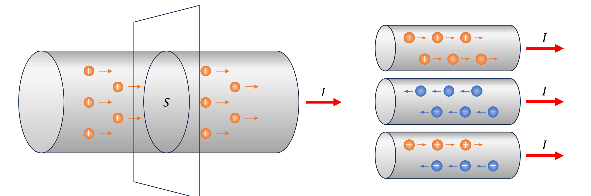
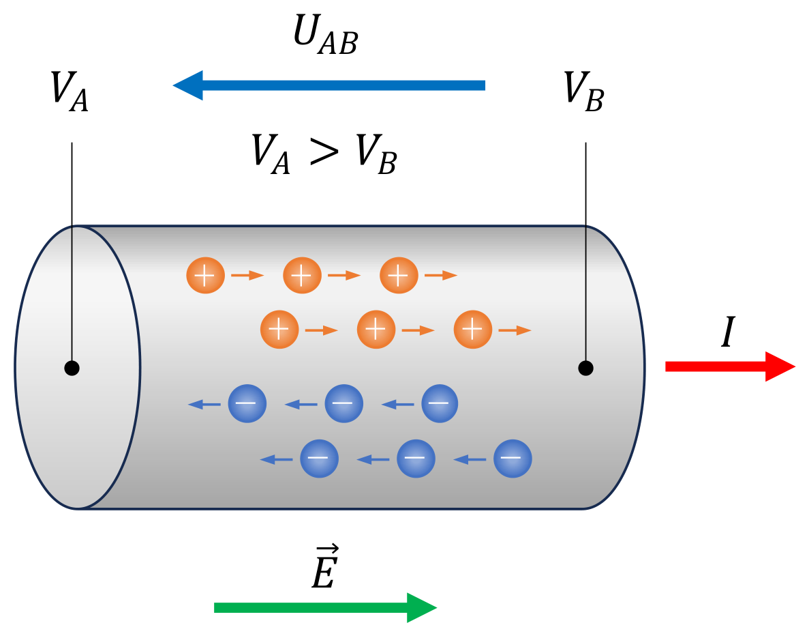
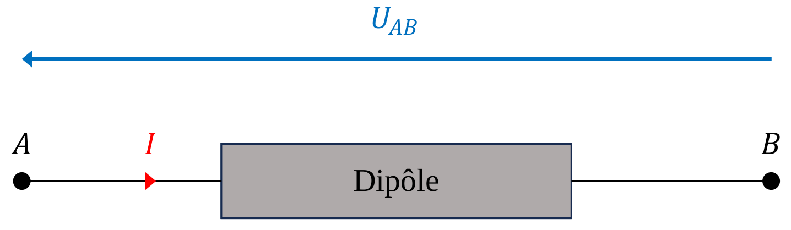
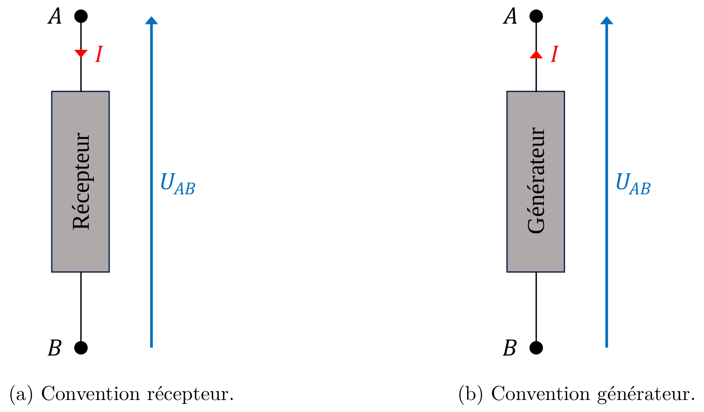
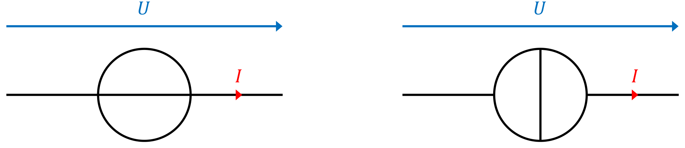

# 第 2 章　电路基础

Chapitre n°2 — Fondements des circuits électriques

中法对照讲义 · 由 LaTeX 源文件渲染

!!! info "阅读说明"

    每段先列法语原文；其下缩进、带深蓝竖条的小字号段落为中文翻译。<strong>加粗</strong>为关键词，括号内为中文释义。

    原讲义是课堂填空版，正文中的推导与例题公式留白供课上填写；本站版本已补全全部公式，便于课后复习与核对。

## 2.1　Intensité du courant électrique 电流强度

Nous avons vu la définition de la densité de courant dans le chapitre 1 (section 1.2), avec \(\vec{J}\) la densité de courant, \(n\) la densité de porteurs de charge, \(q\) leur charge, et \(\vec{v}_d\) leur vitesse de dérive :

我们在第 1 章（1.2 节）中已给出<strong>电流密度</strong>（densité de courant）的定义，其中 \(\vec{J}\) 为电流密度，\(n\) 为电荷载流子密度，\(q\) 为它们的电荷，\(\vec{v}_d\) 为它们的漂移速度：
{: .zh }

\[
\vec{J} = nq\vec{v}_d.
\]

Elle représente la charge totale qui traverse une surface élémentaire par unité de temps (C&nbsp;m\(^{-2}\)&nbsp;s\(^{-1}\) ou A&nbsp;m\(^{-2}\)). Dans l'étude des circuits électriques, nous ne nous intéressons plus à la répartition locale du courant dans un conducteur. Nous regardons uniquement la charge totale qui traverse une section du conducteur.

它表示单位时间内穿过一个面元的总电荷量（C&nbsp;m\(^{-2}\)&nbsp;s\(^{-1}\) 或 A&nbsp;m\(^{-2}\)）。在研究电路时，我们不再关心导体内部电流的局部分布，而只关注穿过导体某一截面的总电荷量。
{: .zh }

### 2.1.1　Déplacement de particules chargées 带电粒子的运动

Figure 2.1 — Déplacement de particules, intensité et sens conventionnel du courant électrique. 图 2.1：带电粒子的运动、电流强度与电流的约定方向。

Pour définir l'intensité du courant électrique (\(I\)), considérons un courant formé par un déplacement de charges. Choisissons une section du circuit et observons les charges qui la traversent (figure 2.1a). Pendant un intervalle de temps \(dt\), une charge totale \(dQ\) passe à travers cette section.

为了定义<strong>电流强度</strong>（intensité du courant électrique，\(I\)），考虑由电荷运动形成的电流。取电路的一个截面，观察穿过它的电荷（图 2.1a）。在时间间隔 \(dt\) 内，总电荷量 \(dQ\) 穿过该截面。
{: .zh }

!!! success "Définition 2.1 : intensité du courant électrique 定义 2.1：电流强度（intensité du courant électrique）"

    L'<strong>intensité</strong> \(I\) du courant électrique correspond à la charge totale \(dQ\) traversant une section par unité de temps \(dt\) (équation 2.1).

    <strong>电流强度</strong>（intensité）\(I\) 等于单位时间 \(dt\) 内穿过某一截面的总电荷量 \(dQ\)（式 2.1）。
    {: .zh }

    \[
    I = \frac{dQ}{dt}.
    \tag{2.1}
    \]

L'unité SI de l'intensité électrique est l'ampère (A). Un courant de 1&nbsp;A correspond au passage d'une charge de 1&nbsp;C à travers une section du circuit pendant 1&nbsp;s. Pour rappel, l'unité SI de la charge électrique est le coulomb (C).

电流强度的 SI 单位是<strong>安培</strong>（ampère，A）。1&nbsp;A 的电流相当于 1&nbsp;s 内有 1&nbsp;C 的电荷穿过电路的某一截面。回顾：电荷的 SI 单位是库仑（C）。
{: .zh }

\[
1\ \text{A} = 1\ \text{C}\,\text{s}^{-1}.
\]

Dans la convention traditionnelle, la direction du courant est celle du déplacement des charges positives ou la direction opposée du mouvement des charges négatives (figure 2.1b). Dans un fil métallique, les électrons transportent la charge (négative). Donc la direction du courant est opposée à celle de la direction du déplacement des électrons.

按照传统约定，电流的方向是正电荷运动的方向，也就是负电荷运动的反方向（图 2.1b）。在金属导线中，电子输运的是负电荷，因此电流方向与电子运动方向相反。
{: .zh }

!!! info "Exemple 2.2 例 2.2"

    Considérons une LED émettant une courte impulsion de lumière. Elle est traversée par un courant \(I\) d'intensité moyenne \(I = 5\)&nbsp;mA pendant un intervalle de temps \(\Delta t = 2\)&nbsp;µs.

    考虑一个发出短光脉冲的 LED。在时间间隔 \(\Delta t = 2\)&nbsp;µs 内，通过它的电流平均强度为 \(I = 5\)&nbsp;mA。
    {: .zh }

    Nous calculons la charge totale \(\Delta Q\) traversant la LED pendant l'intervalle de temps \(\Delta t\) :

    我们计算在时间间隔 \(\Delta t\) 内穿过 LED 的总电荷量 \(\Delta Q\)：
    {: .zh }

    \[
    \begin{aligned}
    \Delta Q&= I\,\Delta t \\
             &= 5 \times 10^{-3} \times 2 \times 10^{-6} \\
             &= 1 \times 10^{-8}\ \text{C} \\
             &= 10\ \text{nC}.
    \end{aligned}
    \]

    Nous pouvons aussi calculer le nombre \(N\) d'électrons traversant la LED pendant l'intervalle de temps \(\Delta t\) :

    我们还可以计算在时间间隔 \(\Delta t\) 内穿过 LED 的电子数 \(N\)：
    {: .zh }

    \[
    \begin{aligned}
    N&= \frac{\Delta Q}{e} \\
      &= \frac{1 \times 10^{-8}}{1{,}6 \times 10^{-19}} \\
      &= 6{,}25 \times 10^{10}.
    \end{aligned}
    \]

### 2.1.2　Lien entre la densité et l'intensité du courant électrique 电流密度与电流强度的关系

La densité de courant électrique \(\vec{J}\) correspond à une intensité de courant par unité de surface, et est exprimée en ampères par mètre carré (A&nbsp;m\(^{-2}\)). De même, l'intensité \(I\) du courant électrique correspond à un déplacement de charge à travers une surface \(S\) par unité de temps. Nous pouvons exprimer l'intensité du courant \(I\) en fonction de la densité de courant \(\vec{J}\). La densité de courant \(\vec{J}\) est un vecteur exprimé en fonction de grandeurs microscopiques et peut varier d'un point à l'autre. Nous obtenons l'intensité \(I\) du courant en calculant l'intégrale de la densité de courant \(\vec{J}\) sur la surface \(S\) traversée par le courant (équation 2.2).

电流密度 \(\vec{J}\) 相当于单位面积上的电流强度，单位为安培每平方米（A&nbsp;m\(^{-2}\)）。同样，电流强度 \(I\) 相当于单位时间内穿过某一曲面 \(S\) 的电荷运动量。我们可以把电流强度 \(I\) 表示为电流密度 \(\vec{J}\) 的函数。电流密度 \(\vec{J}\) 是由微观量表示的向量，可以随空间点变化。将电流密度 \(\vec{J}\) 在有电流穿过的曲面 \(S\) 上积分，就得到电流强度 \(I\)（式 2.2）。
{: .zh }

\[
I = \iint_{S} \vec{J}\cdot d\vec{S}.
\tag{2.2}
\]

Si un courant d'intensité \(I\) traverse une surface \(S\), nous pouvons aussi déterminer la densité moyenne de courant \(J\) (équation 2.3).

若电流强度 \(I\) 穿过曲面 \(S\)，我们也可以确定平均电流密度 \(J\)（式 2.3）。
{: .zh }

\[
J = \frac{I}{S}.
\tag{2.3}
\]

!!! info "Exemple 2.3 例 2.3"

    Considérons un fil conducteur cylindrique de diamètre \(d = 2{,}52\)&nbsp;mm (ou de rayon \(r = 1{,}26\)&nbsp;mm), traversé par un courant dont la densité \(\vec{J}\) est uniforme et de module \(J = 2 \times 10^{6}\)&nbsp;A&nbsp;m\(^{-2}\). Pour calculer l'intensité \(I\) du courant traversant le fil, nous devons d'abord calculer l'aire \(S\) de cette section :

    考虑一根直径为 \(d = 2{,}52\)&nbsp;mm（半径 \(r = 1{,}26\)&nbsp;mm）的圆柱形导线，通过它的电流密度 \(\vec{J}\) 均匀，大小为 \(J = 2 \times 10^{6}\)&nbsp;A&nbsp;m\(^{-2}\)。要计算通过导线的电流强度 \(I\)，首先应计算该截面的面积 \(S\)：
    {: .zh }

    \[
    S = \pi r^{2} = \pi\left(1{,}26 \times 10^{-3}\right)^{2}
      \simeq 4{,}99 \times 10^{-6}\ \text{m}^{2}.
    \]

    Le courant traversant le fil est uniforme. Nous pouvons donc calculer l'intensité \(I\) de ce courant de la manière suivante :

    通过导线的电流是均匀的。因此可以这样计算该电流的强度 \(I\)：
    {: .zh }

    \[
    \begin{aligned}
    I&= J\,S \\
      &= 2 \times 10^{6} \times 4{,}99 \times 10^{-6} \\
      &= 9{,}98\ \text{A}.
    \end{aligned}
    \]

## 2.2　Tension électrique 电压

Nous avons vu dans le chapitre 1 (section 1.1) que le mouvement des porteurs de charge mobiles est dû à la force \(\vec{F}\) exercée par le champ électrique \(\vec{E}\) sur les charges \(q\) :

我们在第 1 章（1.1 节）中看到，可移动电荷载流子的运动源于电场 \(\vec{E}\) 对电荷 \(q\) 施加的力 \(\vec{F}\)：
{: .zh }

\[
\vec{F} = q\vec{E}.
\]

Le champ électrique représente la force exercée par unité de charge (N&nbsp;C\(^{-1}\)).

电场表示单位电荷所受的力（N&nbsp;C\(^{-1}\)）。
{: .zh }

### 2.2.1　Différence de potentiel 电势差

Pour définir la tension électrique, rappelons d'abord la définition du potentiel électrique vue en électrostatique :

为了定义<strong>电压</strong>（tension électrique），先回顾静电学中<strong>电势</strong>（potentiel électrique）的定义：
{: .zh }

!!! success "Définition 2.4 : potentiel électrique 定义 2.4：电势（potentiel électrique）"

    Le <strong>potentiel électrique</strong> \(V\) est défini comme l'énergie potentielle électrique \(E_p\) par unité de charge que possède une charge \(q\) (équation 2.4).

    <strong>电势</strong>（potentiel électrique）\(V\) 定义为单位电荷 \(q\) 所具有的电势能 \(E_p\)（式 2.4）。
    {: .zh }

    \[
    V = \frac{E_p}{q}.
    \tag{2.4}
    \]

L'unité SI du potentiel électrique est le volt (V). Un potentiel électrique de 1&nbsp;V correspond à une charge de 1&nbsp;C ayant une énergie potentielle de 1&nbsp;J.

电势的 SI 单位是<strong>伏特</strong>（volt，V）。1&nbsp;V 的电势对应 1&nbsp;C 电荷具有 1&nbsp;J 的电势能。
{: .zh }

\[
1\ \text{V} = 1\ \text{J}\,\text{C}^{-1}.
\]

La force \(\vec{F}\) exercée par le champ électrique \(\vec{E}\) provoque le mouvement des porteurs de charge mobiles à l'origine du courant électrique. Lorsque deux points présentent des potentiels électriques différents, un champ électrique s'établit entre eux et exerce une force sur les charges électriques. En électrocinétique et dans l'étude des circuits électriques, ce n'est généralement pas le potentiel absolu d'un point qui est important, mais la différence de potentiel entre deux points.

电场 \(\vec{E}\) 施加的力 \(\vec{F}\) 使电荷载流子运动，从而形成电流。当两点具有不同的电势时，它们之间会建立电场，并对电荷施加力。在动电学和电路研究中，通常重要的不是某一点的绝对电势，而是两点之间的<strong>电势差</strong>（différence de potentiel）。
{: .zh }

!!! success "Définition 2.5 : tension électrique 定义 2.5：电压（tension électrique）"

    La <strong>tension électrique</strong> \(U_{AB}\) entre deux points \(A\) et \(B\) est la différence de potentiel électrique (\(V_A\) et \(V_B\) respectivement) entre ces deux points (équation 2.5). Elle correspond à la variation d'énergie potentielle électrique par unité de charge entre ces deux points.

    两点 \(A\)、\(B\) 之间的<strong>电压</strong>（tension électrique）\(U_{AB}\) 就是这两点之间的电势差（分别为 \(V_A\) 和 \(V_B\)）（式 2.5）。它等于两点之间单位电荷的电势能变化。
    {: .zh }

    \[
    U_{AB} = V_A - V_B.
    \tag{2.5}
    \]

Comme pour le potentiel électrique, l'unité SI de la tension électrique est le volt (V). Si une charge mobile \(q\) se déplace d'un point \(A\) vers un point \(B\), la variation d'énergie potentielle \(\Delta E_p\) associée est donnée par :

与电势相同，电压的 SI 单位是伏特（V）。若可移动电荷 \(q\) 从点 \(A\) 移动到点 \(B\)，相应的电势能变化 \(\Delta E_p\) 为：
{: .zh }

\[
\begin{aligned}
U_{AB}&= V_A - V_B \\
       &= \frac{E_{p,A} - E_{p,B}}{q} \\
       &= -\frac{\Delta E_p}{q}.
\end{aligned}
\]

Ainsi, si \(V_A > V_B\), et si la charge \(q\) est positive, elle minimise son énergie potentielle électrique au cours de son déplacement. Donc, les charges positives se déplacent des potentiels élevés vers les potentiels faibles (figure 2.2). Par convention, le sens du courant électrique correspond au sens de déplacement des charges positives. Le courant électrique circule donc des potentiels élevés vers les potentiels faibles.

因此，若 \(V_A > V_B\) 且电荷 \(q\) 为正，它在运动过程中会使自身的电势能最小化。所以正电荷从高电势向低电势运动（图 2.2）。按照约定，电流方向就是正电荷运动的方向。因此电流从高电势流向低电势。
{: .zh }

Figure 2.2 — La tension électrique \(U_{AB}\) correspond à la différence de potentiel \(V_A - V_B\), et établit un champ électrique \(\vec{E}\) responsable du courant d'intensité \(I\). Le courant va du potentiel élevé vers le potentiel faible. 图 2.2：电压 \(U_{AB}\) 等于电势差 \(V_A - V_B\)，它建立电场 \(\vec{E}\) 并产生强度为 \(I\) 的电流。电流从高电势流向低电势。

<i>Remarque.</i> Dans les conducteurs métalliques, les porteurs de charge mobiles sont les électrons. Ceux-ci étant chargés négativement, leur déplacement s'effectue dans le sens opposé à celui du courant conventionnel, des potentiels faibles vers les potentiels élevés (figure 2.2).

<i>注.</i> 在金属导体中，可移动的电荷载流子是电子。由于电子带负电，它们的运动方向与约定电流方向相反，即从低电势向高电势运动（图 2.2）。
{: .zh }

<i>Remarque.</i> Bien que le joule (J) soit l'unité SI de l'énergie, il existe une autre unité (qui n'est pas une unité SI) utilisée pour représenter l'énergie potentielle d'une charge élémentaire. Cette unité est l'<strong>électronvolt</strong> (eV). Une charge élémentaire \(q = e\), se déplaçant d'un point \(A\) vers un point \(B\) avec une différence de potentiel \(U_{AB}\) de 1&nbsp;V, correspond à une variation d'énergie potentielle \(\Delta E_p\) de 1&nbsp;eV, soit \(1{,}602 \times 10^{-19}\)&nbsp;J.

<i>注.</i> 尽管焦耳（J）是能量的 SI 单位，还有一个非 SI 单位常用来表示元电荷的电势能，即<strong>电子伏特</strong>（électronvolt，eV）。元电荷 \(q = e\) 在 \(U_{AB} = 1\)&nbsp;V 的电势差下从 \(A\) 移到 \(B\)，对应的电势能变化 \(\Delta E_p\) 为 1&nbsp;eV，即 \(1{,}602 \times 10^{-19}\)&nbsp;J。
{: .zh }

### 2.2.2　Lien entre la tension et le champ électrique 电压与电场的关系

Le champ électrique correspond à une force exercée par unité de charge, et est exprimé en newtons par coulomb (N&nbsp;C\(^{-1}\)) ou en volts par mètre (V&nbsp;m\(^{-1}\)) (unité SI). Nous avons vu en électrostatique le lien entre la différence de potentiel et la circulation du champ électrique \(\vec{E}\) le long d'un chemin entre un point \(A\) et un point \(B\), avec un déplacement élémentaire \(d\vec{l}\) (équation 2.6).

电场表示单位电荷所受的力，用牛顿每库仑（N&nbsp;C\(^{-1}\)）或伏特每米（V&nbsp;m\(^{-1}\)）（SI 单位）表示。我们在静电学中已经看到电势差与电场 \(\vec{E}\) 沿从 \(A\) 到 \(B\) 的路径的线积分之间的关系，其中元位移为 \(d\vec{l}\)（式 2.6）。
{: .zh }

\[
U_{AB} = \int_{A}^{B} \vec{E}\cdot d\vec{l}.
\tag{2.6}
\]

Si un champ électrique \(\vec{E}\) uniforme circule d'un point \(A\) vers un point \(B\), à une distance \(L\), alors nous pouvons déterminer la tension électrique \(U_{AB}\) (équation 2.7).

若均匀电场 \(\vec{E}\) 沿从 \(A\) 到 \(B\)、距离为 \(L\) 的路径，则可以确定电压 \(U_{AB}\)（式 2.7）。
{: .zh }

\[
\begin{aligned}
U_{AB}&= \int_{A}^{B} E\,dl \\
       &= E\,L.
\end{aligned}
\tag{2.7}
\]

## 2.3　Dipôles 二端元件

Figure 2.3 — Dipôle traversé par un courant d'intensité \(I\), avec une tension \(U_{AB}\) entre ses bornes \(A\) et \(B\). 图 2.3：强度为 \(I\) 的电流通过一个二端元件，其两端 \(A\)、\(B\) 之间的电压为 \(U_{AB}\)。

!!! success "Définition 2.6 : dipôle 定义 2.6：二端元件（dipôle）"

    Un <strong>dipôle</strong> est un composant électrique possédant deux <strong>bornes</strong> (figure 2.3).

    <strong>二端元件</strong>（dipôle）是具有两个<strong>端子</strong>（bornes）的电气元件（图 2.3）。
    {: .zh }

    - Une tension \(U\) peut être définie entre les bornes d'un dipôle.

        可在二端元件的两端定义电压 \(U\)。
        {: .zh }

    - Un courant d'intensité \(I\) peut circuler à travers un dipôle.

        强度为 \(I\) 的电流可以流过二端元件。
        {: .zh }

!!! info "Exemple 2.7 例 2.7"

    Les composants électriques suivants sont des dipôles :

    下列电气元件都是二端元件：
    {: .zh }

    - résistance（电阻）；
    - diode électroluminescente (LED)（发光二极管）；
    - pile, batterie（电池、蓄电池）；
    - moteur（电动机）；
    - condensateur（电容器）。

Il existe deux types de dipôles :

二端元件分为两类：
{: .zh }

- les <strong>dipôles récepteurs</strong>, qui absorbent de l'énergie électrique ;

    <strong>接收器</strong>（dipôles récepteurs，又称负载），吸收电能；
    {: .zh }

- les <strong>dipôles générateurs</strong>, qui fournissent de l'énergie électrique.

    <strong>发生器</strong>（dipôles générateurs，即电源），提供电能。
    {: .zh }

La tension \(U_{AB}\) aux bornes d'un dipôle et l'intensité \(I\) du courant qui traverse un dipôle sont des grandeurs orientées (figure 2.3). Il est donc nécessaire de définir des conventions permettant de représenter leur sens sur un schéma électrique (figure 2.4).

二端元件两端的电压 \(U_{AB}\) 与流过它的电流强度 \(I\) 都是有向的物理量（图 2.3）。因此必须规定<strong>约定</strong>（conventions），以便在电路图上表示它们的方向（图 2.4）。
{: .zh }

Nous choisissons les potentiels \(V_A\) et \(V_B\) aux bornes \(A\) et \(B\) respectivement, tels que \(V_A > V_B\) :

取端点 \(A\)、\(B\) 的电势分别为 \(V_A\)、\(V_B\)，且 \(V_A > V_B\)：
{: .zh }

<strong>Convention récepteur</strong> — Cette convention est utilisée pour les dipôles récepteurs (figure 2.4a).

<strong>接收器约定</strong>（convention récepteur）—— 用于接收器类二端元件（图 2.4a）。
{: .zh }

- L'intensité \(I\) du courant est orientée du potentiel élevé vers le potentiel faible.

    电流强度 \(I\) 从高电势指向低电势。
    {: .zh }

- La tension \(U_{AB}\) est orientée du potentiel faible vers le potentiel élevé.

    电压 \(U_{AB}\) 从低电势指向高电势。
    {: .zh }

<strong>Convention générateur</strong> — Cette convention est utilisée pour les dipôles générateurs (figure 2.4b).

<strong>电源约定</strong>（convention générateur）—— 用于发生器类二端元件（图 2.4b）。
{: .zh }

- L'intensité \(I\) du courant est orientée du potentiel faible vers le potentiel élevé.

    电流强度 \(I\) 从低电势指向高电势。
    {: .zh }

- La tension \(U_{AB}\) est orientée du potentiel faible vers le potentiel élevé.

    电压 \(U_{AB}\) 从低电势指向高电势。
    {: .zh }

Figure 2.4 — Sens conventionnel de la tension \(U_{AB}\) aux bornes d'un dipôle et de l'intensité \(I\) du courant traversant un dipôle. 图 2.4：二端元件两端电压 \(U_{AB}\) 与通过元件的电流强度 \(I\) 的约定方向。

## 2.4　Force électromotrice 电动势

Comme nous l'avons vu dans la section 2.2, les charges positives se déplacent naturellement des potentiels élevés vers les potentiels faibles, en perdant de l'énergie potentielle électrique, et en gagnant de l'énergie cinétique. Dans un dipôle récepteur, cette énergie peut être dissipée sous forme de chaleur, de lumière ou de travail mécanique (avec un moteur par exemple). Par exemple, lorsqu'un courant traverse un matériau conducteur, l'énergie électrique est dissipée sous forme de chaleur, due à la résistivité du matériau (section 1.3).

如 2.2 节所述，正电荷会自然地从高电势向低电势运动，失去电势能而获得动能。在接收器中，这部分能量可以以热、光或机械功（例如电动机）的形式耗散。例如，电流通过导体材料时，电能会因材料的电阻率而以热的形式耗散（1.3 节）。
{: .zh }

Pour maintenir un courant électrique dans un circuit, il est donc nécessaire de fournir de l'énergie électrique aux charges pour les ramener vers des potentiels plus élevés. Ce rôle est assuré par les générateurs, qui fournissent de l'énergie électrique, dissipée par les récepteurs.

因此，要维持电路中的电流，就必须向电荷提供电能，把它们送回较高的电势。这一角色由发生器（电源）承担：它提供电能，而电能最终被接收器耗散。
{: .zh }

!!! success "Définition 2.8 : force électromotrice 定义 2.8：电动势（force électromotrice）"

    La <strong>force électromotrice</strong> (f.é.m.) d'un générateur correspond à l'énergie fournie aux charges électriques par unité de charge pour maintenir leur circulation dans un circuit.

    发电机的<strong>电动势</strong>（force électromotrice，f.é.m.）等于为维持电荷在电路中循环而向单位电荷提供的能量。
    {: .zh }

La f.é.m. correspond à une unité d'énergie par unité de charge, soit des joules par coulomb (J&nbsp;C\(^{-1}\)). Donc, comme pour le potentiel électrique et la tension, l'unité SI de la f.é.m. est le volt (V).

电动势的单位是能量除以电荷，即焦耳每库仑（J&nbsp;C\(^{-1}\)）。因此，与电势和电压一样，电动势的 SI 单位是伏特（V）。
{: .zh }

<i>Remarque.</i> Lorsqu'un générateur ne fournit aucun courant (circuit ouvert), sa f.é.m. est égale à la tension entre ses bornes.

<i>注.</i> 当发电机不输出电流（开路）时，其电动势等于其两端的电压。
{: .zh }

## 2.5　Sources d'énergie électrique 电源

Afin de modéliser le comportement des générateurs dans un circuit électrique, nous introduisons les notions de <strong>source idéale de tension</strong> et de <strong>source idéale de courant</strong> (figure 2.5). Ces modèles simplifiés sont largement utilisés pour l'analyse des circuits électriques et électroniques.

为了对电路中发电机的行为建模，我们引入<strong>理想电压源</strong>（source idéale de tension）与<strong>理想电流源</strong>（source idéale de courant）的概念（图 2.5）。这些简化模型广泛应用于电路与电子电路分析。
{: .zh }

Figure 2.5 — Schéma des sources d'énergie électrique, fournissant une tension \(U\) et un courant d'intensité \(I\). 图 2.5：电源的电路符号，提供电压 \(U\) 与强度为 \(I\) 的电流。

<i>Remarque.</i> Les générateurs réels ne sont jamais parfaitement idéaux. Une pile, une batterie ou une alimentation électrique présentent toujours des limitations qui font que la tension ou le courant délivré dépend partiellement des conditions de fonctionnement.

<i>注.</i> 实际的发电机从来不是完全理想的。电池、蓄电池或电源总有一定限制，使输出的电压或电流部分地依赖于工作条件。
{: .zh }

### 2.5.1　Source de tension 电压源

!!! success "Définition 2.9 : source de tension idéale 定义 2.9：理想电压源（source de tension idéale）"

    Une <strong>source de tension idéale</strong> impose une tension \(U\) entre ses bornes, indépendamment de l'intensité \(I\) du courant qu'elle délivre (figure 2.5a). Elle peut fournir tout courant nécessaire pour maintenir la tension imposée.

    <strong>理想电压源</strong>（source de tension idéale）在其两端施加确定的电压 \(U\)，与它输出的电流强度 \(I\) 无关（图 2.5a）。它可以提供维持该电压所需的任意电流。
    {: .zh }

!!! info "Exemple 2.10 例 2.10"

    Les piles et les batteries sont des sources de tension.

    干电池与蓄电池都是电压源。
    {: .zh }

### 2.5.2　Source de courant 电流源

!!! success "Définition 2.11 : source de courant idéale 定义 2.11：理想电流源（source de courant idéale）"

    Une <strong>source de courant idéale</strong> impose un courant d'intensité \(I\), indépendamment de la tension \(U\) à ses bornes (figure 2.5b). Elle peut développer toute tension nécessaire pour maintenir le courant imposé.

    <strong>理想电流源</strong>（source de courant idéale）施加确定的电流强度 \(I\)，与其两端电压 \(U\) 无关（图 2.5b）。它可以产生维持该电流所需的任意电压。
    {: .zh }

!!! info "Exemple 2.12 例 2.12"

    Les panneaux solaires sont des sources de courant.

    太阳能电池板是电流源。
    {: .zh }

!!! warning "Vocabulaire clé &nbsp;&nbsp; 重点词汇 第二章核心术语"

    - <strong>intensité du courant électrique \(I\)</strong>：电流强度
    - <strong>ampère (A)</strong>：安培
    - <strong>section \(S\)</strong>：截面积
    - <strong>sens conventionnel du courant</strong>：电流的约定方向
    - <strong>tension électrique \(U_{AB}\)</strong>：电压
    - <strong>potentiel électrique \(V\)</strong>：电势
    - <strong>différence de potentiel</strong>：电势差
    - <strong>énergie potentielle \(E_p\)</strong>：势能
    - <strong>électronvolt (eV)</strong>：电子伏特
    - <strong>dipôle</strong>：二端元件
    - <strong>borne</strong>：端子
    - <strong>récepteur</strong>：接收器（负载）
    - <strong>générateur</strong>：发生器（电源）
    - <strong>convention récepteur</strong>：接收器约定
    - <strong>convention générateur</strong>：电源约定
    - <strong>force électromotrice (f.é.m.)</strong>：电动势
    - <strong>source de tension idéale</strong>：理想电压源
    - <strong>source de courant idéale</strong>：理想电流源
    - <strong>circuit ouvert</strong>：开路
    - <strong>être orienté / grandeur orientée</strong>：有向的 / 有向量
    - <strong>être proportionnel à</strong>：与……成正比
