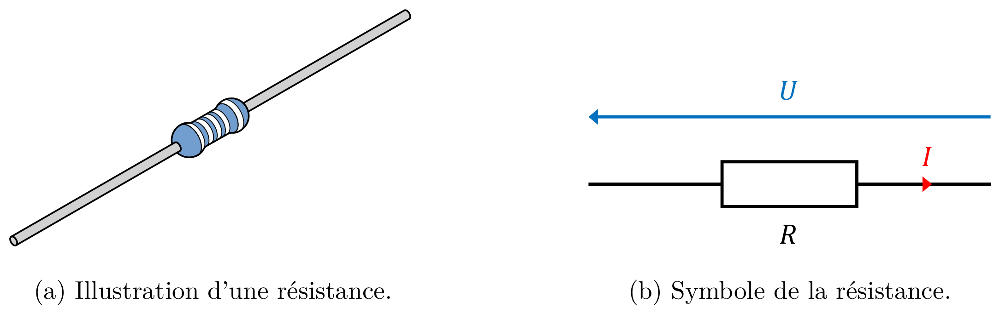

# 第 3 章　能量耗散

Chapitre n°3 — Dissipation d'énergie

中法对照讲义 · 由 LaTeX 源文件渲染

!!! info "阅读说明"

    每段先列法语原文；其下缩进、带深蓝竖条的小字号段落为中文翻译。<strong>加粗</strong>为关键词，括号内为中文释义。

    原讲义是课堂填空版，正文中的推导与例题公式留白供课上填写；本站版本已补全全部公式，便于课后复习与核对。

## 3.1　Résistance 电阻

En électrocinétique et dans l'étude des circuits électriques, le mot « résistance » a en fait deux significations :

在动电学与电路研究中，<strong>电阻</strong>（résistance）一词实际上有两层含义：
{: .zh }

- la <strong>résistance</strong> est une propriété électrique, notée \(R\), d'un conducteur ou circuit ;

    电阻是导体或电路的一种电学性质，记作 \(R\)；
    {: .zh }

- une <strong>résistance</strong> est un composant électronique utilisé dans un circuit.

    电阻器是电路中使用的电子元件。
    {: .zh }

### 3.1.1　Propriété électrique 电学性质

Nous avons vu la définition de la conductivité \(\sigma\) et de la résistivité \(\rho\) dans le chapitre 1 (section 1.3). La conductivité \(\sigma\) des matériaux dépend de leurs propriétés :

我们在第 1 章（1.3 节）中已看到<strong>电导率</strong>（conductivité）\(\sigma\) 与<strong>电阻率</strong>（résistivité）\(\rho\) 的定义。材料的电导率 \(\sigma\) 取决于其性质：
{: .zh }

\[
\sigma = \frac{1}{\rho} = \frac{ne^{2}\tau}{m_e}.
\]

L'unité SI de la conductivité est le siemens par mètre (S&nbsp;m\(^{-1}\)). L'unité SI de la résistivité est l'ohm mètre (\(\Omega\)&nbsp;m).

电导率的 SI 单位是西门子每米（S&nbsp;m\(^{-1}\)）。电阻率的 SI 单位是欧姆米（\(\Omega\)&nbsp;m）。
{: .zh }

La conductivité \(\sigma\) et la résistivité \(\rho\) sont des caractéristiques microscopiques des matériaux conducteurs. Lorsque nous étudions des circuits électriques, nous nous intéressons à leurs propriétés macroscopiques.

电导率 \(\sigma\) 与电阻率 \(\rho\) 是导体材料的微观特征。研究电路时，我们关心的是它们的宏观性质。
{: .zh }

Pour définir la résistance \(R\) d'un conducteur, considérons un conducteur de longueur \(L\) et de section \(S\), composé d'un matériau de résistivité \(\rho\).

为定义导体的<strong>电阻</strong>（résistance）\(R\)，考虑一段长度为 \(L\)、截面积为 \(S\)、由电阻率为 \(\rho\) 的材料构成的导体。
{: .zh }

!!! success "Définition 3.1 : résistance d'un conducteur 定义 3.1：导体的电阻（résistance d'un conducteur）"

    La <strong>résistance</strong> \(R\) d'un conducteur de résistivité \(\rho\) est proportionnelle à sa longueur \(L\), et inversement proportionnelle à sa section \(S\) (équation 3.1).

    <strong>电阻</strong>（résistance）\(R\) 与导体的长度 \(L\) 成正比，与其截面积 \(S\) 成反比（式 3.1）。
    {: .zh }

    \[
    R = \rho\frac{L}{S}.
    \tag{3.1}
    \]

L'unité SI de la résistance est l'ohm (\(\Omega\)).

电阻的 SI 单位是<strong>欧姆</strong>（ohm，\(\Omega\)）。
{: .zh }

!!! info "Exemple 3.2 例 3.2"

    Choisissons un fil conducteur (cylindrique) composé de cuivre, de longueur \(L = 1{,}8\)&nbsp;m et de section \(S = 5\)&nbsp;mm\(^{2}\). Rappelons la résistivité \(\rho\) du cuivre (tableau 1.1) : \(\rho = 1{,}7 \times 10^{-8}\,\Omega\)&nbsp;m. Nous pouvons calculer la résistance totale \(R\) du fil :

    取一根铜制（圆柱形）导线，长度 \(L = 1{,}8\)&nbsp;m，截面积 \(S = 5\)&nbsp;mm\(^{2}\)。回顾铜的电阻率（表 1.1）：\(\rho = 1{,}7 \times 10^{-8}\,\Omega\)&nbsp;m。我们可以计算导线的总电阻 \(R\)：
    {: .zh }

    \[
    \begin{aligned}
    R&= \frac{\rho L}{S} \\
      &= \frac{1{,}7 \times 10^{-8} \times 1{,}8}{5 \times 10^{-6}} \\
      &= 6{,}12 \times 10^{-3}\ \Omega \\
      &= 6{,}12\ \text{m}\Omega.
    \end{aligned}
    \]

Par opposition à la résistance \(R\), la <strong>conductance</strong> notée \(G\) est l'inverse de la résistance : \(G = \frac{1}{R}\). L'unité SI de la conductance est le siemens (S). La conductance est liée à la résistance, comme la conductivité est liée à la résistivité (équation 3.2).

与电阻 \(R\) 相对，<strong>电导</strong>（conductance）记作 \(G\)，是电阻的倒数：\(G = \frac{1}{R}\)。电导的 SI 单位是<strong>西门子</strong>（siemens，S）。电导与电阻的关系，正如电导率与电阻率的关系（式 3.2）。
{: .zh }

\[
G = \frac{1}{R} = \frac{\sigma S}{L}.
\tag{3.2}
\]

### 3.1.2　Composant électrique 电气元件

Figure 3.1 — Le composant « résistance ». 图 3.1：“电阻器”元件。

Une <strong>résistance</strong> est un composant électrique (figure 3.1) conçu pour présenter une valeur de résistance électrique \(R\) déterminée. En s'opposant au passage du courant, elle permet par exemple de limiter l'intensité du courant circulant dans un circuit et de dissiper de l'énergie sous forme de chaleur. Les résistances sont parmi les composants les plus utilisés en électronique. Leur valeur est indiquée en ohms (\(\Omega\)).

<strong>电阻器</strong>（résistance）是一种电气元件（图 3.1），用于提供确定的电阻值 \(R\)。它阻碍电流通过，因此可以用来限制电路中的电流强度，并把电能以热的形式耗散。电阻器是电子学中最常用的元件之一，其阻值以欧姆（\(\Omega\)）标示。
{: .zh }

!!! info "Exemple 3.3 例 3.3"

    Considérons un fil composé de nichrome, de diamètre \(d = 0{,}2\)&nbsp;mm. La section \(S\) du fil est \(S = \pi r^{2} \simeq 0{,}0314\)&nbsp;mm\(^{2}\). Rappelons aussi la résistivité \(\rho\) du nichrome (tableau 1.1) : \(\rho = 1{,}1 \times 10^{-6}\,\Omega\)&nbsp;m. Nous souhaitons fabriquer une résistance avec une valeur \(R = 10\,\Omega\). Nous devons donc choisir la longueur \(L\) du fil permettant d'obtenir cette résistance \(R\) :

    考虑一根镍铬合金导线，直径 \(d = 0{,}2\)&nbsp;mm。导线截面积 \(S = \pi r^{2} \simeq 0{,}0314\)&nbsp;mm\(^{2}\)。再回顾镍铬合金的电阻率（表 1.1）：\(\rho = 1{,}1 \times 10^{-6}\,\Omega\)&nbsp;m。我们希望制作一个阻值为 \(R = 10\,\Omega\) 的电阻器，因此需要选择能得到该电阻 \(R\) 的导线长度 \(L\)：
    {: .zh }

    \[
    \begin{aligned}
    L&= \frac{R S}{\rho} \\
      &= \frac{10 \times 0{,}0314 \times 10^{-6}}{1{,}1 \times 10^{-6}} \\
      &= 2{,}85 \times 10^{-1}\ \text{m} \\
      &= 0{,}285\ \text{m}.
    \end{aligned}
    \]

    Notons que cette longueur \(L\) peut être élevée par rapport à la taille de la plupart des circuits électriques. C'est pourquoi en pratique, une telle longueur de fil est souvent enroulée autour d'un support isolant afin d'obtenir une résistance dite « bobinée ».

    注意，相对于大多数电路的尺寸，这个长度 \(L\) 可能很大。因此在实际中，这样长的导线常被绕在绝缘支架上，制成所谓的“绕线电阻”（résistance bobinée）。
    {: .zh }

    Notons aussi que nous n'avons pas choisi le cuivre comme matériau conducteur. En effet, nous avons choisi un matériau avec une résistivité \(\rho\) plus élevée que celle du cuivre. Si nous avions choisi un fil composé de cuivre, la longueur \(L\) du fil permettant d'obtenir une résistance \(R = 10\,\Omega\) serait :

    还要注意，我们没有选择铜作为导体材料，而是选择了电阻率 \(\rho\) 高于铜的材料。若选用铜导线，要得到 \(R = 10\,\Omega\) 所需的导线长度 \(L\) 将是：
    {: .zh }

    \[
    \begin{aligned}
    L&= \frac{R S}{\rho} \\
      &= \frac{10 \times 0{,}0314 \times 10^{-6}}{1{,}7 \times 10^{-8}} \\
      &= 1{,}85 \times 10^{1}\ \text{m}.
    \end{aligned}
    \]

    Cette longueur est beaucoup plus difficile à placer sur un circuit électrique.

    这样的长度很难布置在电路上。
    {: .zh }

## 3.2　Loi d'Ohm 欧姆定律

Nous avons vu dans le chapitre 2 (section 2.2) qu'une différence de potentiel électrique peut mettre des porteurs de charge en mouvement et engendrer un courant électrique.

我们在第 2 章（2.2 节）中看到，电势差可以使电荷载流子运动并产生电流。
{: .zh }

Nous avons aussi vu dans le chapitre 1 (section 1.3) que la densité de courant est proportionnelle au champ électrique dans les matériaux conducteurs. Le coefficient de proportionnalité est la conductivité.

我们还在第 1 章（1.3 节）中看到，在导体材料中电流密度与电场成正比，比例系数就是电导率。
{: .zh }

!!! success "Définition 3.4 : conducteur ohmique 定义 3.4：欧姆导体（conducteur ohmique）"

    Un <strong>conducteur ohmique</strong> est un conducteur pour lequel la tension \(U\) à ses bornes est proportionnelle à l'intensité \(I\) du courant qui le traverse.

    <strong>欧姆导体</strong>（conducteur ohmique）是其两端电压 \(U\) 与通过它的电流强度 \(I\) 成正比的导体。
    {: .zh }

Ces conducteurs ohmiques respectent la <strong>loi d'Ohm</strong>, qui est une conséquence de la loi d'Ohm microscopique.

这些欧姆导体遵守<strong>欧姆定律</strong>（loi d'Ohm），而欧姆定律是微观欧姆定律的推论。
{: .zh }

!!! success "Définition 3.5 : loi d'Ohm 定义 3.5：欧姆定律（loi d'Ohm）"

    La tension \(U\) aux bornes d'un conducteur ohmique est proportionnelle à l'intensité \(I\) du courant qui le traverse. Le coefficient de proportionnalité entre la tension \(U\) et l'intensité \(I\) du courant est la résistance \(R\) du conducteur (équation 3.3).

    欧姆导体两端的电压 \(U\) 与通过它的电流强度 \(I\) 成正比。电压 \(U\) 与电流强度 \(I\) 之间的比例系数就是导体的电阻 \(R\)（式 3.3）。
    {: .zh }

    \[
    U = R\,I.
    \tag{3.3}
    \]

La tension électrique \(U\) étant la cause du mouvement des charges à l'origine du courant, la loi d'Ohm est souvent utilisée pour calculer l'intensité \(I\) du courant en fonction de la tension \(U\) aux bornes d'un conducteur ohmique et de sa résistance \(R\) :

电压 \(U\) 是电荷运动、从而产生电流的原因，因此欧姆定律常用来由欧姆导体两端的电压 \(U\) 及其电阻 \(R\) 计算电流强度 \(I\)：
{: .zh }

\[
I = \frac{U}{R}.
\]

!!! demo ""

    <strong>Démonstration. &nbsp;&nbsp; 证明</strong>

    Considérons un matériau ohmique homogène de longueur \(L\), de section \(S\), de conductivité \(\sigma\) et de résistivité \(\rho = \frac{1}{\sigma}\). Rappelons la loi d'Ohm microscopique qui lie le champ électrique \(\vec{E}\) et la densité de courant \(\vec{J}\) :

    考虑一段均匀欧姆材料，长度 \(L\)、截面积 \(S\)、电导率 \(\sigma\)、电阻率 \(\rho = \frac{1}{\sigma}\)。回顾联系电场 \(\vec{E}\) 与电流密度 \(\vec{J}\) 的微观欧姆定律：
    {: .zh }

    \[
    \begin{aligned}
    \vec{J}&= \sigma\vec{E}, \\
    \vec{E}&= \rho\vec{J}.
    \end{aligned}
    \]

    Nous pouvons déterminer l'intensité \(I\) du courant traversant le conducteur homogène en fonction de la densité \(\vec{J}\) du courant et de la section \(S\) du conducteur :

    我们可以把通过均匀导体的电流强度 \(I\) 表示为电流密度 \(\vec{J}\) 与导体截面积 \(S\) 的函数：
    {: .zh }

    \[
    \begin{aligned}
    I&= J\,S \\
      &= \sigma E\,S.
    \end{aligned}
    \]

    Nous avons donc :

    于是：
    {: .zh }

    \[
    J = \frac{I}{S}.
    \]

    Nous pouvons aussi déterminer la tension \(U\) aux bornes du conducteur homogène en fonction du champ électrique \(\vec{E}\) et de la longueur \(L\) du conducteur :

    我们还可以把均匀导体两端的电压 \(U\) 表示为电场 \(\vec{E}\) 与导体长度 \(L\) 的函数：
    {: .zh }

    \[
    \begin{aligned}
    U_{AB}&= E\,L \\
           &= \rho J\,L.
    \end{aligned}
    \]

    Nous avons donc :

    于是：
    {: .zh }

    \[
    E = \frac{U_{AB}}{L}.
    \]

    Enfin, nous pouvons déterminer la résistance \(R\) du conducteur en fonction de sa résistivité \(\rho\), de sa longueur \(L\) et de sa section \(S\) :

    最后，我们可以把导体的电阻 \(R\) 表示为电阻率 \(\rho\)、长度 \(L\) 与截面积 \(S\) 的函数：
    {: .zh }

    \[
    R = \rho\frac{L}{S}.
    \]

    Nous avons donc :

    于是：
    {: .zh }

    \[
    \rho = \frac{R S}{L}.
    \]

    Ainsi, à partir de la loi d'Ohm microscopique, nous pouvons calculer la tension \(U\) en fonction de la résistance \(R\) et de l'intensité \(I\) du courant :

    于是，从微观欧姆定律出发，我们可以由电阻 \(R\) 与电流强度 \(I\) 计算电压 \(U\)：
    {: .zh }

    \[
    \begin{aligned}
    E&= \rho J = \frac{\rho}{S}I, \\
    U&= E\,L = \frac{\rho L}{S}I = R\,I.
    \end{aligned}
    \]

    Nous retrouvons bien la loi d'Ohm.

    我们确实重新得到了欧姆定律。
    {: .zh }

    
∎

La conductance \(G\) étant l'inverse de la résistance \(R\), la loi d'Ohm lie aussi la conductance \(G\) à la tension \(U\) et à l'intensité du courant \(I\) (équation 3.4).

由于电导 \(G\) 是电阻 \(R\) 的倒数，欧姆定律也把电导 \(G\) 与电压 \(U\)、电流强度 \(I\) 联系起来（式 3.4）。
{: .zh }

\[
I = G\,U.
\tag{3.4}
\]

<i>Remarque.</i> La loi d'Ohm n'est pas universelle. Les métaux comme le cuivre, l'aluminium, l'argent ou l'or se comportent comme des conducteurs ohmiques. Les résistances sont aussi composées de matériaux conducteurs ohmiques. En revanche, certains composants, comme les diodes, ne présentent pas une relation de proportionnalité entre la tension et le courant. Ces composants ne respectent pas la loi d'Ohm.

<i>注.</i> 欧姆定律并非普遍适用。铜、铝、银、金等金属表现为欧姆导体，电阻器也由欧姆导体材料制成。相反，某些元件（如二极管）的电压与电流之间不存在正比关系，这类元件不遵守欧姆定律。
{: .zh }

!!! info "Exemple 3.6 例 3.6"

    Considérons de nouveau un fil conducteur composé de cuivre, de longueur \(L = 1{,}8\)&nbsp;m et de section \(S = 5\)&nbsp;mm\(^{2}\). Nous avons déjà calculé sa résistance \(R\) (\(R = 6{,}12\)&nbsp;m\(\Omega\)). Supposons un courant d'intensité \(I = 10\)&nbsp;A traversant ce fil. Nous pouvons donc calculer la tension \(U\) aux extrémités du fil :

    再次考虑一根铜导线，长度 \(L = 1{,}8\)&nbsp;m，截面积 \(S = 5\)&nbsp;mm\(^{2}\)。我们已算出其电阻 \(R\)（\(R = 6{,}12\)&nbsp;m\(\Omega\)）。设通过该导线的电流强度 \(I = 10\)&nbsp;A，于是可以计算导线两端的电压 \(U\)：
    {: .zh }

    \[
    \begin{aligned}
    U&= R\,I \\
      &= 6{,}12 \times 10^{-3} \times 10 \\
      &= 6{,}12 \times 10^{-2}\ \text{V} \\
      &= 61{,}2\ \text{mV}.
    \end{aligned}
    \]

!!! info "Exemple 3.7 例 3.7"

    Considérons une source de tension idéale imposant une tension \(U = 1{,}5\)&nbsp;V aux bornes d'un conducteur ohmique. Nous souhaitons obtenir un courant d'intensité \(I = 30\)&nbsp;mA. Nous calculons donc la valeur \(R\) de la résistance devant être utilisée pour obtenir ce courant :

    考虑一个理想电压源，在欧姆导体两端施加电压 \(U = 1{,}5\)&nbsp;V。我们希望得到强度 \(I = 30\)&nbsp;mA 的电流，因此计算为得到该电流所需的电阻值 \(R\)：
    {: .zh }

    \[
    \begin{aligned}
    R&= \frac{U}{I} \\
      &= \frac{1{,}5}{30 \times 10^{-3}} \\
      &= 50\ \Omega.
    \end{aligned}
    \]

## 3.3　Puissance électrique et effet Joule 电功率与焦耳效应

### 3.3.1　Puissance électrique 电功率

Lorsqu'un courant électrique traverse un dipôle, celui-ci peut fournir de l'énergie électrique au circuit (cas d'un générateur) ou, au contraire, convertir cette énergie sous une autre forme, par exemple en chaleur, en lumière ou en mouvement. La <strong>puissance électrique</strong> caractérise la quantité d'énergie fournie ou dissipée par unité de temps.

当电流通过一个二端元件时，它可能向电路提供电能（发生器的情况），也可能把电能转化为其他形式，例如热、光或运动。<strong>电功率</strong>（puissance électrique）表征单位时间内提供或耗散的能量。
{: .zh }

!!! success "Définition 3.8 : puissance électrique 定义 3.8：电功率（puissance électrique）"

    La <strong>puissance électrique</strong> \(P\) dissipée ou fournie par un dipôle correspond au produit de la tension \(U\) aux bornes du dipôle et du courant d'intensité \(I\) le traversant (équation 3.5).

    二端元件耗散或提供的<strong>电功率</strong>（puissance électrique）\(P\) 等于其两端电压 \(U\) 与通过它的电流强度 \(I\) 的乘积（式 3.5）。
    {: .zh }

    \[
    P = U\,I.
    \tag{3.5}
    \]

L'unité SI de la puissance est le watt (W). Cette unité équivaut à des joules par seconde (J&nbsp;s\(^{-1}\)). Une puissance de 1&nbsp;W correspond à une énergie de 1&nbsp;J fournie ou dissipée pendant 1&nbsp;s. Pour rappel, l'unité SI de l'énergie est le joule (J).

功率的 SI 单位是<strong>瓦特</strong>（watt，W），等价于焦耳每秒（J&nbsp;s\(^{-1}\)）。1&nbsp;W 的功率相当于 1&nbsp;s 内提供或耗散 1&nbsp;J 的能量。回顾：能量的 SI 单位是焦耳（J）。
{: .zh }

!!! demo ""

    <strong>Démonstration. &nbsp;&nbsp; 证明</strong>

    Considérons une quantité de charge \(dQ\) traversant un dipôle pendant un intervalle de temps \(dt\). Cette charge subit une variation d'énergie potentielle \(dE\). D'après les définitions de la tension \(U\) et de l'intensité \(I\) du courant, nous avons :

    考虑在时间间隔 \(dt\) 内穿过二端元件的电荷量 \(dQ\)。这部分电荷经历电势能变化 \(dE\)。根据电压 \(U\) 与电流强度 \(I\) 的定义，有：
    {: .zh }

    \[
    \begin{aligned}
    U&= \frac{dE}{dQ}, \\
    I&= \frac{dQ}{dt}.
    \end{aligned}
    \]

    En multipliant ces deux relations, nous obtenons :

    将这两式相乘，得到：
    {: .zh }

    \[
    \begin{aligned}
    U\,I&= \frac{dE}{dQ}\frac{dQ}{dt} \\
         &= \frac{dE}{dt}.
    \end{aligned}
    \]

    Nous obtenons bien une énergie par unité de temps, soit la puissance électrique \(P = U\,I\).

    我们确实得到了单位时间的能量，即电功率 \(P = U\,I\)。
    {: .zh }

    
∎

<i>Remarque.</i> Bien que le joule (J) soit l'unité SI de l'énergie, il existe une autre unité (qui n'est pas une unité SI) souvent utilisée en électricité, pour mesurer la consommation d'énergie électrique d'un domicile par exemple. Cette unité est le <strong>kilo watt heure</strong> (kW&nbsp;h). Une énergie \(E\) de 1&nbsp;kW&nbsp;h correspond à une puissance \(P\) de 1&nbsp;kW consommée (ou dissipée) pendant 1&nbsp;h, soit 3600&nbsp;kJ.

<i>注.</i> 尽管焦耳（J）是能量的 SI 单位，电学中还常用一个非 SI 单位来计量家庭用电量，即<strong>千瓦时</strong>（kilowattheure，kW&nbsp;h）。1&nbsp;kW&nbsp;h 的能量 \(E\) 相当于 1&nbsp;kW 的功率持续 1&nbsp;h 所消耗（或耗散）的能量，即 3600&nbsp;kJ。
{: .zh }

Le signe de la puissance \(P\) dépend de la convention (récepteur ou générateur) utilisée pour chaque dipôle :

功率 \(P\) 的正负取决于每个二端元件所采用的约定（接收器或电源）：
{: .zh }

<strong>Convention récepteur</strong> — La puissance \(P\) est positive lorsque le dipôle reçoit de l'énergie électrique. Elle est négative lorsqu'il fournit de l'énergie électrique.

<strong>接收器约定</strong>—— 当二端元件接收电能时，功率 \(P\) 为正；当它提供电能时，功率为负。
{: .zh }

<strong>Convention générateur</strong> — La puissance \(P\) est positive lorsque le dipôle fournit de l'énergie électrique. Elle est négative lorsqu'il reçoit de l'énergie électrique.

<strong>电源约定</strong>—— 当二端元件提供电能时，功率 \(P\) 为正；当它接收电能时，功率为负。
{: .zh }

Dans une convention donnée, une puissance négative n'est donc pas une puissance « impossible » : elle indique simplement que le dipôle échange de l'énergie dans le sens opposé à celui associé à la convention choisie.

在给定约定下，负功率并不是“不可能”的功率：它只表示二端元件交换能量的方向与所选约定对应的方向相反。
{: .zh }

### 3.3.2　Puissance dissipée par une résistance 电阻耗散的功率

Dans le cas d'un conducteur ohmique avec une résistance \(R\), il est possible de calculer la puissance électrique dissipée en fonction de la résistance \(R\) (équation 3.6). Cette puissance est dissipée sous forme de chaleur : c'est l'<strong>effet Joule</strong>.

对于电阻为 \(R\) 的欧姆导体，可以把耗散的电功率表示为电阻 \(R\) 的函数（式 3.6）。这部分功率以热的形式耗散，这就是<strong>焦耳效应</strong>（effet Joule）。
{: .zh }

\[
P = R\,I^{2} = \frac{U^{2}}{R}.
\tag{3.6}
\]

!!! info "Exemple 3.9 例 3.9"

    Considérons de nouveau un fil conducteur composé de cuivre, de longueur \(L = 1{,}8\)&nbsp;m, de section \(S = 5\)&nbsp;mm\(^{2}\), traversé par un courant d'intensité \(I = 10\)&nbsp;A. Nous pouvons calculer la puissance \(P\) dissipée par le fil par effet Joule :

    再次考虑一根铜导线，长度 \(L = 1{,}8\)&nbsp;m，截面积 \(S = 5\)&nbsp;mm\(^{2}\)，通过的电流强度 \(I = 10\)&nbsp;A。我们可以计算导线因焦耳效应耗散的功率 \(P\)：
    {: .zh }

    \[
    \begin{aligned}
    P&= R\,I^{2} \\
      &= 6{,}12 \times 10^{-3} \times 10^{2} \\
      &= 6{,}12 \times 10^{-1}\ \text{W}.
    \end{aligned}
    \]

    Supposons maintenant que ce courant d'intensité \(I\) traverse le fil pendant un intervalle de temps \(\Delta t = 1\)&nbsp;h. Nous pouvons calculer l'énergie \(E\) dissipée par le fil par effet Joule pendant l'intervalle de temps \(\Delta t\) :

    现在假设该强度为 \(I\) 的电流通过导线的时间为 \(\Delta t = 1\)&nbsp;h。我们可以计算在 \(\Delta t\) 内导线因焦耳效应耗散的能量 \(E\)：
    {: .zh }

    \[
    \begin{aligned}
    E&= P\,\Delta t \\
      &= 6{,}12 \times 10^{-1} \times 3600 \\
      &= 2{,}20 \times 10^{3}\ \text{J} \\
      &\simeq 2{,}2\ \text{kJ}.
    \end{aligned}
    \]

### 3.3.3　Puissance stockée et restituée par un condensateur 电容器储存与释放的功率

Dans le cas d'un condensateur de capacité \(C\), la puissance \(P\) correspond à la variation temporelle de l'énergie \(E\) stockée ou restituée. En électrostatique, nous avons vu la charge \(Q\) accumulée dans un condensateur en fonction de sa capacité \(C\) et de la tension \(U\) à ses bornes (équation 3.7).

对于电容为 \(C\) 的电容器，功率 \(P\) 对应于储存或释放的能量 \(E\) 随时间的变化。在静电学中，我们已经看到电容器中积累的电荷 \(Q\) 与其电容 \(C\) 及两端电压 \(U\) 的关系（式 3.7）。
{: .zh }

\[
Q = C\,U.
\tag{3.7}
\]

Nous avons aussi vu l'énergie \(E\) stockée dans un condensateur en fonction de la charge \(Q\) et de la capacité \(C\) du condensateur (équation 3.8).

我们还看到电容器中储存的能量 \(E\) 与其电荷 \(Q\) 及电容 \(C\) 的关系（式 3.8）。
{: .zh }

\[
E = \frac{Q^{2}}{2C} = \frac{1}{2}C\,U^{2}.
\tag{3.8}
\]

!!! demo ""

    <strong>Démonstration. &nbsp;&nbsp; 证明</strong>

    La puissance \(P\) correspond à une variation d'énergie par unité de temps :

    功率 \(P\) 等于单位时间内能量的变化：
    {: .zh }

    \[
    \begin{aligned}
    P&= \frac{dE}{dt} \\
      &= \frac{d}{dt}\left(\frac{Q^{2}}{2C}\right) \\
      &= \frac{Q}{C}\frac{dQ}{dt} \\
      &= U\,I.
    \end{aligned}
    \]

    Nous obtenons bien la puissance électrique \(P = U\,I\).

    我们确实得到了电功率 \(P = U\,I\)。
    {: .zh }

    
∎

Considérons un condensateur en convention récepteur. Nous supposons que la tension \(U\) à ses bornes est positive. Nous pouvons observer deux régimes de fonctionnement :

考虑采用接收器约定的电容器。设其两端电压 \(U\) 为正。我们可以观察到两种工作状态：
{: .zh }

<strong>Stockage d'énergie</strong> — Le courant d'intensité \(I\) est positif. La puissance \(P\) est positive. Le condensateur reçoit de l'énergie électrique (\(E\) augmente).

<strong>能量储存</strong>（stockage d'énergie）—— 电流强度 \(I\) 为正，功率 \(P\) 为正，电容器接收电能（\(E\) 增大）。
{: .zh }

<strong>Restitution d'énergie</strong> — Le courant d'intensité \(I\) est négatif. La puissance \(P\) est négative. Le condensateur fournit de l'énergie électrique (\(E\) diminue).

<strong>能量释放</strong>（restitution d'énergie）—— 电流强度 \(I\) 为负，功率 \(P\) 为负，电容器提供电能（\(E\) 减小）。
{: .zh }

!!! warning "Vocabulaire clé &nbsp;&nbsp; 重点词汇 第三章核心术语"

    - <strong>résistance (grandeur) \(R\)</strong>：电阻（物理量）
    - <strong>résistance (composant)</strong>：电阻器（元件）
    - <strong>conductance \(G\)</strong>：电导
    - <strong>siemens (S)</strong>：西门子
    - <strong>ohm (\(\Omega\))</strong>：欧姆
    - <strong>conducteur ohmique</strong>：欧姆导体
    - <strong>loi d'Ohm</strong>：欧姆定律
    - <strong>résistance bobinée</strong>：绕线电阻
    - <strong>puissance électrique \(P\)</strong>：电功率
    - <strong>watt (W)</strong>：瓦特
    - <strong>effet Joule</strong>：焦耳效应
    - <strong>kilowattheure (kW&nbsp;h)</strong>：千瓦时
    - <strong>dissiper de l'énergie</strong>：耗散能量
    - <strong>stocker / restituer de l'énergie</strong>：储存 / 释放能量
    - <strong>condensateur</strong>：电容器
    - <strong>capacité \(C\)</strong>：电容
    - <strong>convention récepteur / générateur</strong>：接收器约定 / 电源约定
    - <strong>variation temporelle</strong>：随时间的变化
    - <strong>être proportionnel à</strong>：与……成正比
