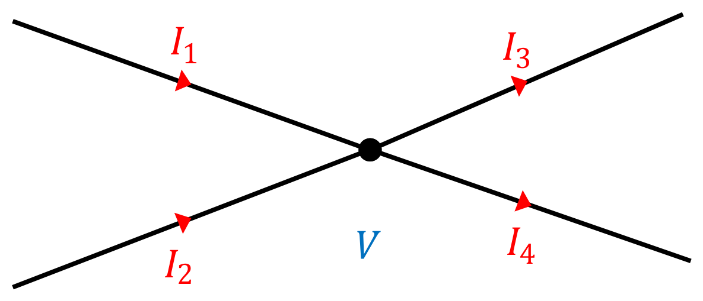
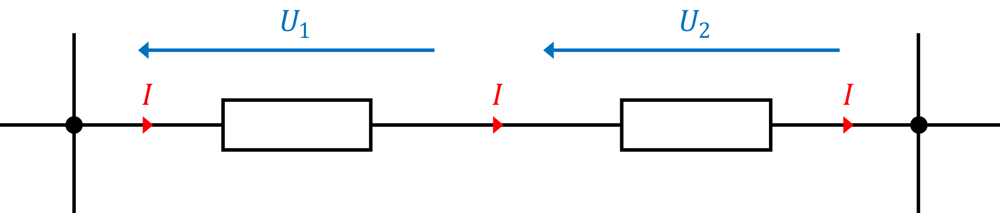
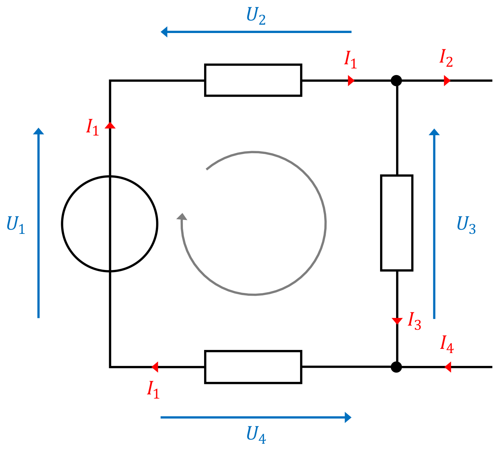
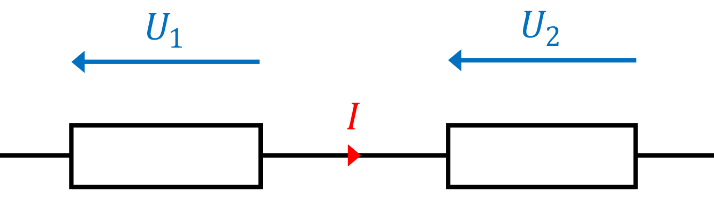
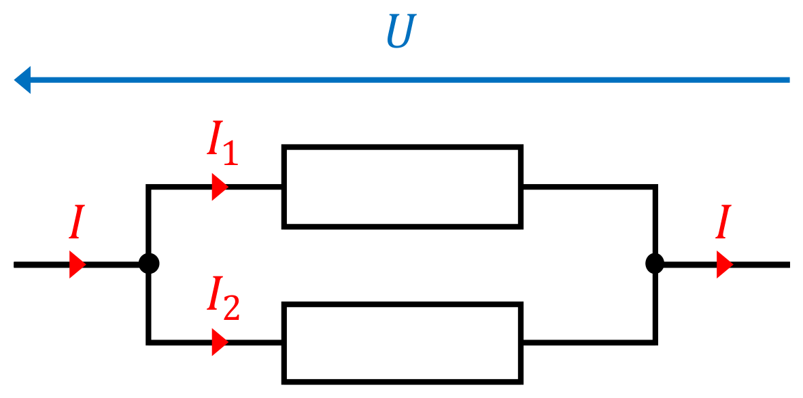
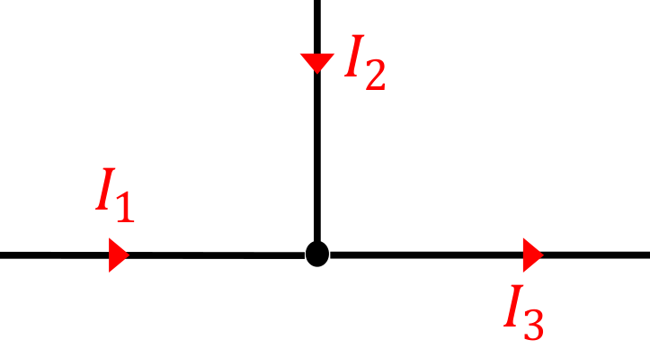
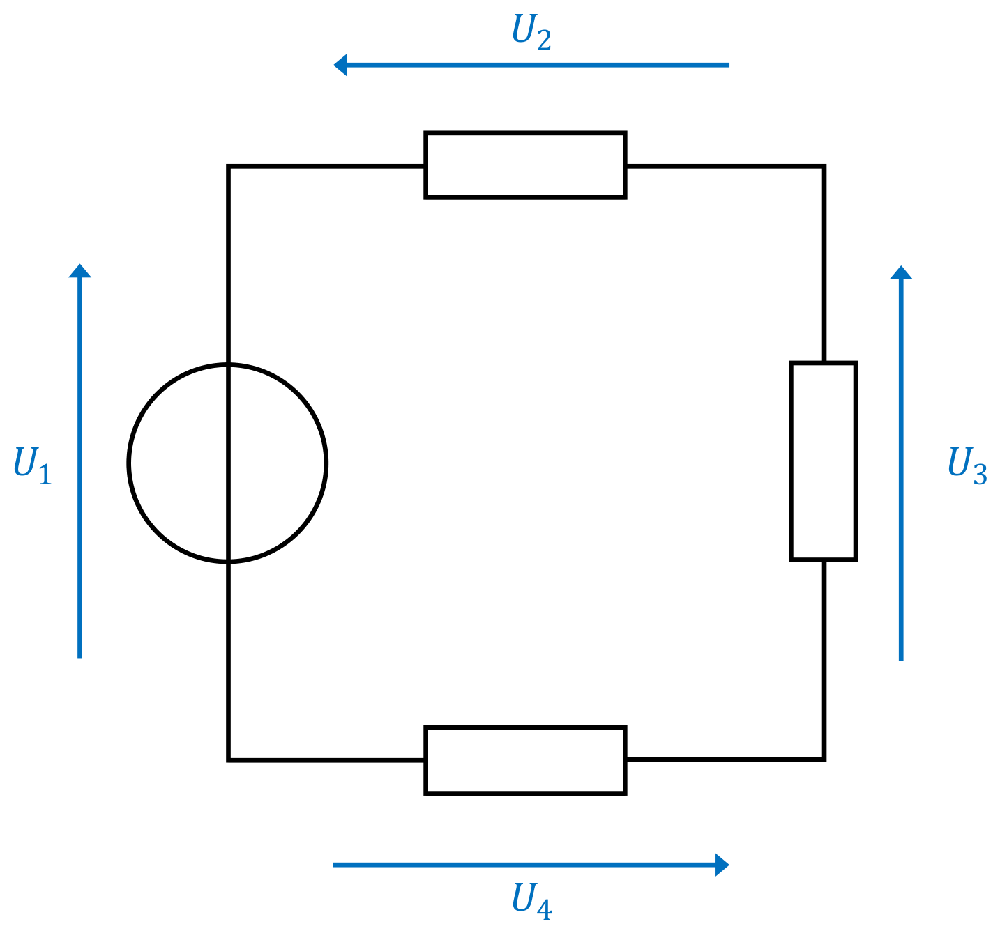

# 第 4 章　电路结构

Chapitre n°4 — Structure des circuits électriques

中法对照讲义 · 由 LaTeX 源文件渲染

!!! info "阅读说明"

    每段先列法语原文；其下缩进、带深蓝竖条的小字号段落为中文翻译。<strong>加粗</strong>为关键词，括号内为中文释义。

    原讲义是课堂填空版，正文中的推导与例题公式留白供课上填写；本站版本已补全全部公式，便于课后复习与核对。

## 4.1　Nœuds, branches et mailles 节点、支路与回路

Nous avons vu dans le chapitre 2 (section 2.3) la notion de dipôles. Dans un circuit électrique, les différents dipôles (résistances, générateurs, etc.) sont reliés entre eux par des conducteurs afin de former un réseau électrique. L'étude de la structure de ce réseau permet d'identifier des éléments caractéristiques, tels que les nœuds, les branches et les mailles, qui jouent un rôle fondamental dans l'analyse des circuits.

我们在第 2 章（2.3 节）中已经了解了二端元件的概念。在电路中，各种二端元件（电阻、电源等）通过导体相互连接，构成电网络。研究该网络的结构可以识别出<strong>节点</strong>（nœuds）、<strong>支路</strong>（branches）和<strong>回路</strong>（mailles）等特征要素，它们在电路分析中起基础性作用。
{: .zh }

### 4.1.1　Nœuds 节点

Figure 4.1 — Un nœud (avec un même potentiel électrique \(V\)) au croisement de quatre branches. 图 4.1：四条支路交叉处的一个节点（具有相同的电势 \(V\)）。

!!! success "Définition 4.1 : nœud 定义 4.1：节点（nœud）"

    Un <strong>nœud</strong> est un point (ou une région conductrice sans résistances ni autres composants) d'un circuit où trois branches ou plus se rencontrent (figure 4.1).

    <strong>节点</strong>（nœud）是电路中三条或三条以上支路交汇的点（或不含电阻及其他元件的导电区域）（图 4.1）。
    {: .zh }

<i>Remarque.</i> Dans le modèle des conducteurs parfaits (résistance nulle), tous les points appartenant à un même nœud sont au même potentiel électrique.

<i>注.</i> 在理想导体（电阻为零）模型中，同一节点上的所有点具有相同的电势。
{: .zh }

Figure 4.2 — Une branche reliant deux nœuds, traversée par un courant d'intensité \(I\). 图 4.2：连接两个节点的一条支路，通过强度为 \(I\) 的电流。

### 4.1.2　Branches 支路

!!! success "Définition 4.2 : branche 定义 4.2：支路（branche）"

    Une <strong>branche</strong> est une portion de circuit reliant deux nœuds consécutifs et ne comportant donc aucun embranchement (figure 4.2).

    <strong>支路</strong>（branche）是连接两个相邻节点的一段电路，因此不含任何分支（图 4.2）。
    {: .zh }

<i>Remarque.</i> Une branche peut contenir un ou plusieurs dipôles montés en série. Peu importe les composants du circuit y étant assemblés en série, le courant est partout le même dans une même branche.

<i>注.</i> 一条支路可以包含一个或多个串联的二端元件。无论支路中串联了哪些元件，同一支路中各处的电流都相同。
{: .zh }

### 4.1.3　Mailles 回路

Figure 4.3 — Une maille constituée de quatre dipôles. 图 4.3：由四个二端元件构成的回路。

!!! success "Définition 4.3 : maille 定义 4.3：回路（maille）"

    Une <strong>maille</strong> est n'importe quel parcours fermé dans un circuit (figure 4.3).

    <strong>回路</strong>（maille）是电路中任意一条闭合路径（图 4.3）。
    {: .zh }

<i>Remarque.</i> Une maille peut contenir plusieurs nœuds et plusieurs dipôles. De plus, un circuit peut comporter plusieurs mailles.

<i>注.</i> 一个回路可以包含多个节点和多个二端元件。此外，一个电路可以包含多个回路。
{: .zh }

## 4.2　Association de dipôles 二端元件的连接

Sur un circuit électrique, les dipôles peuvent être associés en série ou en parallèle. Lorsque les dipôles sont des résistances ou des condensateurs, il est possible de calculer une résistance équivalente \(R_{eq}\) ou une capacité équivalente \(C_{eq}\) respectivement à leur association.

在电路中，二端元件可以<strong>串联</strong>（en série）或<strong>并联</strong>（en parallèle）。当这些元件是电阻或电容器时，可以分别计算其<strong>等效电阻</strong>（résistance équivalente）\(R_{eq}\) 或<strong>等效电容</strong>（capacité équivalente）\(C_{eq}\)。
{: .zh }

### 4.2.1　Mise en série 串联

Figure 4.4 — Mise en série de deux dipôles traversés par un courant d'intensité \(I\). 图 4.4：两个串联的二端元件，通过强度为 \(I\) 的电流。

Dans une association en série, les dipôles sont reliés les uns à la suite des autres, sans embranchement ; deux dipôles consécutifs possèdent une borne commune (figure 4.4).

在<strong>串联</strong>连接中，各二端元件首尾相接，没有分支；相邻两个元件共享一个端子（图 4.4）。
{: .zh }

#### Résistances en série 电阻（串联）

Lorsque \(N\) résistances (de \(R_1\) à \(R_N\)) sont mises en série, la résistance équivalente \(R_{eq}\) est égale à la somme des résistances individuelles (équation 4.1).

当 \(N\) 个电阻（\(R_1\) 到 \(R_N\)）串联时，等效电阻 \(R_{eq}\) 等于各电阻之和（式 4.1）。
{: .zh }

\[
R_{eq} = \sum_{i=1}^{N} R_i.
\tag{4.1}
\]

<i>Remarque.</i> Lorsque des résistances sont mises en série, la résistance équivalente \(R_{eq}\) est toujours supérieure à la plus grande résistance de l'association.

<i>注.</i> 电阻串联时，等效电阻 \(R_{eq}\) 总是大于其中最大的那个电阻。
{: .zh }

!!! demo ""

    <strong>Démonstration. &nbsp;&nbsp; 证明</strong>

    Considérons \(N\) résistances (de \(R_1\) à \(R_N\)) connectées en série (la figure 4.4 donne un exemple avec deux résistances). Puisque la charge ne s'accumule pas, elles sont traversées par le même courant d'intensité \(I\). De plus, la charge se déplace des potentiels élevés vers les potentiels faibles. Le potentiel doit donc continuellement diminuer dans le sens du courant. Nous en déduisons que la tension \(U\) aux bornes de l'ensemble est la somme des tensions individuelles \(U_i\) (avec \(i \in [1;N]\)) :

    考虑 \(N\) 个串联的电阻（\(R_1\) 到 \(R_N\)，图 4.4 给出两个电阻的例子）。由于电荷不会积累，通过它们的电流强度相同，均为 \(I\)。此外，电荷从高电势向低电势运动，因此沿电流方向电势必定不断降低。由此可知，总电压 \(U\) 等于各分电压 \(U_i\) 之和（\(i \in [1;N]\)）：
    {: .zh }

    \[
    \begin{aligned}
    U&= \sum_{i=1}^{N} U_i \\
      &= \sum_{i=1}^{N} R_i I.
    \end{aligned}
    \]

    Remplaçons les résistances \(R_i\) par une seule résistance équivalente \(R_{eq}\). Elle est aussi traversée par le courant d'intensité \(I\) et la tension à ses bornes est \(U\). Ainsi, nous en déduisons que :

    用一个等效电阻 \(R_{eq}\) 替换各电阻 \(R_i\)。它同样通过强度为 \(I\) 的电流，两端电压为 \(U\)。由此可得：
    {: .zh }

    \[
    R_{eq} = \sum_{i=1}^{N} R_i.
    \]

    
∎

#### Condensateurs en série 电容器（串联）

Lorsque \(N\) condensateurs (de \(C_1\) à \(C_N\)) sont mis en série, l'inverse de la capacité équivalente \(C_{eq}\) est égal à la somme des inverses des capacités individuelles (équation 4.2).

当 \(N\) 个电容器（\(C_1\) 到 \(C_N\)）串联时，等效电容 \(C_{eq}\) 的倒数等于各电容倒数之和（式 4.2）。
{: .zh }

\[
\frac{1}{C_{eq}} = \sum_{i=1}^{N} \frac{1}{C_i}.
\tag{4.2}
\]

<i>Remarque.</i> Lorsque des condensateurs sont mis en série, la capacité équivalente \(C_{eq}\) est toujours inférieure à la plus petite capacité de l'association.

<i>注.</i> 电容器串联时，等效电容 \(C_{eq}\) 总是小于其中最小的电容。
{: .zh }

### 4.2.2　Mise en parallèle 并联

Figure 4.5 — Mise en parallèle de deux dipôles avec une tension \(U\) à leurs bornes. 图 4.5：两个并联的二端元件，两端电压为 \(U\)。

Dans une association en parallèle, les dipôles sont reliés entre les mêmes deux nœuds du circuit ; ils possèdent donc deux bornes communes (figure 4.5).

在<strong>并联</strong>连接中，各二端元件接在电路相同的两个节点之间，因此它们有两个公共端子（图 4.5）。
{: .zh }

#### Résistances en parallèle 电阻（并联）

Lorsque \(N\) résistances (de \(R_1\) à \(R_N\)) sont mises en parallèle, la conductance équivalente \(G_{eq} = \frac{1}{R_{eq}}\) est égale à la somme des conductances individuelles (équation 4.3).

当 \(N\) 个电阻（\(R_1\) 到 \(R_N\)）并联时，等效电导 \(G_{eq} = \frac{1}{R_{eq}}\) 等于各电导之和（式 4.3）。
{: .zh }

\[
\begin{aligned}
G_{eq}&= \sum_{i=1}^{N} G_i \\
       &= \sum_{i=1}^{N} \frac{1}{R_i}.
\end{aligned}
\tag{4.3}
\]

<i>Remarque.</i> Lorsque des résistances sont mises en parallèle, la résistance équivalente \(R_{eq}\) est toujours inférieure à la plus petite résistance de l'association.

<i>注.</i> 电阻并联时，等效电阻 \(R_{eq}\) 总是小于其中最小的电阻。
{: .zh }

!!! demo ""

    <strong>Démonstration. &nbsp;&nbsp; 证明</strong>

    Considérons \(N\) résistances (de \(R_1\) à \(R_N\)) connectées en parallèle (la figure 4.5 donne un exemple avec deux résistances). Leur conductance est notée \(G_i\) (avec \(i \in [1;N]\)). Elles ont deux bornes en commun. La tension \(U\) à leurs bornes est donc la même. De plus, puisque la charge ne s'accumule pas, le courant total d'intensité \(I\) se divise dans chaque résistance. Nous en déduisons que l'intensité \(I\) du courant traversant les deux bornes de l'ensemble est la somme des intensités individuelles \(I_i\) (avec \(i \in [1;N]\)) :

    考虑 \(N\) 个并联的电阻（\(R_1\) 到 \(R_N\)，图 4.5 给出两个电阻的例子）。它们的电导记作 \(G_i\)（\(i \in [1;N]\)）。它们有两个公共端子，因此两端电压 \(U\) 相同。又因为电荷不会积累，总电流强度 \(I\) 分配到各电阻中。由此可知，流过总端口的电流强度 \(I\) 等于各分电流强度 \(I_i\) 之和（\(i \in [1;N]\)）：
    {: .zh }

    \[
    \begin{aligned}
    I&= \sum_{i=1}^{N} I_i \\
      &= \sum_{i=1}^{N} G_i U \\
      &= \left(\sum_{i=1}^{N} G_i\right) U.
    \end{aligned}
    \]

    Remplaçons les résistances \(R_i\) (de conductance \(G_i\)) par une seule résistance équivalente \(R_{eq}\) (de conductance \(G_{eq}\)). Elle est aussi traversée par le courant d'intensité \(I\) et la tension à ses bornes est \(U\). Ainsi, nous en déduisons que :

    用一个等效电阻 \(R_{eq}\)（电导为 \(G_{eq}\)）替换各电阻（电导为 \(G_i\)）。它同样通过强度为 \(I\) 的电流，两端电压为 \(U\)。由此可得：
    {: .zh }

    \[
    G_{eq} = \sum_{i=1}^{N} G_i.
    \]

    
∎

#### Condensateurs en parallèle 电容器（并联）

Lorsque \(N\) condensateurs (de \(C_1\) à \(C_N\)) sont mis en parallèle, la capacité équivalente \(C_{eq}\) est égale à la somme des capacités individuelles (équation 4.4).

当 \(N\) 个电容器（\(C_1\) 到 \(C_N\)）并联时，等效电容 \(C_{eq}\) 等于各电容之和（式 4.4）。
{: .zh }

\[
C_{eq} = \sum_{i=1}^{N} C_i.
\tag{4.4}
\]

<i>Remarque.</i> Lorsque des condensateurs sont mis en parallèle, la capacité équivalente \(C_{eq}\) est toujours supérieure à la plus grande capacité de l'association.

<i>注.</i> 电容器并联时，等效电容 \(C_{eq}\) 总是大于其中最大的电容。
{: .zh }

## 4.3　Lois de Kirchhoff 基尔霍夫定律

Les principes de conservation de la charge et de l'énergie permettent d'obtenir deux lois liant l'intensité des courants et les tensions dans un circuit électrique : ce sont les <strong>lois de Kirchhoff</strong>.

电荷守恒与能量守恒原理给出两条联系电路中电流强度与电压的定律：这就是<strong>基尔霍夫定律</strong>（lois de Kirchhoff）。
{: .zh }

### 4.3.1　Loi des nœuds 节点定律

Selon le principe de conservation de la charge électrique, il n'y a ni accumulation ni disparition de charge dans le circuit. À un nœud, la quantité totale de charge \(\Delta D_{entrant}\) qui entre dans le nœud doit être égale à la quantité totale de charge \(\Delta D_{sortant}\) qui sort du nœud.

根据电荷守恒原理，电路中既没有电荷的积累，也没有电荷的消失。在节点处，流入节点的总电荷量 \(\Delta D_{entrant}\) 必须等于流出节点的总电荷量 \(\Delta D_{sortant}\)。
{: .zh }

!!! success "Définition 4.4 : loi des nœuds 定义 4.4：节点定律（loi des nœuds）"

    La somme de l'intensité des courants qui entrent dans un nœud est égale à la somme de l'intensité des courants qui sortent du nœud.

    流入节点的电流强度之和等于流出节点的电流强度之和。
    {: .zh }

    En adoptant une convention de signe, la somme algébrique de l'intensité \(I_k\) des courants qui entrent dans un nœud et qui en sortent est nulle (équation 4.5).

    采用符号约定后，流入和流出节点的电流强度 \(I_k\) 的代数和为零（式 4.5）。
    {: .zh }

    \[
    \sum_{k} I_k = 0.
    \tag{4.5}
    \]

<i>Remarque.</i> Il est important de choisir une convention pour le signe de l'intensité \(I_k\) des courants entrants et sortants (par exemple, positif pour les courants entrants, négatif pour les courants sortants).

<i>注.</i> 必须为流入和流出电流的强度 \(I_k\) 规定符号约定（例如流入为正、流出为负）。
{: .zh }

Figure 4.6 — Exemple de la loi des nœuds avec trois courants d'intensité \(I_1\) (entrant), \(I_2\) (entrant) et \(I_3\) (sortant). 图 4.6：节点定律示例，三个电流强度分别为 \(I_1\)（流入）、\(I_2\)（流入）和 \(I_3\)（流出）。

!!! info "Exemple 4.5 例 4.5"

    Considérons une portion d'un circuit comportant un nœud reliant trois branches (figure 4.6). Ce nœud implique trois courants :

    考虑电路的一部分，其中有一个连接三条支路的节点（图 4.6）。该节点涉及三个电流：
    {: .zh }

    - \(I_1\) est un courant entrant dans le nœud, d'intensité \(I_1 = 2\)&nbsp;mA ;

        \(I_1\) 为流入节点的电流，强度 \(I_1 = 2\)&nbsp;mA；
        {: .zh }

    - \(I_2\) est un courant entrant dans le nœud, d'intensité \(I_2\) inconnue ;

        \(I_2\) 为流入节点的电流，强度未知；
        {: .zh }

    - \(I_3\) est un courant sortant du nœud, d'intensité \(I_3 = 5\)&nbsp;mA.

        \(I_3\) 为流出节点的电流，强度 \(I_3 = 5\)&nbsp;mA。
        {: .zh }

    Nous souhaitons déterminer l'intensité du courant \(I_2\). Nous choisissons d'abord la convention suivante : les courants entrants sont positifs, et les courants sortants sont négatifs.

    我们希望求出电流 \(I_2\) 的强度。首先采用如下约定：流入电流为正，流出电流为负。
    {: .zh }

    D'après la loi des nœuds, nous obtenons :

    根据节点定律，得到：
    {: .zh }

    \[
    I_1 + I_2 - I_3 = 0.
    \]

    Ainsi :

    因此：
    {: .zh }

    \[
    \begin{aligned}
    I_2&= I_3 - I_1 \\
        &= 5 - 2 \\
        &= 3\ \text{mA}.
    \end{aligned}
    \]

### 4.3.2　Loi des mailles 回路定律

Selon le principe de conservation de l'énergie, lorsqu'une charge effectue un parcours fermé dans un circuit, elle revient à son point de départ et possède donc la même énergie potentielle électrique qu'au début de son parcours. Dans une maille, la variation d'énergie potentielle \(\Delta E_p\) d'une charge \(q\) est nulle.

根据能量守恒原理，电荷在电路中沿闭合路径运动后回到起点，因此其电势能与出发时相同。在一个回路中，电荷 \(q\) 的电势能变化 \(\Delta E_p\) 为零。
{: .zh }

!!! success "Définition 4.6 : loi des mailles 定义 4.6：回路定律（loi des mailles）"

    La somme algébrique des variations de potentiel (tensions) \(U_k\) dans une maille est nulle (équation 4.6).

    一个回路中各电势变化（电压）\(U_k\) 的代数和为零（式 4.6）。
    {: .zh }

    \[
    \sum_{k} U_k = 0.
    \tag{4.6}
    \]

<i>Remarque.</i> Il est important de choisir une convention pour le signe des tensions \(U_k\) des générateurs et récepteurs (par exemple, positif pour les générateurs, négatif pour les récepteurs).

<i>注.</i> 必须为电源与负载的电压 \(U_k\) 规定符号约定（例如电源为正、负载为负）。
{: .zh }

Figure 4.7 — Exemple de la loi des mailles avec quatre dipôles, ayant une tension \(U_1\) (générateur), \(U_2\) (récepteur), \(U_3\) (récepteur) et \(U_4\) (récepteur) respectivement à leurs bornes. 图 4.7：回路定律示例，四个二端元件两端分别有电压 \(U_1\)（电源）、\(U_2\)（负载）、\(U_3\)（负载）和 \(U_4\)（负载）。

!!! info "Exemple 4.7 例 4.7"

    Considérons un circuit composé d'une seule maille (figure 4.7). Cette maille comporte quatre dipôles, chacun avec une tension à ses bornes :

    考虑一个只含单个回路的电路（图 4.7）。该回路包含四个二端元件，每个元件两端都有电压：
    {: .zh }

    - \(U_1\) est une tension aux bornes d'un générateur, avec \(U_1 = 12\)&nbsp;V ;

        \(U_1\) 为电源两端的电压，\(U_1 = 12\)&nbsp;V；
        {: .zh }

    - \(U_2\) est une tension aux bornes d'une résistance (récepteur), avec \(U_2 = 3{,}3\)&nbsp;V ;

        \(U_2\) 为电阻（负载）两端的电压，\(U_2 = 3{,}3\)&nbsp;V；
        {: .zh }

    - \(U_3\) est une tension aux bornes d'une résistance (récepteur), avec \(U_3\) inconnue ;

        \(U_3\) 为电阻（负载）两端的电压，未知；
        {: .zh }

    - \(U_4\) est une tension aux bornes d'une résistance (récepteur), avec \(U_4 = 5\)&nbsp;V.

        \(U_4\) 为电阻（负载）两端的电压，\(U_4 = 5\)&nbsp;V。
        {: .zh }

    Nous souhaitons déterminer la tension \(U_3\). Nous choisissons d'abord la convention suivante : les tensions des générateurs sont positives, et les tensions des récepteurs sont négatives.

    我们希望求出电压 \(U_3\)。首先采用如下约定：电源电压为正，负载电压为负。
    {: .zh }

    D'après la loi des mailles, nous obtenons :

    根据回路定律，得到：
    {: .zh }

    \[
    U_1 - U_2 - U_3 - U_4 = 0.
    \]

    Ainsi :

    因此：
    {: .zh }

    \[
    \begin{aligned}
    U_3&= U_1 - U_2 - U_4 \\
        &= 12 - 3{,}3 - 5 \\
        &= 3{,}7\ \text{V}.
    \end{aligned}
    \]

!!! warning "Vocabulaire clé &nbsp;&nbsp; 重点词汇 第四章核心术语"

    - <strong>nœud</strong>：节点
    - <strong>branche</strong>：支路
    - <strong>maille</strong>：回路
    - <strong>embranchement</strong>：分支点
    - <strong>parcours fermé</strong>：闭合路径
    - <strong>mise en série</strong>：串联
    - <strong>mise en parallèle</strong>：并联
    - <strong>résistance équivalente \(R_{eq}\)</strong>：等效电阻
    - <strong>capacité équivalente \(C_{eq}\)</strong>：等效电容
    - <strong>conductance équivalente \(G_{eq}\)</strong>：等效电导
    - <strong>loi des nœuds</strong>：节点定律
    - <strong>loi des mailles</strong>：回路定律
    - <strong>lois de Kirchhoff</strong>：基尔霍夫定律
    - <strong>conservation de la charge</strong>：电荷守恒
    - <strong>conservation de l'énergie</strong>：能量守恒
    - <strong>somme algébrique</strong>：代数和
    - <strong>convention de signe</strong>：符号约定
    - <strong>être relié à</strong>：与……相连
    - <strong>être traversé par un courant</strong>：有电流通过
