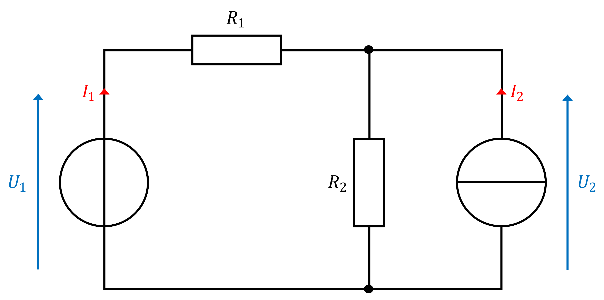
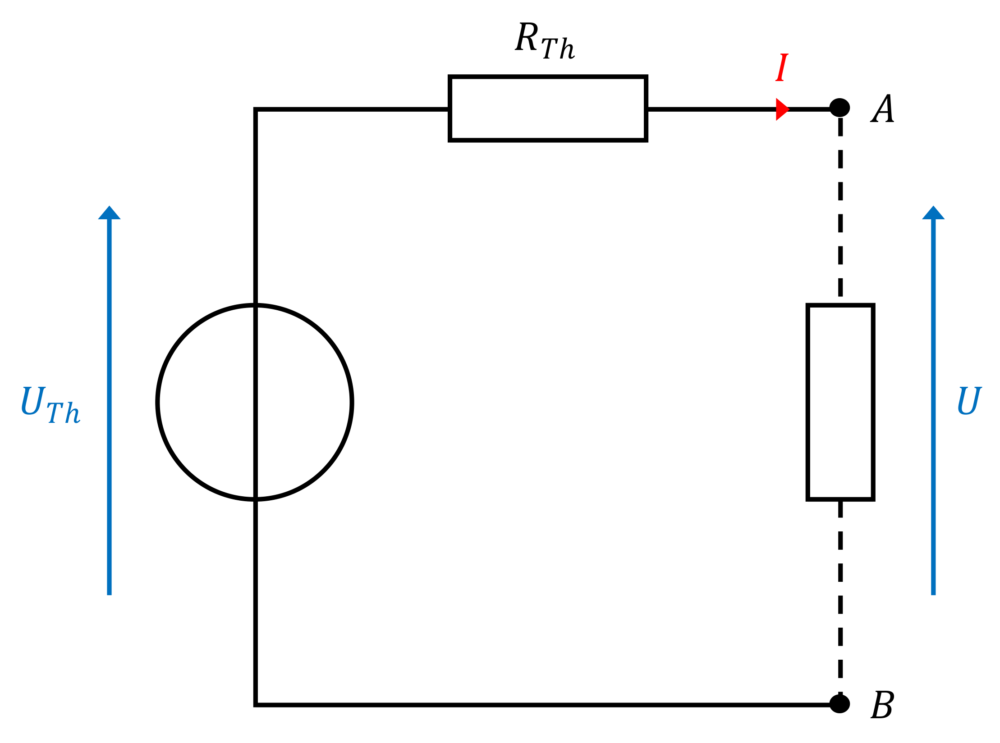
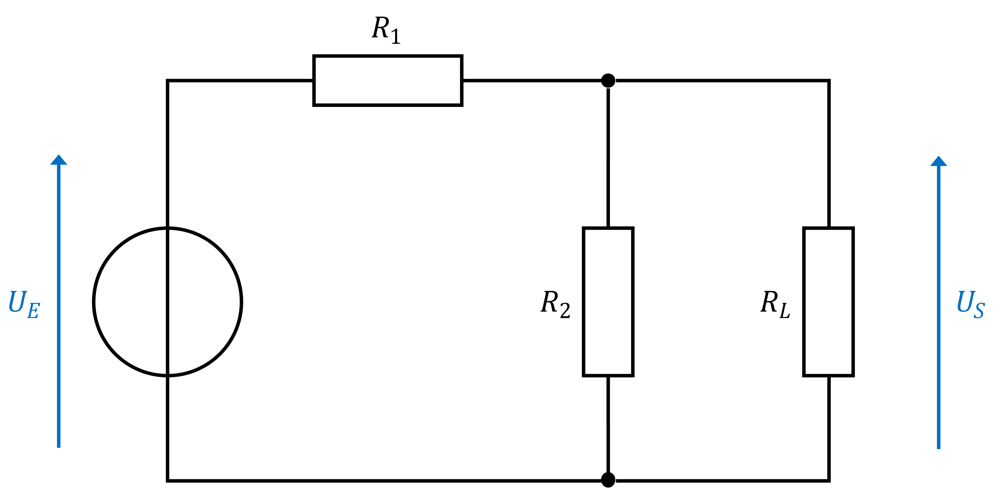
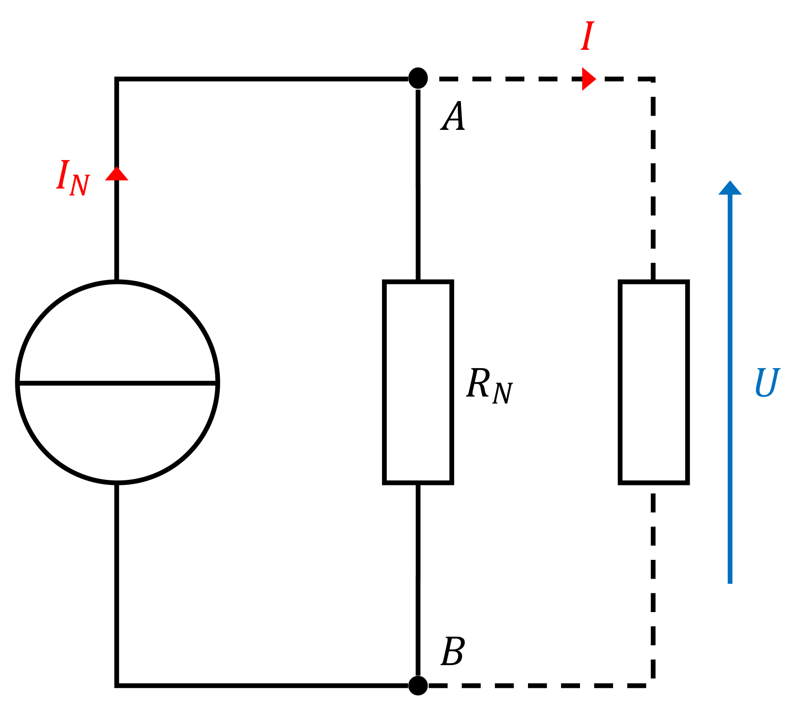
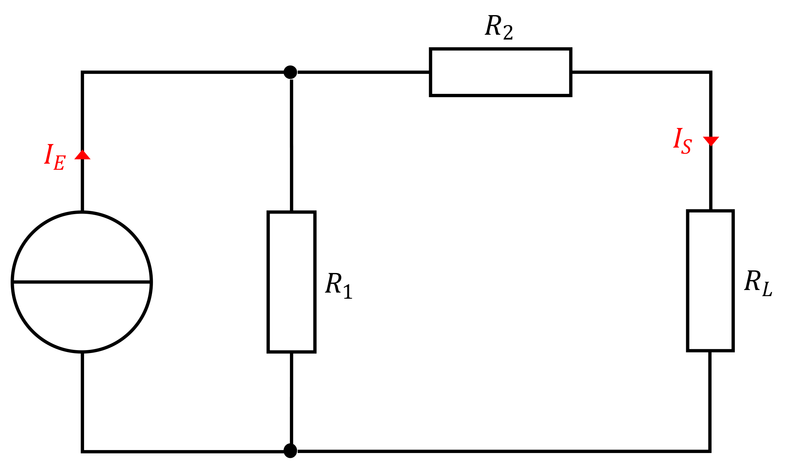
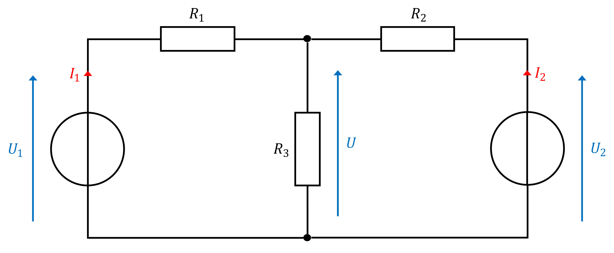

# 第 5 章　线性电路的分析方法

Chapitre n°5 — Méthodes d'analyse des circuits linéaires

中法对照讲义 · 由 LaTeX 源文件渲染

!!! info "阅读说明"

    每段先列法语原文；其下缩进、带深蓝竖条的小字号段落为中文翻译。<strong>加粗</strong>为关键词，括号内为中文释义。

    原讲义是课堂填空版，正文中的推导与例题公式留白供课上填写；本站版本已补全全部公式，便于课后复习与核对。

## 5.1　Théorème de superposition 叠加定理

Nous avons vu dans le chapitre 4 (section 4.3) les lois de Kirchhoff, qui permettent de déterminer les tensions et les intensités des courants dans un circuit. Cependant, lorsque le circuit devient complexe, l'application de ces lois peut conduire à un système d'équations difficile à résoudre, notamment lorsque plusieurs sources indépendantes sont présentes.

我们在第 4 章（4.3 节）已经学习了基尔霍夫定律，它可以确定电路中各处的电压与电流强度。然而，当电路变得复杂时，应用这些定律可能导出一个难以求解的方程组，尤其当存在多个独立源时。
{: .zh }

Pour simplifier l'analyse de ces circuits, il est possible d'utiliser certaines propriétés des circuits linéaires, en utilisant le théorème de superposition.

为了简化这些电路的分析，可以利用线性电路的某些性质，即使用<strong>叠加定理</strong>。
{: .zh }

!!! danger "Théorème 5.1 : théorème de superposition 定理 5.1：叠加定理（théorème de superposition）"

    Dans un circuit électrique linéaire comportant plusieurs sources indépendantes, la tension aux bornes de chaque dipôle et le courant qui le traverse sont égaux à la somme algébrique des tensions ou des courants produits séparément par chacune des sources indépendantes, les autres sources étant neutralisées.

    在一个包含多个独立源的线性电路中，每个二端元件两端的电压以及流过它的电流，等于各独立源分别单独作用（其余电源置零）时所产生的电压或电流的<strong>代数和</strong>。
    {: .zh }

<i>Remarque.</i> La neutralisation des sources fonctionne de la manière suivante :

<i>注.</i> 电源的置零（neutralisation）按如下方式进行：
{: .zh }

- une source idéale de tension neutralisée est remplacée par un fil, la tension \(U\) à ses bornes est donc nulle ;

    理想电压源置零后用一根导线代替，其两端电压 \(U\) 因此为零；
    {: .zh }

- une source idéale de courant neutralisée est remplacée par un circuit ouvert, l'intensité \(I\) du courant la traversant est donc nulle ;

    理想电流源置零后用<strong>开路</strong>代替，流过它的电流强度 \(I\) 因此为零；
    {: .zh }

- les sources réelles doivent conserver leur résistance interne ;

    <strong>实际电源</strong>必须保留其内阻；
    {: .zh }

- les autres composants du circuit restent inchangés.

    电路的其他元件保持不变。
    {: .zh }

!!! demo ""

    <strong>Démonstration. &nbsp;&nbsp; 证明</strong>

    Considérons un circuit comportant plusieurs résistances et sources indépendantes. Les lois de Kirchhoff permettent d'établir des relations entre les différentes branches du circuit :

    考虑一个包含若干电阻和独立源的电路。基尔霍夫定律可以在电路的不同支路之间建立关系：
    {: .zh }

    - la loi des nœuds permet de relier les intensités des courants du circuit :

        节点定律用于联系电路中各电流强度：
        {: .zh }

        \[
        \sum_k I_k = 0.
        \]

    - la loi des mailles permet de lier les tensions du circuit.

        回路定律用于联系电路中的各电压。
        {: .zh }

        \[
        \sum_k U_k = 0.
        \]

    La loi d'Ohm permet de lier les courants aux tensions grâce aux résistances présentes dans le circuit.

    欧姆定律借助电路中的电阻把电流与电压联系起来。
    {: .zh }

    \[
    U = RI.
    \]

    Ces relations sont linéaires. Elles peuvent être regroupées sous la forme d'un système d'équations linéaires :

    这些关系是线性的，可以整理成<strong>线性方程组</strong>的形式：
    {: .zh }

    \[
    \mathbf{A}\mathbf{X} = \mathbf{B},
    \]

    où :

    其中：
    {: .zh }

    - \(\mathbf{A}\) est une matrice dont les coefficients dépendent des résistances et de la structure du circuit ;

        \(\mathbf{A}\) 是一个矩阵，其系数取决于电阻和电路结构；
        {: .zh }

    - \(\mathbf{X}\) est le vecteur des inconnues (tensions et courants du circuit) ;

        \(\mathbf{X}\) 是未知量向量（电路中的电压与电流）；
        {: .zh }

    - \(\mathbf{B}\) est un vecteur contenant les contributions des sources indépendantes.

        \(\mathbf{B}\) 是包含各独立源贡献的向量。
        {: .zh }

    Supposons que le circuit comporte \(n\) sources indépendantes. Le vecteur \(\mathbf{B}\) peut donc être décomposé en la somme des contributions de chaque source :

    假设电路包含 \(n\) 个独立源，则向量 \(\mathbf{B}\) 可以分解为各电源贡献之和：
    {: .zh }

    \[
    \mathbf{B} = \mathbf{B}_1 + \mathbf{B}_2 + \cdots + \mathbf{B}_n.
    \]

    La matrice \(\mathbf{A}\) est indépendante des sources. De plus, nous supposons que le système admet une solution unique. Donc :

    矩阵 \(\mathbf{A}\) 与电源无关。此外，我们假设该方程组有唯一解。因此：
    {: .zh }

    \[
    \begin{aligned}
    \mathbf{X} &= \mathbf{A}^{-1}\mathbf{B} \\
               &= \mathbf{A}^{-1}\left(\mathbf{B}_1 + \mathbf{B}_2 + \cdots + \mathbf{B}_n\right) \\
               &= \mathbf{X}_1 + \mathbf{X}_2 + \cdots + \mathbf{X}_n.
    \end{aligned}
    \]

    En posant \(\mathbf{X}_k = \mathbf{A}^{-1}\mathbf{B}_k\), nous obtenons finalement :

    令 \(\mathbf{X}_k = \mathbf{A}^{-1}\mathbf{B}_k\)，最终得到：
    {: .zh }

    \[
    \mathbf{X} = \sum_{k=1}^{n}\mathbf{X}_k.
    \]

    Chaque vecteur \(\mathbf{X}_k\) correspond à la solution du circuit lorsque seule la source \(k\) est active, les autres sources indépendantes étant neutralisées.

    每个向量 \(\mathbf{X}_k\) 对应只有第 \(k\) 个电源作用、其余独立源置零时电路的解。
    {: .zh }

    
∎

Figure 5.1 — Exemple avec deux sources de tension et de courant réelles branchées en parallèle. 图 5.1：两个实际的电压源与电流源并联的示例电路。

!!! info "Exemple 5.2 例 5.2"

    Considérons un circuit composé de deux sources réelles branchées en parallèle (figure 5.1) :

    考虑一个由两个并联的实际电源构成的电路（图 5.1）：
    {: .zh }

    - une source de tension, délivrant une tension \(U_1\), avec une résistance interne \(R_1\) en série ;

        一个电压源，提供电压 \(U_1\)，串联一个内阻 \(R_1\)；
        {: .zh }

    - une source de courant, délivrant un courant d'intensité \(I_2\), avec une résistance interne \(R_2\) en parallèle.

        一个电流源，提供强度为 \(I_2\) 的电流，并联一个内阻 \(R_2\)。
        {: .zh }

    Le courant d'intensité \(I_1\) traversant la source de tension, et la tension \(U_2\) aux bornes de la source de courant sont inconnus.

    流过电压源的电流强度 \(I_1\) 和电流源两端的电压 \(U_2\) 均未知。
    {: .zh }

    En neutralisant la source de courant \(I_2\), nous obtenons :

    将电流源 \(I_2\) 置零，得到：
    {: .zh }

    \[
    \begin{aligned}
    U_2 &= \frac{U_1 R_2}{R_1 + R_2} \\
    I_1 &= \frac{U_1}{R_1 + R_2}.
    \end{aligned}
    \]

    En neutralisant la source de tension \(U_1\), nous obtenons :

    将电压源 \(U_1\) 置零，得到：
    {: .zh }

    \[
    \begin{aligned}
    U_2 &= I_2\,\frac{R_1 R_2}{R_1 + R_2} \\
    I_1 &= -\frac{I_2 R_2}{R_1 + R_2}.
    \end{aligned}
    \]

    D'après le théorème de superposition, nous obtenons finalement :

    根据叠加定理，最终得到：
    {: .zh }

    \[
    \begin{aligned}
    U_2 &= \frac{U_1 R_2}{R_1 + R_2} + \frac{I_2 R_1 R_2}{R_1 + R_2} \\
        &= \frac{R_2\left(U_1 + R_1 I_2\right)}{R_1 + R_2},
    \end{aligned}
    \]

    et :

    以及：
    {: .zh }

    \[
    \begin{aligned}
    I_1 &= \frac{U_1}{R_1 + R_2} - \frac{I_2 R_2}{R_1 + R_2} \\
        &= \frac{U_1 - R_2 I_2}{R_1 + R_2}.
    \end{aligned}
    \]

!!! warning "Vocabulaire clé &nbsp;&nbsp; 重点词汇 第五章核心术语"

    - <strong>théorème de superposition</strong>：叠加定理
    - <strong>source indépendante</strong>：独立源
    - <strong>source idéale</strong>：理想电源
    - <strong>source réelle</strong>：实际电源
    - <strong>neutraliser une source</strong>：将电源置零
    - <strong>circuit ouvert</strong>：开路
    - <strong>résistance interne</strong>：内阻
    - <strong>loi des nœuds</strong>：节点定律
    - <strong>loi des mailles</strong>：回路定律
    - <strong>loi d'Ohm</strong>：欧姆定律
    - <strong>branche</strong>：支路
    - <strong>système d'équations linéaires</strong>：线性方程组
    - <strong>matrice</strong>：矩阵
    - <strong>vecteur des inconnues</strong>：未知量向量
    - <strong>somme algébrique</strong>：代数和
    - <strong>dipôle</strong>：二端元件
    - <strong>solution unique</strong>：唯一解
    - <strong>en fonction de</strong>：用……表示

## 5.2　Théorèmes de Thévenin et de Norton 戴维宁定理与诺顿定理

Les théorèmes de Thévenin et de Norton permettent de remplacer un circuit linéaire par un circuit équivalent plus simple, ne contenant qu'une source idéale et une résistance.

戴维宁定理与诺顿定理可以把一个线性电路替换为一个更简单的<strong>等效电路</strong>，其中只含一个理想电源和一个电阻。
{: .zh }

### 5.2.1　Théorème de Thévenin 戴维宁定理（théorème de Thévenin）

Figure 5.2 — Circuit équivalent de Thévenin, constitué d'une source de tension équivalente \(U_{\mathrm{Th}}\) et d'une résistance équivalente \(R_{\mathrm{Th}}\) en série. Une charge quelconque est branchée entre les points \(A\) et \(B\). 图 5.2：戴维宁等效电路，由等效电压源 \(U_{\mathrm{Th}}\) 与串联的等效电阻 \(R_{\mathrm{Th}}\) 构成。任一负载接在 \(A\)、\(B\) 两点之间。

!!! danger "Théorème 5.3 : théorème de Thévenin 定理 5.3：戴维宁定理（théorème de Thévenin）"

    Tout circuit linéaire constitué de sources indépendantes et de composants linéaires, vu depuis deux bornes \(A\) et \(B\), peut être remplacé par une source de tension idéale \(U_{\mathrm{Th}}\) mise en série avec une résistance \(R_{\mathrm{Th}}\) (figure 5.2).

    任何由独立源和线性元件构成的线性电路，从两个端子 \(A\) 和 \(B\) 看出去，都可以用一个理想电压源 \(U_{\mathrm{Th}}\) 与一个电阻 \(R_{\mathrm{Th}}\) 串联来等效替换（图 5.2）。
    {: .zh }

    <i>Ce circuit équivalent présente le même comportement électrique que le circuit initial vis-à-vis de toute charge connectée entre \(A\) et \(B\) (équation 5.1).</i>

    <i>该等效电路对于连接在 \(A\)、\(B\) 之间的任意负载，都具有与原始电路相同的电学行为（式 5.1）。</i>
    {: .zh }

    \[
    U = U_{\mathrm{Th}} - R_{\mathrm{Th}} I.
    \tag{5.1}
    \]

La conversion d'un circuit linéaire en un circuit équivalent de Thévenin consiste en deux étapes :

把一个线性电路转换为戴维宁等效电路分为两步：
{: .zh }

<strong>Tension de Thévenin.</strong> La tension de Thévenin \(U_{\mathrm{Th}}\) est égale à la tension à vide (sans charge) \(U_{AB,\mathrm{vide}}\) entre les bornes \(A\) et \(B\) :

<strong>戴维宁电压</strong>（tension de Thévenin）：戴维宁电压 \(U_{\mathrm{Th}}\) 等于 \(A\)、\(B\) 两端之间的开路（无负载）电压 \(U_{AB,\mathrm{vide}}\)：
{: .zh }

\[
U_{\mathrm{Th}} = U_{AB,\mathrm{vide}}.
\]

<strong>Résistance de Thévenin.</strong> La résistance de Thévenin \(R_{\mathrm{Th}}\) est la résistance équivalente \(R_{\mathrm{eq}}\) vue depuis les bornes \(A\) et \(B\) lorsque toutes les sources indépendantes sont neutralisées :

<strong>戴维宁电阻</strong>（résistance de Thévenin）：戴维宁电阻 \(R_{\mathrm{Th}}\) 是把所有独立源置零后，从 \(A\)、\(B\) 两端看进去的等效电阻 \(R_{\mathrm{eq}}\)：
{: .zh }

\[
R_{\mathrm{Th}} = R_{\mathrm{eq}}.
\]

!!! demo ""

    <strong>Démonstration. &nbsp;&nbsp; 证明</strong>

    Considérons un circuit linéaire comportant plusieurs résistances et sources indépendantes, vu depuis deux bornes \(A\) et \(B\). Notons :

    考虑一个包含若干电阻和独立源的线性电路，从两个端子 \(A\)、\(B\) 看出去。记：
    {: .zh }

    - \(U = U_{AB}\) la tension aux bornes du circuit ;

        \(U = U_{AB}\) 为电路两端的电压；
        {: .zh }

    - \(I\) le courant qui sort du circuit par la borne \(A\).

        \(I\) 为从端子 \(A\) 流出电路的电流。
        {: .zh }

    Le circuit étant linéaire, nous pouvons donner la relation entre la tension \(U\) et le courant d'intensité \(I\) :

    电路是线性的，因此可以给出电压 \(U\) 与电流强度 \(I\) 之间的关系：
    {: .zh }

    \[
    U = aI + b,
    \]

    où \(a\) et \(b\) sont deux constantes qui dépendent du circuit. Nous pouvons utiliser le théorème de superposition pour déterminer \(a\) et \(b\).

    其中 \(a\) 和 \(b\) 是两个取决于电路的常数。可以用叠加定理确定 \(a\) 和 \(b\)。
    {: .zh }

    Dans un premier temps, imposons \(I = 0\). Nous obtenons :

    首先，令 \(I = 0\)，得到：
    {: .zh }

    \[
    U = b.
    \]

    La constante \(b\) correspond bien à la tension équivalente de Thévenin \(U_{\mathrm{Th}}\) lorsque la résistance de charge est débranchée :

    常数 \(b\) 恰好对应负载电阻断开时的戴维宁等效电压 \(U_{\mathrm{Th}}\)：
    {: .zh }

    \[
    b = U_{\mathrm{Th}}.
    \]

    Dans un second temps, neutralisons toutes les sources indépendantes du circuit (\(b = 0\)). Nous obtenons :

    然后，把电路中所有独立源置零（\(b = 0\)），得到：
    {: .zh }

    \[
    U = aI.
    \]

    La constante \(a\) correspond à une résistance. Notons \(R_{\mathrm{eq}}\) la résistance équivalente vue depuis les bornes \(A\) et \(B\) du circuit, permettant de lier \(U\) et \(I\). Le circuit ne contenant plus de source indépendante, nous obtenons \(U = -R_{\mathrm{eq}} I\). La résistance \(R_{\mathrm{eq}}\) correspond bien à la résistance équivalente de Thévenin \(R_{\mathrm{Th}}\) :

    常数 \(a\) 对应一个电阻。记 \(R_{\mathrm{eq}}\) 为从电路端子 \(A\)、\(B\) 看进去的等效电阻，它联系 \(U\) 与 \(I\)。电路不再包含独立源时，得到 \(U = -R_{\mathrm{eq}} I\)。电阻 \(R_{\mathrm{eq}}\) 恰好对应戴维宁等效电阻 \(R_{\mathrm{Th}}\)：
    {: .zh }

    \[
    a = -R_{\mathrm{Th}}.
    \]

    Nous obtenons finalement :

    最终得到：
    {: .zh }

    \[
    U = U_{\mathrm{Th}} - R_{\mathrm{Th}} I.
    \]

    Cette relation est caractéristique d'un générateur de Thévenin.

    该关系是<strong>戴维宁电源</strong>（générateur de Thévenin）的特征关系。
    {: .zh }

    
∎

Figure 5.3 — Exemple d'utilisation d'un circuit équivalent de Thévenin. 图 5.3：戴维宁等效电路的应用示例。

!!! info "Exemple 5.4 例 5.4"

    Considérons un circuit composé d'une source de tension idéale \(U_E\) et de deux résistances \(R_1\) et \(R_2\). Une résistance de charge \(R_L\) est branchée en parallèle à \(R_2\) (figure 5.3). Nous cherchons à déterminer la tension \(U_S\) aux bornes de la résistance de charge \(R_L\).

    考虑一个由理想电压源 \(U_E\) 和两个电阻 \(R_1\)、\(R_2\) 构成的电路。负载电阻 \(R_L\) 与 \(R_2\) 并联（图 5.3）。我们要求负载电阻 \(R_L\) 两端的电压 \(U_S\)。
    {: .zh }

    Nous utilisons le théorème de Thévenin. Dans un premier temps, nous calculons la tension équivalente de Thévenin \(U_{\mathrm{Th}}\) lorsque la résistance de charge \(R_L\) est débranchée (circuit ouvert). Nous obtenons un diviseur de tension :

    我们使用戴维宁定理。首先，计算负载电阻 \(R_L\) 断开（开路）时的戴维宁等效电压 \(U_{\mathrm{Th}}\)。得到一个分压器：
    {: .zh }

    \[
    U_{\mathrm{Th}} = U_E\,\frac{R_2}{R_1 + R_2}.
    \]

    Dans un second temps, nous calculons la résistance équivalente de Thévenin \(R_{\mathrm{Th}}\) lorsque la source de tension \(U_E\) est neutralisée (court-circuit). La résistance de charge \(R_L\) est débranchée. Nous obtenons deux résistances en parallèle :

    其次，计算电压源 \(U_E\) 置零（短路）时的戴维宁等效电阻 \(R_{\mathrm{Th}}\)。负载电阻 \(R_L\) 断开。得到两个并联电阻：
    {: .zh }

    \[
    R_{\mathrm{Th}} = \frac{R_1 R_2}{R_1 + R_2}.
    \]

    Nous en déduisons donc la tension \(U_S\) aux bornes de la résistance de charge \(R_L\) lorsqu'elle est branchée au circuit équivalent de Thévenin (figure 5.2). Nous obtenons un diviseur de tension :

    由此可得负载电阻 \(R_L\) 接入戴维宁等效电路（图 5.2）时其两端的电压 \(U_S\)。得到一个分压器：
    {: .zh }

    \[
    \begin{aligned}
    U_S &= U_{\mathrm{Th}}\,\frac{R_L}{R_{\mathrm{Th}} + R_L} \\
        &= \frac{U_E R_2}{R_1 + R_2}\cdot\frac{R_L}{\dfrac{R_1 R_2}{R_1 + R_2} + R_L} \\
        &= \frac{U_E R_2 R_L}{R_1 R_2 + R_1 R_L + R_2 R_L}.
    \end{aligned}
    \]

### 5.2.2　Théorème de Norton 诺顿定理（théorème de Norton）

Figure 5.4 — Circuit équivalent de Norton, constitué d'une source de courant équivalente \(I_N\) et d'une résistance équivalente \(R_N\) en parallèle. Une charge quelconque est branchée entre les points \(A\) et \(B\). 图 5.4：诺顿等效电路，由等效电流源 \(I_N\) 与并联的等效电阻 \(R_N\) 构成。任一负载接在 \(A\)、\(B\) 两点之间。

!!! danger "Théorème 5.5 : théorème de Norton 定理 5.5：诺顿定理（théorème de Norton）"

    Tout circuit linéaire constitué de sources indépendantes et de composants linéaires, vu depuis deux bornes \(A\) et \(B\), peut être remplacé par une source de courant idéale \(I_N\) mise en parallèle avec une résistance \(R_N\) (figure 5.4).

    任何由独立源和线性元件构成的线性电路，从两个端子 \(A\) 和 \(B\) 看出去，都可以用一个理想电流源 \(I_N\) 与一个电阻 \(R_N\) 并联来等效替换（图 5.4）。
    {: .zh }

    <i>Ce circuit équivalent présente le même comportement électrique que le circuit initial vis-à-vis de toute charge connectée entre \(A\) et \(B\) (équation 5.2).</i>

    <i>该等效电路对于连接在 \(A\)、\(B\) 之间的任意负载，都具有与原始电路相同的电学行为（式 5.2）。</i>
    {: .zh }

    \[
    I = I_N - \frac{U}{R_N}.
    \tag{5.2}
    \]

La conversion d'un circuit linéaire en un circuit équivalent de Norton consiste en deux étapes :

把一个线性电路转换为诺顿等效电路分为两步：
{: .zh }

<strong>Courant de Norton.</strong> L'intensité du courant de Norton \(I_N\) est égale à l'intensité du courant de court-circuit (charge remplacée par un fil) \(I_{\mathrm{cc}}\) entre les bornes \(A\) et \(B\) :

<strong>诺顿电流</strong>（courant de Norton）：诺顿电流 \(I_N\) 等于短路电流（负载用导线代替）\(I_{\mathrm{cc}}\)，即 \(A\)、\(B\) 两端之间的短路电流：
{: .zh }

\[
I_N = I_{\mathrm{cc}}.
\]

<strong>Résistance de Norton.</strong> La résistance de Norton \(R_N\) est la résistance équivalente \(R_{\mathrm{eq}}\) vue depuis les bornes \(A\) et \(B\) lorsque toutes les sources indépendantes sont neutralisées :

<strong>诺顿电阻</strong>（résistance de Norton）：诺顿电阻 \(R_N\) 是把所有独立源置零后，从 \(A\)、\(B\) 两端看进去的等效电阻 \(R_{\mathrm{eq}}\)：
{: .zh }

\[
R_N = R_{\mathrm{eq}}.
\]

<i>Remarque.</i> Cette méthode est identique à celle utilisée pour déterminer la résistance de Thévenin.

<i>注.</i> 该方法与确定戴维宁电阻所用的方法相同。
{: .zh }

!!! demo ""

    <strong>Démonstration. &nbsp;&nbsp; 证明</strong>

    Considérons un circuit linéaire comportant plusieurs résistances et sources indépendantes, vu depuis deux bornes \(A\) et \(B\). Notons :

    考虑一个包含若干电阻和独立源的线性电路，从两个端子 \(A\)、\(B\) 看出去。记：
    {: .zh }

    - \(U = U_{AB}\) la tension aux bornes du circuit ;

        \(U = U_{AB}\) 为电路两端的电压；
        {: .zh }

    - \(I\) le courant qui sort du circuit par la borne \(A\).

        \(I\) 为从端子 \(A\) 流出电路的电流。
        {: .zh }

    Le circuit étant linéaire, la relation entre la tension \(U\) et le courant d'intensité \(I\) est affine. Elle peut donc s'écrire :

    电路是线性的，电压 \(U\) 与电流强度 \(I\) 之间的关系是<strong>仿射关系</strong>，因此可以写成：
    {: .zh }

    \[
    I = aU + b,
    \]

    où \(a\) et \(b\) sont deux constantes qui dépendent du circuit. Nous pouvons utiliser le théorème de superposition pour déterminer \(a\) et \(b\).

    其中 \(a\) 和 \(b\) 是两个取决于电路的常数。可以用叠加定理确定 \(a\) 和 \(b\)。
    {: .zh }

    Dans un premier temps, imposons \(U = 0\). Nous obtenons :

    首先，令 \(U = 0\)，得到：
    {: .zh }

    \[
    I = b.
    \]

    La constante \(b\) correspond bien au courant équivalent de Norton \(I_N\) lorsque la résistance de charge est en court-circuit :

    常数 \(b\) 恰好对应负载电阻短路时的诺顿等效电流 \(I_N\)：
    {: .zh }

    \[
    b = I_N.
    \]

    Dans un second temps, neutralisons toutes les sources indépendantes du circuit (\(b = 0\)). Nous obtenons :

    然后，把电路中所有独立源置零（\(b = 0\)），得到：
    {: .zh }

    \[
    I = aU.
    \]

    La constante \(a\) correspond à une conductance. Notons \(G_{\mathrm{eq}}\) la conductance équivalente vue depuis les bornes \(A\) et \(B\) du circuit, permettant de lier \(U\) et \(I\). Le circuit ne contenant plus de source indépendante, nous obtenons \(I = -G_{\mathrm{eq}} U\). La résistance \(R_{\mathrm{eq}} = \frac{1}{G_{\mathrm{eq}}}\) correspond bien à la résistance équivalente de Norton \(R_N\) :

    常数 \(a\) 对应一个<strong>电导</strong>。记 \(G_{\mathrm{eq}}\) 为从电路端子 \(A\)、\(B\) 看进去的等效电导，它联系 \(U\) 与 \(I\)。电路不再包含独立源时，得到 \(I = -G_{\mathrm{eq}} U\)。电阻 \(R_{\mathrm{eq}} = \frac{1}{G_{\mathrm{eq}}}\) 恰好对应诺顿等效电阻 \(R_N\)：
    {: .zh }

    \[
    a = -G_N = -\frac{1}{R_N}.
    \]

    Nous obtenons finalement :

    最终得到：
    {: .zh }

    \[
    I = I_N - \frac{U}{R_N}.
    \]

    Cette relation est caractéristique d'un générateur de Norton.

    该关系是<strong>诺顿电源</strong>（générateur de Norton）的特征关系。
    {: .zh }

    
∎

Figure 5.5 — Exemple d'utilisation d'un circuit équivalent de Norton. 图 5.5：诺顿等效电路的应用示例。

!!! info "Exemple 5.6 例 5.6"

    Considérons un circuit composé d'une source de courant idéale d'intensité \(I_E\) et de deux résistances \(R_1\) et \(R_2\). Une résistance de charge \(R_L\) est branchée en parallèle à \(R_1\) et \(R_2\) (figure 5.5). Nous cherchons à déterminer l'intensité du courant \(I_S\) traversant la résistance de charge \(R_L\).

    考虑一个由理想电流源 \(I_E\) 和两个电阻 \(R_1\)、\(R_2\) 构成的电路。负载电阻 \(R_L\) 与 \(R_1\)、\(R_2\) 并联（图 5.5）。我们要求流过负载电阻 \(R_L\) 的电流强度 \(I_S\)。
    {: .zh }

    Nous utilisons le théorème de Norton. Dans un premier temps, nous calculons l'intensité du courant équivalent de Norton \(I_N\) lorsque la résistance de charge \(R_L\) est remplacée par un court-circuit. Nous obtenons un diviseur de courant :

    我们使用诺顿定理。首先，计算负载电阻 \(R_L\) 用短路代替时的诺顿等效电流 \(I_N\)。得到一个分流器：
    {: .zh }

    \[
    I_N = I_E\,\frac{R_1}{R_1 + R_2}.
    \]

    Dans un second temps, nous calculons la résistance équivalente de Norton \(R_N\) lorsque la source de courant \(I_E\) est neutralisée (circuit ouvert). La résistance de charge \(R_L\) est débranchée. Nous obtenons deux résistances en série :

    其次，计算电流源 \(I_E\) 置零（开路）时的诺顿等效电阻 \(R_N\)。负载电阻 \(R_L\) 断开。得到两个串联电阻：
    {: .zh }

    \[
    R_N = R_1 + R_2.
    \]

    Nous en déduisons donc l'intensité du courant \(I_S\) traversant la résistance de charge \(R_L\) lorsqu'elle est branchée au circuit équivalent de Norton (figure 5.4). Nous obtenons un diviseur de courant :

    由此可得负载电阻 \(R_L\) 接入诺顿等效电路（图 5.4）时流过它的电流强度 \(I_S\)。得到一个分流器：
    {: .zh }

    \[
    \begin{aligned}
    I_S &= I_N\,\frac{R_N}{R_N + R_L} \\
        &= \frac{I_E R_1}{R_1 + R_2}\cdot\frac{R_1 + R_2}{R_1 + R_2 + R_L} \\
        &= \frac{I_E R_1}{R_1 + R_2 + R_L}.
    \end{aligned}
    \]

### 5.2.3　Équivalence Thévenin et Norton 戴维宁等效与诺顿等效

Nous avons déjà établi que :

我们已经得到：
{: .zh }

\[
U = U_{\mathrm{Th}} - R_{\mathrm{Th}} I,
\]

et :

以及：
{: .zh }

\[
I = I_N - \frac{U}{R_N}.
\]

Pour que les deux modèles soient équivalents, la tension \(U\) doit être la même, quel que soit l'intensité du courant \(I\). Nous obtenons donc une relation entre la tension de Thévenin \(U_{\mathrm{Th}}\) et l'intensité du courant de Norton \(I_N\) (équation 5.3), ainsi qu'une relation entre les résistances de Thévenin \(R_{\mathrm{Th}}\) et Norton \(R_N\) (équation 5.4).

为使两种模型等效，无论电流强度 \(I\) 为何值，电压 \(U\) 都必须相同。由此得到戴维宁电压 \(U_{\mathrm{Th}}\) 与诺顿电流 \(I_N\) 之间的关系（式 5.3），以及戴维宁电阻 \(R_{\mathrm{Th}}\) 与诺顿电阻 \(R_N\) 之间的关系（式 5.4）。
{: .zh }

\[
U_{\mathrm{Th}} = R_N I_N.
\tag{5.3}
\]

\[
R_{\mathrm{Th}} = R_N.
\tag{5.4}
\]

Ces relations constituent les formules de transformation d'une source de tension réelle en source de courant réelle, et inversement.

这些关系就是<strong>实际电压源</strong>与<strong>实际电流源</strong>之间相互转换的公式（反之亦然）。
{: .zh }

!!! warning "Vocabulaire clé &nbsp;&nbsp; 重点词汇 第五章核心术语"

    - <strong>théorème de Thévenin</strong>：戴维宁定理
    - <strong>théorème de Norton</strong>：诺顿定理
    - <strong>circuit équivalent</strong>：等效电路
    - <strong>tension à vide</strong>：开路（空载）电压
    - <strong>résistance équivalente</strong>：等效电阻
    - <strong>courant de court-circuit</strong>：短路电流
    - <strong>court-circuit</strong>：短路
    - <strong>conductance</strong>：电导
    - <strong>charge</strong>：负载
    - <strong>débrancher</strong>：断开
    - <strong>vis-à-vis de</strong>：对于、相对
    - <strong>relation affine</strong>：仿射（线性）关系
    - <strong>transformation</strong>：变换
    - <strong>inversement</strong>：反之

## Exercice 练习

Figure 5.6 — Exemple de circuit linéaire comportant deux sources de tension idéales \(U_1\) et \(U_2\) et trois résistances \(R_1\), \(R_2\) et \(R_3\). 图 5.6：包含两个理想电压源 \(U_1\)、\(U_2\) 和三个电阻 \(R_1\)、\(R_2\)、\(R_3\) 的线性电路示例。

!!! info "Exercice 5.1 练习 5.1"

    Considérons un circuit linéaire comportant deux sources de tension idéales indépendantes \(U_1\) et \(U_2\) et trois résistances \(R_1\), \(R_2\) et \(R_3\) (figure 5.6).

    考虑一个包含两个独立理想电压源 \(U_1\) 和 \(U_2\) 以及三个电阻 \(R_1\)、\(R_2\)、\(R_3\) 的线性电路（图 5.6）。
    {: .zh }

    1. Déterminer la tension \(U\) aux bornes de la résistance \(R_3\).

        求电阻 \(R_3\) 两端的电压 \(U\)。
        {: .zh }

!!! warning "Vocabulaire clé &nbsp;&nbsp; 重点词汇 练习核心术语"

    - <strong>exercice</strong>：练习
    - <strong>énoncé</strong>：题设、条件
    - <strong>déterminer</strong>：求、确定
    - <strong>aux bornes de</strong>：在……两端
    - <strong>indépendant</strong>：独立的
    - <strong>linéaire</strong>：线性的
    - <strong>source de tension idéale</strong>：理想电压源
