# 第 1 章　力与静电场

Chapitre n°1 — Force et champ électrostatiques

中法对照讲义 · 静电学部分

!!! info "阅读说明"

    每段先列法语原文；其下缩进、带深蓝竖条的小字号段落为中文翻译。<strong>加粗</strong>为关键词，括号内为中文释义。

    本章是《电路基础》静电学部分的第 1 章，从电荷的基本性质讲到库仑力、电场、场线、电荷分布与静电势。

## 1.1) Propriétés élémentaires de la charge électrique 电荷的基本性质

Chaque élément de matière possède une charge électrique notée \(q\). Cette charge peut être soit positive, soit négative, soit nulle. Son unité est le Coulomb noté C.

物质的每一个基本单元都带有一个电荷，记作 \(q\)。该电荷可以为正、为负或为零。其单位是库仑（Coulomb），记作 C。
{: .zh }

- Un électron possède une charge négative \(q_e \simeq -1{,}6\cdot 10^{-19}\ \mathrm{C}\).

    一个电子带负电荷 \(q_e \simeq -1{,}6\cdot 10^{-19}\ \mathrm{C}\)。
    {: .zh }

- Un proton possède une charge positive \(q_p \simeq +1{,}6\cdot 10^{-19}\ \mathrm{C}\).

    一个质子带正电荷 \(q_p \simeq +1{,}6\cdot 10^{-19}\ \mathrm{C}\)。
    {: .zh }

Un atome est constitué d'autant de protons que d'électrons donc sa charge totale est nulle. Les atomes se différencient par leur nombre d'électrons. On a par exemple He (hélium), H (hydrogène) ou C (carbone).

原子由数量相同的质子和电子构成，因此其总电荷为零。不同原子之间的区别在于电子数。例如 He（氦）、H（氢）或 C（碳）。
{: .zh }

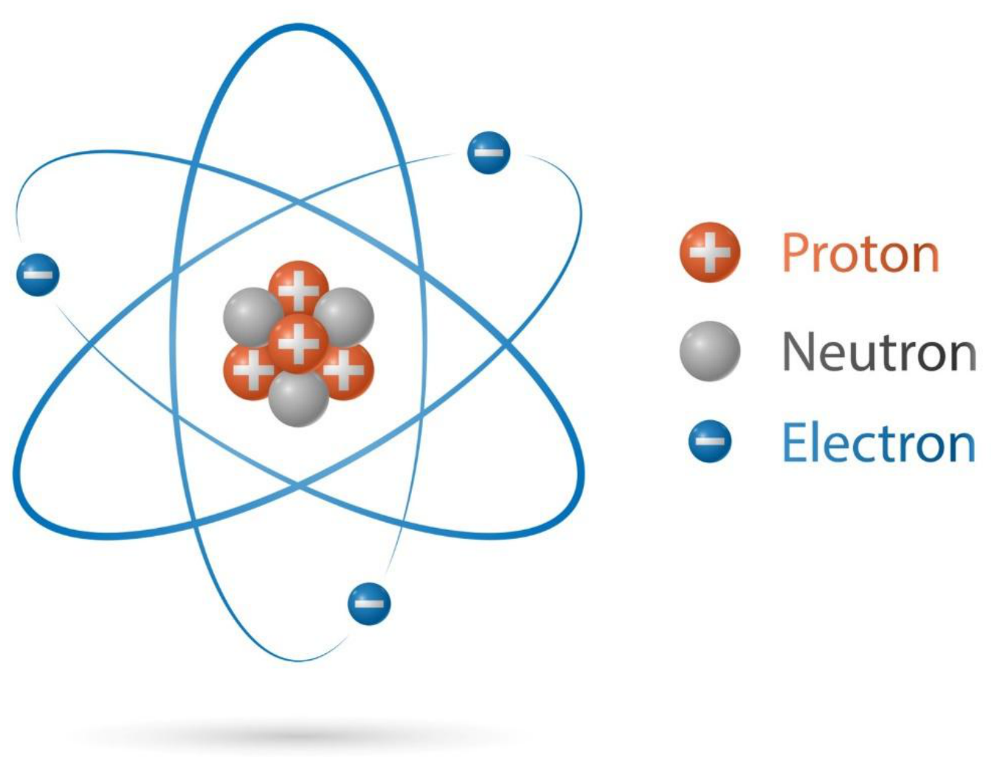

La charge électrique est une propriété fondamentale de la matière. Comme la masse totale d'un système \(S\) est la somme des masses de ses composants, la charge électrique totale de ce système est la somme des charges électriques de ses composants :

电荷是物质的一种基本属性。正如系统 \(S\) 的总质量等于其各组成部分质量之和，该系统的总电荷也等于其各组成部分电荷之和：
{: .zh }

\[
q_{tot}=\sum_{i\in S} q_i.
\]

Pour un système fermé (n'échangeant pas de matière avec l'extérieur), la charge totale du système est constante. C'est-à-dire que <strong>la charge électrique se conserve</strong>, exactement comme la masse.

对于封闭系统（不与外界交换物质），系统的总电荷保持不变。也就是说，<strong>电荷守恒</strong>（la charge électrique se conserve），与质量守恒完全类似。
{: .zh }

En se plaçant à une distance très grande devant la taille caractéristique de l'objet chargé, on peut considérer que toute la charge électrique est située au barycentre de l'objet. On appelle cette charge une <strong>charge ponctuelle</strong>.

当观察距离远大于带电物体的特征尺寸时，可以认为全部电荷都集中在物体的重心（barycentre）处。这样的电荷称为<strong>点电荷</strong>（charge ponctuelle）。
{: .zh }

!!! warning "Vocabulaire clé &nbsp;&nbsp; 重点词汇 1.1 节核心术语"

    - <strong>charge électrique</strong>：电荷：物质可为正、为负或为零的物理属性，单位是库仑（C）。
    - <strong>charge ponctuelle</strong>：点电荷：观察距离远大于物体尺寸时可视为集中于一点的电荷。
    - <strong>électron</strong>：电子：带负电荷的基本粒子。
    - <strong>proton</strong>：质子：带正电荷的粒子。
    - <strong>conservation de la charge</strong>：电荷守恒：封闭系统的总电荷保持不变。

## 1.2) Interaction de Coulomb 库仑相互作用

On se place dans un <strong>référentiel galiléen</strong>, c'est-à-dire un référentiel qui vérifie le principe d'inertie : « Dans un référentiel galiléen, un point matériel \(M\) est en mouvement de translation rectiligne uniforme dans \(R\) si et seulement si la somme des forces extérieures appliquées à \(M\) est nulle. »

我们取一个<strong>伽利略参考系</strong>（référentiel galiléen），即满足惯性原理的参考系：「在伽利略参考系中，质点 \(M\) 在 \(R\) 中作匀速直线平移运动，当且仅当作用于 \(M\) 的外力之和为零。」
{: .zh }

Dans un référentiel galiléen noté \(R\), on considère une particule ponctuelle de charge \(q_1\) en \(M_1\) et une particule ponctuelle de charge \(q_2\) en \(M_2\). On note :

在记作 \(R\) 的伽利略参考系中，考虑位于 \(M_1\)、电荷为 \(q_1\) 的质点，以及位于 \(M_2\)、电荷为 \(q_2\) 的质点。记：
{: .zh }

- \(r\) la distance \(M_1M_2\) ;

    \(r\) 为距离 \(M_1M_2\)。
    {: .zh }

- \(\vec{u}_{12}=\dfrac{1}{r}\,\overrightarrow{M_1M_2}\) est le vecteur unitaire allant de \(M_1\) vers \(M_2\).

    \(\vec{u}_{12}=\dfrac{1}{r}\,\overrightarrow{M_1M_2}\) 为从 \(M_1\) 指向 \(M_2\) 的单位向量。
    {: .zh }

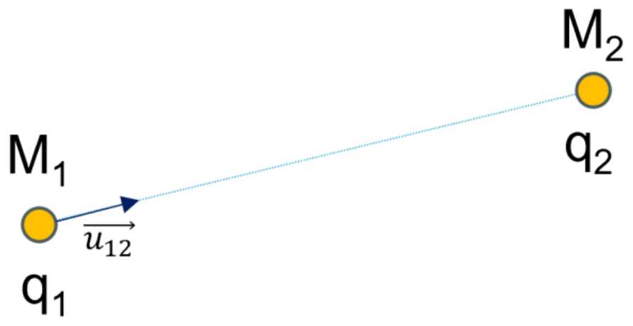

La particule en \(M_1\) exerce sur la particule en \(M_2\) la force électrique \(\overrightarrow{F_{12}}\), elle est appelée <strong>force de Coulomb</strong> :

位于 \(M_1\) 的粒子对位于 \(M_2\) 的粒子施加电场力 \(\overrightarrow{F_{12}}\)，称为<strong>库仑力</strong>（force de Coulomb）：
{: .zh }

\[
\overrightarrow{F_{12}}=\frac{q_1q_2}{4\pi\varepsilon_0 r^2}\,\vec{u}_{12}.
\]

\(\varepsilon_0 = 8{,}85\cdot 10^{-12}\ \mathrm{C^2\,N^{-1}\,m^{-2}}\) est appelée la <strong>permittivité du vide</strong>.

\(\varepsilon_0 = 8{,}85\cdot 10^{-12}\ \mathrm{C^2\,N^{-1}\,m^{-2}}\) 称为<strong>真空介电常数</strong>（permittivité du vide）。
{: .zh }

- Si \(q_1q_2<0\) les deux particules s'attirent (exemple : un proton et un électron).

    若 \(q_1q_2<0\)，两粒子相互吸引（例如质子和电子）。
    {: .zh }

- Si \(q_1q_2>0\) les deux particules se repoussent (exemple : deux électrons).

    若 \(q_1q_2>0\)，两粒子相互排斥（例如两个电子）。
    {: .zh }

## 1.3) Champ électrique 电场

Un <strong>champ</strong> est une fonction de la position \(M\) et du temps \(t\). Il peut s'agir d'un scalaire (on parle de <strong>champ scalaire</strong>) ou d'un vecteur (on parle de <strong>champ vectoriel</strong>).

<strong>场</strong>是位置 \(M\) 与时间 \(t\) 的函数。它可以是标量（称为<strong>标量场</strong>，champ scalaire），也可以是矢量（称为<strong>矢量场</strong>，champ vectoriel）。
{: .zh }

Plutôt que de toujours considérer la force qu'exerce une charge sur une autre, il est souvent plus rigoureux et pratique de considérer qu'une particule crée un champ électrique et que l'autre charge est plongée dans ce champ électrique \(\vec{E}\). On remarque que \(\vec{E}\) est un champ vectoriel. Lorsque le champ ne dépend pas de la position \(M\), on dit qu'il est <strong>uniforme</strong>. Lorsqu'il ne dépend pas de l'instant \(t\) on dit qu'il est <strong>stationnaire</strong>, permanent ou statique.

与其始终考虑一个电荷对另一个电荷施加的力，通常更严谨、更方便的做法是：认为一个粒子产生电场，而另一个电荷置于该电场 \(\vec{E}\) 之中。注意 \(\vec{E}\) 是矢量场。当电场不依赖于位置 \(M\) 时，称其为<strong>均匀场</strong>（uniforme）；当它不依赖于时间 \(t\) 时，称其为<strong>稳恒场</strong>（stationnaire）、永久场或静态场。
{: .zh }

On cherche le champ électrique que crée une charge 1. Pour cela on regarde la force de Coulomb exercée sur une charge 2. On peut réécrire \(\overrightarrow{F_{12}}=q_2\vec{E}(M)\) avec \(\vec{E}(M)=\dfrac{q_1}{4\pi\varepsilon_0 r^2}\,\vec{u}_{12}\). \(\vec{E}\) ne dépend que de la charge \(q_1\) et de la position de \(M_2\) par rapport à \(M_1\).

我们来求电荷 1 所产生的电场。为此考察它作用在电荷 2 上的库仑力。可将 \(\overrightarrow{F_{12}}=q_2\vec{E}(M)\) 改写为 \(\vec{E}(M)=\dfrac{q_1}{4\pi\varepsilon_0 r^2}\,\vec{u}_{12}\)。\(\vec{E}\) 只依赖于电荷 \(q_1\) 以及 \(M_2\) 相对于 \(M_1\) 的位置。
{: .zh }

Quand la charge \(q_1\) ne bouge pas, \(\vec{E}\) ne dépend que de la position de \(M_2\). On dit que \(\vec{E}\) est un <strong>champ électrostatique</strong>.

当电荷 \(q_1\) 不动时，\(\vec{E}\) 只依赖于 \(M_2\) 的位置。此时称 \(\vec{E}\) 为<strong>静电场</strong>（champ électrostatique）。
{: .zh }

Deux points de vue sont alors possibles :

于是有两种观点：
{: .zh }

- \(q_2\) interagit avec \(q_1\), ce qu'on modélise par la force de Coulomb \(\overrightarrow{F_{12}}\).

    \(q_2\) 与 \(q_1\) 相互作用，用库仑力 \(\overrightarrow{F_{12}}\) 来建模。
    {: .zh }

- \(q_2\) interagit avec le champ \(\vec{E}\) créé par \(q_1\). On ne se préoccupe plus de la source (\(q_1\)) mais seulement du champ qui en résulte. Lorsqu'on plonge une charge \(q\) dans ce champ, elle est alors soumise à la force \(\vec{F}=q\vec{E}\).

    \(q_2\) 与 \(q_1\) 产生的场 \(\vec{E}\) 相互作用。此时不再关心场源（\(q_1\)），只关心由此产生的场。当把电荷 \(q\) 放入该场中时，它受到力 \(\vec{F}=q\vec{E}\) 的作用。
    {: .zh }

En termes de dimension :

从量纲上看：
{: .zh }

\[
\bigl[\,\|\vec{E}\|\,\bigr]=[\text{Force}]\,.\,[\text{Charge}]^{-1}
\quad\text{donc}\quad
\bigl[\,\|\vec{E}\|\,\bigr]\ \text{est en}\ \mathrm{N\,C^{-1}}.
\]

!!! warning "Remarque 注意"

    Le champ électrique généré par une charge existe même quand aucune autre charge n'est présente.

    一个电荷所产生的电场，即使不存在任何其他电荷也依然存在。
    {: .zh }

!!! note ""

    <strong>Question.</strong> Pour quel phénomène de la vie de tous les jours a-t-on forcément besoin de la notion de champ électrique ?

    <strong>问题。</strong>日常生活中，哪种现象必然需要用到电场这一概念？
    {: .zh }

    <strong>Réponse.</strong> La notion de champ est indispensable dès qu'on décrit une action à distance qui se propage ou un effet local sans contact : la foudre et les décharges électrostatiques (l'air s'ionise là où le champ est intense), la propagation de la lumière et des ondes radio (champ électromagnétique), ou encore le fonctionnement d'un écran tactile capacitif. Dans ces phénomènes, le champ existe et se propage même en l'absence de toute charge d'épreuve.

    <strong>解答。</strong>只要需要描述隔空作用、传播过程或无接触的局部效应，就必然用到场这一概念：例如闪电与静电放电（空气在场强足够大处被电离）、光与无线电波的传播（电磁场），以及电容式触摸屏的工作原理。在这些现象中，即使没有任何检验电荷，场依然存在并传播。
    {: .zh }

!!! warning "Vocabulaire clé &nbsp;&nbsp; 重点词汇 1.3 节核心术语"

    - <strong>champ scalaire</strong>：标量场：每点取值均为标量的场。
    - <strong>champ vectoriel</strong>：矢量场：每点取值均为矢量的场，如电场。
    - <strong>champ uniforme</strong>：均匀场：不依赖于位置的场。
    - <strong>champ stationnaire</strong>：稳恒场／静态场：不依赖于时间的场。
    - <strong>champ électrostatique</strong>：静电场：由静止电荷产生、只依赖于位置的电场。

## 1.4) Lignes de champs 场线

Si l'on veut visualiser un champ tel que le champ électrique, il n'est souvent pas pratique de représenter les vecteurs. À la place, on préfère représenter les <strong>lignes de champ</strong>. Une ligne de champ est une courbe qui, en partant d'un point, est tangente au champ.

若要可视化电场这样的场，直接画出矢量往往并不方便。取而代之，人们更愿意画出<strong>场线</strong>（lignes de champ）。场线是一条从某点出发、处处与该场相切的曲线。
{: .zh }

Voici une figure représentant le champ électrique (vecteurs verts) créé par 2 charges opposées et les lignes de champ associées (lignes noires).

下图表示由两个异号电荷产生的电场（绿色箭头）以及相应的场线（黑色曲线）。
{: .zh }

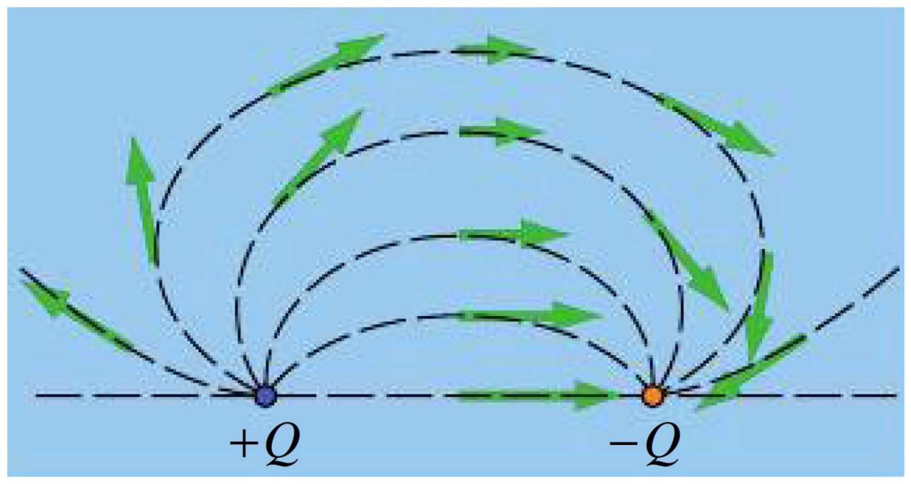

### 1.4.1) Propriétés 性质

Une <strong>ligne de champ</strong> d'un champ vectoriel \(\vec{A}\) est une courbe tangente en chaque point au champ \(\vec{A}\) et orientée dans le sens de \(\vec{A}\).

矢量场 \(\vec{A}\) 的<strong>场线</strong>是一条处处与场 \(\vec{A}\) 相切、并沿 \(\vec{A}\) 方向定向的曲线。
{: .zh }

Soit \(\mathrm{d}\overrightarrow{OM}\) le déplacement élémentaire. Pour obtenir les équations des lignes de champ du champ \(\vec{A}\) on utilise le système d'équations :

设 \(\mathrm{d}\overrightarrow{OM}\) 为元位移。为得到场 \(\vec{A}\) 的场线方程，使用如下方程组：
{: .zh }

\[
\left\{
\begin{aligned}
\vec{A}\wedge \mathrm{d}\overrightarrow{OM}&=\vec{0}\\
\vec{A}\cdot \mathrm{d}\overrightarrow{OM}&>0
\end{aligned}
\right.
\]

<strong>Rappel.</strong> « \(\wedge\) » est le produit vectoriel ; \(\vec{a}\wedge\vec{b}\) se dit « \(\vec{a}\) vectoriel \(\vec{b}\) », et peut aussi se noter \(\vec{a}\times\vec{b}\). « \(\cdot\) » est le produit scalaire ; \(\vec{a}\cdot\vec{b}\) se dit « \(\vec{a}\) scalaire \(\vec{b}\) ».

<strong>复习。</strong>「\(\wedge\)」是叉积（produit vectoriel），\(\vec{a}\wedge\vec{b}\) 读作「\(\vec{a}\) 叉乘 \(\vec{b}\)」，也可记作 \(\vec{a}\times\vec{b}\)；「\(\cdot\)」是点积（produit scalaire），\(\vec{a}\cdot\vec{b}\) 读作「\(\vec{a}\) 点乘 \(\vec{b}\)」。
{: .zh }

Pour deux vecteurs \(\begin{pmatrix}a_1\\a_2\\a_3\end{pmatrix}\) et \(\begin{pmatrix}b_1\\b_2\\b_3\end{pmatrix}\) :

对于两个向量 \(\begin{pmatrix}a_1\\a_2\\a_3\end{pmatrix}\) 与 \(\begin{pmatrix}b_1\\b_2\\b_3\end{pmatrix}\)：
{: .zh }

\[
\begin{pmatrix}a_1\\a_2\\a_3\end{pmatrix}\wedge
\begin{pmatrix}b_1\\b_2\\b_3\end{pmatrix}
=
\begin{pmatrix}
a_2b_3-a_3b_2\\
-a_1b_3+a_3b_1\\
a_1b_2-a_2b_1
\end{pmatrix},
\]

\[
\begin{pmatrix}a_1\\a_2\\a_3\end{pmatrix}\cdot
\begin{pmatrix}b_1\\b_2\\b_3\end{pmatrix}
=a_1b_1+a_2b_2+a_3b_3.
\]

Le déplacement élémentaire \(\mathrm{d}\overrightarrow{OM}\) s'écrit différemment suivant le système de coordonnées. Il existe trois systèmes de coordonnées : cartésiennes, cylindriques et sphériques.

元位移 \(\mathrm{d}\overrightarrow{OM}\) 在不同坐标系中有不同的写法。共有三种坐标系：笛卡尔坐标、柱坐标和球坐标。
{: .zh }

### 1.4.2) Coordonnées cartésiennes 笛卡尔坐标

Le point \(M\) est repéré par ses trois coordonnées \((x,y,z)\) à l'instant \(t\).

在时刻 \(t\)，点 \(M\) 由它的三个坐标 \((x,y,z)\) 确定。
{: .zh }

\((\vec{e}_x,\vec{e}_y,\vec{e}_z)\) sont les trois vecteurs de base du système de coordonnées cartésiennes tels que :

\((\vec{e}_x,\vec{e}_y,\vec{e}_z)\) 是笛卡尔坐标系的三基矢，满足：
{: .zh }

- \(\|\vec{e}_x\|=\|\vec{e}_y\|=\|\vec{e}_z\|=1\) ;
- \(\vec{e}_z=\vec{e}_x\wedge\vec{e}_y\).

On parle de <strong>base orthonormée directe</strong>.

这称为<strong>正交归一右手基底</strong>（base orthonormée directe）。
{: .zh }

Le vecteur position de \(M\) est :

点 \(M\) 的位置矢量为：
{: .zh }

\[
\overrightarrow{OM}=x\vec{e}_x+y\vec{e}_y+z\vec{e}_z.
\]

Le vecteur déplacement élémentaire est :

元位移矢量为：
{: .zh }

\[
\mathrm{d}\overrightarrow{OM}=\mathrm{d}x\,\vec{e}_x+\mathrm{d}y\,\vec{e}_y+\mathrm{d}z\,\vec{e}_z.
\]

Le vecteur vitesse est :

速度矢量为：
{: .zh }

\[
\frac{\mathrm{d}\overrightarrow{OM}}{\mathrm{d}t}
=\frac{\mathrm{d}x}{\mathrm{d}t}\vec{e}_x
+\frac{\mathrm{d}y}{\mathrm{d}t}\vec{e}_y
+\frac{\mathrm{d}z}{\mathrm{d}t}\vec{e}_z.
\]

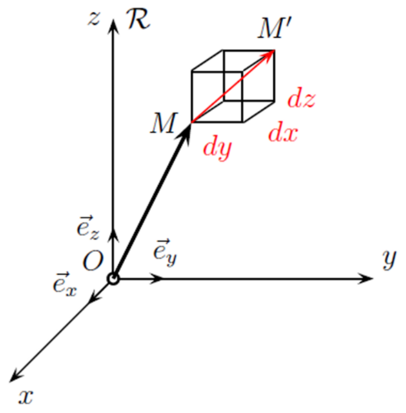

### 1.4.3) Coordonnées cylindriques 柱坐标

Le point \(M\) est repéré par :

点 \(M\) 由以下量确定：
{: .zh }

- La distance \(HM=r\) où \(H\) est le projeté orthogonal de \(M\) sur l'axe des \(z\) ;

    距离 \(HM=r\)，其中 \(H\) 是 \(M\) 在 \(z\) 轴上的正交投影。
    {: .zh }

- L'angle \(\theta\) entre \(\vec{e}_x\) et \(\overrightarrow{HM}\) ;

    \(\vec{e}_x\) 与 \(\overrightarrow{HM}\) 之间的夹角 \(\theta\)。
    {: .zh }

- L'altitude \(z\).

    高度 \(z\)。
    {: .zh }

\((\vec{e}_r,\vec{e}_\theta,\vec{e}_z)\) constitue la base orthonormée directe du système de coordonnées cylindriques avec \(\vec{e}_r=\dfrac{\overrightarrow{HM}}{r}\).

\((\vec{e}_r,\vec{e}_\theta,\vec{e}_z)\) 构成柱坐标系的正交归一右手基底，其中 \(\vec{e}_r=\dfrac{\overrightarrow{HM}}{r}\)。
{: .zh }

On peut décomposer \(\vec{e}_r\) et \(\vec{e}_\theta\) sur la base cartésienne :

可将 \(\vec{e}_r\) 与 \(\vec{e}_\theta\) 在笛卡尔基上分解：
{: .zh }

\[
\vec{e}_r=\cos(\theta)\,\vec{e}_x+\sin(\theta)\,\vec{e}_y,
\]

\[
\vec{e}_\theta=-\sin(\theta)\,\vec{e}_x+\cos(\theta)\,\vec{e}_y.
\]

Donc \(\mathrm{d}(\vec{e}_r)=\mathrm{d}(\cos(\theta))\vec{e}_x+\mathrm{d}(\sin(\theta))\vec{e}_y\).

因此 \(\mathrm{d}(\vec{e}_r)=\mathrm{d}(\cos(\theta))\vec{e}_x+\mathrm{d}(\sin(\theta))\vec{e}_y\)。
{: .zh }

\[
\mathrm{d}(\vec{e}_r)=-\mathrm{d}\theta\sin(\theta)\,\vec{e}_x+\mathrm{d}\theta\cos(\theta)\,\vec{e}_y=\mathrm{d}\theta\,\vec{e}_\theta.
\]

On a aussi :

同样有：
{: .zh }

\[
\mathrm{d}(\vec{e}_\theta)=-\mathrm{d}\theta\cos(\theta)\,\vec{e}_x-\mathrm{d}\theta\sin(\theta)\,\vec{e}_y=-\mathrm{d}\theta\,\vec{e}_r.
\]

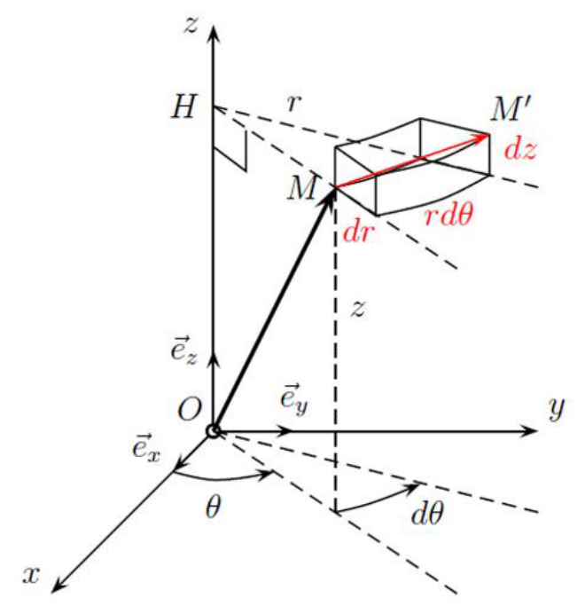

Le vecteur position de \(M\) est :

点 \(M\) 的位置矢量为：
{: .zh }

\[
\overrightarrow{OM}=r\vec{e}_r+z\vec{e}_z.
\]

Le vecteur déplacement élémentaire est :

元位移矢量为：
{: .zh }

\[
\mathrm{d}\overrightarrow{OM}=\mathrm{d}(r\vec{e}_r)+\mathrm{d}z\,\vec{e}_z
=r\,\mathrm{d}\vec{e}_r+\mathrm{d}r\,\vec{e}_r+\mathrm{d}z\,\vec{e}_z,
\]

\[
\mathrm{d}\overrightarrow{OM}=\mathrm{d}r\,\vec{e}_r+r\,\mathrm{d}\theta\,\vec{e}_\theta+\mathrm{d}z\,\vec{e}_z.
\]

Le vecteur vitesse est :

速度矢量为：
{: .zh }

\[
\frac{\mathrm{d}\overrightarrow{OM}}{\mathrm{d}t}
=\frac{\mathrm{d}r}{\mathrm{d}t}\vec{e}_r
+r\frac{\mathrm{d}\theta}{\mathrm{d}t}\vec{e}_\theta
+\frac{\mathrm{d}z}{\mathrm{d}t}\vec{e}_z.
\]

### 1.4.4) Coordonnées sphériques 球坐标

Le point \(M\) est repéré par :

点 \(M\) 由以下量确定：
{: .zh }

- La distance \(OM=r\) ;

    距离 \(OM=r\)。
    {: .zh }

- L'angle \(\theta\) entre \(\vec{e}_z\) et \(\overrightarrow{OM}\) ;

    \(\vec{e}_z\) 与 \(\overrightarrow{OM}\) 之间的夹角 \(\theta\)。
    {: .zh }

- L'angle \(\phi\) entre \(\vec{e}_x\) et \(\overrightarrow{OI}\), avec \(I\) le projeté de \(M\) sur le plan \((x,y)\).

    \(\vec{e}_x\) 与 \(\overrightarrow{OI}\) 之间的夹角 \(\phi\)，其中 \(I\) 是 \(M\) 在 \((x,y)\) 平面上的投影。
    {: .zh }

\((\vec{e}_r,\vec{e}_\theta,\vec{e}_\phi)\) constitue la base orthonormée directe du système de coordonnées sphériques avec \(\vec{e}_r=\dfrac{\overrightarrow{OM}}{r}\).

\((\vec{e}_r,\vec{e}_\theta,\vec{e}_\phi)\) 构成球坐标系的正交归一右手基底，其中 \(\vec{e}_r=\dfrac{\overrightarrow{OM}}{r}\)。
{: .zh }

Le vecteur position de \(M\) est :

点 \(M\) 的位置矢量为：
{: .zh }

\[
\overrightarrow{OM}=r\vec{e}_r.
\]

Le vecteur déplacement élémentaire est :

元位移矢量为：
{: .zh }

\[
\mathrm{d}\overrightarrow{OM}=\mathrm{d}r\,\vec{e}_r+r\,\mathrm{d}\theta\,\vec{e}_\theta
+r\sin(\theta)\,\mathrm{d}\phi\,\vec{e}_\phi.
\]

Le vecteur vitesse est :

速度矢量为：
{: .zh }

\[
\frac{\mathrm{d}\overrightarrow{OM}}{\mathrm{d}t}
=\frac{\mathrm{d}r}{\mathrm{d}t}\vec{e}_r
+r\frac{\mathrm{d}\theta}{\mathrm{d}t}\vec{e}_\theta
+r\sin(\theta)\frac{\mathrm{d}\phi}{\mathrm{d}t}\vec{e}_\phi.
\]

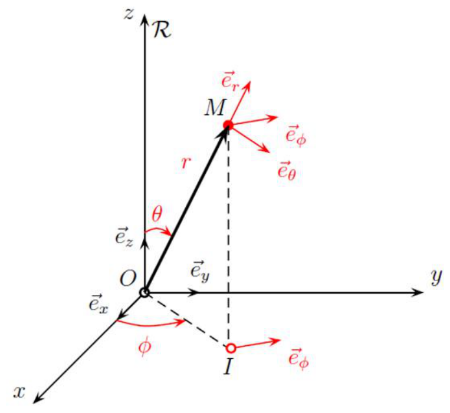

### 1.4.5) Exemples 例题

!!! info "Exemple 1 例 1"

    Déterminer les équations et la forme des lignes de champ dans le plan \(z=0\) du champ vectoriel défini en coordonnées cartésiennes par \(\vec{A}=2A_0\vec{e}_x+A_0\vec{e}_y\), avec \(A_0\) une constante strictement positive.

    求由笛卡尔坐标定义的矢量场 \(\vec{A}=2A_0\vec{e}_x+A_0\vec{e}_y\)（其中 \(A_0\) 为严格正常数）在平面 \(z=0\) 内的场线方程及其形状。
    {: .zh }

    <strong>Solution.</strong> Une ligne de champ est une courbe tangente en chaque point au vecteur champ et orientée dans le sens du champ. Dans le plan \(z=0\), en notant \(\vec{A}=A_x\vec{e}_x+A_y\vec{e}_y\), elle vérifie donc

    <strong>解答。</strong>场线是处处与场矢量相切、并沿场方向定向的曲线。在 \(z=0\) 平面内，记 \(\vec{A}=A_x\vec{e}_x+A_y\vec{e}_y\)，场线因而满足
    {: .zh }

    \[
    \frac{\mathrm{d}y}{\mathrm{d}x}=\frac{A_y}{A_x}.
    \]

    Ici \(A_x=2A_0\) et \(A_y=A_0\), donc \(\dfrac{\mathrm{d}y}{\mathrm{d}x}=\dfrac{1}{2}\) : les lignes de champ sont les droites

    这里 \(A_x=2A_0\)、\(A_y=A_0\)，故 \(\dfrac{\mathrm{d}y}{\mathrm{d}x}=\dfrac{1}{2}\)：场线是直线
    {: .zh }

    \[
    y=\frac{1}{2}x+C,\qquad C\in\mathbb{R}.
    \]

    Comme \(A_x=2A_0>0\), elles sont parcourues dans le sens des \(x\) croissants, donc aussi dans le sens des \(y\) croissants.

    由于 \(A_x=2A_0>0\)，场线沿 \(x\) 增大的方向定向，因而也沿 \(y\) 增大的方向。
    {: .zh }

!!! info "Exemple 2 例 2"

    Déterminer les équations et la forme des lignes de champ dans le plan \(z=0\) du champ électrique créé par un électron.

    求一个电子所产生的电场在平面 \(z=0\) 内的场线方程及其形状。
    {: .zh }

    <strong>Solution.</strong> Le champ créé par une charge ponctuelle \(q\) placée en l'origine \(O\) s'écrit, au point \(M\) de vecteur position \(\vec{r}=\overrightarrow{OM}\),

    <strong>解答。</strong>置于原点 \(O\) 的点电荷 \(q\) 在位置矢量为 \(\vec{r}=\overrightarrow{OM}\) 的点 \(M\) 处产生的场为
    {: .zh }

    \[
    \vec{E}(M)=\frac{q}{4\pi\varepsilon_0}\,\frac{\vec{r}}{r^{3}}.
    \]

    Les lignes de champ sont donc radiales : ce sont les droites passant par \(O\). Pour un électron, \(q=-e<0\) : le champ pointe vers l'électron, les lignes sont parcourues de l'extérieur vers \(O\) et convergent en \(O\), point singulier où \(\vec{E}\) n'est pas défini. Leurs équations sont

    因此场线是径向的：即所有过 \(O\) 的直线。对电子而言 \(q=-e<0\)：场指向电子，场线从外部指向 \(O\) 并在 \(O\) 点汇聚；该点是场无定义的奇点。场线方程为
    {: .zh }

    \[
    y=kx,\qquad k\in\mathbb{R}.
    \]

!!! warning "Vocabulaire clé &nbsp;&nbsp; 重点词汇 1.4 节核心术语"

    - <strong>ligne de champ</strong>：场线：处处与场相切、沿场方向定向的曲线。
    - <strong>produit vectoriel</strong>：叉积：向量间的矢量乘法，记作 \(\wedge\) 或 \(\times\)。
    - <strong>produit scalaire</strong>：点积：向量间的标量乘法，记作「\(\cdot\)」。
    - <strong>base orthonormée directe</strong>：正交归一右手基底：彼此正交的单位矢量构成、按右手定向的基。
    - <strong>déplacement élémentaire</strong>：元位移：描述一点局部位置或运动的极小位移。

## 1.5) Distributions de charges 电荷分布

### 1.5.1) Principe de superposition 叠加原理

On considère un ensemble de \(N\) charges ponctuelles, chacune source d'un champ électrostatique \(\vec{E}_k(M)\) au point \(M\). Le champ électrostatique total au point \(M\) est tel que :

考虑由 \(N\) 个点电荷组成的集合，每个点电荷都在点 \(M\) 处产生静电场 \(\vec{E}_k(M)\)。点 \(M\) 处的总静电场满足：
{: .zh }

\[
\vec{E}(M)=\sum_{k=1}^{N}\vec{E}_k(M).
\]

!!! demo ""

    <strong>Démonstration courte. &nbsp;&nbsp; 简要证明</strong>

    Soit une charge d'épreuve \(q_0\) placée en \(M\). La charge \(k\) exerce sur elle la force \(\vec{F}_k=q_0\,\vec{E}_k(M)\). D'après le principe de superposition des forces, la résultante est

    在 \(M\) 点放置一个检验电荷 \(q_0\)。第 \(k\) 个电荷对它施加的力为 \(\vec{F}_k=q_0\,\vec{E}_k(M)\)。根据力的叠加原理，合力为
    {: .zh }

    \[
    \vec{F}=\sum_{k=1}^{N}\vec{F}_k=q_0\sum_{k=1}^{N}\vec{E}_k(M).
    \]

    Or, par définition du champ total, \(\vec{F}=q_0\,\vec{E}(M)\). En identifiant les deux expressions et en divisant par \(q_0\neq 0\), on obtient bien

    而按总场的定义，\(\vec{F}=q_0\,\vec{E}(M)\)。比较两式并除以 \(q_0\neq 0\)，即得
    {: .zh }

    \[
    \vec{E}(M)=\sum_{k=1}^{N}\vec{E}_k(M).
    \]

### 1.5.2) Distributions de charges 电荷分布

Les distributions continues sont utilisées lorsque le nombre de charges ponctuelles est trop grand pour qu'on puisse les traiter individuellement. Ces charges peuvent être réparties sur une courbe : distribution <strong>linéique</strong> notée ici \(\Gamma\).

当点电荷数目多到无法逐个处理时，就采用连续分布。这些电荷可以分布在一条曲线上：称为<strong>线电荷分布</strong>（linéique），此处记作 \(\Gamma\)。
{: .zh }

Ce modèle de distribution est adapté si les charges sont proches de \((\Gamma)\) par rapport aux distances \(PM\).

当电荷到 \((\Gamma)\) 的距离相对于距离 \(PM\) 很小，即电荷紧邻曲线 \((\Gamma)\) 时，该分布模型适用。
{: .zh }

En notant \(\lambda\) la densité linéique de charges :

记 \(\lambda\) 为线电荷密度：
{: .zh }

\[
\vec{E}(M)=\int_{P\in(\Gamma)}\frac{\lambda\,\mathrm{d}l}{4\pi\varepsilon_0 PM^2}\,\vec{u}.
\]

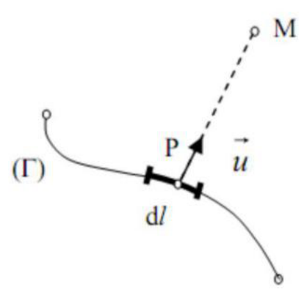

!!! info "Exemple 例"

    Déterminer le champ électrique créé par la distribution de charge \(\Gamma\) en rouge. Le point \(M\) est à une distance \(R\) de chaque point de cette distribution. L'angle \(\theta\) varie entre \(-\alpha\) et \(\alpha\). \(\lambda\) est constante.

    求图中红色电荷分布 \(\Gamma\) 所产生的电场。点 \(M\) 到该分布上每一点的距离均为 \(R\)。角 \(\theta\) 在 \(-\alpha\) 与 \(\alpha\) 之间变化，\(\lambda\) 为常数。
    {: .zh }

    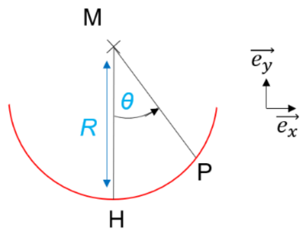

    <strong>Solution.</strong> On repère un élément de l'arc par l'angle \(\theta\in[-\alpha,\alpha]\) mesuré à partir de la médiatrice \(MH\). Cet élément a pour longueur \(\mathrm{d}l=R\,\mathrm{d}\theta\) et porte la charge \(\mathrm{d}q=\lambda\,\mathrm{d}l=\lambda R\,\mathrm{d}\theta\). Il crée en \(M\) le champ

    <strong>解答。</strong>用从对称轴 \(MH\) 量起的角 \(\theta\in[-\alpha,\alpha]\) 标记圆弧上的一个元段。该元段长度为 \(\mathrm{d}l=R\,\mathrm{d}\theta\)，带电 \(\mathrm{d}q=\lambda\,\mathrm{d}l=\lambda R\,\mathrm{d}\theta\)，在 \(M\) 点产生的场为
    {: .zh }

    \[
    \mathrm{d}E=\frac{\mathrm{d}q}{4\pi\varepsilon_0R^2}=\frac{\lambda\,\mathrm{d}\theta}{4\pi\varepsilon_0R},
    \]

    dirigé de l'élément vers \(M\) (répulsion pour \(\lambda>0\)). Par symétrie par rapport à l'axe \(MH\), les composantes perpendiculaires à \(MH\) de deux éléments symétriques s'annulent : le champ total est porté par \(MH\). La composante utile d'un élément est donc \(\mathrm{d}E\cos\theta\), et

    方向由元段指向 \(M\)（当 \(\lambda>0\) 时为排斥）。由关于 \(MH\) 轴的对称性，两个对称元段垂直于 \(MH\) 的分量相互抵消：总场沿 \(MH\) 方向。因此每个元段的有效分量为 \(\mathrm{d}E\cos\theta\)，于是
    {: .zh }

    \[
    E(M)=\int_{-\alpha}^{\alpha}\frac{\lambda R\,\mathrm{d}\theta}{4\pi\varepsilon_0R^2}\cos\theta
    =\frac{\lambda}{4\pi\varepsilon_0R}\int_{-\alpha}^{\alpha}\cos\theta\,\mathrm{d}\theta
    =\frac{\lambda\sin\alpha}{2\pi\varepsilon_0R}.
    \]

    Le champ est dirigé de \(H\) vers \(M\) pour \(\lambda>0\). On vérifie que \(E\to0\) lorsque \(\alpha\to0\) (arc de longueur nulle) et lorsque \(\alpha\to\pi\) (cercle complet, les contributions se compensent).

    当 \(\lambda>0\) 时，场由 \(H\) 指向 \(M\)。可以检验：当 \(\alpha\to0\)（弧长为零）与 \(\alpha\to\pi\)（完整圆周，各贡献相互抵消）时，\(E\to0\)。
    {: .zh }

\(\blacktriangleright\) Une surface : distribution <strong>surfacique</strong>. En notant \(\sigma(P)\) la densité surfacique de charge en un point \(P\) de la distribution :

\(\blacktriangleright\) 一个曲面：<strong>面电荷分布</strong>（surfacique）。记 \(\sigma(P)\) 为分布上点 \(P\) 处的面电荷密度：
{: .zh }

\[
\vec{E}(M)=\iint_{P\in(\Sigma)}\frac{\sigma\,\mathrm{d}S}{4\pi\varepsilon_0 PM^2}\,\vec{u}.
\]

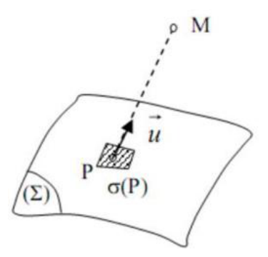

\(\blacktriangleright\) Un volume : distribution <strong>volumique</strong>. En notant \(\rho(P)\) la densité volumique de charge en un point \(P\) de la distribution :

\(\blacktriangleright\) 一个体积：<strong>体电荷分布</strong>（volumique）。记 \(\rho(P)\) 为分布上点 \(P\) 处的体电荷密度：
{: .zh }

\[
\vec{E}(M)=\iiint_{P\in(V)}\frac{\mathrm{d}q}{4\pi\varepsilon_0 PM^2}\,\vec{u}
=\iiint_{P\in(V)}\frac{\rho(P)\,\mathrm{d}V}{4\pi\varepsilon_0 PM^2}\,\vec{u}.
\]

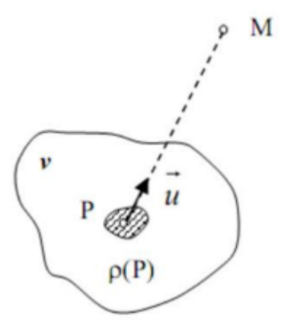

!!! warning "Vocabulaire clé &nbsp;&nbsp; 重点词汇 1.5 节核心术语"

    - <strong>principe de superposition</strong>：叠加原理：多个电荷产生的总场等于各自产生场之和。
    - <strong>distribution de charges</strong>：电荷分布：电荷的空间分布，可为点状或连续。
    - <strong>distribution linéique</strong>：线电荷分布：沿曲线连续分布、由 \(\lambda\) 表征。
    - <strong>densité linéique de charge</strong>：线电荷密度 \(\lambda\)：单位长度上的电荷。
    - <strong>distribution surfacique</strong>：面电荷分布：在曲面上连续分布、由 \(\sigma\) 表征。
    - <strong>densité surfacique de charge</strong>：面电荷密度 \(\sigma\)：单位面积上的电荷。
    - <strong>distribution volumique</strong>：体电荷分布：在体积内连续分布、由 \(\rho\) 表征。
    - <strong>densité volumique de charge</strong>：体电荷密度 \(\rho\)：单位体积上的电荷。

## 1.6) Énergie potentielle et potentiel électrostatique 势能与静电势

### 1.6.1) Énergie potentielle électrostatique 静电势能

!!! warning "Rappel 复习"

    Une force est conservative si et seulement si elle dérive d'une énergie potentielle \(E_p\). Par définition, le travail d'une force conservative ne dépend pas du chemin suivi.

    一个力是<strong>保守力</strong>（conservative），当且仅当它可由某一势能 \(E_p\) 导出。按定义，保守力做功与所经路径无关。
    {: .zh }

On note \(F_{12}\) la composante selon \(\vec{u}\) de la force électrostatique \(\overrightarrow{F_{12}}\) créée par une charge ponctuelle \(q_1\) sur une charge \(q_2\). On a donc :

记 \(F_{12}\) 为点电荷 \(q_1\) 对电荷 \(q_2\) 产生的静电力 \(\overrightarrow{F_{12}}\) 沿 \(\vec{u}\) 的分量。于是有：
{: .zh }

\[
F_{12}=\frac{q_1q_2}{4\pi\varepsilon_0 r^2}.
\]

On calcule le travail élémentaire \(\delta W\) de la force électrostatique lors d'un déplacement \(\mathrm{d}\vec{l}\) :

计算静电力在位移 \(\mathrm{d}\vec{l}\) 中的元功 \(\delta W\)：
{: .zh }

\[
\delta W=\overrightarrow{F_{12}}(M)\cdot \mathrm{d}\vec{l}
=\frac{q_1q_2}{4\pi\varepsilon_0 r^2}\,\mathrm{d}r.
\]

On voit que \(\delta W\) ne dépend pas du chemin suivi donc la force électrostatique est conservative. On remarque que :

可见 \(\delta W\) 与路径无关，因此静电力是保守力。注意到：
{: .zh }

\[
\delta W=-\mathrm{d}\!\left(\frac{q_1q_2}{4\pi\varepsilon_0 r}+\text{constante}\right)
=-\mathrm{d}(E_p).
\]

En pratique on choisit la constante nulle pour que l'énergie potentielle soit nulle à l'infini. Donc l'énergie potentielle électrostatique est \(E_p=\dfrac{q_1q_2}{4\pi\varepsilon_0 r}\).

实际中取该常数为零，使无穷远处的势能为零。因此静电势能为 \(E_p=\dfrac{q_1q_2}{4\pi\varepsilon_0 r}\)。
{: .zh }

!!! warning "Remarque 注意"

    L'énergie potentielle électrostatique associée à plusieurs charges ponctuelles est la somme des énergies potentielles associées à chaque charge. Pour une répartition continue de charge, l'énergie potentielle totale est l'intégrale des énergies potentielles élémentaires.

    多个点电荷的静电势能等于各电荷对应势能之和。对于连续电荷分布，总势能是各元势能的积分。
    {: .zh }

### 1.6.2) Potentiel électrostatique 静电势

En pratique on travaille souvent avec le champ électrostatique \(\vec{E}(M)\) créé par une charge \(q\) plutôt qu'avec la force associée. On pose alors le <strong>potentiel électrostatique</strong> \(V\) tel que \(V(M)=\dfrac{E_p(M)}{q_2}\). Ici \(q_2\) est la charge plongée dans le champ électrique \(\vec{E}\). Cela donne :

实际中，人们常使用电荷 \(q\) 产生的静电场 \(\vec{E}(M)\)，而不是相应的力。于是定义<strong>静电势</strong>（potentiel électrostatique）\(V\)，满足 \(V(M)=\dfrac{E_p(M)}{q_2}\)。这里 \(q_2\) 是置于电场 \(\vec{E}\) 中的电荷。由此得到：
{: .zh }

\[
V=\frac{q}{4\pi\varepsilon_0 r}.
\]

Cela implique aussi que pour le champ électrique \(\vec{E}\) créé par une charge ponctuelle :

这也意味着，对于点电荷产生的电场 \(\vec{E}\)：
{: .zh }

\[
\vec{E}(M)=-\frac{\mathrm{d}V}{\mathrm{d}r}\,\vec{u}.
\]

### 1.6.3) Circulation du champ électrostatique 静电场的环流

On considère une charge \(q\) dans un champ électrostatique \(\vec{E}(M)\). On note le déplacement élémentaire \(\mathrm{d}\vec{l}\) de la charge \(q\) à partir du point \(M\). On a :

考虑静电场 \(\vec{E}(M)\) 中的电荷 \(q\)。记电荷 \(q\) 从点 \(M\) 出发的元位移为 \(\mathrm{d}\vec{l}\)。有：
{: .zh }

\[
\mathrm{d}E_p=-\mathrm{d}E_c.
\]

Or, d'après le théorème de l'énergie cinétique, la variation d'énergie cinétique \(\mathrm{d}E_c\) est égale au travail élémentaire des forces extérieures \(\delta W\) :

而根据动能定理，动能变化 \(\mathrm{d}E_c\) 等于外力元功 \(\delta W\)：
{: .zh }

\[
\mathrm{d}(qV)=-\delta W,
\qquad
q\,\mathrm{d}V=-\vec{F}(M)\cdot \mathrm{d}\vec{l},
\]

\[
q\,\mathrm{d}V=-q\vec{E}(M)\cdot \mathrm{d}\vec{l},
\qquad
\mathrm{d}V=-\vec{E}(M)\cdot \mathrm{d}\vec{l}.
\]

La circulation du champ \(\vec{E}\) le long d'un chemin \(\Gamma_{AB}\) est :

场 \(\vec{E}\) 沿路径 \(\Gamma_{AB}\) 的<strong>环流</strong>（circulation）为：
{: .zh }

\[
C_{A\to B}=\int_{M\in\Gamma_{AB}}\vec{E}(M)\cdot \mathrm{d}\vec{l}.
\]

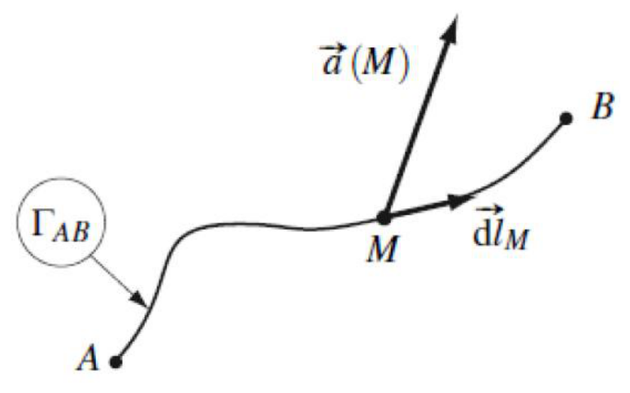

Cela implique que :

由此可得：
{: .zh }

\[
C_{A\to B}=-\int_{A}^{B}\mathrm{d}V=V(A)-V(B).
\]

<u>Remarques :</u>

<u>注：</u>
{: .zh }

- La circulation du champ électrostatique ne dépend que des potentiels électriques aux extrémités.

    静电场的环流只取决于两端点的电势。
    {: .zh }

- Par le principe de superposition, le potentiel électrostatique d'une distribution de charges est la somme des potentiels dus à chacune des charges.

    由叠加原理，电荷分布的静电势等于各电荷所产生电势之和。
    {: .zh }

- Le potentiel \(V\) est défini à une constante additive près (seule sa variation est connue).

    电势 \(V\) 定义到一个可加常数（只有其变化量是已知的）。
    {: .zh }

- Pour une distribution d'extension finie, c'est-à-dire dans une zone bornée de l'espace, \(V\) est pris nul à l'infini, ce qui fixe la constante.

    对于有限延伸的分布，即位于空间有界区域内的分布，取无穷远处 \(V=0\)，从而固定该常数。
    {: .zh }

- \(V(A)-V(B)\) est ce que l'on appelle la tension. Son unité est le volt et on la note \(U\).

    \(V(A)-V(B)\) 称为<strong>电压</strong>（tension），单位为伏特（V），记作 \(U\)。
    {: .zh }

### 1.6.4) Équipotentielle et lignes de champ 等势线与场线

Une <strong>équipotentielle</strong> est une courbe telle qu'en tout point \(P\) de la courbe \(V(P)=\text{cste}\).

<strong>等势线</strong>（équipotentielle）是一条曲线，其上每一点 \(P\) 都满足 \(V(P)=\text{cste}\)。
{: .zh }

On rappelle que \(\mathrm{d}V=-\vec{E}(M)\cdot \mathrm{d}\vec{l}\). Une équipotentielle est décrite par \(\mathrm{d}V=0\). Cela implique que \(\mathrm{d}\vec{l}\) est perpendiculaire à \(\vec{E}(M)\). Les équipotentielles sont des courbes perpendiculaires au champ électrostatique \(\vec{E}(M)\). Puisque les lignes de champ sont tangentes à \(\vec{E}(M)\), elles sont aussi orthogonales aux équipotentielles.

复习：\(\mathrm{d}V=-\vec{E}(M)\cdot \mathrm{d}\vec{l}\)。等势线由 \(\mathrm{d}V=0\) 描述，这意味着 \(\mathrm{d}\vec{l}\) 垂直于 \(\vec{E}(M)\)。因此等势线是垂直于静电场 \(\vec{E}(M)\) 的曲线。由于场线与 \(\vec{E}(M)\) 相切，场线也与等势线正交。
{: .zh }

Les lignes de champ électrostatique ne se croisent jamais, sauf en un <strong>point singulier</strong>, c'est-à-dire tel que \(\vec{E}(M)\) n'est pas défini en ce point (exemple : particule ponctuelle) ou est nul en ce point (exemple : au milieu de deux charges \(q\) et \(-q\)).

静电场线永不相交，除非在<strong>奇点</strong>（point singulier）处，即 \(\vec{E}(M)\) 在该点未定义（例如点粒子处）或为零（例如两个电荷 \(q\) 与 \(-q\) 的中点处）。
{: .zh }

Dans une zone vide de charge, le long d'une ligne de champ, le champ électrique est plus intense lorsque les lignes de champ voisines se resserrent. Au contraire, il est moins intense quand les lignes de champ voisines s'écartent.

在无电荷区域，沿一条场线看，相邻场线越密集处电场越强；相反，相邻场线越稀疏处电场越弱。
{: .zh }

Le schéma ci-dessous représente le champ électrostatique issu de deux charges égales. Sur ce schéma les lignes de champ sont en rouge et les équipotentielles en noir.

下图表示由两个等量电荷产生的静电场。图中红色为场线，黑色为等势线。
{: .zh }

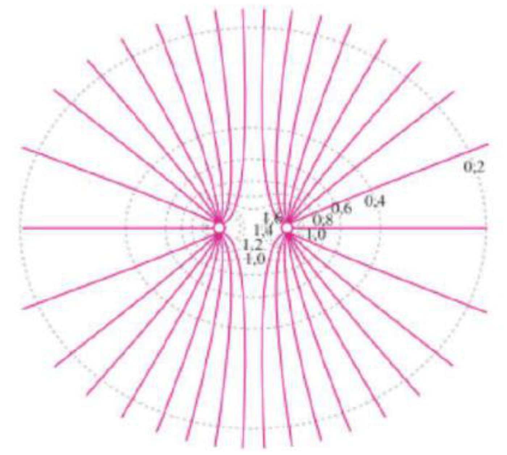

!!! warning "Vocabulaire clé &nbsp;&nbsp; 重点词汇 1.6 节核心术语"

    - <strong>force conservative</strong>：保守力：由势能导出、做功与路径无关的力。
    - <strong>énergie potentielle électrostatique</strong>：静电势能：与静电相互作用相关的势能，通常取无穷远处为零。
    - <strong>potentiel électrostatique</strong>：静电势：单位电荷的静电势能，记作 \(V\)。
    - <strong>circulation du champ</strong>：静电场的环流：场沿路径的积分，只取决于两端电势。
    - <strong>équipotentielle</strong>：等势线／等势面：电势处处相同的曲线或曲面。
    - <strong>point singulier</strong>：奇点：场未定义或为零的点。
    - <strong>constante additive</strong>：加性常数：可加在电势上而不改变其变化量的常数。

## Glossaire 术语表

本章全部词汇，连同其中文译名与双语释义。

| Terme français | 中文 | Définition / 释义 |
|---|---|---|
| charge électrique | 电荷 | Propriété physique de la matière pouvant être positive, négative ou nulle. La charge totale d'un système fermé se conserve.（物质的物理属性，可为正、负或零；封闭系统的总电荷守恒。） |
| charge ponctuelle | 点电荷 | Charge que l'on peut considérer comme concentrée en un point lorsque la distance d'observation est très grande devant la taille de l'objet chargé.（当观察距离远大于带电物体尺寸时，可视为集中于一点的电荷。） |
| électron | 电子 | Particule élémentaire portant une charge électrique négative.（带负电荷的基本粒子。） |
| proton | 质子 | Particule portant une charge électrique positive.（带正电荷的粒子。） |
| conservation de la charge | 电荷守恒 | Dans un système fermé, la charge électrique totale reste constante.（在封闭系统中，总电荷保持不变。） |
| référentiel galiléen | 伽利略参考系（惯性参考系） | Référentiel dans lequel le principe d'inertie est vérifié.（满足惯性原理的参考系。） |
| force de Coulomb | 库仑力 | Force électrique exercée entre deux particules ponctuelles chargées.（两个带电质点之间施加的电场力。） |
| permittivité du vide | 真空介电常数 | Constante physique intervenant dans l'expression de la force de Coulomb ; elle est notée \(\varepsilon_0\).（出现在库仑力表达式中的物理常数，记作 \(\varepsilon_0\)。） |
| champ électrique | 电场 | Champ vectoriel qui décrit l'action électrique exercée sur une charge placée en un point de l'espace.（描述空间某点处对置于该点的电荷所施加电作用的矢量场。） |
| champ électrostatique | 静电场 | Champ électrique créé par des charges immobiles ; dans le cours, il ne dépend alors que de la position.（由静止电荷产生的电场；在课程中它只依赖于位置。） |
| champ scalaire | 标量场 | Champ dont la valeur en chaque point est un scalaire.（每点取值均为标量的场。） |
| champ vectoriel | 矢量场 | Champ dont la valeur en chaque point est un vecteur, comme le champ électrique.（每点取值均为矢量的场，如电场。） |
| champ uniforme | 均匀场 | Champ qui ne dépend pas de la position.（不依赖于位置的场。） |
| champ stationnaire | 稳恒场／静态场 | Champ qui ne dépend pas du temps.（不依赖于时间的场。） |
| ligne de champ | 场线 | Courbe tangente au champ vectoriel en chaque point et orientée dans le sens du champ.（处处与矢量场相切、并沿场方向定向的曲线。） |
| base orthonormée directe | 正交归一右手基底 | Base de vecteurs unitaires orthogonaux entre eux et orientée de manière directe.（由彼此正交的单位矢量构成、并按右手方向定向的基底。） |
| coordonnées cartésiennes | 笛卡尔坐标 | Système de coordonnées dans lequel un point est repéré par \((x,y,z)\).（用 \((x,y,z)\) 确定一点位置的坐标系。） |
| coordonnées cylindriques | 柱坐标 | Système de coordonnées utilisant notamment une distance radiale \(r\), un angle \(\theta\) et une altitude \(z\).（使用径向距离 \(r\)、角度 \(\theta\) 和高度 \(z\) 的坐标系。） |
| coordonnées sphériques | 球坐标 | Système de coordonnées utilisant une distance \(r\) et deux angles \(\theta\) et \(\phi\) pour repérer un point.（用距离 \(r\) 和两个角 \(\theta\)、\(\phi\) 确定一点位置的坐标系。） |
| déplacement élémentaire | 元位移 | Très petit déplacement utilisé pour décrire localement la position ou le mouvement d'un point.（用于局部描述一点位置或运动的极小位移。） |
| principe de superposition | 叠加原理 | Le champ électrostatique total créé par plusieurs charges est la somme des champs créés par chacune des charges.（多个电荷产生的总静电场等于各电荷单独产生场之和。） |
| distribution de charges | 电荷分布 | Répartition spatiale de charges, pouvant être modélisée comme ponctuelle ou continue.（电荷的空间分布，可建模为点电荷或连续分布。） |
| distribution linéique | 线电荷分布 | Distribution continue de charges le long d'une courbe, caractérisée par une densité linéique \(\lambda\).（沿曲线连续分布的电荷，由线电荷密度 \(\lambda\) 表征。） |
| densité linéique de charge | 线电荷密度 | Charge électrique répartie par unité de longueur ; elle est notée \(\lambda\).（单位长度上的电荷，记作 \(\lambda\)。） |
| distribution surfacique | 面电荷分布 | Distribution continue de charges sur une surface, caractérisée par une densité surfacique \(\sigma\).（在曲面上连续分布的电荷，由面电荷密度 \(\sigma\) 表征。） |
| densité surfacique de charge | 面电荷密度 | Charge électrique répartie par unité de surface ; elle est notée \(\sigma\).（单位面积上的电荷，记作 \(\sigma\)。） |
| distribution volumique | 体电荷分布 | Distribution continue de charges dans un volume, caractérisée par une densité volumique \(\rho\).（在体积内连续分布的电荷，由体电荷密度 \(\rho\) 表征。） |
| densité volumique de charge | 体电荷密度 | Charge électrique répartie par unité de volume ; elle est notée \(\rho\).（单位体积上的电荷，记作 \(\rho\)。） |
| force conservative | 保守力 | Force qui dérive d'une énergie potentielle et dont le travail ne dépend pas du chemin suivi.（由势能导出、且做功与路径无关的力。） |
| énergie potentielle électrostatique | 静电势能 | Énergie potentielle associée à l'interaction électrostatique ; le cours choisit généralement sa valeur nulle à l'infini.（与静电相互作用相关的势能；课程通常取无穷远处为零。） |
| potentiel électrostatique | 静电势 | Grandeur définie à partir de l'énergie potentielle électrostatique par unité de charge.（由单位电荷的静电势能定义的物理量。） |
| circulation du champ électrostatique | 静电场的环流 | Intégrale du champ électrostatique le long d'un chemin ; elle ne dépend que des potentiels aux extrémités.（静电场沿路径的积分；只取决于两端点的电势。） |
| équipotentielle | 等势线／等势面 | Courbe dont tous les points possèdent le même potentiel électrique.（所有点电势相同的曲线。） |
| point singulier | 奇点 | Point où le champ n'est pas défini ou est nul ; les lignes de champ peuvent alors se rencontrer.（场未定义或为零的点；场线可在该点相交。） |
| constante additive | 加性常数 | Constante qui peut être ajoutée au potentiel sans modifier sa variation ; le cours fixe souvent cette constante en prenant \(V=0\) à l'infini.（可加在电势上而不改变其变化量的常数；课程常取无穷远处 \(V=0\) 来固定它。） |
