# 第 2 章　高斯定理

Chapitre n°2 — Théorème de Gauss

中法对照讲义 · 静电学部分

!!! info "阅读说明"

    每段先列法语原文；其下缩进、带深蓝竖条的小字号段落为中文翻译。<strong>加粗</strong>为关键词，括号内为中文释义。

## 2.1) Définitions et concepts 定义与概念

### 2.1.1) Symétries 对称性

La distribution de charges \(D\) est symétrique par rapport au plan \(\Pi\) si et seulement si :

电荷分布 \(D\) 关于平面 \(\Pi\) 对称，当且仅当：
{: .zh }

- Pour tout point \(M\in D\), le symétrique \(M'\) de \(M\) par rapport à \(\Pi\) (noté \(M'=\mathrm{sym}(M)\)) appartient à la distribution ;

    对任意点 \(M\in D\)，\(M\) 关于 \(\Pi\) 的对称点 \(M'\)（记作 \(M'=\mathrm{sym}(M)\)）仍属于该分布；
    {: .zh }

- \(\rho(M')=\rho(M)\).

    \(\rho(M')=\rho(M)\)。
    {: .zh }

Un plan de symétrie « coupe » la distribution de charges en deux distributions miroirs et de même signe de part et d'autre du plan.

对称平面把电荷分布“切成”两份互为镜像、且电荷符号相同的分布。
{: .zh }

La distribution de charges \(D\) est antisymétrique par rapport au plan \(\Pi\) si et seulement si :

电荷分布 \(D\) 关于平面 \(\Pi\) 反对称，当且仅当：
{: .zh }

- Pour tout point \(M\in D\), le symétrique \(M'\) de \(M\) par rapport à \(\Pi\) appartient à la distribution ;

    对任意点 \(M\in D\)，\(M\) 关于 \(\Pi\) 的对称点 \(M'\) 仍属于该分布；
    {: .zh }

- \(\rho(M')=-\rho(M)\).

    \(\rho(M')=-\rho(M)\)。
    {: .zh }

Un plan d'antisymétrie « coupe » la distribution de charges en deux distributions miroirs mais de signe opposé de part et d'autre du plan.

反对称平面把电荷分布“切成”两份互为镜像、但电荷符号相反的分布。
{: .zh }

<strong>Principe de Curie</strong> : les éléments de symétrie des causes se retrouvent dans les effets.

<strong>居里原理</strong>（principe de Curie）：原因的对称要素必然出现在结果之中。
{: .zh }

En appliquant le principe de Curie avec \(M'=\mathrm{sym}(M)\) :

把居里原理用于 \(M'=\mathrm{sym}(M)\)：
{: .zh }

- Si \(\Pi\) est un plan de <strong>symétrie</strong> de la distribution de charges, \(\vec{E}(M')=\mathrm{sym}\bigl(\vec{E}(M)\bigr)\) ; et si \(M\in\Pi\), alors \(\vec{E}(M)\in\Pi\).

    若 \(\Pi\) 是电荷分布的<strong>对称平面</strong>，则 \(\vec{E}(M')=\mathrm{sym}\bigl(\vec{E}(M)\bigr)\)；且若 \(M\in\Pi\)，则 \(\vec{E}(M)\in\Pi\)。
    {: .zh }

- Si \(\Pi\) est un plan <strong>d'antisymétrie</strong> de la distribution de charges, \(\vec{E}(M')=-\mathrm{sym}\bigl(\vec{E}(M)\bigr)\) ; et si \(M\in\Pi\), alors \(\vec{E}(M)\) est orthogonal à \(\Pi\).

    若 \(\Pi\) 是电荷分布的<strong>反对称平面</strong>，则 \(\vec{E}(M')=-\mathrm{sym}\bigl(\vec{E}(M)\bigr)\)；且若 \(M\in\Pi\)，则 \(\vec{E}(M)\) 垂直于 \(\Pi\)。
    {: .zh }

En pratique, un plan d'antisymétrie donne directement la direction de \(\vec{E}\), alors qu'il faut deux plans de symétrie pour cela. Attention : les plans de symétrie ou d'antisymétrie choisis doivent passer par \(M\).

实用上，一个反对称平面就能直接给出 \(\vec{E}\) 的方向，而用对称平面则需要两个。注意：所选的对称平面或反对称平面都必须经过 \(M\)。
{: .zh }

!!! note ""

    <strong>Exemple.</strong> Le champ \(\vec{E}(M)\) est indiqué par la flèche rouge. \(Q>0\). Dessiner le champ \(\vec{E}\) en \(M'\) et pour les points appartenant à \(\Pi^{*}\).

    <strong>例。</strong>场 \(\vec{E}(M)\) 由红色箭头表示，\(Q>0\)。画出 \(M'\) 处的场 \(\vec{E}\)，以及属于 \(\Pi^{*}\) 的各点处的场。
    {: .zh }

    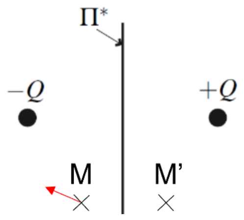

    <strong>Réponse.</strong> Le plan \(\Pi^{*}\) échange les deux charges : la distribution est <em>antisymétrique</em> par rapport à \(\Pi^{*}\). Par conséquent \(\vec{E}(M')=-\mathrm{sym}_{\Pi^{*}}\bigl(\vec{E}(M)\bigr)\) : le champ en \(M'\) est le symétrique du champ en \(M\) par rapport à \(\Pi^{*}\), changé de sens. Pour tout point de \(\Pi^{*}\), le champ est perpendiculaire à \(\Pi^{*}\) (ici il pointe vers la région de la charge \(-Q\)).

    <strong>解答。</strong>平面 \(\Pi^{*}\) 交换两个电荷：分布关于 \(\Pi^{*}\) 是<strong>反对称</strong>的。因此 \(\vec{E}(M')=-\mathrm{sym}_{\Pi^{*}}\bigl(\vec{E}(M)\bigr)\)：\(M'\) 处的场等于 \(M\) 处的场关于 \(\Pi^{*}\) 的镜像再反向。对于 \(\Pi^{*}\) 上任一点，场垂直于 \(\Pi^{*}\)（此处指向 \(-Q\) 电荷一侧）。
    {: .zh }

### 2.1.2) Invariances 不变性

<strong>Par translation.</strong> La distribution de charges \(D\) est invariante par translation de vecteur \(\vec{a}\) si et seulement si :

<strong>平移。</strong>电荷分布 \(D\) 在平移向量 \(\vec{a}\) 下不变，当且仅当：
{: .zh }

- Pour tout \(M\in D\), l'image \(M'\) de \(M\) par translation de vecteur \(\vec{a}\) appartient à \(D\) ;

    对任意 \(M\in D\)，\(M\) 经平移 \(\vec{a}\) 后的像 \(M'\) 仍属于 \(D\)；
    {: .zh }

- \(\rho(M')=\rho(M)\).

    \(\rho(M')=\rho(M)\)。
    {: .zh }

<strong>Par rotation.</strong> La distribution de charges \(D\) est invariante par rotation d'axe \(\Delta\) et d'angle \(\theta\) si et seulement si :

<strong>旋转。</strong>电荷分布 \(D\) 在绕轴 \(\Delta\)、转角 \(\theta\) 的旋转下不变，当且仅当：
{: .zh }

- Pour tout \(M\in D\), l'image \(M'\) de \(M\) par cette rotation appartient à \(D\) ;

    对任意 \(M\in D\)，\(M\) 经该旋转后的像 \(M'\) 仍属于 \(D\)；
    {: .zh }

- \(\rho(M')=\rho(M)\).

    \(\rho(M')=\rho(M)\)。
    {: .zh }

En appliquant le principe de Curie, si la distribution de charges est invariante par translation selon \(\vec{e}_z\), cela signifie que \(\vec{E}\) <strong>en tout point de l'espace</strong> ne dépend pas de \(z\), de même pour le potentiel électrostatique \(V\).

应用居里原理：若电荷分布在沿 \(\vec{e}_z\) 的平移下不变，则<strong>空间任意一点</strong>的 \(\vec{E}\) 不依赖于 \(z\)，静电势 \(V\) 亦然。
{: .zh }

Dans le cas d'une invariance de la distribution par rotation d'angle \(\theta\), \(\vec{E}\) et \(V\) en tout point de l'espace ne dépendent pas de \(\theta\).

若分布绕轴旋转角 \(\theta\) 不变，则空间任意一点的 \(\vec{E}\) 与 \(V\) 都不依赖于 \(\theta\)。
{: .zh }

### 2.1.3) Énoncé du théorème de Gauss 高斯定理的表述

Le flux du champ électrostatique au travers d'une surface est par définition :

静电场通过某一曲面的<strong>通量</strong>（flux），按定义为：
{: .zh }

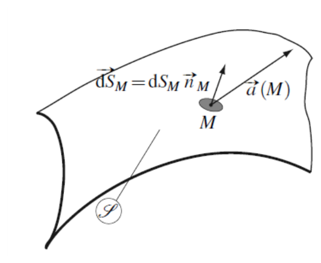

\[
\Phi=\iint_{M\in S}\vec{E}(M)\,\cdot\,\overrightarrow{\mathrm{d}S}(M).
\]

On peut a priori orienter la surface de deux façons différentes. Lorsque celle-ci est fermée on l'orientera toujours par convention vers l'extérieur (le flux déterminé sera ainsi le flux sortant) et on notera :

原则上，曲面有两种不同的定向方式。当曲面闭合时，按惯例总取外法向（这样得到的通量即为向外通量），并记作：
{: .zh }

\[
\Phi=\oint_{M\in S}\vec{E}(M)\,\cdot\,\overrightarrow{\mathrm{d}S}(M).
\]

!!! danger "Théorème de Gauss 高斯定理"

    Le flux du champ électrostatique \(\vec{E}\) au travers d'une surface <strong>fermée</strong> \(S\) (appelée surface de Gauss) est tel que :

    静电场 \(\vec{E}\) 通过<strong>闭合</strong>曲面 \(S\)（称为<strong>高斯面</strong>）的通量满足：
    {: .zh }

    \[
    \Phi=\oint_{M\in S}\vec{E}(M)\,\cdot\,\overrightarrow{\mathrm{d}S}(M)=\frac{Q_{int}}{\varepsilon_0},
    \]

    en notant \(Q_{int}\) la charge totale contenue à l'intérieur du volume délimité par la surface \(S\).

    其中 \(Q_{int}\) 表示由曲面 \(S\) 所围体积内部的电荷总量。
    {: .zh }

Ce théorème sera démontré à partir des équations de Maxwell (vues en 3e année).

该定理将在 Maxwell 方程组（三年级课程）的基础上证明。
{: .zh }

Attention, le champ \(\vec{E}\) qui apparaît dans le théorème de Gauss est le champ dû à <em>toutes</em> les charges (y compris celles éventuellement en dehors du volume délimité par la surface de Gauss choisie).

注意：高斯定理中出现的场 \(\vec{E}\) 是由<em>全部</em>电荷产生的场（包括可能位于所选高斯面之外的那些电荷）。
{: .zh }

## 2.2) Exemples à fort degré de symétrie 高对称性示例

### 2.2.1) Plan infini 无限大平面

On considère une plaque métallique porteuse d'une charge surfacique \(\sigma\).

考虑一块带面电荷 \(\sigma\) 的金属板。
{: .zh }

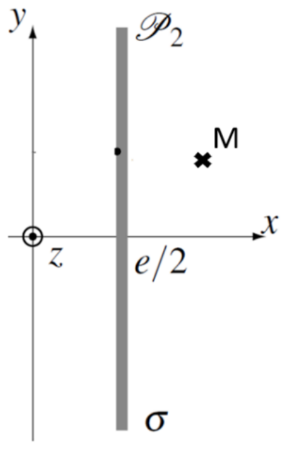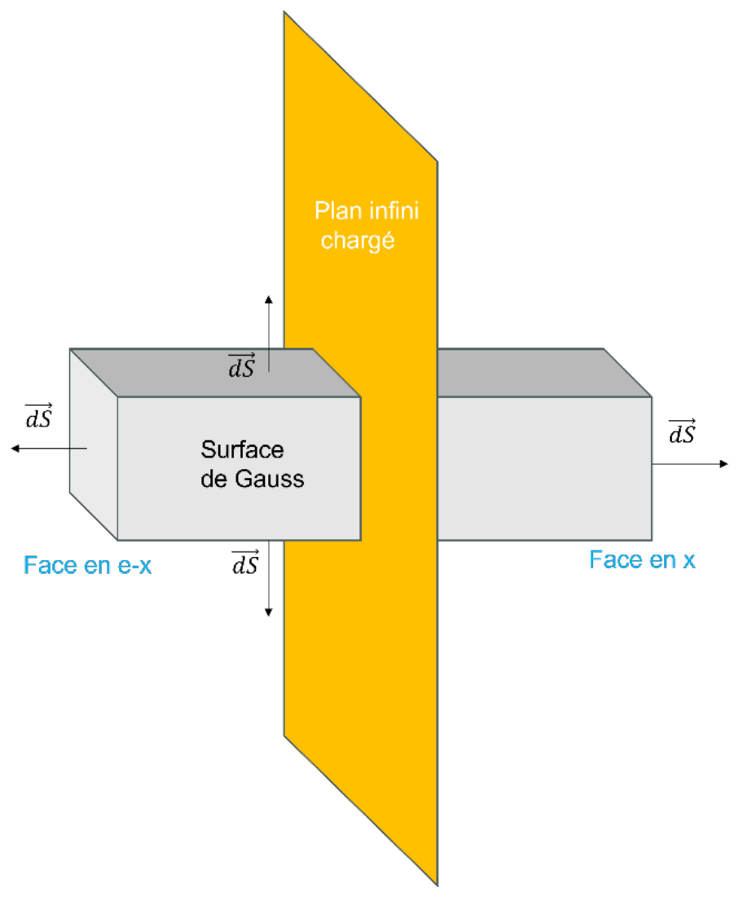

On s'intéresse au champ électrostatique \(\vec{E}\) qu'elle génère en un point \(M(x,y,z)\) de l'espace suffisamment éloigné des bords pour qu'on puisse supposer la plaque de dimensions infinies selon \(y\) et \(z\).

我们关心它在空间一点 \(M(x,y,z)\) 处产生的静电场 \(\vec{E}\)，该点离边缘足够远，以致可以认为板在 \(y\) 与 \(z\) 方向上是无限大的。
{: .zh }

!!! note ""

    <u>Symétries :</u> tout plan contenant la normale \(Ox\) et le point \(M\) est un plan de symétrie de la distribution. L'intersection de deux tels plans est l'axe \(Ox\), donc \(\vec{E}(M)\) est porté par \(\vec{e}_x\).

    <u>对称性：</u>任何包含法线 \(Ox\) 且经过点 \(M\) 的平面都是电荷分布的对称平面。两个这样的平面的交线是 \(Ox\) 轴，因此 \(\vec{E}(M)\) 沿 \(\vec{e}_x\) 方向。
    {: .zh }

    <u>Invariances :</u> la distribution est invariante par toute translation parallèle à \((Oy)\) ou à \((Oz)\) ; le champ ne dépend donc ni de \(y\) ni de \(z\), soit \(\vec{E}(M)=E(x)\,\vec{e}_x\).

    <u>不变性：</u>分布在任何平行于 \((Oy)\) 或 \((Oz)\) 的平移下不变；因此场既不依赖于 \(y\) 也不依赖于 \(z\)，即 \(\vec{E}(M)=E(x)\,\vec{e}_x\)。
    {: .zh }

Plaçons-nous dans le cas où \(x>e/2\), le point \(M(x,y,z)\) étant donc situé à droite de la distribution sur le schéma.

取 \(x>e/2\) 的情形，即点 \(M(x,y,z)\) 位于图中分布的右侧。
{: .zh }

On peut choisir comme surface de Gauss un cube symétrique par rapport à la plaque, dont les faces latérales sont situées en \(e-x\) et \(x\) pour que le point \(M\) appartienne à la face située en \(x\). On note \(S\) l'aire d'une face. C'est une surface fermée à laquelle appartient \(M\), donc on peut appliquer le théorème de Gauss :

可取一个关于板对称的立方体作为高斯面，使其侧面位于 \(e-x\) 与 \(x\) 处，从而点 \(M\) 属于位于 \(x\) 的那个面。记 \(S\) 为一个面的面积。这是一个包含 \(M\) 的闭合曲面，因此可以应用高斯定理：
{: .zh }

\[
\Phi=\oint_{M\in S}\vec{E}(M)\,\cdot\,\overrightarrow{\mathrm{d}S}(M).
\]

Comme \(\vec{E}\) est selon \(\vec{e}_x\), le champ est orthogonal à \(\overrightarrow{\mathrm{d}S}\) sur toutes les faces du cube sauf celles en \(e-x\) et \(x\). De plus, comme le plan contenant la distribution est un plan de symétrie :

由于 \(\vec{E}\) 沿 \(\vec{e}_x\) 方向，除 \(e-x\) 与 \(x\) 两个面外，立方体各面上场都垂直于 \(\overrightarrow{\mathrm{d}S}\)。此外，由于包含分布的平面是对称平面：
{: .zh }

\[
\vec{E}(x)=\mathrm{sym}\bigl(\vec{E}(e-x)\bigr)=-\vec{E}(x).
\]

Les faces latérales du cube sont parallèles à \(\vec{E}\) : le flux y est nul. Seules les faces situées en \(x\) et en \(e-x\) contribuent. En orientant les normales vers l'extérieur du cube et en utilisant \(\vec{E}(e-x)=-\vec{E}(x)\) :

立方体的侧面平行于 \(\vec{E}\)：通过侧面的通量为零。只有位于 \(x\) 与 \(e-x\) 的两个面有贡献。取法线指向立方体外部，并利用 \(\vec{E}(e-x)=-\vec{E}(x)\)：
{: .zh }

\[
\Phi=\underbrace{E(x)\,S}_{\text{face en }x}+\underbrace{E(x)\,S}_{\text{face en }e-x}=2E(x)\,S.
\]

La charge enfermée dans le cube est \(Q_{int}=\sigma S\). Le théorème de Gauss donne donc :

立方体内包围的电荷为 \(Q_{int}=\sigma S\)。因此高斯定理给出：
{: .zh }

\[
2E(x)\,S=\frac{\sigma S}{\varepsilon_0}
\qquad\Longrightarrow\qquad
E(x)=\frac{\sigma}{2\varepsilon_0}\qquad(x>e/2).
\]

Le champ est uniforme, normal au plan et dirigé vers l'extérieur pour \(\sigma>0\). Par symétrie par rapport au plan médian, on en déduit pour \(x<e/2\) : \(E(x)=-\dfrac{\sigma}{2\varepsilon_0}\).

场是均匀的，垂直于平面；当 \(\sigma>0\) 时指向外侧。由关于中面的对称性可推出 \(x<e/2\) 时 \(E(x)=-\dfrac{\sigma}{2\varepsilon_0}\)。
{: .zh }

La distribution étant symétrique par rapport aux plans \((yOz)\) et \((zOx)\), on a \(\vec{E}(x)=-\vec{E}(e-x)\) quel que soit \(x\), ce qui permet de conclure dans le cas où \(x<e/2\) (point \(M\) à gauche de la distribution) :

由于分布关于 \((yOz)\) 与 \((zOx)\) 张成的平面对称，对任意 \(x\) 都有 \(\vec{E}(x)=-\vec{E}(e-x)\)，由此可对 \(x<e/2\)（点 \(M\) 位于分布左侧）的情形得出结论：
{: .zh }

\[
E(x)=-\frac{\sigma}{2\varepsilon_0}.
\]

### 2.2.2) Problème à symétrie cylindrique 柱对称问题

Étudions maintenant le cas d'un cylindre de rayon \(a\) et de longueur \(L\) telle que \(L\gg a\) portant une densité volumique de charge uniforme \(\rho\).

现在研究半径为 \(a\)、长度 \(L\gg a\) 的圆柱，它带有均匀体电荷密度 \(\rho\)。
{: .zh }

On s'intéresse au champ électrostatique produit en un point \(M\) situé à une distance de l'axe du cylindre faible par rapport à \(L\), de sorte qu'on puisse le considérer de longueur infinie selon \(\vec{e}_z\).

关心在距圆柱轴的距离远小于 \(L\) 的点 \(M\) 处产生的静电场，从而可把它看作沿 \(\vec{e}_z\) 无限长的圆柱。
{: .zh }

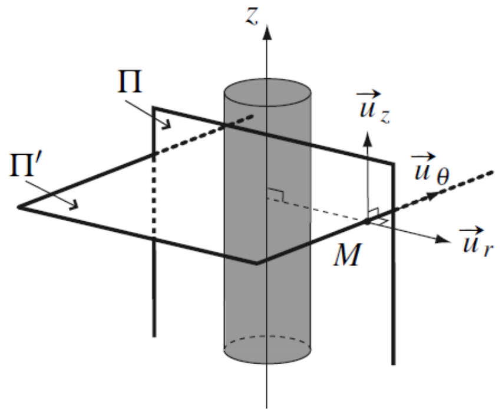

On repère \(M\) en coordonnées cylindriques \(M(r,\theta,z)\).

用柱坐标 \(M(r,\theta,z)\) 标记点 \(M\)。
{: .zh }

!!! note ""

    <u>Symétries de la distribution :</u> tout plan contenant l'axe du cylindre et le point \(M\) est un plan de symétrie ; le plan perpendiculaire à l'axe passant par \(M\) l'est aussi (cylindre considéré comme infini). Leur intersection est la droite radiale passant par \(M\), donc \(\vec{E}(M)\) est porté par \(\vec{u}_r\).

    <u>分布的对称性：</u>任何包含圆柱轴且经过点 \(M\) 的平面都是对称平面；过 \(M\) 且垂直于轴的平面也是对称平面（圆柱视为无限长）。两者的交线是过 \(M\) 的径向直线，因此 \(\vec{E}(M)\) 沿 \(\vec{u}_r\) 方向。
    {: .zh }

    <u>Invariances de la distribution :</u> la distribution est invariante par rotation d'angle \(\theta\) autour de l'axe et par translation selon \(z\). Le champ ne dépend donc que de \(r\) : \(\vec{E}(M)=E(r)\,\vec{u}_r\).

    <u>分布的不变性：</u>分布绕轴旋转任意角 \(\theta\) 以及在沿 \(z\) 的平移下均不变。因此场只依赖于 \(r\)：\(\vec{E}(M)=E(r)\,\vec{u}_r\)。
    {: .zh }

Appliquons le théorème de Gauss au cylindre fermé passant par \(M\) représenté sur le schéma suivant :

对下图所示、经过 \(M\) 的闭合圆柱面应用高斯定理：
{: .zh }

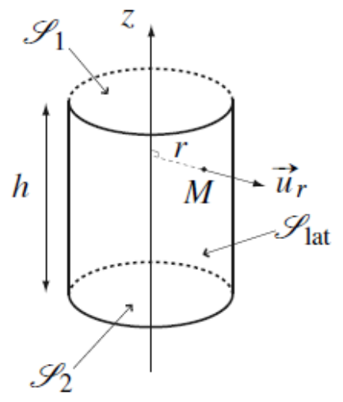

On note qu'il est intéressant de choisir cette surface de Gauss car \(\vec{E}\) est uniforme sur la surface latérale (\(r=\text{cste}\)) et perpendiculaire aux deux bases (donc le flux de \(\vec{E}\) est nul sur ces deux surfaces). Finalement :

注意：选取这一高斯面是有利的，因为 \(\vec{E}\) 在侧面上均匀（\(r=\text{cste}\)）且垂直于两个底面（故 \(\vec{E}\) 在这两个面上的通量为零）。最终：
{: .zh }

\[
\begin{aligned}
\Phi&=\iint_{M\in S_{lat}}\vec{E}(M)\,\cdot\,\overrightarrow{\mathrm{d}S}(M)
     +\iint_{M\in S_1}\vec{E}(M)\,\cdot\,\overrightarrow{\mathrm{d}S}(M)
     +\iint_{M\in S_2}\vec{E}(M)\,\cdot\,\overrightarrow{\mathrm{d}S}(M)\\
&=rE(r)\left(\int_{\theta=0}^{2\pi}\mathrm{d}\theta\right)
  \left(\int_{z=0}^{h}\mathrm{d}z\right)=2\pi hrE(r).
\end{aligned}
\]

Selon où se trouve le point \(M\), l'expression de \(Q_{int}\) ne sera pas la même ; il faut impérativement distinguer les cas :

视点 \(M\) 的位置不同，\(Q_{int}\) 的表达式也不同，必须分情况讨论：
{: .zh }

!!! note ""

    **• Si \(r\geqslant a\) :** la surface de Gauss de rayon \(r\) et de hauteur \(h\) enferme toute la charge du cylindre sur cette hauteur : \(Q_{int}=\rho\,\pi a^2h\). Le flux vaut \(\Phi=E(r)\,2\pi rh\), donc le théorème de Gauss donne

    **• 若 \(r\geqslant a\)：**半径为 \(r\)、高为 \(h\) 的高斯圆柱面包围了该高度内圆柱的全部电荷：\(Q_{int}=\rho\,\pi a^2h\)。通量为 \(\Phi=E(r)\,2\pi rh\)，故高斯定理给出
    {: .zh }

    \[
    E(r)\,2\pi rh=\frac{\rho\,\pi a^2h}{\varepsilon_0}
    \qquad\Longrightarrow\qquad
    \vec{E}(M)=\frac{\rho a^2}{2\varepsilon_0 r}\,\vec{u}_r.
    \]

    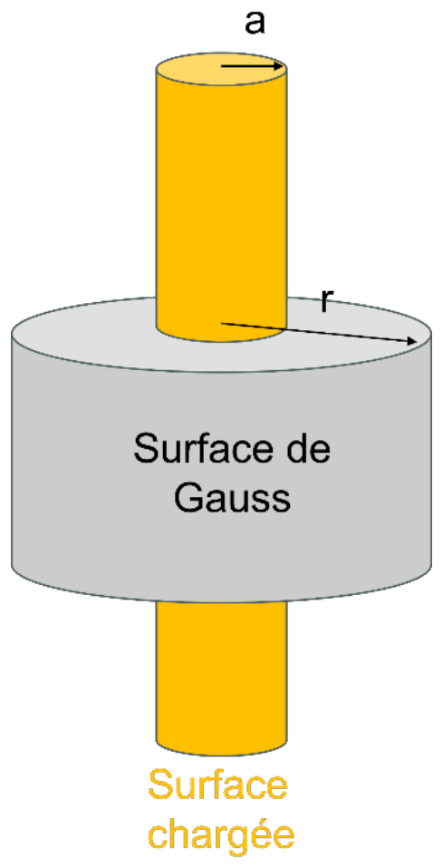

!!! note ""

    **• Si \(r<a\) :** la surface de Gauss de rayon \(r\) n'enferme que la charge contenue dans le cylindre de rayon \(r\) : \(Q_{int}=\rho\,\pi r^2h\). D'où

    **• 若 \(r<a\)：**半径为 \(r\) 的高斯圆柱面只包围半径 \(r\) 的圆柱内的电荷：\(Q_{int}=\rho\,\pi r^2h\)。于是
    {: .zh }

    \[
    E(r)\,2\pi rh=\frac{\rho\,\pi r^2h}{\varepsilon_0}
    \qquad\Longrightarrow\qquad
    \vec{E}(M)=\frac{\rho r}{2\varepsilon_0}\,\vec{u}_r.
    \]

    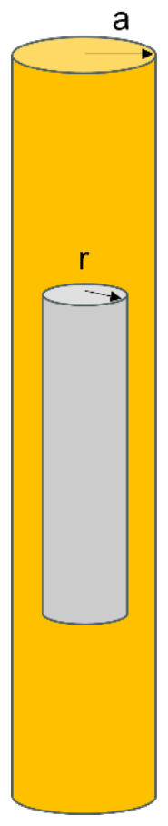

Pour déterminer les constantes \(A\) et \(B\), il faut fixer arbitrairement la valeur du potentiel en un point (et non à l'infini) car il y a présence de charges à l'infini. La deuxième constante est alors déterminée par continuité de \(V\) en \(r=a\).

为确定常数 \(A\) 与 \(B\)，必须人为指定某一点处的电势值（而不是无穷远处），因为存在延伸到无穷远的电荷。第二个常数则由 \(V\) 在 \(r=a\) 处的连续性确定。
{: .zh }

Par exemple ici on trace l'allure du champ et du potentiel en choisissant arbitrairement \(V(0)=0\) :

例如这里在任意选取 \(V(0)=0\) 的情况下画出场与电势的曲线：
{: .zh }

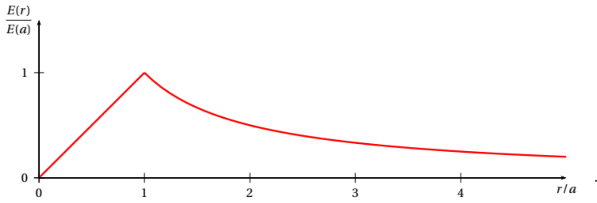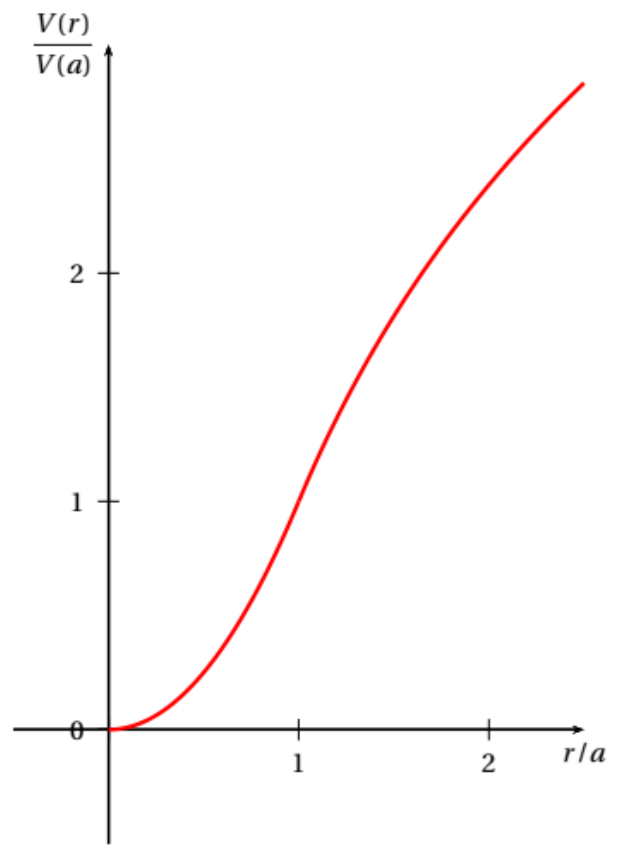

<u>Remarques :</u>

<u>注：</u>
{: .zh }

- \(E\) est nul à l'infini (l'interaction électrostatique décroît en effet en \(1/r^2\)).

    \(E\) 在无穷远处为零（静电相互作用确实按 \(1/r^2\) 衰减）；
    {: .zh }

- La valeur du potentiel dépend du choix arbitraire de la constante d'intégration (ici on a pris \(V(0)=0\)). Un choix différent a seulement pour influence de translater verticalement la courbe précédente du potentiel.

    电势值取决于积分常数的任意选取（这里取 \(V(0)=0\)）。不同的选择只会把上述电势曲线整体上下平移。
    {: .zh }

### 2.2.3) Problème à symétrie sphérique 球对称问题

Étudions le cas d'une boule de rayon \(R\) portant la charge \(Q\) uniformément répartie dans son volume. On repère \(M\) en coordonnées sphériques \(M(r,\theta,\phi)\).

研究半径为 \(R\) 的球体，电荷 \(Q\) 在其体积内均匀分布。用球坐标 \(M(r,\theta,\phi)\) 标记点 \(M\)。
{: .zh }

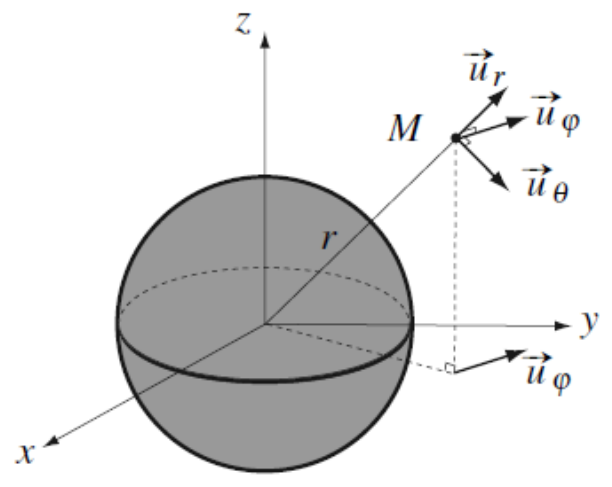

<u>Symétries de la distribution :</u> tout plan contenant \(\overrightarrow{OM}\) est plan de symétrie de la distribution de charges, donc \(\vec{E}(M)=E(M)\,\vec{u}_r\).

<u>分布的对称性：</u>任何包含 \(\overrightarrow{OM}\) 的平面都是电荷分布的对称平面，因此 \(\vec{E}(M)=E(M)\,\vec{u}_r\)。
{: .zh }

<u>Invariances de la distribution :</u> il y a invariance de la distribution de charges par rotation d'axe \(\vec{u}_z\) d'angle \(\phi\). Il y a invariance par rotation d'axe \(\vec{u}_\phi\) d'angle \(\theta\), donc \(E(M)=E(r)\,\vec{u}_r\) et \(V(M)=V(r)\).

<u>分布的不变性：</u>电荷分布在绕 \(\vec{u}_z\) 轴、转角 \(\phi\) 的旋转下不变；在绕 \(\vec{u}_\phi\) 轴、转角 \(\theta\) 的旋转下也不变。因此 \(E(M)=E(r)\,\vec{u}_r\)，且 \(V(M)=V(r)\)。
{: .zh }

Appliquons le théorème de Gauss à une sphère centrée sur \(O\) et de rayon \(r\) passant par \(M\). Cette surface est intéressante car \(\vec{E}\) y est uniforme.

对以 \(O\) 为球心、半径为 \(r\) 且经过 \(M\) 的球面应用高斯定理。这个曲面很有利，因为 \(\vec{E}\) 在其上均匀。
{: .zh }

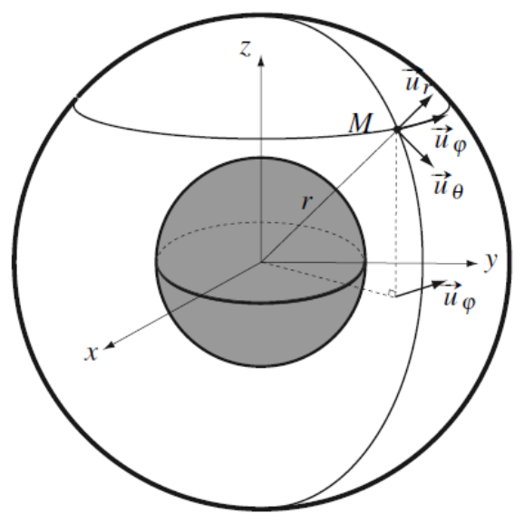

\[
\Phi=\iint_{M\in S}\vec{E}(M)\,\cdot\,\overrightarrow{\mathrm{d}S}(M)
    =\iint_{M\in S}E(r)\,\vec{u}_r\,\cdot\,\mathrm{d}S\,\vec{u}_r
    =E(r)\iint_{M\in S}\mathrm{d}S=4\pi r^2E(r).
\]

Selon où se trouve le point \(M\), l'expression de \(Q_{int}\) ne sera pas la même :

视点 \(M\) 的位置不同，\(Q_{int}\) 的表达式也不同：
{: .zh }

!!! note ""

    **• Si \(r\geqslant R\) :** la sphère de Gauss de rayon \(r\) enferme toute la charge de la boule : \(Q_{int}=\rho\frac{4}{3}\pi R^3=Q\). Comme \(\Phi=E(r)\,4\pi r^2\),

    **• 若 \(r\geqslant R\)：**半径为 \(r\) 的高斯球面包围球体的全部电荷：\(Q_{int}=\rho\frac{4}{3}\pi R^3=Q\)。因 \(\Phi=E(r)\,4\pi r^2\)，
    {: .zh }

    \[
    E(r)\,4\pi r^2=\frac{Q}{\varepsilon_0}
    \qquad\Longrightarrow\qquad
    \vec{E}(M)=\frac{Q}{4\pi\varepsilon_0r^2}\,\vec{u}_r
    =\frac{\rho R^3}{3\varepsilon_0r^2}\,\vec{u}_r.
    \]

    **• Si \(r<R\) :** la sphère de Gauss de rayon \(r\) n'enferme que la charge contenue dans la boule de rayon \(r\) : \(Q_{int}=\rho\frac{4}{3}\pi r^3\). D'où

    **• 若 \(r<R\)：**半径为 \(r\) 的高斯球面只包围半径 \(r\) 的球体内的电荷：\(Q_{int}=\rho\frac{4}{3}\pi r^3\)。于是
    {: .zh }

    \[
    E(r)\,4\pi r^2=\frac{\rho}{\varepsilon_0}\frac{4}{3}\pi r^3
    \qquad\Longrightarrow\qquad
    \vec{E}(M)=\frac{\rho r}{3\varepsilon_0}\,\vec{u}_r.
    \]

Comme la distribution de charges est finie, cette fois-ci on peut fixer \(V(\infty)=0\), ce qui donne \(A=0\). Avec la continuité de \(V\) en \(r=R\) (puisque la distribution est volumique) on obtient \(B=\dfrac{\rho R^2}{2\varepsilon_0}\), soit :

由于电荷分布是有限的，这一次可以取 \(V(\infty)=0\)，从而 \(A=0\)。利用 \(V\) 在 \(r=R\) 处的连续性（因为分布是体分布的），得到 \(B=\dfrac{\rho R^2}{2\varepsilon_0}\)，即：
{: .zh }

\[
\left\{
\begin{aligned}
r<R &: \qquad V(r)=\frac{\rho R^2}{6\varepsilon_0}\left(3-\frac{r^2}{R^2}\right),\\[6pt]
r\geq R &: \qquad V(r)=\frac{\rho R^3}{3\varepsilon_0 r}.
\end{aligned}
\right.
\]

On note qu'à l'extérieur de la sphère, le champ électrostatique est le même que celui créé par une charge ponctuelle \(Q\) égale à la charge totale de la distribution et placée en \(O\) :

注意：在球外，静电场与“把总电荷 \(Q\) 集中于 \(O\) 点的点电荷”所产生的场相同：
{: .zh }

\[
\vec{E}(r)=\frac{\rho R^3}{3r^2\varepsilon_0}\,\vec{u}_r=\frac{Q}{4\pi r^2\varepsilon_0}\,\vec{u}_r.
\]

Cela simplifiera les expressions dès lors qu'on s'intéressera à ce type de situation. On représente l'allure des champs et potentiels électrostatiques.

当研究这类情形时，这会简化表达式。图中给出静电场与电势的曲线形状。
{: .zh }

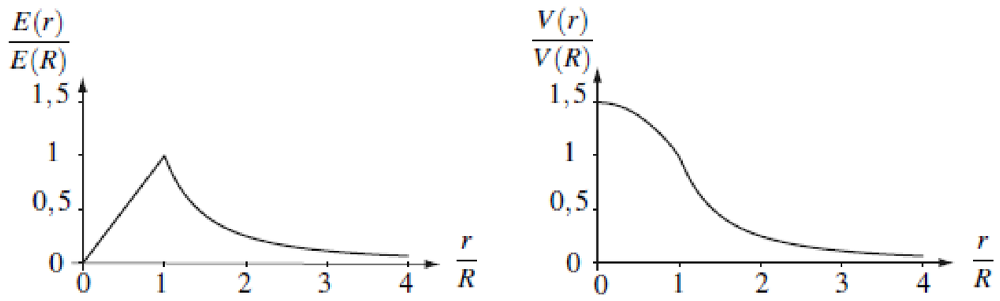

\(E(0)=0\) était attendu. En effet, une charge qui y serait placée subirait un champ total nul de la part de la distribution par symétrie.

\(E(0)=0\) 是意料之中的：放在该处的电荷由对称性会受到分布产生的总场为零。
{: .zh }

## 2.3) Analogie gravitationnelle 引力类比

La force gravitationnelle et la force de Coulomb ont la même forme. Les deux sont proportionnelles à \(1/r^2\) et suivant \(\vec{u}_r\). On peut de manière similaire considérer le champ gravitationnel \(\vec{A}\) qui lie la masse \(m\) d'un objet et la force exercée sur lui par \(\vec{F}=m\vec{A}\). Il existe de même un théorème de Gauss gravitationnel.

万有引力与库仑力形式相同：二者都正比于 \(1/r^2\) 且沿 \(\vec{u}_r\) 方向。类似地可以引入引力场 \(\vec{A}\)，它把物体的质量 \(m\) 与所受的力联系起来：\(\vec{F}=m\vec{A}\)。同样存在引力版的高斯定理。
{: .zh }

| Électrostatique | Gravitation |
|---|---|
| Charge électrique \(q\) | Masse \(m\) |
| Interaction électrique : \(\overrightarrow{F_{1\to2}}=\dfrac{1}{4\pi\varepsilon_0}\,\dfrac{q_1q_2}{r^2}\,\overrightarrow{u_{1\to2}}\) Attractive si \(q_1q_2<0\)；répulsive si \(q_1q_2>0\) | Interaction gravitationnelle : \(\overrightarrow{F_{1\to2}}=-G\,\dfrac{m_1m_2}{r^2}\,\overrightarrow{u_{1\to2}}\) Toujours attractive（永远吸引） |
| Constante \(\dfrac{1}{4\pi\varepsilon_0}\) avec \(\varepsilon_0=8{,}85\cdot10^{-12}\,\mathrm{F\,m^{-1}}\)（真空介电常数） | Constante \(-G\) avec \(G=6{,}67\cdot10^{-11}\,\mathrm{N\,m^2\,kg^{-2}}\)（万有引力常数） |
| Champ électrostatique \(\vec{E}\) | Champ gravitationnel \(\vec{A}\) |
| Potentiel électrostatique \(V\) tel que \(\mathrm{d}V=-\vec{E}(M)\cdot\overrightarrow{\mathrm{d}l}\) | Potentiel gravitationnel \(V_g\) tel que \(\mathrm{d}V_g=-\vec{A}(M)\cdot\overrightarrow{\mathrm{d}l}\) |
| Énergie potentielle électrique : \(E_p=qV\) | Énergie potentielle gravitationnelle : \(E_{pg}=mV_g\) |
| \(\displaystyle\Phi_{\vec{E}}=\oint_{M\in S}\vec{E}(M)\cdot\overrightarrow{\mathrm{d}S}(M)=\frac{Q_{int}}{\varepsilon_0}\) | \(\displaystyle\Phi_{\vec{A}}=\oint_{M\in S}\vec{A}(M)\cdot\overrightarrow{\mathrm{d}S}(M)=-4\pi G M_{int}\) |

## Glossaire 术语表

本章词汇，按出现顺序排列。

| Terme français | 中文 | Définition |
|---|---|---|
| plan de symétrie | 对称平面 | Plan par rapport auquel la distribution de charges se retrouve en miroir avec le même signe de charge.（电荷分布关于它成镜像、且电荷符号不变的平面。） |
| plan d'antisymétrie | 反对称平面 | Plan qui partage la distribution en deux parties miroirs portant des signes de charge opposés.（把分布分成两部分镜像、且电荷符号相反的平面。） |
| principe de Curie | 居里原理 | Les éléments de symétrie des causes se retrouvent dans les effets.（原因的对称要素会出现在结果中的原理。） |
| invariance | 不变性 | Propriété d'une distribution qui ne change pas lorsqu'on lui applique une transformation donnée.（分布经某种给定变换后保持不变的属性。） |
| invariance par translation | 平移不变性 | La distribution reste identique lorsqu'elle est translatée d'un vecteur donné.（分布平移一给定向量的结果处处相同。） |
| invariance par rotation | 旋转不变性 | La distribution reste identique après une rotation autour d'un axe donné.（分布绕给定轴旋转后保持不变。） |
| axe de rotation | 旋转轴 | Droite autour de laquelle s'effectue une rotation.（旋转所绕的直线。） |
| angle de rotation | 旋转角 | Angle qui caractérise l'amplitude d'une rotation autour d'un axe.（描述绕轴旋转幅度的角。） |
| surface fermée | 闭合曲面 | Surface qui délimite complètement un volume et sur laquelle le flux est orienté vers l'extérieur par convention.（完全围成一块体积的曲面；按惯例其通量取向为外法向。） |
| surface de Gauss | 高斯面 | Surface fermée choisie pour appliquer le théorème de Gauss et exploiter les symétries du problème.（为应用高斯定理、利用问题对称性而选取的闭合曲面。） |
| flux sortant | 向外通量 | Flux associé à l'orientation conventionnelle vers l'extérieur d'une surface fermée.（按闭合曲面向外定向所得到的通量。） |
| charge intérieure | 内部电荷 | Charge totale contenue dans un volume.（体积内包含的总电荷。） |
| surface latérale | 侧表面 | Partie latérale d'une surface cylindrique, distincte de ses deux bases.（圆柱面的侧面部分，与两个底面不同。） |
| base d'un cylindre | 圆柱底面 | L'une des deux surfaces planes qui ferment un cylindre.（封闭圆柱的两个平面之一。） |
| symétrie cylindrique | 柱对称性 | Configuration où la géométrie et les grandeurs physiques sont invariantes selon l'axe et autour de celui-ci.（几何与物理量沿轴及绕轴都不变的构型。） |
| cylindre de Gauss | 高斯圆柱面 | Surface de Gauss cylindrique utilisée pour exploiter une configuration à symétrie cylindrique.（用于处理柱对称构型的圆柱形高斯面。） |
| symétrie sphérique | 球对称性 | Configuration où les grandeurs physiques ne dépendent que de la distance au centre.（物理量只依赖于到球心距离的构型。） |
| charge totale | 总电荷 | Somme de toutes les charges contenues dans la distribution considérée.（所考虑分布中全部电荷之和。） |
| densité uniforme | 均匀密度 | Densité de charge constante dans la région considérée.（在所考虑区域内为常数的电荷密度。） |
| continuité du potentiel | 电势连续性 | Indique que le potentiel est une fonction continue.（说明电势是连续函数。） |
| constante d'intégration | 积分常数 | Constante apparaissant après l'intégration d'une fonction.（函数积分后出现的常数。） |
| condition aux limites | 边界条件 | Condition imposée en un point ou à une frontière.（在某点或某边界上施加的条件。） |
