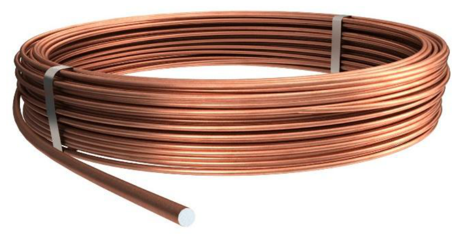
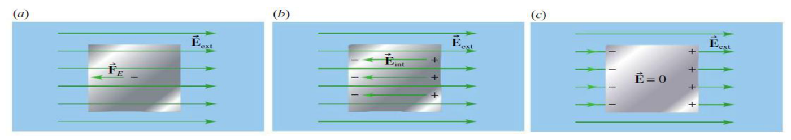
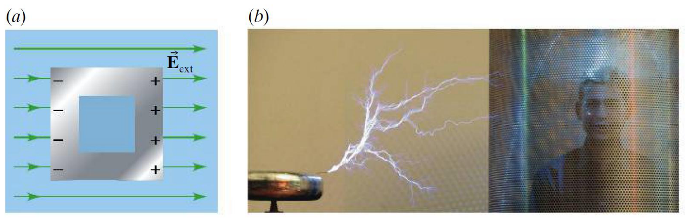
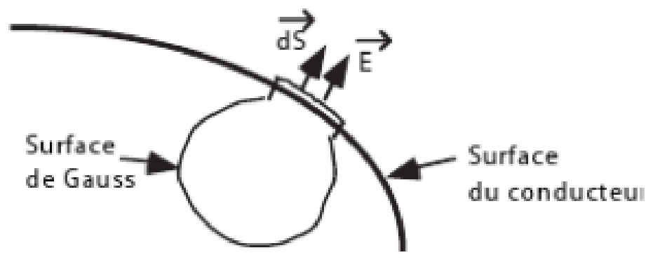
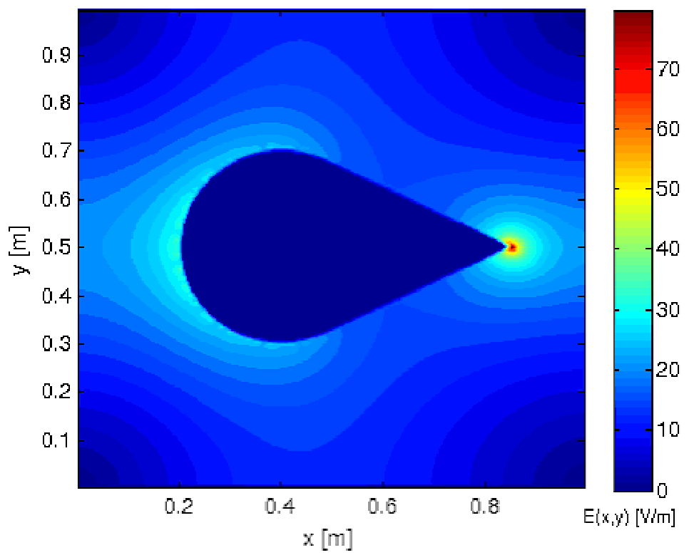
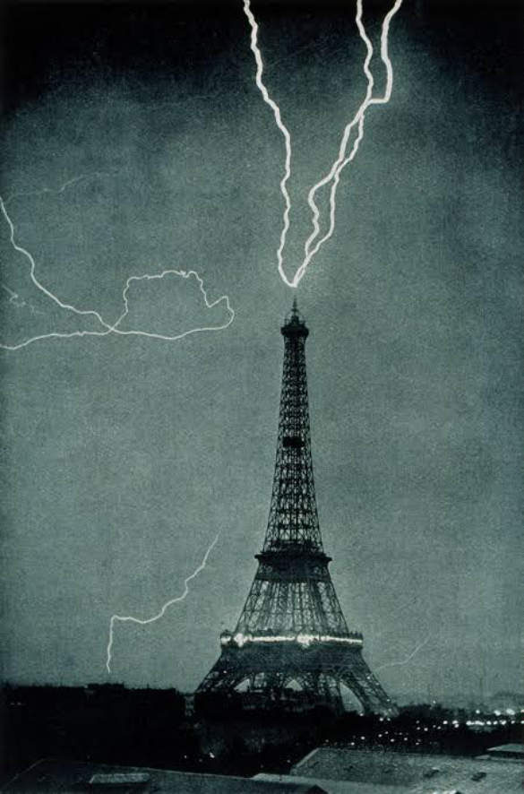
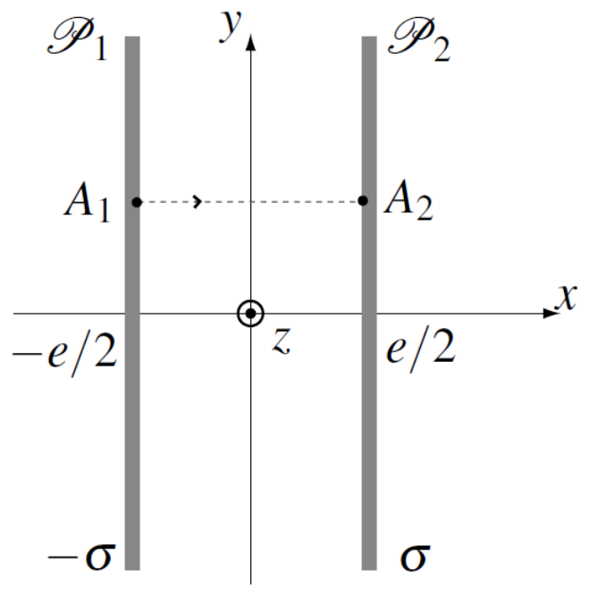

# 第 3 章　导体与电容器

Chapitre n°3 — Conducteurs et condensateurs

中法对照讲义 · 静电学部分

!!! info "阅读说明"

    每段先列法语原文；其下缩进、带深蓝竖条的小字号段落为中文翻译。<strong>加粗</strong>为关键词，括号内为中文释义。

## 3.1) Propriétés des conducteurs 导体的性质

### 3.1.1) Définition conducteur / isolant 导体与绝缘体的定义

Un <strong>conducteur</strong> est un matériau qui possède des charges mobiles ; un <strong>isolant</strong> n'en possède pas.

<strong>导体</strong>（conducteur）是拥有可移动电荷的材料；<strong>绝缘体</strong>（isolant）则没有。
{: .zh }

Le terme « mobile » indique que les charges peuvent se déplacer dans un conducteur. Ces charges sont des électrons si le matériau est solide.

“可移动”（mobile）一词表明电荷能在导体中运动。若材料为固体，这些电荷就是电子。
{: .zh }

Pour conduire le courant électrique, on utilise donc des matériaux conducteurs comme le cuivre (Cu) sur la photo ci-dessous.

因此，为传导电流，人们使用铜（Cu）等导体材料，如下图照片所示。
{: .zh }

### 3.1.2) Champ électrostatique dans un conducteur 导体内部的静电场

On considère un matériau conducteur plongé dans un champ électrostatique comme sur le schéma suivant.

考虑一块置于静电场中的导体材料，如下图所示。
{: .zh }

En (a) on observe que le champ électrostatique \(\vec{E}_{ext}\) exerce une force de Coulomb sur les électrons du matériau conducteur. Cette force tend à faire déplacer les électrons du matériau vers la gauche. La surface gauche du matériau se charge donc négativement. Puisque la charge totale doit être conservée, la surface droite du matériau se charge positivement.

在 (a) 中可以看到，静电场 \(\vec{E}_{ext}\) 对导体材料中的电子施加库仑力。该力使材料中的电子向左移动，于是材料左表面带负电。由于总电荷必须守恒，材料右表面带正电。
{: .zh }

En (b) on voit que, du fait de l'accumulation de charges en surface, il se forme un champ électrique supplémentaire \(\vec{E}_{int}\) de sens opposé à \(\vec{E}_{ext}\). Tant que \(\|\vec{E}_{ext}\|>\|\vec{E}_{int}\|\), les électrons dans le matériau sont soumis à une force totale \(q\vec{E}_{tot}=q(\vec{E}_{int}+\vec{E}_{ext})\) qui intensifie l'accumulation de charges sur la surface.

在 (b) 中可以看到，由于表面电荷的积累，形成了一个与 \(\vec{E}_{ext}\) 方向相反的附加电场 \(\vec{E}_{int}\)。只要 \(\|\vec{E}_{ext}\|>\|\vec{E}_{int}\|\)，材料中的电子就受到总力 \(q\vec{E}_{tot}=q(\vec{E}_{int}+\vec{E}_{ext})\)，这会使表面电荷进一步积累。
{: .zh }

Au bout d'un moment, en (c), le système atteint un équilibre quand \(\vec{E}_{int}=-\vec{E}_{ext}\). Le champ à l'intérieur du conducteur est donc nul et il n'y a plus de force de Coulomb qui s'exerce dans le volume du conducteur.

经过一段时间，在 (c) 中系统达到平衡：\(\vec{E}_{int}=-\vec{E}_{ext}\)。于是导体内部的场为零，导体体积内不再有库仑力作用。
{: .zh }

!!! danger "Propriété 性质"

    Le champ électrique macroscopique à l'intérieur d'un conducteur est nul à l'équilibre. L'accumulation de charge associée se fait à la surface du conducteur.

    平衡时，导体内部的宏观电场为零。相应的电荷积累发生在导体表面。
    {: .zh }

<i>Remarque.</i> Un isolant, au contraire, peut posséder un champ électrique interne car les charges ne bougent pas et ne permettent donc pas de créer un champ interne qui s'oppose au champ extérieur.

<i>注。</i>相反，绝缘体内部可以存在电场，因为电荷不能移动，无法产生与外加场相抗衡的内场。
{: .zh }

<strong>Conséquence.</strong> Le volume d'un conducteur est à un potentiel électrique constant. On l'appelle un <strong>volume équipotentiel</strong>.

<strong>推论。</strong>导体体积处于恒定电势，称为<strong>等势体</strong>（volume équipotentiel）。
{: .zh }

<strong>Application.</strong> On creuse une cavité (un grand trou) à l'intérieur d'un conducteur comme sur le schéma (a) ci-dessous. Puisque le champ est nul partout dans le matériau conducteur malgré la présence d'un éventuel champ externe, <strong>le champ demeurera nul dans la cavité</strong>. Une <strong>cage de Faraday</strong> fonctionne selon ce principe : il s'agit d'une boîte métallique conductrice fermée (comme les boîtiers d'ordinateur) dont on se sert pour protéger un contenu sensible de l'effet des champs électriques qui existent dans l'environnement externe. C'est ce qu'on voit sur l'image (b) ci-dessous.

<strong>应用。</strong>在导体内部挖出一个空腔（一个大洞），如下图 (a) 所示。既然尽管可能存在外场，导体材料中各处的场仍为零，那么<strong>空腔内的场仍将为零</strong>。<strong>法拉第笼</strong>（cage de Faraday）就按此原理工作：它是一个封闭的金属导体箱（如电脑机箱），用来保护内部敏感物件免受外部环境电场的影响。下图 (b) 所示即为此。
{: .zh }

### 3.1.3) Champ électrostatique à la surface d'un conducteur 导体表面的静电场

On considère un conducteur en équilibre électrostatique. Ses charges sont donc situées en surface.

考虑处于静电平衡的导体。其电荷因此分布在表面。
{: .zh }

Par l'absurde, on suppose que le champ électrique \(\vec{E}\) à la surface du conducteur possède une composante tangentielle non nulle. Cela exerce donc une force de Coulomb sur les charges, qui se déplacent sur la surface. Cela est impossible car on est à l'équilibre. Donc, en surface du conducteur, \(\vec{E}\) est normal à la surface : il n'a pas de composante tangentielle.

用反证法，假设导体表面的电场 \(\vec{E}\) 具有非零切向分量。这会对电荷施加库仑力，使其沿表面移动。但平衡状态下这是不可能的。因此，在导体表面，\(\vec{E}\) 垂直于表面，没有切向分量。
{: .zh }

!!! danger "Propriété 性质"

    Les lignes de champ électrostatique sont toujours normales à la surface d'un conducteur.

    静电场的场线总是垂直于导体表面。
    {: .zh }

Nous allons calculer le champ électrique \(\vec{E}\) à proximité immédiate de la surface d'un conducteur en équilibre. Pour cela, nous appliquons le théorème de Gauss à une surface fermée \(S_G\) dont un côté est un élément infiniment petit \(\mathrm{d}S\) parallèle à la surface du conducteur, le reste de \(S_G\) étant soit perpendiculaire à la surface, soit à l'intérieur du conducteur.

下面计算平衡导体表面紧邻处的电场 \(\vec{E}\)。为此，对闭合曲面 \(S_G\) 应用高斯定理：它的一面是与导体表面平行的无穷小面元 \(\mathrm{d}S\)，\(S_G\) 的其余部分要么垂直于导体表面，要么位于导体内部。
{: .zh }

Vu que \(\vec{E}\) est normal à la surface du conducteur, on a :

由于 \(\vec{E}\) 垂直于导体表面，有：
{: .zh }

\[
\Phi=E\,\mathrm{d}S=\frac{\sigma\,\mathrm{d}S}{\varepsilon_0},
\qquad
E=\frac{\sigma}{\varepsilon_0}.
\]

En nommant \(\vec{n}\) le vecteur normal à la surface, on obtient le <strong>théorème de Coulomb</strong> :

记 \(\vec{n}\) 为表面法向量，即得<strong>库仑定理</strong>：
{: .zh }

!!! tip "Théorème de Coulomb 库仑定理"

    Le champ électrique \(\vec{E}\) à proximité immédiate de la surface d'un conducteur en équilibre est

    平衡导体表面紧邻处的电场为
    {: .zh }

    \[
    \vec{E}=\frac{\sigma}{\varepsilon_0}\,\vec{n}.
    \]

Ce champ électrique est à l'origine de l'<strong>effet de pointe</strong>. Au niveau de la pointe d'un matériau conducteur, la densité de charge \(\sigma\) est extrêmement forte ; le champ électrique de surface associé y est donc extrêmement fort.

该电场是“<strong>尖端效应</strong>”（effet de pointe）的根源。在导体材料的尖端处，电荷密度 \(\sigma\) 极大，相应的表面电场也因此极强。
{: .zh }

En particulier, lors des orages, les pointes ont tendance à accumuler plus de charges en surface, ce qui crée un chemin que la foudre prend plus facilement. C'est le principe du <strong>paratonnerre</strong>.

特别是在雷暴时，尖端倾向于在表面积累更多电荷，从而形成一条更容易被闪电选中的路径。这就是<strong>避雷针</strong>（paratonnerre）的原理。
{: .zh }

<i>Remarque.</i> L'air en temps calme est un isolant électrique. Lorsque le champ électrique dans l'air est trop intense, cela peut arracher des électrons des atomes. Pendant un court moment, l'air devient alors un conducteur électrique. C'est le principe de la foudre.

<i>注。</i>平静天气下空气是电绝缘体。当空气中的电场过强时，会把电子从原子中剥离。在很短的时间内，空气便成为电导体。这就是闪电的原理。
{: .zh }

<strong>Conseil.</strong> Si le ciel est orageux et que vous voyez vos cheveux se dresser sur votre tête comme sur l'image ci-dessous, c'est qu'ils sont chargés et que leur pointe pourrait servir de paratonnerre. Mettez-vous à l'abri rapidement si vous n'avez pas de meilleur paratonnerre !

<strong>建议。</strong>若天空雷雨交加，而您看到自己的头发像下图那样竖起来，说明它们带了电，发梢可能起到避雷针的作用。如果您没有更好的避雷针，请赶快躲避！
{: .zh }

## 3.2) Propriétés des condensateurs 电容器的性质

### 3.2.1) Principales caractéristiques des condensateurs 电容器的主要特征

Lorsque l'on approche un conducteur chargé (positivement par exemple) d'un conducteur neutre (non chargé), les charges positives du conducteur neutre sont repoussées alors que ses charges négatives sont attirées. La répartition des charges dans le conducteur neutre a été modifiée par <strong>influence</strong> (partielle).

当把一个带电导体（例如带正电）靠近一个中性（不带电）导体时，中性导体中的正电荷被排斥，负电荷被吸引。中性导体中的电荷分布因<strong>（部分）静电感应</strong>（influence (partielle)）而改变。
{: .zh }

L'influence est <strong>totale</strong> lorsqu'un des conducteurs entoure l'autre. On peut montrer que les surfaces qui se font face portent des charges opposées.

当其中一个导体包围另一个导体时，称为<strong>完全静电感应</strong>（influence totale）。可以证明，彼此相对的表面带有相反符号的电荷。
{: .zh }

!!! success "Définition 定义"

    Un <strong>condensateur</strong> est un ensemble de deux conducteurs à l'équilibre sous influence totale : on les appelle <strong>armatures</strong> du condensateur, elles portent les charges \(-Q\) et \(+Q\). Ces armatures sont séparées par un isolant.

    <strong>电容器</strong>（condensateur）是处于完全静电感应平衡下的两个导体组成的整体：它们称为电容器的<strong>极板</strong>（armatures），分别带有电荷 \(-Q\) 与 \(+Q\)。两极板之间由绝缘体隔开。
    {: .zh }

### 3.2.2) Plans infinis 无限大平行板

On considère deux plaques métalliques (appelées armatures) porteuses de charges surfaciques opposées \(\sigma\) et \(-\sigma\) (avec \(\sigma>0\)) se faisant face en étant séparées par du vide. Par superposition, le champ électrique associé à ce condensateur est la somme des champs générés par chaque plaque.

考虑两块金属板（称为极板），带有相反的面电荷 \(\sigma\) 与 \(-\sigma\)（\(\sigma>0\)），彼此相对、由真空隔开。由叠加原理，该电容器对应的电场是各板所产生场之和。
{: .zh }

Si on considère le champ généré par une plaque \(P_1\) de charge surfacique \(-\sigma\), celui-ci est identique en substituant \(\sigma\) par \(-\sigma\). On a donc :

若考虑面电荷为 \(-\sigma\) 的板 \(P_1\) 所产生的场，只需在结果中把 \(\sigma\) 换成 \(-\sigma\) 即可。于是：
{: .zh }

À gauche de la plaque \(P_1\) : \(E_1(x)=\dfrac{\sigma}{2\varepsilon_0}\).

板 \(P_1\) 左侧：\(E_1(x)=\dfrac{\sigma}{2\varepsilon_0}\)。
{: .zh }

À droite de la plaque \(P_1\) : \(E_1(x)=-\dfrac{\sigma}{2\varepsilon_0}\).

板 \(P_1\) 右侧：\(E_1(x)=-\dfrac{\sigma}{2\varepsilon_0}\)。
{: .zh }

La superposition de ces deux champs donne le champ total pour la distribution des deux plaques :

这两个场的叠加给出双板分布的总场：
{: .zh }

- Entre les plaques, \(x\in\left[-\frac{e}{2};\frac{e}{2}\right]\) : \(\vec{E}(M)=-\dfrac{\sigma}{\varepsilon_0}\vec{e}_x\).

    两板之间 \(x\in\left[-\frac{e}{2};\frac{e}{2}\right]\)：\(\vec{E}(M)=-\dfrac{\sigma}{\varepsilon_0}\vec{e}_x\)。
    {: .zh }

- En dehors de cette zone : \(\vec{E}(M)=\vec{0}\).

    该区域之外：\(\vec{E}(M)=\vec{0}\)。
    {: .zh }

Dans les deux zones le champ est à chaque fois uniforme. On retiendra que le champ généré par un condensateur plan uniformément chargé avec la densité surfacique \(\sigma\) est uniforme et tel que \(\vec{E}(M)=-\dfrac{\sigma}{\varepsilon_0}\vec{e}_x\) entre les armatures (si on note \(\vec{e}_x\) le vecteur unitaire dirigé de l'armature chargée avec \(-\sigma\) vers celle chargée avec \(\sigma\)). Il est nul en dehors de cette zone.

在两个区域中，场各自都是均匀的。应记住：面电荷密度为 \(\sigma\) 的均匀带电平行板电容器所产生的场是均匀的，且在极板之间满足 \(\vec{E}(M)=-\dfrac{\sigma}{\varepsilon_0}\vec{e}_x\)（其中 \(\vec{e}_x\) 为由带 \(-\sigma\) 的极板指向带 \(\sigma\) 的极板的单位向量）。在该区域之外场为零。
{: .zh }

!!! success "Capacité 电容"

    La <strong>capacité</strong> \(C\) caractérise la charge qu'un condensateur peut accumuler sur ses armatures lorsqu'elles sont soumises à une tension \(U\). Elle est définie par la relation

    <strong>电容</strong>（capacité）\(C\) 表征电容器极板在电压 \(U\) 作用下所能积累的电荷，由以下关系定义：
    {: .zh }

    \[
    Q=C\,U.
    \]

Ici \(Q\) désigne la charge portée par une armature (en valeur absolue) et \(U=V_+-V_-\) la différence de potentiel entre les deux armatures (\(V_+\) pour celle chargée avec \(\sigma\), \(V_-\) pour celle chargée avec \(-\sigma\)).

这里 \(Q\) 表示一个极板所带电荷（取绝对值），\(U=V_+-V_-\) 为两极板间的电势差（\(V_+\) 对应带 \(\sigma\) 的极板，\(V_-\) 对应带 \(-\sigma\) 的极板）。
{: .zh }

Il faut donc déterminer l'expression de la différence de potentiel électrostatique \(V\). Entre les armatures, \(\vec{E}=-\dfrac{\sigma}{\varepsilon_0}\vec{e}_x\), où \(\vec{e}_x\) est dirigé de l'armature chargée \(-\sigma\) vers celle chargée \(+\sigma\). Comme \(\vec{E}=-\operatorname{grad}V\), on a \(\dfrac{\mathrm{d}V}{\mathrm{d}x}=\dfrac{\sigma}{\varepsilon_0}\), d'où

因此需要确定静电势差 \(V\) 的表达式。在极板之间，\(\vec{E}=-\dfrac{\sigma}{\varepsilon_0}\vec{e}_x\)，其中 \(\vec{e}_x\) 由带 \(-\sigma\) 的极板指向带 \(+\sigma\) 的极板。由于 \(\vec{E}=-\operatorname{grad}V\)，故 \(\dfrac{\mathrm{d}V}{\mathrm{d}x}=\dfrac{\sigma}{\varepsilon_0}\)，于是
{: .zh }

\[
V(x)=\frac{\sigma}{\varepsilon_0}x+C.
\]

Les armatures sont situées en \(x=-e/2\) et \(x=+e/2\), donc

两块极板分别位于 \(x=-e/2\) 与 \(x=+e/2\)，因此
{: .zh }

\[
U=V(e/2)-V(-e/2)=\frac{\sigma e}{\varepsilon_0}.
\]

La charge d'une armature vaut \(Q=\sigma S\). La capacité est donc

一块极板的电荷为 \(Q=\sigma S\)。因此电容为
{: .zh }

\[
C=\frac{Q}{U}=\frac{\sigma S}{\sigma e/\varepsilon_0}=\frac{\varepsilon_0S}{e}.
\]

On aurait aussi pu directement écrire

也可以直接写成
{: .zh }

\[
U=\int_{V_-}^{V_+}\mathrm{d}V
=-\int_{A_1}^{A_2}\vec{E}(M)\cdot\overrightarrow{\mathrm{d}l}
=\int_{-e/2}^{e/2}\frac{\sigma}{\varepsilon_0}\,\mathrm{d}x
=\frac{\sigma e}{\varepsilon_0}.
\]

Donc \(U=\dfrac{\sigma e}{\varepsilon_0}\). De plus \(Q=\sigma S\), donc pour un condensateur plan la capacité est

因此 \(U=\dfrac{\sigma e}{\varepsilon_0}\)。又因 \(Q=\sigma S\)，所以平行板电容器的电容为
{: .zh }

\[
C=\frac{Q}{U}=\frac{\varepsilon_0 S}{e}.
\]

On note que pour un condensateur plan infini, la norme du champ électrique ne dépend pas de la distance entre les armatures ; en revanche, la tension entre les armatures et la capacité du condensateur en dépendent.

注意：对无限大平行板电容器，电场强度不依赖于极板间距；但极板间电压与电容则依赖于该间距。
{: .zh }

<i>Remarque.</i> En changeant le matériau isolant entre les deux armatures, on peut augmenter la permittivité \(\varepsilon\) et donc la capacité. On a dans ce cas \(C=\dfrac{\varepsilon S}{e}\).

<i>注。</i>更换两极板之间的绝缘材料可以提高介电常数 \(\varepsilon\)，从而提高电容。此时 \(C=\dfrac{\varepsilon S}{e}\)。
{: .zh }

### 3.2.3) Énergie stockée dans un condensateur 电容器储存的能量

Calculons le travail extérieur qui doit être fourni pour complètement charger un condensateur de capacité \(C\). En partant de \(q=0\), la charge \(q(t)\) va évoluer jusqu'à atteindre la charge finale \(Q_f\). Lorsque la charge évolue, la différence de potentiel entre les deux armatures \(\Delta V=q/C\) évolue aussi. Pendant un temps infinitésimal \(\mathrm{d}t\) entre \(t\) et \(t+\mathrm{d}t\), le travail à fournir pour déplacer une charge infinitésimale \(\mathrm{d}q\) est \(\mathrm{d}W_{ext}\) tel que :

计算把一个电容为 \(C\) 的电容器完全充电所需提供的外功。从 \(q=0\) 出发，电荷 \(q(t)\) 将演化到最终电荷 \(Q_f\)。电荷变化时，两极板间的电势差 \(\Delta V=q/C\) 也随之变化。在 \(t\) 到 \(t+\mathrm{d}t\) 的无穷小时间 \(\mathrm{d}t\) 内，移动无穷小电荷 \(\mathrm{d}q\) 所需的外功为 \(\mathrm{d}W_{ext}\)，满足：
{: .zh }

\[
\mathrm{d}W_{ext}=\vec{F}\cdot\overrightarrow{\mathrm{d}l}
=\mathrm{d}q\,\vec{E}\cdot\overrightarrow{\mathrm{d}l},
\qquad
\mathrm{d}W_{ext}=\mathrm{d}q\,\Delta V=\mathrm{d}q\,\frac{q}{C}.
\]

Donc le travail total à fournir pour complètement charger le condensateur est :

因此，把电容器完全充电所需的总功为：
{: .zh }

\[
W_{ext}=\int_0^Q \mathrm{d}q\,\frac{q}{C}
=\left[\frac{q^2}{2C}\right]_0^Q=\frac{Q^2}{2C}.
\]

La force électrique étant conservative, ce travail est stocké sous la forme d'énergie potentielle emmagasinée dans le condensateur. Cette énergie pourra être entièrement restituée plus tard par décharge du condensateur. Ainsi, un condensateur est un dispositif qui permet de stocker de l'énergie et de la charge électrique. Comme nous le verrons plus tard, il est souvent utilisé car il a un temps de décharge très court par rapport à une pile.

由于电场力是保守力，该功以电势能的形式储存在电容器中。这部分能量以后可以通过电容器放电完全释放。因此，电容器是一种能够储存能量与电荷的器件。正如我们以后会看到的，它常被使用，因为与电池相比它的放电时间非常短。
{: .zh }

!!! tip "En résumé 小结"

    L'énergie stockée dans un condensateur est

    电容器中储存的能量为
    {: .zh }

    \[
    \Delta E_p=\frac{q^2}{2C}=\frac{CU^2}{2}.
    \]

## Glossaire 术语表

本章词汇，按出现顺序排列。

| Terme français | 中文 | Définition |
|---|---|---|
| conducteur | 导体 | Matériau qui possède des porteurs de charge mobiles ; dans le cours, ces charges sont des électrons.（拥有可移动电荷载流子的材料；本课中这些载流子即电子。） |
| isolant | 绝缘体 | Matériau qui ne possède pas de porteurs de charge mobiles.（不含可移动电荷载流子的材料。） |
| porteur de charge mobile | 可移动电荷载流子 | Charge pouvant se déplacer dans un matériau conducteur ; le cours précise qu'il s'agit des électrons.（能在导体材料中运动的电荷；本课说明指的是电子。） |
| équilibre électrostatique | 静电平衡 | État dans lequel les charges d'un conducteur ne se déplacent plus et où le champ électrostatique dans son volume est nul.（导体中的电荷不再运动、且其体积内静电场为零的状态。） |
| champ électrostatique intérieur | 导体内部静电场 | Champ électrostatique macroscopique à l'intérieur d'un conducteur en équilibre ; il est nul.（平衡导体内部的宏观静电场；它为零。） |
| accumulation de charges en surface | 表面电荷积聚 | Répartition des charges sur la surface d'un conducteur sous l'action du champ électrique, jusqu'à l'équilibre.（在电场作用下电荷在导体表面重新分布直至平衡。） |
| volume équipotentiel | 等势体 | Volume d'un conducteur dont le potentiel électrique est constant.（电势处处相等的导体体积。） |
| cavité conductrice | 导体空腔 | Trou creusé à l'intérieur d'un conducteur ; dans le cas présenté, le champ y reste nul.（在导体内部挖出的空腔；本课情形中其内场仍为零。） |
| cage de Faraday | 法拉第笼 | Boîte métallique conductrice fermée utilisée pour protéger un contenu sensible des champs électriques extérieurs.（用于保护内部敏感物件免受外部电场的封闭金属导体箱。） |
| composante tangentielle | 切向分量 | Composante du champ parallèle à la surface d'un conducteur ; elle est nulle à l'équilibre électrostatique.（平行于导体表面的场分量；在静电平衡时为零。） |
| champ normal à la surface | 垂直于表面的电场 | Champ dont la direction est normale à la surface du conducteur en équilibre.（方向垂直于平衡导体表面的电场。） |
| surface d'un conducteur | 导体表面 | Surface sur laquelle se trouvent les charges d'un conducteur en équilibre électrostatique.（静电平衡导体的电荷所在之处。） |
| théorème de Coulomb | 库仑定理 | Relation donnant le champ électrique à proximité immédiate de la surface d'un conducteur en équilibre, en fonction de la charge surfacique et de la normale à la surface.（给出平衡导体表面紧邻处电场与面电荷、法向量之间关系的定理。） |
| vecteur normal | 法向量 | Vecteur dirigé perpendiculairement à la surface du conducteur.（垂直于导体表面的向量。） |
| densité de charge surfacique | 面电荷密度 | Grandeur décrivant la quantité de charge répartie sur une surface ; elle intervient dans l'expression du champ près d'un conducteur.（描述曲面上电荷分布多少的物理量；出现在导体附近场的表达式中。） |
| effet de pointe | 尖端效应 | Phénomène selon lequel la densité de charge et le champ électrique de surface deviennent très importants au niveau d'une pointe conductrice.（导体尖端处电荷密度与表面电场变得极大的现象。） |
| paratonnerre | 避雷针 | Objet utilisant l'accumulation de charges aux pointes pour favoriser un chemin à la foudre.（利用尖端电荷积聚为闪电提供通道的装置。） |
| influence électrique | 静电感应 | Modification de la répartition des charges dans un conducteur neutre lorsqu'un conducteur chargé est approché.（带电导体靠近时中性导体中电荷分布的改变。） |
| influence totale | 完全静电感应 | Situation d'influence dans laquelle un conducteur entoure l'autre ; les surfaces qui se font face portent des charges opposées.（一个导体包围另一个导体的感应情形；相对表面带相反电荷。） |
| condensateur | 电容器 | Ensemble de deux conducteurs à l'équilibre sous influence totale, appelés armatures, séparés par un isolant.（处于完全静电感应平衡的两个导体组成的整体，称为极板，由绝缘体隔开。） |
| armature | 电容器极板 | Conducteur constituant l'une des deux parties d'un condensateur et portant une charge.（构成电容器两部分之一并带电荷的导体。） |
| condensateur plan | 平行板电容器 | Condensateur constitué de deux plaques métalliques parallèles portant des charges surfaciques opposées.（由两块带相反面电荷的平行金属板构成的电容器。） |
| plaque métallique | 金属板 | Plaque conductrice constituant une armature d'un condensateur plan.（构成平行板电容器极板的导电板。） |
| charge surfacique uniforme | 均匀面电荷 | Charge répartie uniformément sur une surface avec une densité surfacique constante.（以恒定面密度均匀分布在曲面上的电荷。） |
| tension entre les armatures | 极板间电压 | Différence de potentiel entre les deux armatures, notée \(U=V_+-V_-\) dans le cours.（两极板间的电势差，本课记作 \(U=V_+-V_-\)。） |
| capacité électrique | 电容量 | Grandeur caractérisant la charge qu'un condensateur peut accumuler lorsqu'il est soumis à une tension \(U\) ; elle vérifie \(Q=CU\).（表征电容器在电压 \(U\) 下可积累多少电荷的物理量；满足 \(Q=CU\)。） |
| constante additive du potentiel | 电势加性常数 | Constante pouvant être choisie arbitrairement dans le potentiel, sans modifier sa variation.（可在电势中任意选取而不改变其变化的常数。） |
| énergie stockée | 储存能量 | Énergie potentielle emmagasinée dans un condensateur lors de sa charge.（充电时储存在电容器中的电势能。） |
| charge progressive | 逐步充电 | Évolution de la charge du condensateur de \(q=0\) jusqu'à la charge finale \(Q_f\).（电容器电荷由 \(q=0\) 演化到最终电荷 \(Q_f\) 的过程。） |
| décharge du condensateur | 电容器放电 | Processus par lequel l'énergie stockée dans le condensateur peut être entièrement restituée.（电容器中储存的能量得以完全释放的过程。） |
| stockage d'énergie électrique | 电能储存 | Fonction du condensateur consistant à stocker de l'énergie sous forme d'énergie potentielle et à la restituer lors de la décharge.（电容器以电势能形式储能并在放电时释放的功能。） |
