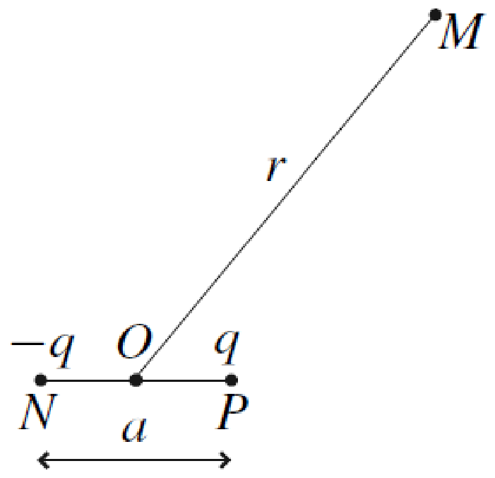
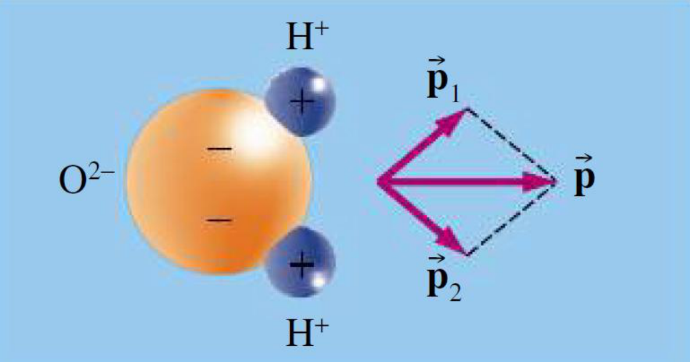
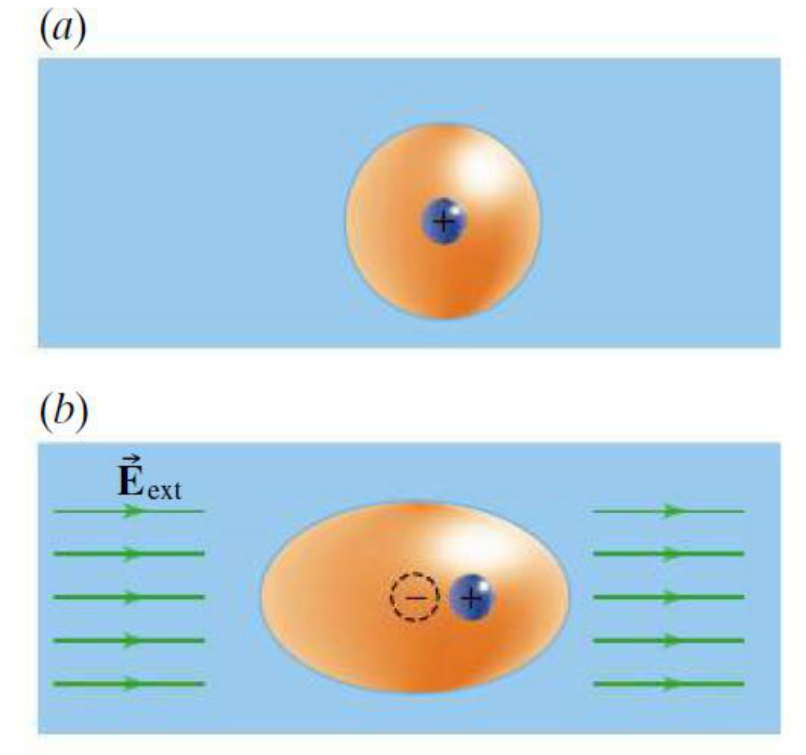
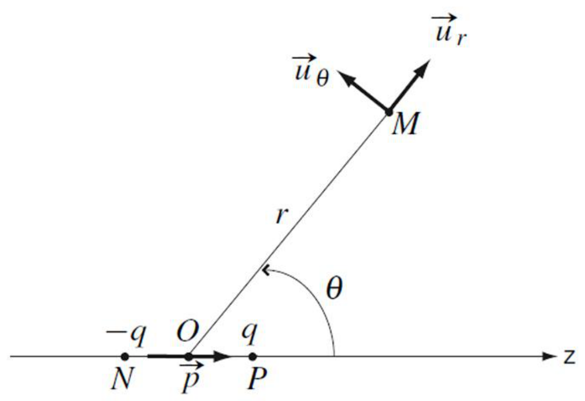
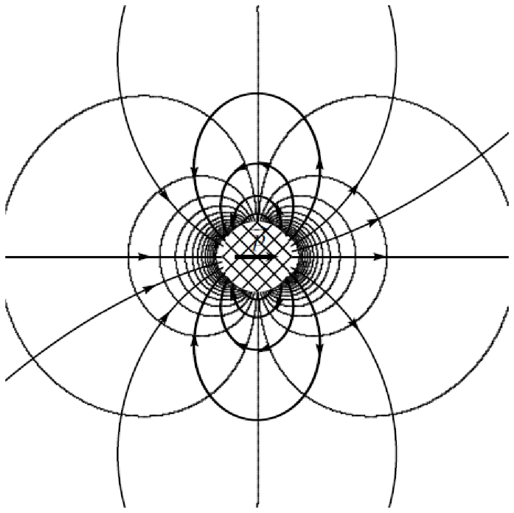
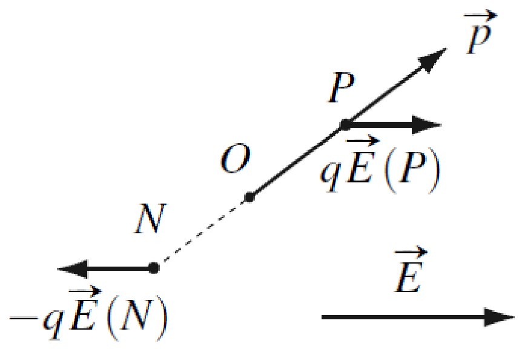
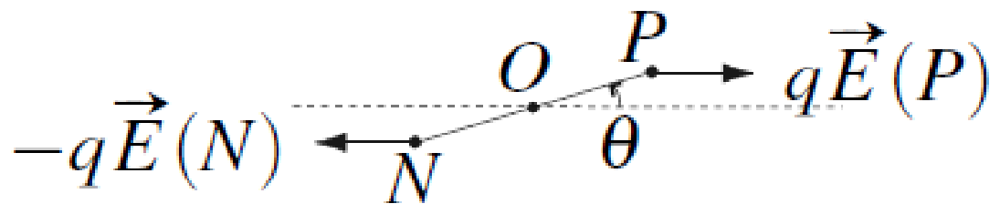
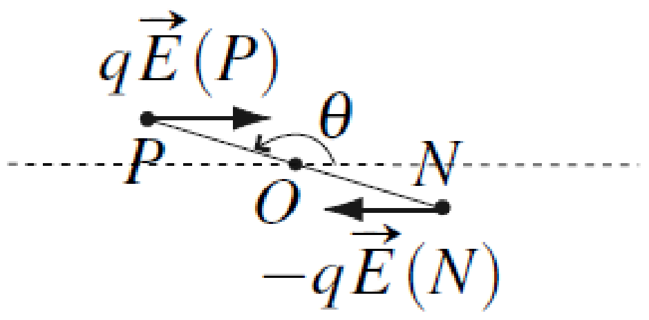
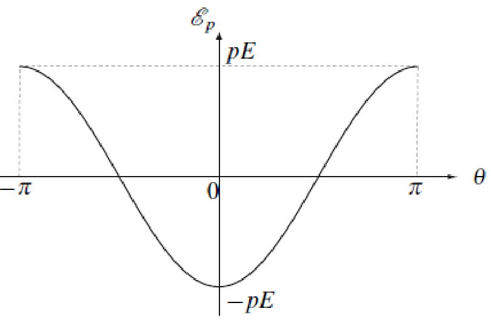

# 第 4 章　电偶极子

Chapitre bonus — Dipôles électrostatiques

中法对照讲义 · 静电学部分（附加章）

!!! info "阅读说明"

    每段先列法语原文；其下缩进、带深蓝竖条的小字号段落为中文翻译。<strong>加粗</strong>为关键词，括号内为中文释义。

## 1) Définition du dipôle électrostatique 电偶极子的定义

On appelle <strong>dipôle électrostatique</strong> un ensemble de deux charges électriques ponctuelles opposées (\(q\) et \(-q\)) avec \(q>0\), séparées de la distance \(a\).

所谓<strong>电偶极子</strong>（dipôle électrostatique），是由两个等量异号的点电荷（\(q\) 与 \(-q\)，\(q>0\)）组成、彼此相距 \(a\) 的整体。
{: .zh }

C'est une notion importante notamment en chimie pour modéliser les interactions entre les molécules. Dans toute cette étude, on se place dans le cadre de l'<strong>approximation dipolaire</strong> : \(r\gg a\). On s'intéresse au cas où \(a=\text{cste}\) (<strong>dipôle rigide</strong>).

这一概念在化学中尤为重要，用来建模分子之间的相互作用。在整个研究中，我们都在<strong>偶极近似</strong>（approximation dipolaire）的框架内：\(r\gg a\)。我们关注 \(a=\text{cste}\) 的情形（<strong>刚性偶极子</strong>，dipôle rigide）。
{: .zh }

<i>Remarque.</i> Si les deux charges étaient isolées, elles se rapprocheraient sous l'action de la force de Coulomb et leur distance \(a\) ne pourrait pas être constante. Il existe donc d'autres interactions qui permettent de maintenir les deux charges éloignées à la distance \(a\). Ces interactions ne sont pas étudiées ici.

<i>注。</i>如果两个电荷彼此孤立，它们会在库仑力作用下相互靠近，距离 \(a\) 就不可能保持不变。因此必定存在其他相互作用，使两个电荷得以维持相距 \(a\)。这些相互作用不在本章讨论的范围之内。
{: .zh }

## 2) Moment dipolaire 电偶极矩

!!! success "Définition 定义"

    Par définition, le <strong>moment dipolaire</strong> \(\vec{p}\) associé à un dipôle électrostatique est

    按定义，与电偶极子相关联的<strong>电偶极矩</strong>（moment dipolaire）\(\vec{p}\) 为
    {: .zh }

    \[
    \vec{p}=q\,\overrightarrow{NP}.
    \]

Il est dirigé de la charge négative vers la charge positive et s'exprime en \(\mathrm{C\,m}\). À l'échelle d'une molécule, \(q=e\) et \(a=10^{-10}\) m, donc :

它的方向由负电荷指向正电荷，单位为 \(\mathrm{C\,m}\)。在分子尺度上，\(q=e\)、\(a=10^{-10}\) m，因此：
{: .zh }

\[
p\simeq 10^{-29}\ \mathrm{C\,m}.
\]

On utilisera parfois une unité plus adaptée : le <strong>debye</strong>, avec

有时会使用更合适的单位：<strong>德拜</strong>（debye），其换算关系为：
{: .zh }

\[
1\ \mathrm{D}=3{,}336\cdot10^{-30}\ \mathrm{C\,m}.
\]

Exemples :

例：
{: .zh }

- Certaines molécules comme H\(_2\)O possèdent un moment dipolaire \(\vec{p}\) à l'équilibre. H\(_2\)O a même deux moments dipolaires qui s'ajoutent :

    某些分子（如 H\(_2\)O）在平衡时具有电偶极矩 \(\vec{p}\)。H\(_2\)O 甚至有两个电偶极矩，它们叠加为：
    {: .zh }

    \[
    \vec{p}=\vec{p}_1+\vec{p}_2.
    \]

- On peut induire (créer) un moment dipolaire dans une molécule en appliquant un champ électrique. On parle alors de <strong>dipôle induit</strong>. <strong>Le ciel est bleu car des dipôles induits dans le ciel interagissent avec les rayons du soleil et réémettent en majorité de la lumière bleue et violette.</strong>

    通过施加电场，可以在分子中诱导（产生）电偶极矩，此时称为<strong>诱导偶极子</strong>（dipôle induit）。<strong>天空之所以是蓝色，是因为大气中的诱导偶极子与太阳光相互作用，并主要重新发射蓝光和紫光。</strong>
    {: .zh }

<strong>Points importants du chapitre :</strong>

<strong>本章要点：</strong>
{: .zh }

- Les dipôles électrostatiques sont influencés par les champs électriques.

    电偶极子会受到电场的影响。
    {: .zh }

- Un dipôle électrostatique émet son propre champ électrique.

    电偶极子会发出自身的电场。
    {: .zh }

    - Les dipôles électriques peuvent interagir entre eux par l'intermédiaire des champs électriques qu'ils créent.

        电偶极子可以通过它们产生的电场彼此相互作用。
        {: .zh }

    - C'est pour cette raison que les dipôles électrostatiques sont importants en chimie.

        正因如此，电偶极子在化学中十分重要。
        {: .zh }

## 3) Potentiel et champ électrostatique 电势与电场

On se place en coordonnées sphériques \(M(r,\theta,\phi)\), avec \(\vec{u}_z\) l'axe du dipôle et \(O\) le milieu de \([NP]\).

我们采用球坐标 \(M(r,\theta,\phi)\)，以 \(\vec{u}_z\) 为偶极子的轴，\(O\) 为线段 \([NP]\) 的中点。
{: .zh }

!!! note ""

    <u>Symétries :</u> le plan contenant \((O,\vec{u}_r,\vec{u}_\theta)\) est un plan de symétrie de la distribution de charges, donc \(\vec{E}\) n'a pas de composante selon \(\vec{u}_\phi\), et \(V\) ne dépend pas de \(\phi\).

    <u>对称性：</u>包含 \((O,\vec{u}_r,\vec{u}_\theta)\) 的平面是电荷分布的对称平面，因此 \(\vec{E}\) 没有沿 \(\vec{u}_\phi\) 的分量，且 \(V\) 不依赖于 \(\phi\)。
    {: .zh }

    <u>Invariances :</u> la distribution de charges (c'est-à-dire le dipôle) est invariante par rotation d'axe \(\vec{u}_z\) et d'angle \(\phi\), donc \(E\) ne dépend pas de \(\phi\).

    <u>不变性：</u>电荷分布（即偶极子）绕轴 \(\vec{u}_z\) 旋转任意角 \(\phi\) 保持不变，因此 \(E\) 不依赖于 \(\phi\)。
    {: .zh }

    Finalement :

    最终：
    {: .zh }

    \[
    \vec{E}=E_r(r,\theta)\vec{u}_r+E_\theta(r,\theta)\vec{u}_\theta,
    \qquad
    V(M)=V(r,\theta).
    \]

On se place donc dans le plan \(\phi=\text{cste}\). Le potentiel électrostatique généré par le dipôle est :

因此我们只需在平面 \(\phi=\text{cste}\) 内考察。偶极子产生的静电势为：
{: .zh }

!!! note ""

    \[
    V(M)=\frac{-q}{4\pi\varepsilon_0 MN}+\frac{q}{4\pi\varepsilon_0 MP}
         =\frac{q}{4\pi\varepsilon_0}\left(\frac{1}{MP}-\frac{1}{MN}\right),
    \]

    \[
    MP^2=r^2+\frac{a^2}{4}-ra\cos\theta
         =r^2\left(1-\frac{a\cos\theta}{r}+\frac{a^2}{4r^2}\right).
    \]

    Comme \(r\gg a\), on effectue un développement limité à l'ordre 1 en \(a/r\) :

    又因为 \(r\gg a\)，我们对 \(a/r\) 作一阶展开（DL，développement limité）：
    {: .zh }

    \[
    \frac{1}{MP}=\frac{1}{r\sqrt{1-\frac{a\cos\theta}{r}+\frac{a^2}{4r^2}}}
    \simeq\frac{1}{r}\left(1+\frac{a\cos\theta}{2r}\right).
    \]

    De même :

    同理可得：
    {: .zh }

    \[
    \frac{1}{MN}\simeq\frac{1}{r}\left(1-\frac{a\cos\theta}{2r}\right).
    \]

    D'où :

    于是：
    {: .zh }

    \[
    V(M)=\frac{1}{4\pi\varepsilon_0}\frac{qa\cos\theta}{r^2}
         =\frac{1}{4\pi\varepsilon_0}\frac{q\overrightarrow{NP}\cdot\vec{u}_r}{r^2}
         =\frac{1}{4\pi\varepsilon_0}\frac{\vec{p}\cdot\vec{u}_r}{r^2}
         =\frac{1}{4\pi\varepsilon_0}\frac{\vec{p}\cdot\overrightarrow{OM}}{r^3}.
    \]

L'intérêt de cette dernière écriture est qu'elle ne dépend pas du système de coordonnées choisi. On l'utilise en particulier pour superposer l'effet de plusieurs dipôles.

最后一种写法的好处在于：它不依赖于所选用的坐标系。我们尤其用它来叠加多个偶极子的效应。
{: .zh }

En électrostatique, \(\mathrm{d}V=-\vec{E}(M)\cdot\overrightarrow{\mathrm{d}l}\). De plus, en coordonnées polaires (cylindriques sans variation selon \(z\)) :

在静电学中，\(\mathrm{d}V=-\vec{E}(M)\cdot\overrightarrow{\mathrm{d}l}\)。此外，在极坐标（沿 \(z\) 无变化的柱坐标）下：
{: .zh }

\[
\mathrm{d}V=\frac{\partial V}{\partial r}\mathrm{d}r+\frac{\partial V}{\partial \theta}\mathrm{d}\theta,
\qquad
\vec{E}=E_r\vec{u}_r+E_\theta\vec{u}_\theta,
\qquad
\overrightarrow{\mathrm{d}l}=\mathrm{d}r\,\vec{u}_r+r\,\mathrm{d}\theta\,\vec{u}_\theta.
\]

Donc \(\mathrm{d}V=-(\mathrm{d}r\,E_r+r\,\mathrm{d}\theta\,E_\theta)\). Cette relation est valable quelles que soient les valeurs de \(\mathrm{d}r\) et \(\mathrm{d}\theta\). Ainsi :

因此 \(\mathrm{d}V=-(\mathrm{d}r\,E_r+r\,\mathrm{d}\theta\,E_\theta)\)。该关系对任意的 \(\mathrm{d}r\) 与 \(\mathrm{d}\theta\) 取值都成立。因此：
{: .zh }

\[
\left\{
\begin{aligned}
E_r&=-\frac{\partial V}{\partial r},\\[6pt]
rE_\theta&=\frac{\partial V}{\partial \theta},
\end{aligned}
\right.
\qquad\Longrightarrow\qquad
\left\{
\begin{aligned}
E_r&=\frac{1}{4\pi\varepsilon_0}\frac{2qa\cos\theta}{r^3},\\[6pt]
rE_\theta&=\frac{1}{4\pi\varepsilon_0}\frac{qa\sin\theta}{r^2}.
\end{aligned}
\right.
\]

\[
\vec{E}=\frac{qa}{4\pi\varepsilon_0 r^3}\left(2\cos\theta\,\vec{u}_r+\sin\theta\,\vec{u}_\theta\right).
\]

On essaie, comme pour \(V\), d'écrire le champ électrostatique sous une forme qui ne dépende pas du système de coordonnées mais seulement de \(\vec{p}\) et \(\overrightarrow{OM}\) :

我们像处理 \(V\) 那样，尝试把电场写成不依赖坐标系、而只依赖 \(\vec{p}\) 与 \(\overrightarrow{OM}\) 的形式：
{: .zh }

\[
\vec{E}=\frac{qa}{4\pi\varepsilon_0 r^3}\left(3\cos\theta\,\vec{u}_r-\vec{u}_z\right)
=\frac{1}{4\pi\varepsilon_0 r^5}\left(3(\vec{p}\cdot\overrightarrow{OM})\overrightarrow{OM}-OM^2\,\vec{p}\right).
\]

Cette expression n'est pas à connaître : elle sera fournie dans les énoncés.

该表达式不要求记住，题目中会给出。
{: .zh }

<u>Remarques :</u>

<u>备注：</u>
{: .zh }

- Le champ et le potentiel ne dépendent que du moment dipolaire \(\vec{p}\), et pas de \(a\) et \(q\) séparément : c'est donc bien la grandeur qui caractérise le dipôle.

    电场与电势只依赖于电偶极矩 \(\vec{p}\)，而与 \(a\)、\(q\) 各自无关；因此 \(\vec{p}\) 确实是刻画偶极子的特征量。
    {: .zh }

- Le potentiel est en \(1/r^2\) et le champ en \(1/r^3\), contrairement à la charge ponctuelle (potentiel en \(1/r\) et champ en \(1/r^2\)). Les effets d'un dipôle se font ressentir à moins grande distance que ceux d'une charge ponctuelle seule !

    电势按 \(1/r^2\)、电场按 \(1/r^3\) 衰减，这与点电荷（电势 \(1/r\)、电场 \(1/r^2\)）不同。偶极子的效应比单个点电荷的效应在更短的距离上就感受不到了！
    {: .zh }

- On aurait aussi pu exprimer \(\vec{E}\) et en déduire \(V\), mais c'est beaucoup plus compliqué dans ce cas car les champs \(\vec{E}\) créés par les deux charges ne sont pas colinéaires.

    我们本也可以先写出 \(\vec{E}\) 再推出 \(V\)，但这种情况要复杂得多，因为两个电荷产生的电场 \(\vec{E}\) 并不共线。
    {: .zh }

On trace les lignes de champ et les équipotentielles pour le dipôle électrostatique :

下面画出电偶极子的电场线与等势线：
{: .zh }

La partie centrale hachurée correspond à une zone où l'approximation dipolaire n'est pas valable. On ne peut donc pas utiliser l'expression du champ déterminée précédemment et on ignore l'allure des lignes.

中央阴影部分对应偶极近似不成立的区域。因此不能使用前面确定的电场表达式，我们也无法得知该区域内场线的走向。
{: .zh }

On vérifie qu'en tout point les lignes de champ sont orthogonales aux équipotentielles. Elles sortent de la charge positive (extrémité de \(\vec{p}\)) et entrent par la charge négative.

可以验证：在每一点，电场线都与等势线正交。电场线从正电荷（\(\vec{p}\) 的端点）发出，从负电荷进入。
{: .zh }

## 4) Actions subies par un dipôle électrostatique 电偶极子受到的作用

### 4.1) Champ extérieur uniforme 均匀外电场

!!! danger "Résultante 合力"

    La résultante des actions subies par un dipôle dans un champ électrostatique <strong>uniforme</strong> est nulle.

    电偶极子在<strong>均匀</strong>（uniforme）静电场中所受的合力为零。
    {: .zh }

\[
\overrightarrow{M_O}=\overrightarrow{OP}\wedge q\vec{E}(P)-\overrightarrow{ON}\wedge q\vec{E}(N)
=q\overrightarrow{NP}\wedge\vec{E}=\vec{p}\wedge\vec{E}.
\]

Il ne dépend pas du point \(O\) choisi. On retiendra que le moment des actions subies par un dipôle dans un champ électrostatique uniforme est

它与所选的点 \(O\) 无关。应记住：电偶极子在均匀静电场中所受力矩为
{: .zh }

\[
\overrightarrow{M_O}=\vec{p}\wedge\vec{E}.
\]

On cherche les positions d'équilibre, c'est-à-dire les positions du dipôle telles que \(\overrightarrow{M_O}=\vec{0}\). Elles correspondent au cas où le moment dipolaire et \(\vec{E}\) sont colinéaires (\(\theta=0\) ou \(\theta=\pi\)).

我们寻找平衡位置，即满足 \(\overrightarrow{M_O}=\vec{0}\) 的偶极子取向。它们对应于电偶极矩与 \(\vec{E}\) 共线的情形（\(\theta=0\) 或 \(\theta=\pi\)）。
{: .zh }

- Cas parallèle (\(\theta=0\)) :

    平行情形（\(\theta=0\)）：
    {: .zh }

En écartant le dipôle d'un angle \(\theta\), il subit un moment qui a tendance à le ramener dans sa position en \(\theta=0\) : l'équilibre est donc <strong>stable</strong>.

把偶极子偏转一个角度 \(\theta\)，它受到一个力图使其回到 \(\theta=0\) 位置的力矩：因此该平衡是<strong>稳定</strong>的。
{: .zh }

- Cas antiparallèle (\(\theta=\pi\)) :

    反平行情形（\(\theta=\pi\)）：
    {: .zh }

En écartant le dipôle d'un angle \(\theta\), celui-ci subit un moment qui a tendance à l'écarter de la position \(\theta=\pi\) : l'équilibre est donc <strong>instable</strong>.

把偶极子偏转一个角度 \(\theta\)，它受到一个力图使其偏离 \(\theta=\pi\) 位置的力矩：因此该平衡是<strong>不稳定</strong>的。
{: .zh }

### 4.2) Champ extérieur non uniforme 非均匀外电场

Dans le cas d'un champ extérieur \(\vec{E}\) non uniforme, un dipôle électrostatique de moment dipolaire \(\vec{p}\) subit les actions de la force \(\vec{F}\) et du moment \(\overrightarrow{M_O}\) tels que :

在外电场 \(\vec{E}\) 非均匀的情况下，电偶极矩为 \(\vec{p}\) 的电偶极子受到力 \(\vec{F}\) 与力矩 \(\overrightarrow{M_O}\) 的作用，满足：
{: .zh }

\[
\mathrm{d}(\vec{p}\cdot\vec{E})=\vec{F}\cdot\overrightarrow{\mathrm{d}l},
\qquad
\overrightarrow{M_O}=\vec{p}\wedge\vec{E}.
\]

Dans le cas du moment, il s'agit de la même expression que pour le champ uniforme, à ceci près que le champ \(\vec{E}\) doit être évalué en \(O\) (il n'est pas uniforme cette fois-ci). Le champ a toujours tendance à faire tourner le dipôle pour qu'il soit aligné avec lui.

关于力矩，表达式与均匀场情形相同，只是电场 \(\vec{E}\) 必须在 \(O\) 点取值（这一次它并不均匀）。电场始终倾向于使偶极子转向与它对齐。
{: .zh }

En prenant le cas où le dipôle et le champ sont colinéaires, sans perte de généralité on peut écrire :

取偶极子与电场共线的情形，不失一般性可写：
{: .zh }

\[
\vec{p}=p_x\vec{u}_x,\qquad
\vec{E}=E\vec{u}_x,\qquad
\vec{F}=F\vec{u}_x,
\]

\[
\mathrm{d}(p_xE)=\vec{F}\cdot\overrightarrow{\mathrm{d}l}
\quad\Longrightarrow\quad
p_x\,\mathrm{d}E=F\,\mathrm{d}x
\quad\Longrightarrow\quad
F=p_x\frac{\partial E}{\partial x},
\qquad
\vec{F}=p_x\frac{\partial E}{\partial x}\vec{u}_x.
\]

Si \(p_x>0\) (cas aligné dans le même sens), le signe de \(\dfrac{\partial E}{\partial x}\) détermine le sens de la force, c'est-à-dire le sens des champs croissants en intensité.

若 \(p_x>0\)（同向对齐的情形），则 \(\dfrac{\partial E}{\partial x}\) 的符号决定力的方向，即指向场强增大的方向。
{: .zh }

!!! tip "À retenir 应记住"

    Le champ oriente le dipôle parallèlement aux lignes de champ comme pour le champ uniforme (effet du moment) et la résultante l'attire vers les zones où le champ est plus intense.

    电场使偶极子平行于场线取向（与均匀场相同，这是力矩的效应），而合力则把它吸引到场强更大的区域。
    {: .zh }

Compte tenu de l'écriture de \(\vec{F}\), celle-ci est conservative (force de Coulomb) et l'énergie potentielle qui lui est associée est

鉴于 \(\vec{F}\) 的写法，该力是保守力（库仑力），与之相关的势能为
{: .zh }

\[
E_p=-\vec{p}\cdot\vec{E}.
\]

Le tracé de l'énergie potentielle en fonction de \(\theta\) confirme ce qui a été vu précédemment, à savoir :

势能随 \(\theta\) 变化的曲线印证了前面得到的结论，即：
{: .zh }

- \(\theta=0\) : équilibre stable ;

    \(\theta=0\)：稳定平衡；
    {: .zh }

- \(\theta=\pm\pi\) : équilibre instable.

    \(\theta=\pm\pi\)：不稳定平衡。
    {: .zh }

## Glossaire 术语表

本章词汇，按出现顺序排列。

| Terme français | 中文 | Définition |
|---|---|---|
| dipôle électrostatique | 电偶极子 | Ensemble de deux charges ponctuelles opposées \(q\) et \(-q\) séparées par la distance \(a\).（两个等量异号点电荷 \(q\) 与 \(-q\) 相距 \(a\) 组成的整体。） |
| moment dipolaire | 电偶极矩 | Vecteur \(\vec{p}=q\overrightarrow{NP}\) dirigé de la charge négative vers la charge positive, exprimé en \(\mathrm{C\,m}\).（由负电荷指向正电荷的矢量，单位 \(\mathrm{C\,m}\)。） |
| approximation dipolaire | 偶极近似 | Cadre d'étude \(r\gg a\) dans lequel le dipôle n'est décrit que par son moment \(\vec{p}\).（\(r\gg a\) 的适用范围，此时偶极子只用其偶极矩刻画。） |
| dipôle rigide | 刚性偶极子 | Dipôle dont la distance \(a\) entre les deux charges reste constante.（两电荷间距 \(a\) 保持不变的偶极子。） |
| dipôle induit | 诱导偶极子 | Moment dipolaire créé dans une molécule par l'application d'un champ électrique extérieur.（在外电场作用下于分子中产生的电偶极矩。） |
| debye (D) | 德拜 | Unité de moment dipolaire adaptée à l'échelle moléculaire : \(1\ \mathrm{D}=3{,}336\cdot10^{-30}\ \mathrm{C\,m}\).（适用于分子尺度的电偶极矩单位。） |
| coordonnées sphériques | 球坐标 | Repérage \(M(r,\theta,\phi)\) utilisé avec l'axe du dipôle comme axe \(z\).（以偶极子轴为 \(z\) 轴的坐标 \((r,\theta,\phi)\)。） |
| plan de symétrie | 对称平面 | Plan par rapport auquel la distribution de charges se retrouve en miroir avec le même signe de charge.（分布关于它成镜像、且电荷符号不变的平面。） |
| invariance | 不变性 | Propriété d'une distribution qui ne change pas sous une transformation donnée.（分布经给定变换后保持不变的属性。） |
| développement limité (DL) | 有限展开 | Approximation au premier ordre, utilisée ici en \(a/r\).（此处对 \(a/r\) 作的一阶近似。） |
| potentiel électrostatique | 静电势 | Grandeur scalaire \(V(M)\) ; pour un dipôle elle varie en \(1/r^2\).（标量 \(V(M)\)；对偶极子按 \(1/r^2\) 衰减。） |
| champ électrostatique | 静电场 | Grandeur vectorielle \(\vec{E}(M)\) ; pour un dipôle elle varie en \(1/r^3\).（矢量场；对偶极子按 \(1/r^3\) 衰减。） |
| ligne de champ | 电场线 | Courbe tangente en chaque point au champ ; elle sort de la charge positive et entre par la charge négative.（处处与电场相切的曲线，从正电荷发出、从负电荷进入。） |
| équipotentielle | 等势线 | Courbe sur laquelle le potentiel est constant ; elle est orthogonale aux lignes de champ.（势值相同的曲线，与电场线处处正交。） |
| champ uniforme | 均匀场 | Champ dont le vecteur est identique en tout point de l'espace.（空间中处处相同的场。） |
| résultante | 合力 | Somme vectorielle des forces subies par le dipôle.（偶极子所受各力的矢量和。） |
| moment d'une force | 力矩 | Grandeur \(\overrightarrow{M_O}=\vec{p}\wedge\vec{E}\) qui tend à faire tourner le dipôle.（使偶极子转动的作用量。） |
| position d'équilibre | 平衡位置 | Orientation du dipôle pour laquelle \(\overrightarrow{M_O}=\vec{0}\), soit \(\theta=0\) ou \(\theta=\pi\).（满足 \(\overrightarrow{M_O}=\vec{0}\) 的取向。） |
| équilibre stable / instable | 稳定平衡／不稳定平衡 | Équilibre que le dipôle retrouve (stable) ou qu'il quitte (instable) après un petit écart.（微小偏离后偶极子会返回（稳定）或继续远离（不稳定）。） |
| énergie potentielle | 势能 | Énergie \(E_p=-\vec{p}\cdot\vec{E}\) associée à la force conservative subie par le dipôle.（与偶极子所受保守力相关的能量。） |
| force conservative | 保守力 | Force qui dérive d'une énergie potentielle.（可由势能导出的力。） |
| colinéaire | 共线的 | Se dit de deux vecteurs de même direction, de même sens ou de sens opposés.（两矢量方向相同或相反。） |
| orthogonale | 正交的 | Se dit de deux directions perpendiculaires.（两个方向互相垂直。） |
