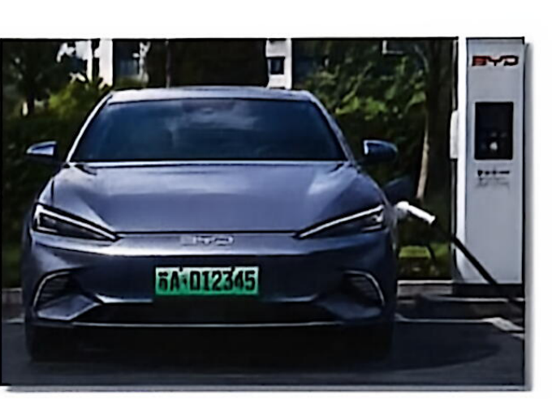
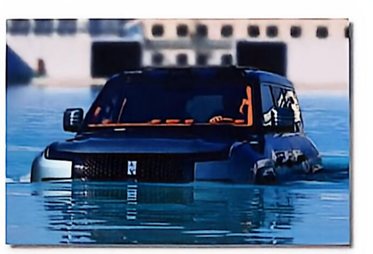
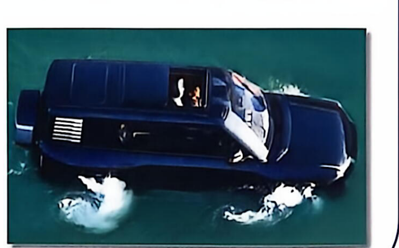

# 第 1 课　电动汽车

Dossier 1 · Transport de demain — Leçon 1 : Voitures électriques

FICHE 1 · 中法对照

综合法语实训（Français Général – Travaux Pratiques 3）· 大二上学期 · Dossier 1 未来的交通

!!! info "阅读说明"

    每段先列法语原文；其下缩进、带深蓝竖条的小字号段落为中文翻译。<strong>加粗</strong>为关键词或可替换的句型骨架。

## Objectifs　学习目标

Vous allez apprendre à :

本课学习目标

1. Découvrir les moyens de transport du futur et leurs caractéristiques, ainsi que les enjeux liés à leur développement.

    了解未来的交通工具及其特点，以及与其发展相关的各种挑战。
    {: .zh }

2. Acquérir et réutiliser le lexique lié aux transports, à l'intelligence artificielle et aux technologies des véhicules autonomes.

    掌握并复用与交通、人工智能和自动驾驶汽车技术相关的词汇。
    {: .zh }

3. Identifier les avantages et les limites d'une innovation technologique et exprimer une opinion argumentée sur son impact dans la société.

    识别一项技术创新的优势与局限，并围绕其社会影响表达有理有据的观点。
    {: .zh }

## Brainstorming　头脑风暴

**Activité 1 — Observez l'image.**

观察图片。

a. Reconnaissez-vous cette voiture ? Quelle est sa marque ?

你认得这辆车吗？它是什么品牌？
{: .zh }

b. Selon vous, c'est une voiture électrique ou une voiture thermique (essence / diesel) ? Pourquoi ?

你认为这是一辆电动汽车还是燃油汽车（汽油/柴油）？为什么？
{: .zh }

c. Connaissez-vous d'autres marques de voitures électriques ? Lesquelles ?

你还知道其他电动汽车品牌吗？是哪些？
{: .zh }

## Comprendre　理解

!!! tip "Pour vous aider · 学习助手"

    | 法语 | 中文 |
    |---|---|
    | le siège (n.m.) | 座椅 |
    | le pare-brise (n.m.) | 挡风玻璃 |
    | le rétroviseur (n.m.) | 后视镜 |
    | la caméra de recul (n.f.) | 倒车摄像头 |
    | l'efficacité énergétique (n.f.) | 能源效率 |
    | la fiabilité (n.f.) | 可靠性 |
    | une immatriculation (n.f.) | 登记、注册（车牌） |
    | l'autonomie (n.f.) | 续航时间 |
    | disséquer (v.) | 解剖、剖析 |

**Activité 2 — Regardez la vidéo et choisissez la bonne réponse.**

活动 2——观看视频，选择正确答案。
{: .zh }

1. Quel est le sujet principal de la vidéo ?

    视频的主题是什么？
    {: .zh }

    a. Les voitures hybrides — 混合动力汽车

    b. Les voitures électriques chinoises et européennes — 中国和欧洲的电动汽车

    c. Les transports publics — 公共交通

2. Quel est l'objectif du reportage ?

    这篇报道的目的是什么？
    {: .zh }

    a. Expliquer comment fabriquer une voiture — 解释如何制造汽车

    b. Comparer les performances des voitures — 比较汽车的性能

    c. Raconter une histoire d'un modèle de voiture — 讲述某款汽车的故事

3. Quelle est la tendance actuelle ?

    当前的趋势是什么？
    {: .zh }

    a. Les voitures européennes dominent le marché. — 欧洲汽车主导市场。

    b. Les voitures chinoises progressent rapidement. — 中国汽车快速崛起。

    c. Le marché des voitures électriques est en difficulté. — 电动汽车市场陷入困境。

### Séquence 1（0:00–0:33）

**Activité 3 — Regardez la séquence 1 et choisissez l'expression qui a le même sens.**

活动 3——观看片段 1，选出意思相同的表达。
{: .zh }

1. « Une voiture BYD amphibie » signifie :

    “比亚迪水陆两栖汽车”的意思是：
    {: .zh }

    a. Une voiture qui roule très vite — 一辆开得很快的汽车

    b. Une voiture qui utilise à la fois l'électricité et l'essence — 一辆同时使用电力和汽油的汽车

    c. Une voiture qui peut rouler sur la route et dans l'eau — 一辆既能在路上行驶、又能在水中行驶的汽车

2. « Des voitures de zinzin » signifie :

    “Des voitures de zinzin”的意思是：（zinzin 为法语口语，意为“疯狂的、不可思议的”）
    {: .zh }

    a. Des voitures normales — 普通的汽车

    b. Des voitures très simples — 非常简单的汽车

    c. Des voitures incroyables — 不可思议的汽车

3. « L'Europe transforme ses usines en musées » signifie :

    “欧洲把工厂变成博物馆”的意思是：
    {: .zh }

    a. L'Europe développe l'industrie de voiture — 欧洲发展汽车工业

    b. L'Europe perd son industrie de voiture — 欧洲失去其汽车工业

    c. L'Europe construit de nouveaux musées automobiles — 欧洲建造新的汽车博物馆

### Séquence 2（0:34–1:40）

**Activité 4 — Regardez la séquence 2. Vrai ou faux ? Justifiez.**

活动 4——观看片段 2。判断正误并说明理由。
{: .zh }

a. Selon le reportage, la MG4 Urban coûte très cher.

据报告，MG4 Urban 价格非常昂贵。
{: .zh }

b. Ces dernières années, les ventes de voitures électriques chinoises en Europe sont en baisse.

近年来，中国电动汽车在欧洲的销量持续下降。
{: .zh }

c. Les voitures chinoises comme XPENG proposent des technologies modernes.

小鹏等中国汽车品牌提供现代技术。
{: .zh }

**Activité 5 — Regardez les séquences 1 et 2 une deuxième fois et classez les caractéristiques suivantes :**

活动 5——再次观看片段 1 和 2，将下列特征归类：
{: .zh }

- a. se gare toute seule — 可自动泊车
- b. caméra réglable à la place du rétroviseur — 以可调节摄像头取代后视镜
- c. voiture amphibie — 水陆两栖汽车
- d. un bon rapport qualité-prix — 良好的性价比
- e. allie de belles autonomies et un grand confort — 兼具出色的续航与极佳的舒适性
- f. aide au recul projetée sur le pare-brise — 将倒车辅助影像投射到挡风玻璃上
- g. siège massant activé par commande vocale — 语音控制的按摩座椅

| BYD | XPENG | MG |
|---|---|---|
| &nbsp; | &nbsp; | &nbsp; |

### Séquence 3（1:41–结束）

**Activité 6 — Regardez la séquence 3.**

活动 6——观看片段 3。
{: .zh }

**a. Complétez les domaines évoqués dans la vidéo.**

a. 补全视频中提到的领域。
{: .zh }

- a. les batteries — 电池
- b. l'efficacité énergétique — 能源效率
- c. la recharge — 充电
- d. les logiciels — 软件
- e. la conduite autonome — 自动驾驶
- f. le confort de conduite — 驾驶舒适性
- g. la qualité des matériaux (cuir, etc.) — 材料品质（皮革等）
- h. la fiabilité sur le long terme — 长期可靠性

**b. D'après Patrick, dans quels domaines la Chine et l'Europe sont-elles respectivement en avance ? Classez-les.**

b. 根据帕特里克的说法，中国和欧洲分别在哪些领域领先？请将它们分类。
{: .zh }

| Chine 中国 | Europe 欧洲 |
|---|---|
| &nbsp; | &nbsp; |

**Activité 7 — Complétez le résumé avec les mots proposés :**

活动 7——用所给词语补全摘要：
{: .zh }

*combler — conduite autonome — rapport qualité-prix — ventes — en avance — séduit — recharge*

弥补（差距）— 自动驾驶 — 性价比 — 销量 — 领先 — 吸引 — 充电
{: .zh }

Les voitures électriques chinoises impressionnent par leurs performances technologiques.

中国电动汽车以其技术性能令人惊叹。
{: .zh }

Dans une concession française, c'est l'électrique chinois qui séduit le plus les consommateurs.

在一家法国汽车经销店里，最吸引消费者的是中国电动汽车。
{: .zh }

Par exemple, la MG4 Urban a un excellent rapport qualité-prix : elle coûte environ 20 000 euros.

例如，MG4 Urban 性价比极高：售价约 20 000 欧元。
{: .zh }

Grâce à ce prix attractif, les ventes de cette concession sont en hausse.

得益于这一诱人的价格，该经销店的销量不断上升。
{: .zh }

Les constructeurs chinois sont particulièrement en avance sur la technologie de conduite autonome ainsi que sur la recharge des batteries.

中国制造商在自动驾驶技术和电池充电方面尤其领先。
{: .zh }

Cependant, les experts prévoient que les constructeurs européens vont combler leur retard dans les prochaines années, notamment sur les batteries et l'architecture logicielle.

然而，专家预测欧洲制造商将在未来几年内弥补差距，尤其是在电池和软件架构方面。
{: .zh }

## Outils d'expression　表达工具

### Comparer et opposer des performances technologiques　比较与对照技术性能

Pour comparer les voitures électriques chinoises et européennes, exprimer une avance ou un retard technologique, on peut utiliser différentes expressions.

为了比较中国与欧洲的电动汽车、表达技术上的领先或落后，可以使用多种表达方式。
{: .zh }

#### 1. Exprimer une avance ou une supériorité　表达领先或优势

- **être en avance sur** + qqn/qqch

    *Exemple :* Les constructeurs chinois sont en avance sur les constructeurs européens.

    <strong>在某人/某方面领先。</strong>例：中国制造商领先于欧洲制造商。
    {: .zh }

- **être en avance dans** + domaine/secteur

    *Exemple :* Les constructeurs chinois sont en avance dans les batteries.

    <strong>在某个领域/行业领先。</strong>例：中国制造商在电池领域领先。
    {: .zh }

- **être plus performant(e)(s)** (que + nom)

    *Exemple :* Les voitures chinoises sont plus performantes technologiquement.

    <strong>性能优于（某物）。</strong>例：中国汽车在技术上性能更优。
    {: .zh }

- **dominer dans** + nom

    *Exemple :* Les voitures électriques chinoises dominent dans la recharge et l'autonomie.

    <strong>在……方面占据主导。</strong>例：中国电动汽车在充电和续航方面占据主导。
    {: .zh }

#### 2. Exprimer un retard ou une faiblesse　表达落后或劣势

- **être en retard sur** + qqn/qqch

    *Exemple :* Il est en retard sur son temps avec ses méthodes de travail.

    <strong>落后于某人/某物。</strong>例：他的工作方法落后于时代。
    {: .zh }

- **être en retard dans** + domaine/secteur

    *Exemple :* Ce pays est en retard sur ses voisins dans l'éducation.

    <strong>在某个领域/行业落后。</strong>例：这个国家在教育方面落后于邻国。
    {: .zh }

- **être moins avancé(e)(s)** (que + nom)

    *Exemple :* Cette marque est moins avancée dans la recharge rapide.

    <strong>不如（某物）先进。</strong>例：这个品牌在快速充电方面不够先进。
    {: .zh }

- **être à la traîne**

    *Exemple :* Les zones rurales sont à la traîne dans l'accès à Internet.

    <strong>处于落后状态、掉队。</strong>例：农村地区在互联网接入方面处于落后地位。
    {: .zh }

#### 3. Faire une comparaison ou une opposition　进行比较或对照

- **alors que** + proposition

    *Exemple :* Elle préfère les voitures électriques, alors que son mari reste attaché aux moteurs thermiques.

    <strong>而、然而（引导从句）。</strong>例：她偏爱电动汽车，而她丈夫仍然钟情于燃油发动机。
    {: .zh }

- **pendant que** + proposition

    *Exemple :* Les Chinois investissent dans la conduite autonome pendant que les Européens améliorent le confort des voitures.

    <strong>当……时、与此同时（引导从句）。</strong>例：中国人在自动驾驶领域投入，而欧洲人则在提升汽车的舒适性。
    {: .zh }

## Échanger　交流

**Activité 8 — En petit groupe, discutez des questions suivantes. Exprimez vos opinions en utilisant les expressions ci-dessus.**

活动 8——小组讨论以下问题，并运用上面学过的表达方式发表观点。
{: .zh }

a. Si vous deviez acheter une voiture électrique aujourd'hui, choisiriez-vous une marque chinoise ou européenne ?

如果你现在要买一辆电动汽车，你会选择中国品牌还是欧洲品牌？
{: .zh }

b. Quels critères sont les plus importants pour vous : le prix, la technologie, le confort ou la fiabilité ?

对你来说，哪些标准最重要：价格、技术、舒适性还是可靠性？
{: .zh }

## Culture　文化

### La voiture BYD amphibie　比亚迪水陆两栖汽车

Le Yangwang U8 est un véhicule électrique tout-terrain développé par BYD.

仰望 U8 是比亚迪研发的一款电动越野车。
{: .zh }

Grâce à ses quatre moteurs indépendants et à son système intelligent, il peut affronter des terrains difficiles.

凭借四个独立电机和智能系统，它能够应对复杂地形。
{: .zh }

En cas d'urgence, il peut même flotter sur l'eau pendant quelques minutes.

在紧急情况下，它甚至能在水面上漂浮数分钟。
{: .zh }

## Corrigé des annotations　手写答案整理

!!! example "附：手写答案整理 · Corrigé des annotations"

    依据原件上的手写批注整理，仅供参考。

    - **Activité 2**：1. b　2. b　3. b
    - **Activité 3**：1. c　2. c　3. b
    - **Activité 4**：a. Faux（20 000 euros，性价比高）；b. Faux（销量翻倍：×2，14 %）；c. Vrai
    - **Activité 5**：BYD — a, c　XPENG — b, g　MG — d, e
    - **Activité 6 b**：Chine — a, b, c, d, e　Europe — f, g, h
    - **Activité 7**：séduit — rapport qualité-prix — ventes — en avance — conduite autonome — recharge — combler

## Vocabulaire et expressions　词汇与表达

### La voiture et ses performances　汽车及其性能

| 法语 | 中文 |
|---|---|
| la voiture électrique (n.f.) | 电车 |
| un siège massant (n.m.) | 按摩座椅 |
| la caméra (n.f.) | 摄像头 |
| une plaque d'immatriculation (n.f.) | 车牌 |
| un stock (n.m.) | 库存 |
| la recharge (n.f.) | 充电 |
| un logiciel (n.m.) | 软件 |
| la conduite autonome (n.f.) | 自动驾驶 |
| conduire (vt.) | 驾驶 |
| le conducteur / la conductrice | 驾驶者 |

### Le marché　市场

| 法语 | 中文 |
|---|---|
| les ventes (n.f.pl.) | 销量 |
| un constructeur (n.m.) | 制造商 |
| un consommateur (n.m.) | 消费者 |
| une part de marché (n.f.) | 市场份额 |
| la concurrence (n.f.) | 竞争 |
| concurrent(e) | 竞争对手 |
| le rapport qualité-prix (n.m.) | 性价比 |
| un prix cassé (n.m.) | 超低价 |

### Les actions et les expressions　动作与表达

| 法语 | 中文 |
|---|---|
| exploser (vt.) | 激增、爆发式增长 |
| séduire (vt.) | 吸引 |
| être en avance (loc.v.) | 领先 |
| avoir une longueur d'avance (loc.v.) | 领先 |
| être à la traîne (loc.v.) | 落后 |
| combler un retard (loc.v.) | 弥补落后 |
| transformer A en B | 将 A 转变成 B |
| allier A et B | 结合 A 和 B |

## 打印版 PDF

[下载《综合法语实训 · 第 1 课 电动汽车》中法对照讲义 PDF](../../../../../assets/files/综合法语实训_第1课_电动汽车.pdf)
