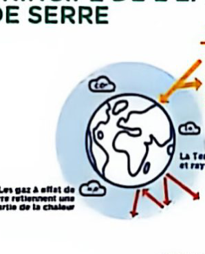
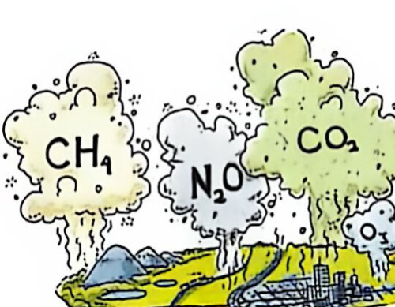

# 第 2 课　电动汽车真的更环保吗？

Dossier 1 · Transport de demain — Leçon 2 : La voiture électrique est-elle vraiment plus écologique ?

FICHE 2 · 中法对照

综合法语实训（Français Général – Travaux Pratiques 3）· 大二上学期 · Dossier 1 未来的交通

!!! info "阅读说明"

    每段先列法语原文；其下缩进、带深蓝竖条的小字号段落为中文翻译。<strong>加粗</strong>为关键词或可替换的句型骨架。

## Brainstorming　头脑风暴

**Activité 1 — Discutez en groupe.**

活动 1——小组讨论。
{: .zh }

a. Selon vous, la voiture électrique est-elle vraiment plus écologique ? Pourquoi ?

你认为电动汽车真的更环保吗？为什么？
{: .zh }

b. Quels sont les matériaux nécessaires à la fabrication des batteries ?

制造电池需要哪些材料？
{: .zh }

## Comprendre　理解

!!! tip "Pour vous aider · 学习助手"

    | 法语 | 中文 |
    |---|---|
    | le cobalt (n.m.) | 钴 |
    | le graphite (n.m.) | 石墨 |
    | le lithium (n.m.) | 锂 |
    | le manganèse (n.m.) | 锰 |
    | le nickel (n.m.) | 镍 |
    | le néodyme (n.m.) | 钕 |
    | extraire (vt.) | 开采、提取 |
    | l'extraction (n.f.) | 开采、提取 |
    | raffiner (vt.) | 精炼、提纯 |
    | le raffinage (n.m.) | 精炼、提纯 |
    | purifier (vt.) | 提纯、净化 |

**Activité 2 — Regardez la vidéo et choisissez la bonne réponse.**

活动 2——观看视频，选择正确答案。
{: .zh }

1. Quel est le sujet principal de la vidéo ?

    视频的主题是什么？
    {: .zh }

    a. Comment fabriquer une voiture électrique — 如何制造电动汽车

    b. L'impact environnemental réel de la voiture électrique — 电动汽车的真实环境影响

    c. Les techniques pour apprendre à conduire une voiture électrique — 学习驾驶电动汽车的技巧

    d. L'histoire de Tesla — 特斯拉的历史

2. Quel est le type de document ?

    这份材料的类型是什么？
    {: .zh }

    a. Une publicité — 广告

    b. Un reportage — 报道

    c. Une conversation privée — 私人谈话

    d. Une interview publique — 公开采访

3. D'après la vidéo, à quels moments la voiture électrique produit-elle de la pollution ? (Plusieurs réponses)

    根据视频，电动汽车在哪些环节产生污染？（多个答案）
    {: .zh }

    a. Lors de la production des batteries et des métaux — 在生产电池和金属时

    b. Lors de la conduite quotidienne — 在日常驾驶时

    c. Lors de la recharge en électricité — 在为电池充电时

    d. Lors du stationnement — 在停车时

### Séquence 1（0:00–1:40）

**Activité 3 — Regardez la séquence 1 et répondez aux questions suivantes :**

活动 3——观看片段 1，回答以下问题：
{: .zh }

a. D'après la vidéo, qu'a prévu le plan climat présenté par Nicolas Hulot en 2017 ?

根据视频，尼古拉·于洛 2017 年提出的气候计划作了什么规定？
{: .zh }

b. Qu'ont annoncé plusieurs pays comme la France, la Chine et l'Inde ?

法国、中国和印度等多个国家宣布了什么？
{: .zh }

c. Citez deux énergies fossiles mentionnées dans la vidéo.

请举出视频中提到的两种化石能源。
{: .zh }

d. Selon la vidéo, quel est l'effet du CO2 sur l'atmosphère ?

根据视频，二氧化碳对大气有什么影响？
{: .zh }

e. Pourquoi la voiture électrique est-elle un bon choix pour le climat en France ?

为什么电动汽车在法国是应对气候问题的好选择？
{: .zh }

### Séquence 2（1:41–3:02）

**Activité 4 — Associez les mots et les définitions.**

活动 4——将词语与释义连线。
{: .zh }

**Mot　词语**

| 序号 | 词语 | 中文 |
|---|---|---|
| 1 | les métaux rares | 稀有金属 |
| 2 | l'extraction | 开采、提取 |
| 3 | une batterie | 电池 |
| 4 | un moteur | 发动机 |
| 5 | raffiner | 精炼、提纯 |

**Définition　释义**

| 序号 | 法语定义 | 中文 |
|---|---|---|
| a | l'action de sortir une matière minérale | 从矿物中提取物质的行为 |
| b | les matériaux difficiles à trouver pour fabriquer certaines technologies | 制造某些技术产品所需的、难以找到的材料 |
| c | un appareil qui transforme l'énergie en mouvement pour faire fonctionner une voiture | 将能量转化为运动以驱动汽车的装置 |
| d | l'action de purifier un métal ou un produit | 提纯金属或产品的行为 |
| e | l'élément qui stocke l'énergie électrique | 储存电能的元件 |

**Activité 5 — Regardez la séquence 2 et choisissez la/les bonne(s) réponse(s) :**

活动 5——观看片段 2，选择正确答案（可能有多项）：
{: .zh }

1. Quels sont les deux points à prendre en compte pour savoir si la voiture électrique est vraiment écologique ? (deux réponses)

    要判断电动汽车是否真正环保，需要考虑哪两点？（两个答案）
    {: .zh }

    a. La construction de la voiture — 汽车的制造

    b. Le coût de l'électricité — 电费

    c. L'énergie pour recharger les batteries — 为电池充电所使用的能源

2. La construction d'une voiture électrique produit combien de CO2 en plus ?

    制造一辆电动汽车会多产生多少二氧化碳？
    {: .zh }

    a. 30 % — 30 %

    b. 50 % — 50 %

    c. 100 % — 100 %

3. Quels sont les métaux rares mentionnés dans le reportage ? (Plusieurs réponses)

    报道中提到了哪些稀有金属？（多个答案）
    {: .zh }

    a. Le cobalt — 钴

    b. Le lithium — 锂

    c. Le fer — 铁

    d. Le néodyme — 钕

    e. Le manganèse — 锰

    f. L'aluminium — 铝

4. Quelle est la profession de Guillaume Pitron ?

    纪尧姆·皮特龙的职业是什么？
    {: .zh }

    a. Un ingénieur automobile — 汽车工程师

    b. Un journaliste d'investigation — 调查记者

    c. Un blogueur — 博主

**Activité 6 — Regardez une deuxième fois et répondez aux questions suivantes :**

活动 6——再次观看视频，回答以下问题：
{: .zh }

a. Pourquoi la fabrication d'une voiture électrique produit-elle plus de CO2 que celle d'une voiture thermique ?

为什么制造电动汽车比制造燃油汽车产生更多二氧化碳？
{: .zh }

b. Selon la vidéo, quels sont les coûts environnementaux de l'extraction des métaux rares ?

根据视频，开采稀有金属会带来哪些环境代价？
{: .zh }

### Séquence 3（3:03–结束）

**Activité 7 — Regardez la séquence 3. Vrai ou faux ? Justifiez.**

活动 7——观看片段 3。判断正误并说明理由。
{: .zh }

a. Plusieurs pays, comme la Chine et la France, utilisent surtout des énergies fossiles pour produire de l'électricité.

中国和法国等多个国家主要使用化石能源发电。
{: .zh }

b. Dans les grandes villes, la pollution liée aux voitures électriques disparaît complètement.

在大城市，与电动汽车相关的污染完全消失。
{: .zh }

**Activité 8 — Complétez le texte avec les mots proposés :**

活动 8——用所给词语补全文本：
{: .zh }

*réchauffement climatique — métaux rares — polluent — écologique — énergies fossiles — émissions — déplacer le problème — prendre en compte*

全球变暖 — 稀有金属 — 污染 — 环保的 — 化石能源 — 排放 — 转移问题 — 考虑
{: .zh }

!!! note "原文为选词填空"

    以下按手写批注补全，供理解与背诵。

La voiture électrique est souvent considérée comme une solution **écologique** aux problèmes de pollution. En effet, elle ne produit pas de gaz à effet de serre quand elle roule, ce qui pourrait limiter le **réchauffement climatique**.

电动汽车常被视为解决污染问题的<strong>环保</strong>方案。事实上，它行驶时不产生温室气体，这可能有助于减缓<strong>全球变暖</strong>。
{: .zh }

Cependant, il faut **prendre en compte** deux aspects importants. D'abord, la construction de la voiture produit beaucoup de CO2. L'extraction des **métaux rares** demande énormément d'énergie et d'eau, et les produits chimiques utilisés **polluent** l'environnement.

然而，必须<strong>考虑</strong>两个重要方面。首先，汽车的制造会产生大量二氧化碳。<strong>稀有金属</strong>的开采需要消耗大量能源和水，所使用的化学产品也会<strong>污染</strong>环境。
{: .zh }

Ensuite, de nombreux pays utilisent encore des **énergies fossiles** comme le charbon ou le gaz pour produire de l'électricité. Dans ce cas, la voiture électrique ne fait que **déplacer le problème** : les **émissions** de CO2 sont toujours présentes, elles sont simplement déplacées vers les lieux de production d'énergie.

其次，许多国家仍使用煤炭或天然气等<strong>化石能源</strong>发电。在这种情况下，电动汽车只是<strong>转移了问题</strong>：二氧化碳<strong>排放</strong>依然存在，只是被转移到了能源生产地。
{: .zh }

## Corrigé des annotations　手写答案整理

!!! example "附：手写答案整理 · Corrigé des annotations"

    依据原件上的手写批注整理，仅供参考。

    - **Activité 2**：1. b　2. b　3. a, c
    - **Activité 4**：1. b　2. a　3. e　4. c　5. d
    - **Activité 5**：1. a, c　2. b　3. a, b, d, e, f　4. b
    - **Activité 7**：a. Faux（主要依靠核能）；b. Faux（污染只是被转移到城市外的能源生产地）
    - **Activité 8**：écologique — réchauffement climatique — prendre en compte — métaux rares — polluent — énergies fossiles — déplacer le problème — émissions

## Outils d'expression　表达工具

### Donner une opinion, argumenter et nuancer　表达观点、论证与缓和语气

Pour exprimer une opinion nuancée sur un sujet controversé et présenter des arguments, on peut utiliser les expressions suivantes.

为了就有争议的话题表达细致的观点并陈述论据，可以使用以下表达。
{: .zh }

#### 1. Présenter une idée reçue ou une opinion courante　引出成见或普遍观点

- **être considéré(e)(s) comme** + nom

    *Exemple :* Les voitures électriques sont souvent considérées comme une solution idéale pour l'environnement.

    <strong>被视为……。</strong>例：电动汽车常被视为解决环境问题的理想方案。
    {: .zh }

- **laisser entendre que** + proposition

    *Exemple :* Certaines décisions politiques laissent entendre que la voiture électrique est écologique.

    <strong>暗示……。</strong>例：某些政治决策暗示电动汽车是环保的。
    {: .zh }

#### 2. Introduire un argument　引入论据

- **Il faut prendre en compte** + nom

    *Exemple :* Il faut prendre en compte l'énergie utilisée pour produire l'électricité.

    <strong>必须考虑……。</strong>例：必须考虑发电所使用的能源。
    {: .zh }

- **Le point qui est mis en avant, c'est que** + proposition

    *Exemple :* Le point qui est mis en avant, c'est que la voiture électrique n'émet pas de CO2 en roulant.

    <strong>被强调的一点是……。</strong>例：被强调的一点是，电动汽车行驶时不排放二氧化碳。
    {: .zh }

- **Il ne faut pas oublier que** + proposition

    *Exemple :* Il ne faut pas oublier que la situation est différente selon les pays.

    <strong>不要忘记……。</strong>例：不要忘记，各国情况不同。
    {: .zh }

#### 3. Exprimer une concession　表达让步

- **Ça pourrait être vrai, mais** + proposition

    *Exemple :* Ça pourrait être vrai, mais il faut aussi penser à la fabrication des batteries.

    <strong>这也许是真的，但是……。</strong>例：这也许是真的，但还必须考虑电池的制造。
    {: .zh }

- **Même si** + proposition

    *Exemple :* Même si le nucléaire a des problèmes, il ne produit pas de CO2.

    <strong>即使……。</strong>例：即使核能有其问题，它也不产生二氧化碳。
    {: .zh }

- **Malgré tout,** + proposition

    *Exemple :* La voiture électrique a des inconvénients. Malgré tout, elle reste l'avenir de l'automobile.

    <strong>尽管如此……。</strong>例：电动汽车有其缺点。尽管如此，它仍是汽车的未来。
    {: .zh }

## Échanger　交流

**Activité 9 — En petit groupe, discutez des questions suivantes. Exprimez vos opinions en utilisant les expressions ci-dessus.**

活动 9——小组讨论以下问题，并运用上面学过的表达方式发表观点。
{: .zh }

a. Selon vous, la voiture électrique est-elle vraiment une solution écologique ?

你认为电动汽车真的是环保方案吗？
{: .zh }

b. Voiture électrique vs voiture thermique : laquelle préférez-vous ?

电动汽车 vs 燃油汽车：你更喜欢哪一种？
{: .zh }

c. Faut-il interdire les voitures thermiques en 2040 ?

是否应在 2040 年禁止燃油汽车？
{: .zh }

## Culture　文化

### L'effet de serre　温室效应

L'effet de serre est un phénomène naturel qui permet de maintenir une température agréable sur la Terre. Certains gaz présents dans l'atmosphère, comme le dioxyde de carbone (CO₂) et le méthane, retiennent une partie de la chaleur du Soleil et empêchent la Terre de devenir trop froide.

温室效应是一种自然现象，使地球得以维持宜人的温度。大气中的某些气体，如二氧化碳（CO₂）和甲烷，会留住一部分太阳热量，防止地球变得过冷。
{: .zh }

Cependant, les activités humaines augmentent la quantité de gaz à effet de serre dans l'atmosphère. La combustion du charbon, du pétrole et du gaz produit beaucoup de CO₂. Ces émissions renforcent l'effet de serre naturel et provoquent une augmentation de la température moyenne de la planète : c'est le réchauffement climatique.

然而，人类活动增加了大气中温室气体的含量。煤炭、石油和天然气的燃烧产生大量二氧化碳。这些排放强化了自然温室效应，导致地球平均气温上升，这就是全球变暖。
{: .zh }

Ses conséquences sont déjà visibles : fonte des glaces, montée des eaux, canicules plus fréquentes, etc. Pour limiter ce réchauffement, il faut réduire nos émissions de gaz à effet de serre. C'est tout l'enjeu de la transition énergétique.

其后果已经显现：冰川融化、海平面上升、热浪更加频繁等。为限制变暖，必须减少温室气体排放。这正是能源转型的关键所在。
{: .zh }

→ À votre avis, quelles actions individuelles ou collectives peuvent aider à lutter contre le réchauffement climatique ?

→ 你认为哪些个人或集体行动有助于应对全球变暖？
{: .zh }

## Vocabulaire et expressions　词汇与表达

### La voiture et ses composants　汽车及其部件

| 法语 | 中文 |
|---|---|
| une voiture thermique (n.f.) | 燃油车 |
| un véhicule (n.m.) | 车辆 |
| le moteur (n.m.) | 发动机 |
| la batterie (n.f.) | 电池 |
| un constructeur (n.m.) | 制造商 |
| un fournisseur (n.m.) | 供应商 |
| un intermédiaire (n.m.) | 中间商 |

### L'énergie　能源

| 法语 | 中文 |
|---|---|
| une énergie fossile (n.f.) | 化石能源 |
| le charbon (n.m.) | 煤炭 |
| le pétrole (n.m.) | 石油 |
| le gaz naturel (n.m.) | 天然气 |
| l'essence (n.f.) | 汽油 |
| le diesel (n.m.) | 柴油 |
| l'électricité (n.f.) | 电力 |
| la recharge (n.f.) | 充电 |
| l'énergie nucléaire (n.f.) | 核能 |
| les matières premières (n.f.) | 原材料 |

### Les actions　动作

| 法语 | 中文 |
|---|---|
| consommer (vt.) | 消耗 |
| brûler (vt.) | 燃烧 |
| produire (vt.) | 生产 |
| recharger (vt.) | 充电 |
| extraire (vt.) | 开采、提取 |
| raffiner (vt.) | 精炼、提纯 |
| rejeter (vt.) | 丢弃 |

### L'environnement　环境

| 法语 | 中文 |
|---|---|
| écologique (adj.) | 环保的 |
| la pollution (n.f.) | 污染 |
| polluer (vt.) | 污染 |
| polluant / polluante (adj.) | 污染的 |
| les gaz à effet de serre (n.m.) | 温室气体 |
| l'effet de serre (n.m.) | 温室效应 |
| le réchauffement climatique (n.m.) | 全球变暖 |
| l'atmosphère (n.f.) | 大气 |
| les écosystèmes (n.m.) | 生态系统 |
| les produits chimiques (n.m.) | 化学产品 |

### Les expressions utiles　常用表达

| 法语 | 中文 |
|---|---|
| prendre en compte | 考虑 |
| mettre en avant | 强调、突出 |
| déplacer le problème | 转移问题 |
| être considéré(e)(s) comme | 被视为…… |
| laisser entendre que | 暗示…… |
| permettre de + inf. | 允许…… |
| éviter de + inf. | 避免…… |
| malgré tout | 尽管如此 |

## 打印版 PDF

[下载《综合法语实训 · 第 2 课 电动汽车真的更环保吗》中法对照讲义 PDF](../../../../../assets/files/综合法语实训_第2课_电动汽车真的更环保吗.pdf)
