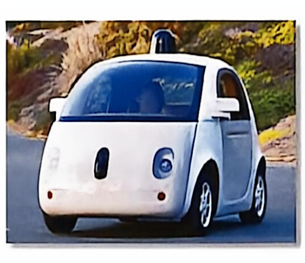

# 第 3 课　自动驾驶汽车

Dossier 1 · Transport de demain — Leçon 3 : Véhicules autonomes

FICHE 3 · 中法对照

综合法语实训（Français Général – Travaux Pratiques 3）· 大二上学期 · Dossier 1 未来的交通

!!! info "阅读说明"

    每段先列法语原文；其下缩进、带深蓝竖条的小字号段落为中文翻译。<strong>加粗</strong>为关键词或可替换的句型骨架。

## Brainstorming　头脑风暴

**Activité 1 — Observez la photo et répondez aux questions.**

活动 1——观察照片并回答问题。
{: .zh }

a. Qu'est-ce qui est particulier ?

这张照片有什么特别之处？
{: .zh }

b. Comment la voiture peut-elle conduire toute seule ?

这辆车如何能够独自驾驶？
{: .zh }

c. Est-ce que vous feriez confiance à une voiture sans conducteur ? Pourquoi ?

你会信任一辆没有驾驶员的汽车吗？为什么？
{: .zh }

## Comprendre　理解

### Texte　课文

**Véhicules électriques et autonomes : le transport de demain ?**

电动与自动驾驶汽车：未来的交通？
{: .zh }

Longtemps réservés aux livres et films de science-fiction, les véhicules électriques et autonomes font désormais pleinement partie de notre société. Pourtant, leur arrivée sur le marché peine à se faire une réelle place. Alors, les véhicules électriques et autonomes sont-ils vraiment les véhicules de demain ? Pour répondre à cette question, il faut d'abord comprendre comment fonctionne cette technologie.

长期以来只存在于科幻书籍和电影中的电动与自动驾驶汽车，如今已完全融入我们的社会。然而，它们进入市场后却难以真正占据一席之地。那么，电动与自动驾驶汽车真的是未来的交通工具吗？要回答这个问题，首先必须了解这项技术如何运作。
{: .zh }

Pour conduire toute seule, une voiture autonome doit d'abord voir et comprendre son environnement. Elle utilise pour cela des caméras, des radars et des lidars (des sortes de lasers). Ces outils détectent les piétons, les autres voitures, les panneaux de signalisation et les obstacles. Toutes ces informations sont envoyées au système d'intelligence artificielle (IA), qui les analyse très rapidement. En une fraction de seconde, l'IA prend une décision : freiner, tourner, accélérer ou continuer tout droit.

要独自驾驶，自动驾驶汽车必须首先“看见”并理解周围环境。为此，它使用摄像头、雷达和激光雷达（一种激光装置）。这些工具能够检测行人、其他车辆、交通标志和障碍物。所有信息被发送到人工智能（AI）系统，由系统快速分析。在几分之一秒内，AI 就会做出决定：刹车、转向、加速或继续直行。
{: .zh }

Grâce à ce fonctionnement, la voiture autonome offre plusieurs avantages importants. Le système de conduite autonome permet d'améliorer la sécurité sur nos routes. Aujourd'hui, 90 % des accidents sont causés par des erreurs humaines. Les conducteurs sont fatigués ou distraits. L'IA, elle, ne se fatigue jamais et réagit beaucoup plus vite qu'un humain. Tesla donne des chiffres impressionnants : ses voitures équipées du système Autopilot ont eu un accident tous les 4,6 millions de kilomètres, contre un accident tous les 770 000 kilomètres en moyenne aux États-Unis. L'IA aide aussi à économiser de l'énergie. En analysant la conduite et la circulation, elle ajuste les réglages de la voiture pour utiliser moins de batterie. Certains constructeurs utilisent l'IA pour choisir le meilleur moment pour recharger, en fonction du prix de l'électricité. Cela permet aux utilisateurs de payer moins cher.

凭借这种运作方式，自动驾驶汽车具有多项重要优势。自动驾驶系统能够提高道路安全。如今，90 % 的事故由人为失误造成。驾驶员会疲劳或分心。而 AI 从不疲劳，反应速度也比人类快得多。特斯拉给出了惊人的数据：配备 Autopilot 系统的车辆每行驶 460 万公里发生一次事故，而美国平均每 77 万公里发生一次事故。AI 还有助于节约能源。通过分析驾驶行为和交通状况，它会调整车辆设置以减少电池消耗。一些制造商利用 AI 根据电价选择最佳充电时间，让用户少花钱。
{: .zh }

Mais la voiture autonome n'est pas la seule à bénéficier de cette technologie. Aux États-Unis, un camion autonome a parcouru 4 500 kilomètres tout seul. En France, une navette roule sans chauffeur à Châteauroux. Airbus a même réussi à faire atterrir un avion sans pilote. La révolution autonome concerne tous les moyens de transport.

但自动驾驶汽车并不是唯一受益于这项技术的交通工具。在美国，一辆自动驾驶卡车独自行驶了 4500 公里。在法国，一辆接驳车在沙托鲁实现了无人驾驶运行。空客甚至成功让一架飞机在没有飞行员的情况下着陆。自动驾驶革命涉及所有交通方式。
{: .zh }

Malgré tous ces avantages, la voiture autonome n'est pas encore partout. Son prix est très élevé : entre 270 000 et 360 000 euros. Le seul système LIDAR peut coûter jusqu'à 68 000 euros. Les voitures électriques actuelles coûtent entre 30 000 et 70 000 euros. Ces prix sont encore trop chers pour la plupart des gens. De plus, les constructeurs doivent travailler avec des entreprises spécialisées dans l'IA, les batteries et les logiciels.

尽管有这些优势，自动驾驶汽车仍未普及。其价格非常高昂：在 27 万至 36 万欧元之间。仅 LIDAR 系统就可能高达 6.8 万欧元。目前的电动汽车价格在 3 万至 7 万欧元之间。这些价格对大多数人来说仍然太贵。此外，制造商还必须与专门从事 AI、电池和软件的企业合作。
{: .zh }

La voiture autonome arrivera progressivement dans nos vies. Elle deviendra plus accessible quand les prix baisseront. Une chose est sûre : demain, nos déplacements ne seront plus les mêmes, et l'IA sera au cœur de ce changement.

自动驾驶汽车将逐步进入我们的生活。当价格下降时，它会变得更加普及。有一点是确定的：明天，我们的出行方式将不再一样，而 AI 将处于这场变革的核心。
{: .zh }

来源：<em>futura-sciences.com</em> — « Véhicules électriques et autonomes : le transport de demain ? »

**Activité 2 — Lisez l'article et choisissez la bonne réponse.**

活动 2——阅读文章，选择正确答案。
{: .zh }

1. Quel est le sujet principal de cet article ?

    这篇文章的主题是什么？
    {: .zh }

    a. Les différents types de voitures électriques — 不同类型的电动汽车

    b. Le fonctionnement et les promesses de la voiture autonome — 自动驾驶汽车的运作方式与前景

    c. Les risques de la voiture autonome — 自动驾驶汽车的风险

    d. L'histoire de l'intelligence artificielle — 人工智能的历史

2. Le ton général de l'article est plutôt :

    文章的整体语气更偏向：
    {: .zh }

    a. Ironique — 讽刺

    b. Publicitaire — 广告宣传

    c. Informatif — 信息性

    d. Critique — 批评

**Activité 3 — Relisez l'article et associez chaque paragraphe à l'intitulé qui lui correspond.**

活动 3——重读文章，将每个段落与相应的小标题连线。
{: .zh }

| Paragraphe 段落 | Intitulé 小标题 |
|---|---|
| Paragraphe 1 | a. Introduction : présentation du sujet et question centrale（引言：主题呈现与核心问题） |
| Paragraphe 2 | b. Les avantages de la voiture autonome（自动驾驶汽车的优点） |
| Paragraphe 3 | c. Les problèmes actuels（当前的问题） |
| Paragraphe 4 | d. Fonctionnement de la voiture autonome（自动驾驶汽车的运作方式） |
| Paragraphe 5 | e. Conclusion : l'avenir de la voiture autonome（结论：自动驾驶汽车的未来） |
| Paragraphe 6 | f. Les applications de la technologie au-delà des voitures（该技术在汽车之外的应用） |

**Activité 4 — Relisez l'article.**

活动 4——重读文章。
{: .zh }

**a. Vrai ou Faux ? Justifiez.**

a. 判断正误并说明理由。
{: .zh }

1. Les voitures autonomes n'utilisent que des caméras pour analyser leur environnement.

    自动驾驶汽车仅使用摄像头来分析环境。
    {: .zh }

2. L'IA prend des décisions très rapidement.

    人工智能决策非常迅速。
    {: .zh }

3. Les accidents sont souvent causés par des machines.

    事故往往由机器造成。
    {: .zh }

4. Les voitures Tesla équipées d'Autopilot ont de meilleurs résultats que la moyenne américaine.

    配备 Autopilot 的特斯拉汽车表现优于美国平均水平。
    {: .zh }

5. La voiture autonome est déjà très abordable pour la plupart des gens.

    对大多数人来说，自动驾驶汽车已经很负担得起。
    {: .zh }

**b. Reliez chaque élément à sa ou ses fonctions.**

b. 将每个部件与其功能连线。
{: .zh }

| Élément 部件 | Fonction 功能 |
|---|---|
| 1. caméras（摄像头） | a. analyser les informations（分析信息） |
| 2. radars et lidars（雷达和激光雷达） | b. voir l'environnement comme un œil（像眼睛一样观察环境） |
| 3. intelligence artificielle (IA)（人工智能） | c. prendre des décisions（做出决定） |
|  | d. gérer la consommation d'énergie（管理能源消耗） |
|  | e. détecter les objets avec des ondes（用波探测物体） |
|  | f. choisir le meilleur moment pour recharger（选择最佳充电时机） |

**c. Répondez aux questions suivantes.**

c. 回答以下问题。
{: .zh }

1. Pourquoi l'intelligence artificielle est-elle plus sûre qu'un conducteur humain ?

    为什么人工智能比人类驾驶员更安全？
    {: .zh }

2. Quels sont les autres véhicules autonomes mentionnés dans l'article ?

    文章中提到了哪些其他自动驾驶交通工具？
    {: .zh }

3. Pourquoi la voiture autonome n'est-elle pas encore accessible à tout le monde ? (Donnez deux raisons.)

    为什么自动驾驶汽车尚未普及到所有人？（请给出两个原因。）
    {: .zh }

**Activité 5 — Observez la dernière phrase du texte :**

活动 5——观察文章最后一句话：
{: .zh }

« Une chose est sûre : demain, nos déplacements ne seront plus les mêmes, et l'IA sera au cœur de ce changement. »

“有一点是确定的：明天，我们的出行方式将不再一样，而人工智能将处于这场变革的核心。”
{: .zh }

1. À quel temps sont conjugués les verbes *seront* et *sera* ?

    *seront* 和 *sera* 是什么时态？
    {: .zh }

    a. au présent — 现在时

    b. au futur simple — 简单将来时

    c. à l'imparfait — 未完成过去时

2. Pourquoi l'auteur utilise-t-il ce temps dans cette phrase ?

    作者为什么在这句话中使用这个时态？
    {: .zh }

    a. pour parler d'une habitude — 谈论习惯

    b. pour décrire une action passée — 描述过去动作

    c. pour faire une prédiction sur l'avenir — 对未来做出预测

3. Relevez d'autres verbes conjugués au futur simple dans le dernier paragraphe.

    找出最后一段中其他用简单将来时变位的动词。
    {: .zh }

## Outils linguistiques　语言工具

### Le futur simple　简单将来时

**1) Formation　构成**

- Radical de l'infinitif + terminaisons : -ai, -as, -a, -ons, -ez, -ont

    不定式词根 + 词尾：-ai, -as, -a, -ons, -ez, -ont
    {: .zh }

- a. Verbes en -er et -ir : trouver → il trouvera ; réussir → nous réussirons

    a. 以 -er 和 -ir 结尾的动词：trouver → il trouvera；réussir → nous réussirons
    {: .zh }

- b. Verbes en -re : prendre → je prendrai

    b. 以 -re 结尾的动词：prendre → je prendrai
    {: .zh }

- c. Les verbes avec une particularité orthographique : acheter → j'achèterai, se lever → je me lèverai, (s')appeler → il s'appellera

    c. 拼写特殊的动词：acheter → j'achèterai；se lever → je me lèverai；(s')appeler → il s'appellera
    {: .zh }

**Quelques formes irrégulières　一些不规则形式**

avoir → j'aurai ; être → je serai ; faire → je ferai ; aller → j'irai ; venir → je viendrai ; pouvoir → je pourrai ; vouloir → je voudrai ; savoir → je saurai ; voir → je verrai ; devoir → je devrai ; falloir → il faudra

这些是必须整体记忆的高频不规则词根。
{: .zh }

**2) Fonction　功能**

- Pour faire une prévision

    *Exemple :* Dans 10 ans, tu verras des bornes de recharge dans chaque village.

    用于做预测。例：十年后，你会在每个村庄看到充电桩。
    {: .zh }

- Pour formuler une promesse

    *Exemple :* Nous installerons des panneaux solaires sur tous les toits de l'usine.

    用于做出承诺。例：我们将把太阳能板安装到工厂所有屋顶上。
    {: .zh }

- Pour annoncer un programme

    *Exemple :* La réunion commencera à 9 heures demain matin.

    用于宣布日程。例：会议将于明天上午 9 点开始。
    {: .zh }

## S'entraîner　练习

**Activité 6 — Conjuguez les verbes au futur simple.**

活动 6——将动词变为简单将来时。
{: .zh }

a. Dans 10 ans, les voitures autonomes <u>deviendront</u> (devenir) plus courantes.

十年后，自动驾驶汽车将变得更加普遍。
{: .zh }

b. Les constructeurs <u>amélioreront</u> (améliorer) la sécurité des véhicules.

制造商会提高车辆安全性。
{: .zh }

c. Est-ce que tu <u>iras</u> (aller) au salon de l'automobile demain ?

你明天会去车展吗？
{: .zh }

d. Les utilisateurs <u>pourront</u> (pouvoir) travailler pendant le trajet.

用户将能在旅途中工作。
{: .zh }

e. J'<u>achèterai</u> (acheter) une voiture électrique l'année prochaine.

我明年会买一辆电动汽车。
{: .zh }

f. Nous <u>prendrons</u> (prendre) le train pour aller à Paris le mois prochain.

我们下个月将乘火车去巴黎。
{: .zh }

g. Ma sœur <u>viendra</u> (venir) me voir le week-end prochain.

我姐姐下周末将来看我。
{: .zh }

*答案按手写批注填入。*

**Activité 7 — Répondez aux questions en conjuguant les verbes au futur simple.**

活动 7——用简单将来时回答问题。
{: .zh }

*Exemple :* Tu achètes la voiture aujourd'hui ? — Non, je l'achèterai la semaine prochaine.

例：你今天买这辆车吗？——不，我下周买。
{: .zh }

a. Le train part à 8h ? — Non, il <u>partira</u> à 9h.

火车 8 点出发吗？——不，它将于 9 点出发。
{: .zh }

b. Tu fais les courses ce soir ? — Non, je <u>ferai</u> les courses ce week-end.

你今晚去买东西吗？——不，我周末去。
{: .zh }

c. Tu prends le volant tout de suite ? — Non, je le <u>prendrai</u> tout à l'heure.

你马上开车吗？——不，我过一会儿开。
{: .zh }

d. On recharge la voiture maintenant ? — Non, on <u>rechargera</u> ce soir.

我们现在给车充电吗？——不，我们今晚充。
{: .zh }

e. La voiture autonome est arrivée sur le marché ? — Non, elle <u>arrivera</u> dans cinq ans.

自动驾驶汽车已经上市了吗？——不，它将在五年内上市。
{: .zh }

**Activité 8 — Complétez les phrases avec les mots proposés.**

活动 8——用所给词语补全句子。
{: .zh }

*accélérer — bénéficier de — détecter — en fonction de — freiner — la distraction — la voiture autonome — parcourir*

加速 — 受益于 — 检测 — 根据 — 刹车 — 分心 — 自动驾驶汽车 — 行驶（路程）
{: .zh }

a. <u>La voiture autonome</u> est équipée de nombreux capteurs pour observer son environnement.

自动驾驶汽车配备了许多传感器来观察周围环境。
{: .zh }

b. Le système peut <u>détecter</u> un piéton ou un vélo à plusieurs dizaines de mètres.

系统能在数十米外检测到行人或自行车。
{: .zh }

c. Pour éviter un accident, l'IA peut <u>freiner</u> ou <u>accélérer</u> en une fraction de seconde.

为避免事故，AI 可以在几分之一秒内刹车或加速。
{: .zh }

d. Les camions autonomes peuvent <u>parcourir</u> de très longues distances sans conducteur.

自动驾驶卡车可以在没有驾驶员的情况下行驶很长的距离。
{: .zh }

e. La vitesse de la voiture s'adapte <u>en fonction de</u> la circulation et des conditions météo.

车速根据交通状况和天气条件进行调整。
{: .zh }

f. Les conducteurs peuvent <u>bénéficier de</u> cette technologie pour se reposer pendant le trajet.

驾驶员可以利用这项技术在旅途中休息。
{: .zh }

g. <u>La distraction</u> est l'une des principales causes d'accidents chez les conducteurs humains.

分心是人类驾驶员发生事故的主要原因之一。
{: .zh }

## Corrigé des annotations　手写答案整理

!!! example "附：手写答案整理 · Corrigé des annotations"

    依据原件上的手写批注整理，仅供参考。

    - **Activité 2**：1. b　2. c
    - **Activité 3**：1. c　2. d　3. b　4. a　5. f　6. e
    - **Activité 4 a**：1. Faux　2. Vrai　3. Faux　4. Vrai　5. Faux
    - **Activité 4 b**：caméras — b；radars et lidars — e；IA — a, c, d, f
    - **Activité 4 c**：3. Son prix est très élevé.
    - **Activité 5**：1. b　2. c
    - **Activité 6**：deviendront — amélioreront — iras — pourront — achèterai — prendrons — viendra
    - **Activité 7**：partira — ferai — prendrai — rechargera — arrivera
    - **Activité 8**：la voiture autonome — détecter — freiner — accélérer — parcourir — en fonction de — bénéficier de — la distraction

## Vocabulaire et expressions　词汇与表达

### Les véhicules autonomes　自动驾驶汽车

| 法语 | 中文 |
|---|---|
| la voiture autonome (n.f.) | 自动驾驶汽车 |
| un avion sans pilote (n.m.) | 无人驾驶飞机 |
| la caméra (n.f.) | 摄像头 |
| le radar (n.m.) | 雷达 |
| le lidar (n.m.) | 激光雷达 |
| le capteur (n.m.) | 传感器 |
| un panneau de signalisation | 交通标志、路牌 |
| un obstacle (n.m.) | 障碍物 |

### La conduite　驾驶

| 法语 | 中文 |
|---|---|
| le déplacement (n.m.) | 移动 |
| le temps de trajet | 行程时间 |
| le volant (n.m.) | 方向盘 |
| un piéton / une piétonne | 行人 |
| la sécurité routière (n.f.) | 道路交通安全 |
| la fatigue (n.f.) | 疲劳 |
| la distraction (n.f.) | 分心 |
| un accident (n.m.) | 事故 |

### Les actions et les processus　动作与过程

| 法语 | 中文 |
|---|---|
| rouler (vi.) | 行驶 |
| fonctionner (vi.) | 运作、运行 |
| le fonctionnement (n.m.) | 运作、运行 |
| détecter (vt.) | 检测、探测 |
| analyser (vt.) | 分析 |
| freiner (vl.) | 刹车 |
| tourner (vl.) | 转弯 |
| accélérer (vl.) | 加速 |
| atterrir (vl.) | 降落 |
| parcourir (vt.) | 行驶（路程） |

### Les expressions utiles　常用表达

| 法语 | 中文 |
|---|---|
| réserver à | 专供……使用、为……保留 |
| bénéficier de | 受益于…… |
| prendre une décision | 做出决定 |
| peiner à faire qqch | 难以做某事 |
| se faire une place | 给自己赢得一席之地 |
| en une fraction de seconde | 不到一秒钟 |
| en fonction de | 根据…… |
| être au cœur de | 处于……的核心 |

## 打印版 PDF

[下载《综合法语实训 · 第 3 课 自动驾驶汽车》中法对照讲义 PDF](../../../../../assets/files/综合法语实训_第3课_自动驾驶汽车.pdf)
