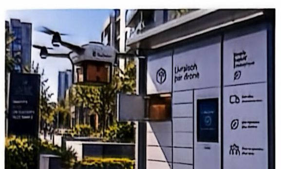
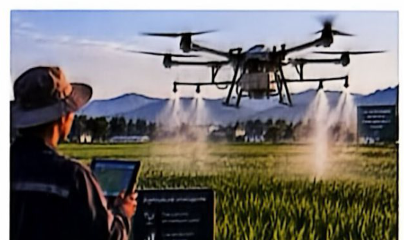

# 第 6 课　服务日常生活的无人机

Dossier 2 · Économie de basse altitude — Leçon 6 : Les drones au service du quotidien

FICHE 6 · 中法对照

综合法语实训（Français Général – Travaux Pratiques 3）· 大二上学期 · Dossier 2 低空经济

!!! info "阅读说明"

    每段先列法语原文；其下缩进、带深蓝竖条的小字号段落为中文翻译。<strong>加粗</strong>为关键词或可替换的句型骨架。

## Brainstorming　头脑风暴

**Activité 1 — Observez les images et discutez en groupe.**

活动 1——观察图片并小组讨论。
{: .zh }

a. Dans la vie quotidienne, quels types d'aéronefs voyez-vous ?

在日常生活中，你会看到哪些类型的航空器？
{: .zh }

b. Décrivez les images, quels services sont réalisés à l'aide du drone ?

描述图片：无人机被用来提供哪些服务？
{: .zh }

c. Dans ces deux situations, comparez le drone avec la méthode traditionnelle.

在这两种场景中，比较无人机与传统方式。
{: .zh }

**Activité 2 — Discutez en binôme.**

活动 2——两人一组讨论。
{: .zh }

a. Comment recevez-vous habituellement vos achats en ligne ?

你通常如何接收网购商品？
{: .zh }

b. Avez-vous déjà eu un problème de livraison ? Lequel ?

你是否遇到过配送问题？是什么问题？
{: .zh }

c. Dans quelle situation une livraison très rapide serait-elle utile ?

在什么情况下快速配送会很有用？
{: .zh }

## Comprendre — Document 1　理解——材料 1

**Activité 3 — Regardez la vidéo sans le son et répondez aux questions.**

活动 3——无声观看视频并回答问题。
{: .zh }

a. Que voyez-vous ?

你看到了什么？
{: .zh }

b. À votre avis, quel est le sujet de la vidéo ?

你认为视频的主题是什么？
{: .zh }

**Activité 4 — Regardez la vidéo avec le son et répondez aux questions.**

活动 4——带声观看视频并回答问题。
{: .zh }

a. Dans quels pays la livraison par drone est-elle déjà pratiquée ?

哪些国家已经在使用无人机配送？
{: .zh }

b. Dans ces pays, quels produits peuvent être livrés avec ce service ?

在这些国家，哪些商品可以通过该服务配送？
{: .zh }

**Activité 5 — Vrai ou Faux ? Justifiez vos réponses.**

活动 5——判断正误并说明理由。
{: .zh }

a. Le supermarché Walmart a lancé ce projet de livraison par drone en 2023.

沃尔玛超市于 2023 年启动了这项无人机配送项目。
{: .zh }

b. Walmart promet aux clients des livraisons en une heure.

沃尔玛承诺一小时内送达。
{: .zh }

c. L'objectif d'Amazon et d'UPS est de faire baisser le coût de la livraison.

亚马逊和 UPS 的目标是降低配送成本。
{: .zh }

d. En France, les expérimentations ont commencé avec des livraisons de fruits et de boissons.

在法国，试验最初是配送水果和饮料。
{: .zh }

e. La livraison par drone peut être utile dans les zones difficiles d'accès.

无人机配送在难以到达的地区可能很有用。
{: .zh }

**Activité 6 — Associez chaque avantage à la situation correspondante selon la vidéo.**

活动 6——根据视频，将每个优点与相应场景连线。
{: .zh }

| Avantage 优点 | Situation 场景 |
|---|---|
| 1. gagner du temps（节省时间） | a. dans les zones inaccessibles aux facteurs（在邮递员无法进入的地区） |
| 2. réduire les risques sur la route（降低道路风险） | b. quand les rues sont embouteillées en fin de journée（傍晚街道拥堵时） |
|  | c. quand on fait la queue au supermarché（在超市排队时） |
|  | d. pour les chauffeurs de la poste（对邮递员而言） |

## Échanger　交流

**Activité 7 — Travaillez en petit groupe et discutez des questions suivantes.**

活动 7——小组讨论以下问题。
{: .zh }

a. Êtes-vous prêt(e) à recevoir vos achats par drone ? Pourquoi ?

你是否愿意通过无人机接收网购商品？为什么？
{: .zh }

b. En dehors de la livraison, dans quels domaines peut-on utiliser les drones ?

除了配送，无人机还能用于哪些领域？
{: .zh }

## Comprendre — Document 2　理解——材料 2

!!! tip "Pour vous aider · 学习助手"

    | 法语 | 中文 |
    |---|---|
    | la pulvérisation (n.f.) | 喷洒 |
    | le semis (n.m.) | 播种 |
    | l'engrais (n.m.) | 肥料 |
    | la graine (n.f.) | 种子 |

### Texte　课文

**L'économie de basse altitude : de nouvelles applications en Chine**

低空经济：中国的新应用
{: .zh }

Les drones ne sont pas uniquement un gadget high-tech, ils sont devenus un outil indispensable pour les géants de la logistique. Meituan, leader chinois de la livraison de nourriture, a mis en place des lignes de drones dans plusieurs villes chinoises. Fengyi Technology, filiale de SF Express, a également déployé des lignes de livraison par drone. Ces exemples montrent une tendance claire : les drones sont devenus des acteurs majeurs de la logistique en Chine.

无人机不仅是高科技小玩意，它们已成为物流巨头不可或缺的工具。中国外卖领军企业美团在中国多个城市建立了无人机航线。顺丰速运子公司丰翼科技也部署了无人机配送航线。这些例子显示出明确趋势：无人机已成为中国物流的重要参与者。
{: .zh }

Un exemple particulièrement révélateur de cette transformation est la mise en place d'un service de livraison par drone à la section Badaling de la Grande Muraille de Pékin. Les touristes, équipés de smartphones, peuvent désormais commander en scannant un simple code QR et recevoir en quelques minutes de l'eau, des médicaments ou des articles comme des parapluies, livrés directement par drone. « C'est incroyable ! », s'émerveille un touriste portugais, devant la rapidité et la précision du service. Ce projet pilote ne se limite pas au seul site touristique de la Grande Muraille. Aujourd'hui, les lignes de livraison par drone couvrent des zones urbaines, rurales, mais aussi des régions montagneuses et des îles isolées.

这一转变的一个尤为典型的例子，是北京八达岭长城景区推出的无人机配送服务。配备智能手机的游客，如今只需扫描二维码下单，几分钟内就能收到由无人机直接送达的水、药品或雨伞等物品。“太不可思议了！”一位葡萄牙游客惊叹于这项服务的速度与精准。这一试点项目并不限于长城景区。如今，无人机配送航线覆盖城市、农村，也覆盖山区和孤岛。
{: .zh }

L'économie de basse altitude ne se cantonne pas à la logistique. Elle redéfinit également le transport avec l'introduction des taxis aériens. Ces innovations accélèrent les déplacements personnels et optimisent les trajets professionnels. Cette année, une première liaison sur courte distance reliant Shenzhen à Zhuhai a vu le jour, réduisant les trajets à une vingtaine de minutes. De la même manière, la liaison entre Shanghai et Kunshan, grâce à des taxis aériens, permet de franchir une distance habituellement longue en seulement 25 minutes.

低空经济并不局限于物流。它还通过引入空中出租车重新定义交通。这些创新加快个人出行并优化商务出行。今年，深圳至珠海的首条短途航线开通，将行程缩短至约二十分钟。同样，借助空中出租车，上海至昆山的航线只需 25 分钟即可跨越通常很长的距离。
{: .zh }

Dans l'agriculture, les drones sont utilisés pour des tâches telles que la pulvérisation d'engrais, le semis de graines ou encore la protection des cultures. Cette automatisation permet de réduire les coûts, d'améliorer la productivité et de remplacer progressivement des méthodes traditionnelles, accélérant ainsi la modernisation du secteur agricole.

在农业领域，无人机被用于喷洒肥料、播种或保护作物等任务。这种自动化降低了成本、提高了生产率，并逐步取代传统方法，从而加速农业部门的现代化。
{: .zh }

Derrière ces applications se cache une réalité : l'économie de basse altitude est capable de transformer différents secteurs grâce à ses innovations technologiques, avec le développement continu des technologies, de nouveaux usages pourraient encore apparaître dans les années à venir.

这些应用背后隐藏着一个现实：低空经济能够凭借技术创新改变不同行业；随着技术持续发展，未来几年还可能涌现新的用途。
{: .zh }

来源：<em>entreprendre.fr</em> — « L'économie de basse altitude révolutionne le marché de la livraison en Chine »

**Activité 8 — Lisez l'article, de quoi parle-t-il ?**

活动 8——阅读文章：它在讲什么？
{: .zh }

**Activité 9 — Relisez l'article puis répondez aux questions suivantes.**

活动 9——重读文章，然后回答以下问题。
{: .zh }

a. Pourquoi l'auteur dit que les drones ne sont pas uniquement « un gadget high-tech » ?

作者为什么说无人机不仅仅是“高科技小玩意”？
{: .zh }

b. Comment fonctionne le service de livraison par drone à la Grande Muraille ? Quelles sont les caractéristiques de ce service ?

长城无人机配送服务如何运作？这项服务有什么特点？
{: .zh }

c. Comment les taxis aériens peuvent-ils modifier les déplacements entre les villes ?

空中出租车如何改变城市间出行？
{: .zh }

d. En quoi l'utilisation des drones influence-t-elle le secteur agricole ?

无人机的使用如何影响农业部门？
{: .zh }

**Activité 10 — Vocabulaire**

活动 10——词汇
{: .zh }

**a. Repérez les mots/expressions soulignés. Associez-les à leur définition.**

a. 找出划线词语，将其与释义连线。
{: .zh }

| Mot 词语 | Définition 释义 |
|---|---|
| 1. un projet pilote（试点项目） | a. mettre en place quelque chose（建立、实施某事） |
| 2. se cantonner à（局限于） | b. une première expérience pour tester quelque chose（为测试某事物而进行的首次尝试） |
| 3. déployer（部署；推广） | c. être limité à un seul domaine（被限制在单一领域） |
| 4. la logistique（物流） | d. l'utilisation de machines pour réaliser des tâches automatiquement（使用机器自动完成任务） |
| 5. une zone isolée（偏远地区） | e. un endroit éloigné et difficile d'accès（偏远且难以到达的地方） |
| 6. l'automatisation（自动化） | f. l'organisation du transport des produits（产品运输的组织） |
| 7. la productivité（生产率） | g. le rapport entre une production et les ressources mobilisées pour l'obtenir（产出与所投入资源之间的比率） |

**b. Complétez le texte avec les mots de l'activité précédente, mettez-les au pluriel si nécessaire.**

b. 用上一题中的词语补全文本，必要时变为复数。
{: .zh }

!!! note "原件未填"

    以下为参考答案，供理解与背诵。

Aujourd'hui, les drones jouent un rôle de plus en plus important dans la **logistique**. Avant de développer un nouveau service à grande échelle, une entreprise peut d'abord lancer un **projet pilote**. Si les résultats sont positifs, elle peut ensuite **déployer** ce service dans différentes régions, notamment dans des **zones isolées** difficiles à atteindre. Mais l'utilisation des drones ne **se cantonne pas** à la livraison. Dans l'agriculture, elle favorise également l'**automatisation** de certaines tâches et permet d'améliorer la **productivité**.

如今，无人机在<strong>物流</strong>中发挥着越来越重要的作用。在大规模开发新服务之前，企业可以先启动一个<strong>试点项目</strong>。如果结果积极，它可以随后在不同地区<strong>部署</strong>该服务，尤其是在难以到达的<strong>偏远地区</strong>。但无人机的使用并不<strong>局限于</strong>配送。在农业中，它还促进了某些任务的<strong>自动化</strong>，并有助于提高<strong>生产率</strong>。
{: .zh }

## Outils d'expression　表达工具

### Les expressions avec « mettre »　与 mettre 相关的表达

- **Mettre en place** + nom = créer, organiser ou instaurer un service

    *Exemple :* La ville a mis en place un service de livraison par drone pour faciliter la vie des habitants.

    <strong>建立、实施</strong>（创建、组织或设立一项服务）。例：该市建立了无人机配送服务，以方便居民生活。
    {: .zh }

- **Mettre au point** + nom = élaborer ou perfectionner quelque chose pour le rendre prêt à être utilisé

    *Exemple :* Les ingénieurs travaillent pour mettre au point un drone plus rapide et plus autonome.

    <strong>研发、完善</strong>（制定或改进某事物，使其可供使用）。例：工程师们正致力于研发更快、更自主的无人机。
    {: .zh }

- **Mettre en service** + nom = commencer l'utilisation d'un équipement ou d'un service

    *Exemple :* Une nouvelle ligne de drones sera mise en service dans plusieurs régions l'année prochaine.

    <strong>投入使用</strong>（开始使用某设备或服务）。例：一条新的无人机航线将于明年在多个地区投入使用。
    {: .zh }

- **Mettre à jour** = actualiser des informations, un document ou un logiciel

    *Exemple :* L'entreprise met régulièrement à jour le système de navigation des drones.

    <strong>更新</strong>（更新信息、文件或软件）。例：该企业定期更新无人机导航系统。
    {: .zh }

- **Se mettre à** + infinitif = commencer à faire quelque chose

    *Exemple :* D'Amazon à UPS, tous les grands groupes se mettent à proposer ce service.

    <strong>开始做……</strong>（开始做某事）。例：从亚马逊到 UPS，各大集团都开始提供这项服务。
    {: .zh }

## S'entraîner　练习

**Activité 11 — Complétez le texte avec les expressions ci-dessus, conjuguez-les si nécessaire.**

活动 11——用上面的表达补全文本，必要时变位。
{: .zh }

!!! note "原件未填"

    以下为参考答案。

La livraison par drone se développe rapidement. Les ingénieurs travaillent actuellement à **mettre au point** un nouveau modèle capable de transporter des colis plus lourds. De leur côté, certaines villes souhaitent **mettre en place** un service spécial pour livrer des médicaments dans les zones isolées. Après plusieurs mois de tests, les premiers drones seront **mis en service** au début de l'année prochaine. Pour garantir la sécurité des vols, les techniciens devront régulièrement **mettre à jour** leur système de navigation. Face au succès de cette nouvelle technologie, de nombreuses entreprises **se mettent à** proposer, elles aussi, des livraisons par drone.

无人机配送发展迅速。工程师们目前正致力于<strong>研发</strong>一种能运输更重包裹的新机型。一些城市则希望<strong>建立</strong>专门服务，向偏远地区配送药品。经过数月测试，首批无人机将于明年年初<strong>投入使用</strong>。为确保飞行安全，技术人员需要定期<strong>更新</strong>导航系统。面对这项新技术的成功，许多企业也<strong>开始</strong>提供无人机配送服务。
{: .zh }

## Échanger　交流

**Activité 12 — Travaillez en petit groupe et discutez.**

活动 12——小组讨论。
{: .zh }

Les drones vont-ils remplacer complètement les méthodes traditionnelles ? Pourquoi ?

无人机会完全取代传统方式吗？为什么？
{: .zh }

## Vocabulaire et expressions　词汇与表达

### La livraison et la logistique　配送与物流

| 法语 | 中文 |
|---|---|
| une enseigne (n.f.) | 招牌 |
| la livraison (n.f.) | 配送 |
| la grande distribution (n.f.) | 大型零售业 |
| un colis (n.m.) | 包裹 |
| l'acheminement (n.m.) | 运送；运输 |
| la ligne de livraison (n.f.) | 配送线路 |
| la logistique (n.f.) | 物流 |

### Les lieux et les déplacements　地点与出行

| 法语 | 中文 |
|---|---|
| embouteillé(e) (adj.) | 拥堵的 |
| une zone inaccessible (n.f.) | 难以到达的地区 |
| une zone isolée (n.f.) | 偏远、孤立地区 |
| un déplacement (n.m.) | 出行；移动 |
| le trajet (n.m.) | 行程；路线 |
| faire la queue (v.) | 排队 |

### Le développement et les applications technologiques　发展与技术应用

| 法语 | 中文 |
|---|---|
| une expérimentation (n.f.) | 试验 |
| un projet pilote (n.m.) | 试点项目 |
| l'automatisation (n.f.) | 自动化 |
| la productivité (n.f.) | 生产效率；生产率 |
| la modernisation (n.f.) | 现代化 |

### Les verbes et expressions utiles　常用动词与表达

| 法语 | 中文 |
|---|---|
| être équipé(e) de (v.) | 配有 |
| étendre (v.) | 扩展；扩大 |
| parcourir (v.) | 行驶；走过（一段距离） |
| mettre en place (v.) | 建立；实施 |
| déployer (v.) | 部署；推广 |
| se limiter à (v.) | 局限于 |
| se cantonner à (v.) | 蛰居；局限于 |
| optimiser (v.) | 优化 |

## 打印版 PDF

[下载《综合法语实训 · 第 6 课 服务日常生活的无人机》中法对照讲义 PDF](../../../../../assets/files/综合法语实训_第6课_服务日常生活的无人机.pdf)
